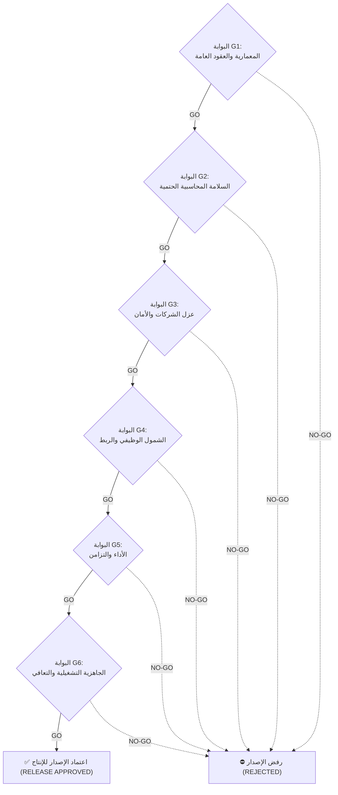

# معايير القبول الشاملة لمحرك المحاسبة (Accounting Engine Acceptance Criteria)

> **بيان الإلزام والهدف:**  
> تُحدد هذه الوثيقة **شروط ومعايير القبول التعاقدية الصارمة (Acceptance Criteria)** وبوابات الاعتماد المنهجية (Go/No-Go Gateways) لمشروع `accounting_engine`.  
> لا يُقبل أي إصدار أو تعديل معماري أو تسليم مرحلي ما لم يستوفِ كافة شروط القبول المحددة أدناه دون استثناء، وتُعد هذه الشروط المرجع الأساسي لمسؤولي ضمان المشروع (Project Assurance) والمراجعين المحاسبيين للتوقيع على جاهزية المحرك.

---

## فهرس المحتويات

1. [شروط القبول الحتمية غير القابلة للتفاوض (Non-Negotiable Acceptance Conditions)](#1-شروط-القبول-الحتمية-غير-القابلة-للتفاوض-non-negotiable-acceptance-conditions)
2. [معايير قبول النواة المحاسبية والترحيل (Kernal Accounting & Posting Acceptance)](#2-معايير-قبول-النواة-المحاسبية-والترحيل-kernal-accounting--posting-acceptance)
3. [معايير قبول المعمارية والعقود العامة (Architecture & Public Contracts Acceptance)](#3-معايير-قبول-المعمارية-والعقود-العامة-architecture--public-contracts-acceptance)
4. [معايير قبول تعدد الشركات والأمان (Multi-Tenancy & Security Acceptance)](#4-معايير-قبول-تعدد-الشركات-والأمان-multi-tenancy--security-acceptance)
5. [معايير قبول التخزين والذرية والمطابقة (Persistence, Atomicity & Reconciliation)](#5-معايير-قبول-التخزين-والذرية-والمطابقة-persistence-atomicity--reconciliation)
6. [معايير قبول استيعاب الأحداث ومنع التكرار (Events & Idempotency Acceptance)](#6-معايير-قبول-استيعاب-الأحداث-ومنع-التكرار-events--idempotency-acceptance)
7. [معايير قبول التقارير المالية (Financial Reporting Acceptance)](#7-معايير-قبول-التقارير-المالية-financial-reporting-acceptance)
8. [بوابات الاعتماد الصارمة للإصدار (Go/No-Go Release Gateways)](#8-بوابات-الاعتماد-الصارمة-للإصدار-gono-go-release-gateways)
9. [مصفوفة التحقق وطرق الإثبات (Acceptance Verification Matrix)](#9-مصفوفة-التحقق-وطرق-الإثبات-acceptance-verification-matrix)

---

## 1. شروط القبول الحتمية غير القابلة للتفاوض (Non-Negotiable Acceptance Conditions)

يجب أن تحقق النسخة المسلمة جميع الشروط الإلزامية التالية كشرط مسبق لفتح أي تقييم تفصيلي:

1. **[AC-MAND-01]** كل قيد مرحّل متوازن محاسبياً بالعملة الوظيفية ($\sum \text{Debit} = \sum \text{Credit}$) بدقة السنت.
2. **[AC-MAND-02]** كل عملية ترحيل إما أن تنجح بالكامل بكافة آثارها (أستاذ عام، أرصدة، دفاتر فرعية، تدقيق) أو تتراجع بالكامل؛ لا يُقبل أي حفظ جزئي مطلقاً.
3. **[AC-MAND-03]** منع قاطع لأي عملية تعديل (`UPDATE`) أو حذف (`DELETE`) على القيود والأسطر المرحلة في قاعدة البيانات، والتصحيح يتم حصراً بقيد عكسي مرتبط.
4. **[AC-MAND-04]** إعادة إرسال نفس الطلب بنفس مفتاح عدم التكرار لا يُحدث أي أثر مالي مضاعف إطلاقاً.
5. **[AC-MAND-05]** استحالة وصول مستأجر/شركة إلى حسابات أو قيود أو أرصدة مستأجر/شركة أخرى.
6. **[AC-MAND-06]** حظر الترحيل على الحسابات التجميعية (Header) أو في الفترات المقفلة نهائياً (Closed) أو في سنوات مالية مقفلة.
7. **[AC-MAND-07]** عدم استخدام الفاصلة العائمة (No Float32/Float64) في أي حساب مالي أو قيمة نقدية.
8. **[AC-MAND-08]** إمكانية بناء واستخدام المحرك كـ Go SDK مضمنة دون الحاجة لتشغيل أي خادم شبكي (HTTP/gRPC).
9. **[AC-MAND-09]** فرض تطابق العملة الوظيفية لكافة أسطر القيد مع العملة الوظيفية للشركة، وتطابق عملة مبلغ المعاملة مع عملة المعاملة في كل سطر.
10. **[AC-MAND-10]** حظر الإسقاط الصامت لفروق التقريب؛ وأي متبقي ناتج عن التقريب للوحدة الصغرى يلزم تسويته بحساب فروق تقريب معتمد (`ErrRoundingAccountRequired`).
11. **[AC-MAND-11]** قفل دورة حياة القيد: الترحيل حصري من حالة المسودة (`Draft`)، بهوية منفذ معلومة (`ActorID != empty`)، مع فحص الرقابة المزدوجة ومطابقة بصمة المحتوى (`ContentHash`).
12. **[AC-MAND-12]** فترات التسوية 13 و 14 إجرائية بحتة تستبعد من البحث بالتواريخ (`Contains == false`) وتستهدف بالرقم الصريح فقط.
13. **[AC-MAND-13]** سجل التدقيق الجنائي محمي بالترميز البنيوي بالفواصل الصريحة، وتوقيت النانو ثانية، والترقيم التسلسلي الصاعد لكشف الحذف التراجعي (Tail-Truncation).

---

## 2. معايير قبول النواة المحاسبية والترحيل (Kernal Accounting & Posting Acceptance)

| المعرف | معيار القبول الدقيق | طريقة الإثبات والتحقق |
| :--- | :--- | :--- |
| **AC-POST-01** | رفض القيود غير المتوازنة قبل بدء أي معاملة تخزين مع إرجاع الخطأ الصريح `ErrUnbalancedEntry`. | اختبارات الوحدة الحدودية في `internal/kernal/posting`. |
| **AC-POST-02** | رفض أي سطر يحتوي على مبالغ سالبة أو مبالغ مدينة ودائنة في آن واحد. | اختبارات التحقق من صحة الأسطر `entry_invariants_test.go`. |
| **AC-POST-03** | رفض الترحيل إذا كان الحساب غير نشط أو معلقاً أو يتبع شركة أخرى. | اختبارات التحقق من الحسابات مع محاكي Master Data. |
| **AC-POST-04** | إثبات ارتباط القيد العكسي بالقيد الأصلي وتعديل حالة القيد الأصلي إلى `REVERSED` وتحديث الأرصدة فوراً. | اختبار دورة حياة العكس `reversal_lifecycle_test.go`. |
| **AC-POST-05** | رفض محاولة عكس قيد معكوس مسبقاً مع إرجاع خطأ صريح `ErrEntryAlreadyReversed`. | اختبارات منع تكرار العكس. |
| **AC-POST-06** | نجاح سيناريو إقفال نهاية السنة الذري: تصفير الإيرادات والمصروفات وترحيل الصافي إلى الأرباح المبقاة. | اختبارات سير عمل إقفال السنة `p9_workflows_test.go`. |
| **AC-POST-07** | رفض القيد فوراً بخطأ `ErrFunctionalCurrencyMismatch` إذا اختلفت عملة أي سطر عن عملة الشركة الوظيفية، أو `ErrTransactionCurrencyMismatch` عند اختلاف عملة السطر عن عملة مبلغه. | اختبارات `phase3_currency_test.go` و `pipeline_currency_test.go`. |
| **AC-POST-08** | كشف متبقي التقريب (مثل 0.004) ورفض الترحيل بـ `ErrRoundingAccountRequired` عند غياب الحساب، أو توليد سطر موازنة صريح عند توفره. | اختبارات التقريب الصريح `rounding_test.go`. |
| **AC-POST-09** | رفض ترحيل أي قيد ليس بحالة `Draft` أو بدون `ActorID` ممرر في السياق. | اختبارات دورة حياة القيد `lifecycle_test.go`. |
| **AC-POST-10** | حظر ترحيل القيود المتجاوزة لحد الصانع والمتحقق ما لم يختلف المنفذ عن المنشئ وتتطابق بصمة المحتوى `ContentHash`. | اختبارات الرقابة المزدوجة `governance/approval_test.go`. |
| **AC-POST-11** | ترتيب أقفال الحسابات تصاعدياً واجتياز اختبار التزامن المكثف (100 معالج متزامن) دون حدوث أي Deadlock. | اختبارات التزامن `lock_test.go`. |
| **AC-POST-12** | عودة `false` قطعياً من `Contains(date)` لفترات التسوية 13 و 14، وحظر الترحيل في سنة مقفلة حتى لو كانت الفترة مفتوحة. | اختبارات التقويم المالي `fiscal_calendar_test.go`. |
| **AC-POST-13** | كشف أي تلاعب في سجلات التدقيق أو حذف أواخر السجلات بنجاح عبر محرك التحقق الجنائي `VerifyAuditIntegrity`. | اختبارات كشف التلاعب `audit_chain_test.go`. |

---

## 3. معايير قبول المعمارية والعقود العامة (Architecture & Public Contracts Acceptance)

| المعرف | معيار القبول الدقيق | طريقة الإثبات والتحقق |
| :--- | :--- | :--- |
| **AC-ARCH-01** | خلو حزم النواة `internal/*` من أي استيراد لحزم النقل الشبكي `net/http` أو `google.golang.org/grpc`. | فحص آلي عبر سكربت CI (`grep` و `go list -f`). |
| **AC-ARCH-02** | خلو النواة المحاسبية من جداول المستخدمين ومكتبات التحقق من كلمات المرور وتوكنات JWT. | فحص كود واعتماد مصفوفة التبعيات. |
| **AC-ARCH-03** | نجاح بناء وتشغيل مستهلك خارجي يعتمد فقط على `pkg/sdk` و `pkg/api` و `pkg/spi` دون استيراد `internal/*`. | اجتياز حزمة `test/external_consumer/` بالكامل. |
| **AC-ARCH-04** | اجتياز فحص التوافق العكسي للعقود العامة ضد لقطة العقد المعتمدة دون وجود أخطاء تراجع. | نجاح سكربت `scripts/check_api_compat.sh`. |
| **AC-ARCH-05** | اعتماد مسار بناء موحد للمحرك عبر `sdk.NewBuilder` وحذف أو تعطيل المسارات المزدوجة المتجاوزة. | اختبارات المنشئ `builder_test.go`. |

---

## 4. معايير قبول تعدد الشركات والأمان (Multi-Tenancy & Security Acceptance)

| المعرف | معيار القبول الدقيق | طريقة الإثبات والتحقق |
| :--- | :--- | :--- |
| **AC-SEC-01** | التحقق الإلزامي من تطابق `company_id` الموجود في الطلب مع سياق الأمان الموثوق `Security Context`. | اختبارات الاختراق الداخلي واختبارات الأمان. |
| **AC-SEC-02** | فرض سياسات RLS على مستوى PostgreSQL واجتياز اختبارات الاختراق بدور غير متجاوز للسياسات (Non-Superuser). | اجتياز اختبارات `test/dr/` و `phase6_rls_penetration_test.go`. |
| **AC-SEC-03** | منع استعلام أي سجل أو حركة أو رصيد يخص شركة أخرى حتى لو تم تمرير المعرف الصحيح للشركة الأخرى. | اختبارات العزل بين الشركات `rls_test.go`. |
| **AC-SEC-04** | تسجيل هوية المنفذ الموثوقة والطابع الزمني الدقيق بالنانوثانية ومعرف الحدث مع كل قيد في سجل التدقيق. | فحص سجلات التدقيق الناتجة عن عمليات الترحيل. |

---

## 5. معايير قبول التخزين والذرية والمطابقة (Persistence, Atomicity & Reconciliation)

| المعرف | معيار القبول الدقيق | طريقة الإثبات والتحقق |
| :--- | :--- | :--- |
| **AC-STOR-01** | إثبات الذرية التامة للمعاملة المالية بحقن أعطال متعمدة (Fault Injection) عند كل خطوة من خطوات الترحيل. | اجتياز اختبارات `test/atomic/posting_atomicity_test.go`. |
| **AC-STOR-02** | تطابق تام ومثبت بين موائم الذاكرة وموائم PostgreSQL في كافة دلالات العقود والعمليات المالية. | اجتياز اختبارات تكافؤ العقود `test/contract_parity/`. |
| **AC-STOR-03** | تطابق إجمالي دفاتر الأستاذ المساعدة (AR, AP, Cash, Assets) مع رصيد حسابات الرقابة المناظرة لها في الأستاذ العام. | اختبارات المطابقة والرقابة `subledgers_test.go`. |
| **AC-STOR-04** | نجاح استعادة قاعدة البيانات من نسخة احتياطية مطابقة واجتياز فحوصات النزاهة المحاسبية الستة بنسبة 100%. | اجتياز تمرين الاستعادة الآلي `test/dr/dr_drill_test.go`. |

---

## 6. معايير قبول استيعاب الأحداث ومنع التكرار (Events & Idempotency Acceptance)

| المعرف | معيار القبول الدقيق | طريقة الإثبات والتحقق |
| :--- | --- | --- |
| **AC-EVT-01** | استيعاب الأحداث الاقتصادية المعيارية (`AccountingEvent`) وتحويلها إلى قيود متوازنة بدقة وفق قواعد التوجيه. | اجتياز اختبارات `pkg/sdk/event_ingestion_test.go`. |
| **AC-EVT-02** | إرجاع النتيجة السابقة فوراً دون تكرار الأثر المالي عند إعادة إرسال حدث يحمل نفس مفتاح التكرار والحمولة. | اختبارات `event_idempotency_test.go`. |
| **AC-EVT-03** | إرجاع خطأ تعارض صريح `ErrIdempotencyKeyConflict` عند إعادة استخدام مفتاح مسجل بحمولة مختلفة. | اختبارات تعارض المفاتيح. |
| **AC-EVT-04** | سلامة المعالجة تحت ظروف انقطاع الشبكة أو التزامن الشديد على نفس مفتاح الحدث. | اختبارات `event_fault_recovery_test.go`. |

---

## 7. معايير قبول التقارير المالية (Financial Reporting Acceptance)

| المعرف | معيار القبول الدقيق | طريقة الإثبات والتحقق |
| :--- | --- | --- |
| **AC-REP-01** | تطابق تام في ميزان المراجعة ($\sum \text{Debit} = \sum \text{Credit}$) لكافة التواريخ والفترات المفتوحة والمغلقة. | اختبارات السيناريوهات الذهبية للتقارير. |
| **AC-REP-02** | تطابق معادلة المركز المالي ($\text{Assets} = \text{Liabilities} + \text{Equity}$) في قائمة المركز المالي. | اختبارات `balance_sheet_test.go`. |
| **AC-REP-03** | صحة تجميع أرقام قائمة الدخل وفق الفترات الزمنية المحددة والعملة الوظيفية المعتمدة. | اختبارات `income_statement_test.go`. |
| **AC-REP-04** | مطابقة الأرصدة المستخرجة بالتقارير مع مجموع الحركات التاريخية للأستاذ العام بنسبة 100%. | اختبارات إعادة الاحتساب التام (Recomputability). |

---

## 8. بوابات الاعتماد الصارمة للإصدار (Go/No-Go Release Gateways)

لا يُسمح بإصدار النسخة الإنتاجية أو اعتماد مرحلة التسليم ما لم تُغلق كافة البوابات التالية بنتيجة **GO**:

### تفاصيل شروط البوابات

| البوابة | شرط الموافقة المسبق (GO Condition) | شرط الرفض الفوري الحتمي (NO-GO Condition) |
| :--- | :--- | :--- |
| **G1 — Architecture & API** | استقلالية تامة للنواة؛ خلوها من gRPC/HTTP/Auth؛ ثبات عقود API snapshot. | وجود أي استيراد غير مصرح به أو كسر في العقود العامة أو مسارات بناء مزدوجة. |
| **G2 — Accounting Integrity** | اجتياز 100% من سيناريوهات التوازن والذرية والحرمة والعكس وإقفال السنة. | حدوث ترحيل غير متوازن، أو حفظ جزئي، أو تكرار أثر مالي، أو ترحيل في فترة مغلقة. |
| **G3 — Multi-Tenant Isolation** | نجاح اختبارات RLS والعزل التام بين الشركات بدور قاعدة بيانات غير خارق للسياسات. | إمكانية استعلام أو تعديل بيانات شركة أخرى تحت أي ظرف أو تسرب بيانات. |
| **G4 — Functional Coverage** | تحقق كافة متطلبات التحقق، العملات، الفترات، وشجرة الحسابات والدفاتر الفرعية. | عجز في معالجة العملات الأجنبية، أو خلل في تقويم الفترات المالية، أو نقص وظيفي حرج. |
| **G5 — Performance & Concurrency** | زمن الاستجابة $P95 \le 50\,\text{ms}$؛ انعدام أخطاء Deadlocks؛ تغطية الكود $\ge 80\%$. | تجاوز $P95$ حاجز 50ms، حدوث Deadlocks عند التزامن، أو انخفاض التغطية عن 80%. |
| **G6 — Operations & Recovery** | نجاح تمرين استعادة قاعدة البيانات الآلي، ثبات سلسلة التدقيق، وتوفر Runbooks معتمدة. | فشل في تمرين الاستعادة، كسر في سلسلة التجزئة لسجلات التدقيق، أو غياب أدلة التشغيل. |

---

## 9. مصفوفة التحقق وطرق الإثبات (Acceptance Verification Matrix)

| فئة القبول | الأداة / الاختبار البرمجي المعتمد | بيئة التحقق | المسؤول عن التوقيع والاعتماد |
| :--- | :--- | :--- | :--- |
| **معايير المحاسبة** | سيناريوهات الاختبارات الذهبية في `test/standards/` | PostgreSQL 18.x / Memory | المراجع المحاسبي المعتمد |
| **معايير المعمارية** | سكربتات فحص التبعيات `scripts/` وفحص `go list` | بيئة البناء والتكامل CI | قائد هندسة البرمجيات / المعماري |
| **معايير الأمان و RLS** | اختبارات الاختراق `test/acid/` واختبارات RLS | دور مستخدم محدود الصلاحيات | مهندس أمن المعلومات والبرمجيات |
| **معايير التزامن والأداء** | حزمة قياس الأداء المعتمدة `test/benchmark/` | بيئة مطابقة لمواصفات الإنتاج | مهندس الموثوقية والأداء (SRE) |
| **معايير التعافي (DR)** | تمرين الاستعادة الفعلي `test/dr/dr_drill_test.go` | خادم PostgreSQL مستقل | مسؤول قواعد البيانات (DBA) |

---

> **خاتمة وإلزام:**  
> تُشكل هذه الوثيقة العهد المعتمد لقبول مخرجات مشروع `accounting_engine`. وأي استثناء أو تجاوز لأي معيار يتطلب موافقة كتابية رسمية من المالك المسؤول الأول (SRO) ومجلس المشروع مع توثيق الأسباب والمخاطر المترتبة.
