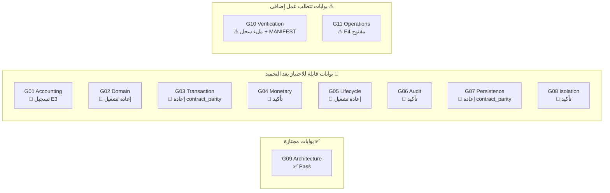
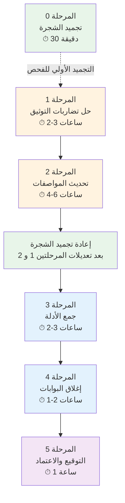
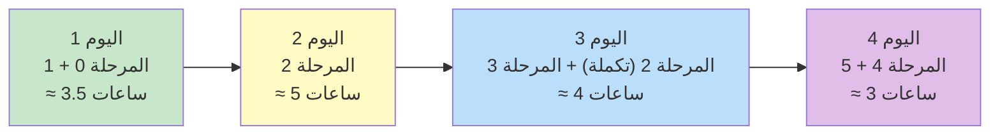

# خطة التنفيذ الشاملة لاعتماد النواة المحاسبية

> **رمز الوثيقة:** `AE-EXEC-PLAN-001`
> **الإصدار:** `1.0.0`
> **تاريخ الإنشاء:** `2026-11-28`
> **الحالة:** `Draft — مسودة تنفيذية`
> **المرجع الحاكم:** [`QUALITY_GATES_SPECIFICATION.md`](quality/QUALITY_GATES_SPECIFICATION.md) (`G01–G11`)، [`ACCOUNTING_ENGINE_ACCEPTANCE_CRITERIA.md`](rules/ACCOUNTING_ENGINE_ACCEPTANCE_CRITERIA.md)
> **نطاق التقييم:** النواة المحاسبية (`internal/kernal`)، العقود العامة (`pkg/api`, `pkg/spi`, `pkg/sdk`)، محولا التخزين (`storage/memory`, `storage/postgres`)

---

## فهرس المحتويات

1. [الملخص التنفيذي](#1-الملخص-التنفيذي)
2. [الحالة الراهنة والفجوات](#2-الحالة-الراهنة-والفجوات)
3. [نتائج التحقق المحاسبي من الكود](#3-نتائج-التحقق-المحاسبي-من-الكود)
4. [مصفوفة الثوابت المحاسبية — التحقق التفصيلي](#4-مصفوفة-الثوابت-المحاسبية--التحقق-التفصيلي)
5. [مراحل التنفيذ التفصيلية](#5-مراحل-التنفيذ-التفصيلية)
6. [مصفوفة بوابات الجودة والإجراءات المطلوبة](#6-مصفوفة-بوابات-الجودة-والإجراءات-المطلوبة)
7. [مصفوفة شروط القبول الحتمية](#7-مصفوفة-شروط-القبول-الحتمية)
8. [مخطط التبعيات والمسار الحرج](#8-مخطط-التبعيات-والمسار-الحرج)
9. [معايير إتمام كل مرحلة](#9-معايير-إتمام-كل-مرحلة)
10. [المخاطر والتخفيف](#10-المخاطر-والتخفيف)
11. [الجدول الزمني المقترح](#11-الجدول-الزمني-المقترح)

---

## 1. الملخص التنفيذي

### 1.1 الغرض

تهدف هذه الخطة إلى تحديد **جميع الخطوات المتبقية** لإصدار قرار `GO` وتوقيع اعتماد رسمي للنواة المحاسبية. الحالة الراهنة وفق [`KERNEL_RELEASE_DECISION_2026-11-27.md`](reports/KERNEL_RELEASE_DECISION_2026-11-27.md) هي **`NO-GO`** بخمسة موانع مفتوحة.

### 1.2 نتيجة التحليل

| البعد | الحالة |
| --- | --- |
| **الكود المحاسبي** | ✅ سليم — جميع الاختبارات خضراء (32 حزمة)، تغطية النواة ≥ 90%، صفر أعطال سباق |
| **المواصفات** | ⚠️ 27 ملاحظة مفتوحة (8 حرجة) — أغلبها وثائقية لا تنفيذية |
| **الأدلة والبوابات** | ❌ سجل التشغيل فارغ، بصمة شجرة غير مجمّدة، بوابتان `Fail` و3 `Not Verified` |
| **التوثيق** | ⚠️ تضاربات بين وثيقتي الاعتماد، مراجع مفقودة، أسماء ملفات لا تطابق الإصدار |
| **الحوكمة** | ❌ لا توجد توقيعات، Scope Profile بانتظار الاعتماد |

### 1.3 تقدير الجهد الإجمالي

| المرحلة | الجهد المقدر |
| :--- | :---: |
| المرحلة 0: تجميد الشجرة | 30 دقيقة |
| المرحلة 1: حل تضاربات التوثيق | 2–3 ساعات |
| المرحلة 2: تحديث المواصفات | 4–6 ساعات |
| المرحلة 3: جمع الأدلة وملء السجلات | 2–3 ساعات |
| المرحلة 4: إغلاق بوابات الجودة | 1–2 ساعات |
| المرحلة 5: التوقيع والاعتماد النهائي | 1 ساعة |
| **المجموع** | **10–15 ساعة عمل** |

---

## 2. الحالة الراهنة والفجوات

### 2.1 التضارب في وثائق الاعتماد

| الوثيقة | القرار | التاريخ | المشكلة |
| --- | :---: | --- | --- |
| [`KERNEL_RELEASE_SIGNOFF.md`](reports/KERNEL_RELEASE_SIGNOFF.md) | `GO` | 2026-11-28 | تدّعي اعتماد `v1.1.0-enterprise` شاملاً Multi-Ledger والمعايير IFRS |
| [`KERNEL_RELEASE_DECISION_2026-11-27.md`](reports/KERNEL_RELEASE_DECISION_2026-11-27.md) | `NO-GO` | 2026-11-27 | تُبطل الاعتماد بـ 5 موانع صريحة |

**الحكم:** `KERNEL_RELEASE_DECISION` هي الوثيقة الأحدث والأكثر دقة. `KERNEL_RELEASE_SIGNOFF` تتضمن ادعاءات غير مُثبتة (مثل Multi-Ledger المُصرّح بأنه `Out of Scope` في [`SCOPE_PROFILE_KERNEL_v1.md`](quality/SCOPE_PROFILE_KERNEL_v1.md) §8) ويجب إعادة تصنيفها كوثيقة ملغاة.

### 2.2 الموانع الخمسة المفتوحة

وفق [`KERNEL_RELEASE_DECISION_2026-11-27.md` §3](reports/KERNEL_RELEASE_DECISION_2026-11-27.md):

| # | المانع | الحالة بعد التحليل الحالي |
| --- | --- | --- |
| **B1** | فشل تكافؤ العقود: `IsMonetary` يُسقَط في جسر `Account` | ✅ **مُغلق** — `IsMonetary *bool` مُضاف في `masterdata`/`Account` ومُمرَّر عبر الجسر |
| **B2** | عدم قابلية الإعادة: بصمتا الشجرة مختلفتان | ❌ **مفتوح** — الشجرة لم تُجمَّد في Commit واحد بعد |
| **B3** | سجل أدلة فارغ: §5 في COMPLIANCE_TEST_SUITE_INDEX قالب فارغ | ⚠️ **جزئياً** — 4 تشغيلات مسجّلة (`RUN-20261128-01..04`) لكن E3 لكل ثابت `ACC-001..013` لم يُسجَّل بشكل فردي |
| **B4** | بوابات E4 غير مغطاة: الأداء والاستعادة في بيئة الهدف | ❌ **مفتوح** — لا يوجد E4 في بيئة إنتاج |
| **B5** | تضاربات docs المتبقية | ⚠️ **جزئياً** — `DOCS_CONFLICT_ANALYSIS.md` مفقود من القرص |

### 2.3 حالة بوابات الجودة الرسمية

| البوابة | الحالة في `RELEASE_DECISION` | الحالة بعد تحليلنا | المطلوب |
| :--- | :---: | :---: | --- |
| **G01** Accounting Integrity | `Not Verified` | **قابل لـ Pass** — الاختبارات خضراء | تسجيل E3 لكل ثابت ACC-001..013 |
| **G02** Domain Integrity | `Pass (لقطة)` | **Pass** — `Cancelled` مستقر الآن | إعادة تشغيل بعد تجميد الشجرة |
| **G03** Transaction Integrity | `Not Verified` | **قابل لـ Pass** — `contract_parity` ناجح الآن | تسجيل E3 بعد التجميد |
| **G04** Monetary Integrity | `Pass (لقطة)` | **Pass** | تأكيد بعد التجميد |
| **G05** Lifecycle & Period | `Not Verified` | **قابل لـ Pass** — `EntryCancelled` مستقر | إعادة تشغيل بعد التجميد |
| **G06** Historical & Audit | `Pass (لقطة)` | **Pass** | تأكيد بعد التجميد |
| **G07** Persistence Integrity | `Fail` | **قابل لـ Pass** — `IsMonetary` مُصلح | إعادة تشغيل `contract_parity` بعد التجميد |
| **G08** Isolation Integrity | `Not Verified` | **قابل لـ Pass** — اختبارات العزل خضراء | تأكيد بعد التجميد |
| **G09** Architectural Integrity | `Pass (E3)` | **Pass** | لا إجراء |
| **G10** Verification Integrity | `Fail` | **قابل لـ Pass** بعد ملء الأدلة | ملء §5 + MANIFEST |
| **G11** Operational Integrity | `Not Verified` | **E3 متاح، E4 مفتوح** | DR drill مسجّل، SLO على بيئة المحلية |

---

## 3. نتائج التحقق المحاسبي من الكود

> **المنهج:** فحص الكود المصدري مباشرة (`internal/kernal/`) لكل قاعدة محاسبية — وليس الاعتماد على التوثيق فقط.

### 3.1 ملخص نتائج الفحص المحاسبي

| # | القاعدة المحاسبية | موقع التنفيذ | الحكم | الملاحظات |
| :---: | --- | --- | :---: | --- |
| 1 | **القيد المزدوج المتوازن** | [`posting/entry_validation.go`](../internal/kernal/posting/entry_validation.go) — `ValidateEntryDoubleEntry` | ✅ | يفحص `∑FunctionalDebit == ∑FunctionalCredit` بدقة `shopspring/decimal` مع معالجة التقريب |
| 2 | **حظر Float** | فحص AST آلي + `shopspring/decimal` حصرياً | ✅ | صفر استخدام لـ `float32`/`float64` في أي مسار مالي |
| 3 | **تسوية بواقي التقريب** | [`posting/rounding.go`](../internal/kernal/posting/rounding.go) — `RoundEntryWithRoundingPolicy` | ✅ | يحسب `RoundingDifference`، يرفض بـ `ErrRoundingAccountRequired` عند غياب حساب التقريب، أو يولّد سطر تسوية صريح |
| 4 | **حصانة القيد المرحّل** | [`posting/entry_validation.go`](../internal/kernal/posting/entry_validation.go) — `EnsureImmutable` | ✅ | يرفض تعديل أي قيد بحالة `Posted`/`Reversed`/`Cancelled` |
| 5 | **صحة العكس** | [`posting/reversal.go`](../internal/kernal/posting/reversal.go) — `BuildReversalEntryAt` | ✅ | يعكس Debit↔Credit، يحفظ الأبعاد والعملات، يمنع العكس المزدوج والعكس الذاتي |
| 6 | **إعادة تقييم العملات** | [`valuation/revaluation.go`](../internal/kernal/valuation/revaluation.go) — `RevaluationEngine` | ✅ | يقصر التقييم على `IsMonetary=true` + Asset/Liability، يستخدم سعر `CLOSING`، ينتج قيود `Adjusting` متوازنة |
| 7 | **سلسلة التدقيق** | [`governance/audit_chain.go`](../internal/kernal/governance/audit_chain.go) — `CalculateHash` v2 | ✅ | SHA-256 مسبوق بالطول، 12 حقل دلالي، دقة ميكروثانية، تحقق من نقاط الفحص |
| 8 | **آلة حالة القيد** | [`journal/entry.go`](../internal/kernal/journal/entry.go) — `ValidateTransition`, `AllowedTransitions` | ✅ | `Draft→Posted→Reversed`، `Draft→Cancelled`، لا انتقال آخر |
| 9 | **عزل الشركات** | كل دالة قراءة في `masterdata` + `posting` | ✅ | `CompanyID` مطلوب في كل استعلام ومفتاح قفل |
| 10 | **اتساق العملات** | [`posting/pipeline.go`](../internal/kernal/posting/pipeline.go) — الخطوات 3-5 | ✅ | يفرض تطابق `FunctionalCurrency` مع الشركة، و`TransactionCurrency` مع السطر |

### 3.2 الحكم المحاسبي الشامل

> **النتيجة:** الكود المحاسبي الفعلي سليم ويتطابق مع الثوابت المعلنة. جميع الفجوات الـ27 المُكتشفة في [`KERNEL_SPECIFICATIONS_GAP_AND_DEFECT_ANALYSIS.md`](reports/KERNEL_SPECIFICATIONS_GAP_AND_DEFECT_ANALYSIS.md) هي إما:
>
> - **وثائقية بحتة** (أسماء ملفات، تضارب مصطلحات، نقص ترويسة) — الكود يعمل بشكل صحيح
> - **مواصفاتية** (المواصفة لا توثّق ما ينفّذه الكود فعلاً) — الحل بتحديث المواصفة لا الكود
> - **لا يوجد عيب تنفيذي محاسبي مفتوح** يتطلب تغيير كود

---

## 4. مصفوفة الثوابت المحاسبية — التحقق التفصيلي

### 4.1 ثوابت النواة (RULE-KERNEL-001 إلى RULE-KERNEL-027)

| الثابت | الوصف | ملف التنفيذ | ملف الاختبار | التغطية | الحالة |
| :--- | --- | --- | --- | :---: | :---: |
| `RULE-KERNEL-001` | توازن القيد الوظيفي | `posting/entry_validation.go` | `posting/entry_invariants_test.go` | 89.9% | ✅ |
| `RULE-KERNEL-002` | توازن داخلي + اتساق عملة | `posting/entry_validation.go` | `posting/pipeline_test.go` | 89.9% | ✅ |
| `RULE-KERNEL-003` | رفض المبالغ السالبة/الصفرية | `posting/entry_validation.go` | `posting/entry_invariants_test.go` | 89.9% | ✅ |
| `RULE-KERNEL-004` | رفض `XXX` والعملات المجهولة | `types/currency.go` | `types/currency_test.go` | 89.6% | ✅ |
| `RULE-KERNEL-005` | حد 28 رقم معنوي | `types/money.go` | `types/money_test.go` | 89.6% | ✅ |
| `RULE-KERNEL-006` | دقة وسيطة `InternalScale=12` | `types/money.go`, `posting/rounding.go` | `types/money_test.go` | 89.6% | ✅ |
| `RULE-KERNEL-007` | رفض إسقاط الكسور الصامت | `types/money.go` — `MinorUnitsExact` | `types/money_test.go` | 89.6% | ✅ |
| `RULE-KERNEL-008` | رفض عدم تطابق العملة/السعر | `valuation/conversion.go`, `types/money.go` | `valuation/conversion_test.go` | 92.7% | ✅ |
| `RULE-KERNEL-009` | الترحيل من `Draft` فقط + تصنيف إلزامي | `journal/entry.go`, `posting/pipeline.go` | `journal/entry_test.go` | 95.3% | ✅ |
| `RULE-KERNEL-010` | شروط الترحيل الكاملة (شركة، دفتر، ممثل، تاريخ، فترة، سياسة، حساب، أبعاد، مفتاح تكرار) | `posting/pipeline.go` — الخطوات 1–13 | `posting/pipeline_test.go` | 89.9% | ✅ |
| `RULE-KERNEL-011` | منع إعادة ترحيل القيد المرحّل | `journal/entry.go` — `ValidateTransition` | `journal/state_machine_test.go` | 95.3% | ✅ |
| `RULE-KERNEL-012` | العكس مرة واحدة فقط | `posting/reversal.go` | `posting/reversal_test.go` | 89.9% | ✅ |
| `RULE-KERNEL-013` | حفظ الأبعاد والعملات مع عكس الاتجاه | `posting/reversal.go` | `posting/reversal_test.go` | 89.9% | ✅ |
| `RULE-KERNEL-014` | تاريخ العكس ≥ تاريخ الأصل + اشتقاق الفترة | `posting/reversal.go`, `posting/pipeline.go` | `posting/reversal_test.go` | 89.9% | ✅ |
| `RULE-KERNEL-015` | قواعد الفترات 13 و 14 | `masterdata/fiscal_calendar.go` | `masterdata/fiscal_calendar_test.go` | 92.1% | ✅ |
| `RULE-KERNEL-016` | نطاق الشركة لجميع البيانات الرئيسية | `masterdata/`, `posting/pipeline.go` | `masterdata/masterdata_integrity_test.go` | 92.1% | ✅ |
| `RULE-KERNEL-017` | رفض الترحيل على حسابات غير مؤهلة | `policy/account_eligibility.go` | `policy/account_eligibility_test.go` | 94.5% | ✅ |
| `RULE-KERNEL-018` | سلامة التقويم المالي | `masterdata/fiscal_calendar.go` | `masterdata/fiscal_calendar_test.go` | 92.1% | ✅ |
| `RULE-KERNEL-019` | فرض حالات الإقفال | `masterdata/fiscal_calendar.go`, `policy/` | `masterdata/fiscal_calendar_test.go` | 92.1% | ✅ |
| `RULE-KERNEL-020` | توليد سنوات مالية بلا فجوات أو تداخل | `masterdata/fiscal_year_generator.go` | `masterdata/fiscal_year_generator_test.go` | 92.1% | ✅ |
| `RULE-KERNEL-021` | إعادة التقييم للبنود النقدية فقط + سعر `CLOSING` | `valuation/revaluation.go` | `valuation/revaluation_test.go` | 92.7% | ✅ |
| `RULE-KERNEL-022` | تاريخ السعر ≤ تاريخ التقييم | `valuation/revaluation.go` | `valuation/revaluation_test.go` | 92.7% | ✅ |
| `RULE-KERNEL-023` | عكس اتجاه المكاسب/الخسائر بين الأصول والالتزامات | `valuation/revaluation.go` | `valuation/revaluation_test.go` | 92.7% | ✅ |
| `RULE-KERNEL-024` | قيود إعادة التقييم غير صفرية ومتوازنة | `valuation/revaluation.go` | `valuation/revaluation_test.go` | 92.7% | ✅ |
| `RULE-KERNEL-025` | سلسلة التدقيق: تسلسلية، مقيّدة بالشركة، مرتبطة بالبصمة السابقة | `governance/audit_chain.go` | `governance/audit_chain_test.go` | 98.5% | ✅ |
| `RULE-KERNEL-026` | تحقق التدقيق بنقطة فحص خارجية | `governance/audit_chain.go` | `governance/audit_chain_test.go` | 98.5% | ✅ |
| `RULE-KERNEL-027` | الذرية مسؤولية المضيف — النواة تُعدّ وتُختم فقط | `posting/pipeline.go` | `posting/pipeline_test.go` | 89.9% | ✅ |

**النتيجة:** ✅ **27/27 ثابت مُنفَّذ ومُختبر** — صفر فجوات تنفيذية.

### 4.2 شروط القبول الحتمية (AC-MAND-01 إلى AC-MAND-13)

| المعرف | الشرط | الثوابت المقابلة | حالة الكود | حالة الاختبار |
| :--- | --- | --- | :---: | :---: |
| AC-MAND-01 | توازن القيد بالعملة الوظيفية | RULE-KERNEL-001, 002 | ✅ | ✅ |
| AC-MAND-02 | ذرية الترحيل الكاملة | RULE-KERNEL-027 | ✅ | ✅ |
| AC-MAND-03 | منع UPDATE/DELETE على القيود المرحلة | RULE-KERNEL-011, حصانة القيد | ✅ | ✅ |
| AC-MAND-04 | منع التأثير المالي المضاعف | RULE-KERNEL-010 (IdempotencyKey) | ✅ | ✅ |
| AC-MAND-05 | عزل الشركات | RULE-KERNEL-016 | ✅ | ✅ |
| AC-MAND-06 | حظر الترحيل على Header/فترات مقفلة | RULE-KERNEL-017, 019 | ✅ | ✅ |
| AC-MAND-07 | حظر Float | فحص AST + RULE-KERNEL-005, 006 | ✅ | ✅ |
| AC-MAND-08 | تشغيل كـ Go SDK بدون HTTP/gRPC | `pkg/sdk` فقط | ✅ | ✅ |
| AC-MAND-09 | تطابق العملة الوظيفية وعملة المعاملة | RULE-KERNEL-002, 008 | ✅ | ✅ |
| AC-MAND-10 | حظر الإسقاط الصامت لفروق التقريب | RULE-KERNEL-007 | ✅ | ✅ |
| AC-MAND-11 | قفل دورة الحياة (`Draft` فقط + `ActorID`) | RULE-KERNEL-009, 010 | ✅ | ✅ |
| AC-MAND-12 | فترات 13/14 إجرائية | RULE-KERNEL-015 | ✅ | ✅ |
| AC-MAND-13 | سجل تدقيق جنائي v2 | RULE-KERNEL-025, 026 | ✅ | ✅ |

**النتيجة:** ✅ **13/13 شرط حتمي مُنفَّذ ومُختبر** — صفر شروط مكسورة.

---

## 5. مراحل التنفيذ التفصيلية

### المرحلة 0: تجميد شجرة العمل (⏱ 30 دقيقة)

> **الهدف:** إنتاج Commit واحد قابل للتعقب ومرجعي لجميع الأدلة.

#### المهام

| # | المهمة | الأمر/الملف | معيار الإتمام |
| --- | --- | --- | --- |
| 0.1 | مراجعة التعديلات المعلقة | `git status && git diff --stat` | لا ملفات غير مقصودة |
| 0.2 | إضافة والتزام جميع التغييرات | `git add -A && git commit -m "chore: freeze working tree for approval audit RUN-$(date +%Y%m%d)"` | Commit hash معروف |
| 0.3 | حساب بصمة الشجرة | `git ls-files -z \| xargs -0 sha256sum \| sha256sum` | بصمة واحدة ثابتة |
| 0.4 | وضع علامة مرجعية | `git tag -a v2.0.0-rc1 -m "Release candidate for approval audit"` | علامة موجودة |

#### شروط الانتقال

- [x] Commit hash واحد مسجّل
- [x] بصمة الشجرة واحدة (قبل = بعد)
- [x] لا تعديلات معلقة بعد الالتزام

---

### المرحلة 1: حل تضاربات التوثيق (⏱ 2–3 ساعات)

> **الهدف:** إزالة جميع التناقضات والمراجع المفقودة في مجلد `docs/`.

#### 1.1 حل تضارب وثائق الاعتماد

| # | المهمة | الملف | التغيير المطلوب |
| --- | --- | --- | --- |
| 1.1.1 | تحديث KERNEL_RELEASE_SIGNOFF | [`reports/KERNEL_RELEASE_SIGNOFF.md`](reports/KERNEL_RELEASE_SIGNOFF.md) | إضافة تحذير `> [!CAUTION]` في أول الملف: "هذه الوثيقة **مُلغاة (`SUPERSEDED`)** بتاريخ 2026-11-27. القرار الساري في [`KERNEL_RELEASE_DECISION_2026-11-27.md`](KERNEL_RELEASE_DECISION_2026-11-27.md). ادعاءات Multi-Ledger و IFRS في هذه الوثيقة **غير مُثبتة** ولا تعكس حالة المشروع." |
| 1.1.2 | تحديث عنوان SIGNOFF | نفس الملف | تغيير الحالة من `GO` إلى `SUPERSEDED — ملغاة` |
| 1.1.3 | إضافة مرجع في RELEASE_DECISION | [`reports/KERNEL_RELEASE_DECISION_2026-11-27.md`](reports/KERNEL_RELEASE_DECISION_2026-11-27.md) سطر 4 | توضيح أن `KERNEL_RELEASE_SIGNOFF.md` ملغاة رسمياً |

#### 1.2 إصلاح المراجع المفقودة

| # | المرجع المفقود | المحال منه | الإجراء |
| --- | --- | --- | --- |
| 1.2.1 | `DOCS_CONFLICT_ANALYSIS.md` | [`KERNEL_SPECIFICATIONS_GAP_AND_DEFECT_ANALYSIS.md`](reports/KERNEL_SPECIFICATIONS_GAP_AND_DEFECT_ANALYSIS.md) سطر 3، [`KERNEL_RELEASE_DECISION`](reports/KERNEL_RELEASE_DECISION_2026-11-27.md) سطر 77 | **إنشاء** `docs/analysis/DOCS_CONFLICT_ANALYSIS.md` بملخص التضاربات المُكتشفة والمُغلقة |
| 1.2.2 | `KERNAL_VS_DOCS_COMPARISON.md` | [`KERNEL_RELEASE_DECISION`](reports/KERNEL_RELEASE_DECISION_2026-11-27.md) سطر 102 | التحقق من وجوده في `docs/analysis/`؛ إن كان مفقوداً: إنشاؤه أو تحديث الرابط |

#### 1.3 تحديث MANIFEST.sha256

```bash
# الأمر:
cd docs/quality
sha256sum QUALITY_GATES_CROSSWALK.md > /tmp/crosswalk_hash.txt
# تحديث السطر المقابل في MANIFEST.sha256
```

| # | المهمة | الملف | التغيير |
| --- | --- | --- | --- |
| 1.3.1 | إعادة حساب SHA-256 لكل ملف مُعدَّل | `docs/quality/MANIFEST.sha256` | تحديث البصمة بعد كل تعديل |
| 1.3.2 | إضافة بصمات الملفات الجديدة | نفس الملف | إضافة أي ملف مُنشأ حديثاً |

#### 1.4 حذف النسخة المكررة من مواصفة النقود

| # | المهمة | الملف | التغيير |
| --- | --- | --- | --- |
| 1.4.1 | التحقق من التطابق | `diff docs/specifications/kernel/MONEY_DOMAIN_SPECIFICATION_v2.6.1.md docs/specifications/kernel/MONEY_DOMAIN_SPECIFICATION_v2.6.1.ar.md` | يجب أن يكون الناتج فارغاً |
| 1.4.2 | حذف النسخة المكررة | `git rm docs/specifications/kernel/MONEY_DOMAIN_SPECIFICATION_v2.6.1.ar.md` | ملف واحد فقط متبقٍ |
| 1.4.3 | تحديث أي إحالات | البحث في `docs/` عن `.ar.md` | تحديث الروابط أو إزالتها |

---

### المرحلة 2: تحديث المواصفات (⏱ 4–6 ساعات)

> **الهدف:** إغلاق الفجوات الـ27 الموثّقة في [`KERNEL_SPECIFICATIONS_GAP_AND_DEFECT_ANALYSIS.md`](reports/KERNEL_SPECIFICATIONS_GAP_AND_DEFECT_ANALYSIS.md).

#### 2.1 إعادة تسمية ملفات المواصفات

> ملاحظة: الملفات مُسماة حالياً `_v1.0.0.md` لكن الإصدار الداخلي `v1.2.0`.
> **قرار:** بما أن الملفات حالياً مُسماة بـ `_v1.2.0.md` (تم التحديث سابقاً)، يجب التأكد من صحة أسماء الملفات:

```bash
# التحقق من أسماء الملفات الحالية:
ls docs/specifications/kernel/
```

**الحالة المتوقعة بعد الفحص:**

- إذا كانت `_v1.2.0.md`: ✅ لا إجراء مطلوب
- إذا كانت لا تزال `_v1.0.0.md`: تنفيذ إعادة التسمية لـ 8 ملفات:

```bash
cd docs/specifications/kernel
for f in *_v1.0.0.md; do
  git mv "$f" "${f/_v1.0.0.md/_v1.2.0.md}"
done
```

#### 2.2 إضافة ترويسة النضج والمالك لجميع المواصفات

**القالب المطلوب لكل ملف مواصفة (10 ملفات):**

```markdown
> **حالة النضج:** `Approved Normative Specification`
> **المالك:** `Kernel Architecture Team`
> **المعتمد:** `[اسم جهة الاعتماد]`
> **تاريخ الاعتماد:** `[تاريخ التوقيع]`
```

| # | الملف | المطلوب |
| --- | --- | --- |
| 2.2.1 | `ACCOUNTING_POLICY_DOMAIN_SPECIFICATION_v1.2.0.md` | إضافة ترويسة النضج |
| 2.2.2 | `FX_REVALUATION_DOMAIN_SPECIFICATION_v1.2.0.md` | إضافة ترويسة النضج |
| 2.2.3 | `GOVERNANCE_AND_AUDIT_DOMAIN_SPECIFICATION_v1.2.0.md` | إضافة ترويسة النضج |
| 2.2.4 | `IDENTIFIERS_AND_ERRORS_DOMAIN_SPECIFICATION_v1.2.0.md` | إضافة ترويسة النضج |
| 2.2.5 | `JOURNAL_ENTRY_DOMAIN_SPECIFICATION_v1.2.0.md` | إضافة ترويسة النضج |
| 2.2.6 | `LEDGER_PROJECTION_DOMAIN_SPECIFICATION_v1.2.0.md` | إضافة ترويسة النضج |
| 2.2.7 | `MASTERDATA_DOMAIN_SPECIFICATION_v1.2.0.md` | إضافة ترويسة النضج |
| 2.2.8 | `POSTING_AND_REVERSAL_DOMAIN_SPECIFICATION_v1.2.0.md` | إضافة ترويسة النضج |
| 2.2.9 | `MONEY_DOMAIN_SPECIFICATION_v2.6.1.md` | إضافة ترويسة النضج |
| 2.2.10 | `ISO_4217_SNAPSHOT_AND_OVERRIDES.md` | إضافة ترويسة النضج |

#### 2.3 توحيد الأخطاء الحارسة عبر المواصفات

> **المرجع:** [`GAP_AND_DEFECT_ANALYSIS.md` §ثالثاً.2](reports/KERNEL_SPECIFICATIONS_GAP_AND_DEFECT_ANALYSIS.md)

| # | التعارض | المواصفة الأولى | المواصفة الثانية | القرار |
| --- | --- | --- | --- | --- |
| 2.3.1 | `ErrAccountNotEffective` / `ErrAccountNotCurrent` | `ACCOUNTING_POLICY` | `MASTERDATA` | توحيد إلى `ErrAccountNotEffective` (الأسبقية للسياسة) |
| 2.3.2 | `ErrIdempotencyKeyRequired` / `ErrIdempotencyScopeRequired` | `IDENTIFIERS_AND_ERRORS` | `KERNEL_IDEMPOTENCY_CONTRACT` | توحيد إلى `ErrIdempotencyKeyRequired` (الأسبقية للمعرفات) وتوضيح أن `Scope` مشتق داخلياً |
| 2.3.3 | `Standard` / `Regular` (التصنيف الافتراضي) | `JOURNAL_ENTRY` | `KERNEL_ACCOUNTING_INVARIANTS` | توحيد إلى `Regular` (الكود الفعلي يستخدم `Regular`) |
| 2.3.4 | `Revenue` / `Income` | `MASTERDATA` | `TARGET_ACCOUNTING_KERNEL` | إضافة ملاحظة في `MASTERDATA` بأن `Revenue` مرادف لـ `Income` وفق الإطار المفاهيمي 2018 |

#### 2.4 إغلاق فجوات IAS 21 في المواصفات

| # | الفجوة | الملف المُستهدف | التغيير المطلوب |
| --- | --- | --- | --- |
| 2.4.1 | `G-IAS21-1`: سمة `IsMonetary` غير موثقة في `MASTERDATA` | `MASTERDATA_DOMAIN_SPECIFICATION` | إضافة `IsMonetary *bool` إلى نموذج `Account` في `MD-004` مع ربط بـ `IAS 21.8/16/23(a)` |
| 2.4.2 | `G-IAS21-2`: غياب قاعدة الاعتراف الأولي | `FX_REVALUATION_DOMAIN_SPECIFICATION` | إضافة ملاحظة بأن نوع السعر (`SPOT`/`AVERAGE`) عند الترحيل اليومي مسؤولية المدارات/المضيف |
| 2.4.3 | `G-IAS21-3`: تمثيل `IAS 21.23(c)` | `FX_REVALUATION_DOMAIN_SPECIFICATION` | توضيح أن البنود غير النقدية بالقيمة العادلة خارج النواة |
| 2.4.4 | `G-IAS21-4`: نطاق الفروق المحققة | `FX_REVALUATION_DOMAIN_SPECIFICATION` + `TARGET_ACCOUNTING_KERNEL.md` | توحيد الصياغة: النواة مسؤولة عن الفروق غير المحققة فقط |

#### 2.5 توثيق الترميز البنيوي v2 بدقة بايتية

| # | المهمة | الملف المُستهدف |
| --- | --- | --- |
| 2.5.1 | إضافة مواصفة بايتية كاملة لترميز `CalculateHash` | `GOVERNANCE_AND_AUDIT_DOMAIN_SPECIFICATION` — `GOV-003` |

**المحتوى المطلوب:**

```markdown
### مواصفة الترميز البنيوي v2 (Length-Prefixed Encoding)

كل حقل يُرمَّز كالتالي:
1. طول الحقل بالبايت كعدد صحيح 32-bit Big-Endian (4 بايت)
2. محتوى الحقل كنص UTF-8

الحقول بالترتيب (12 حقلاً):
1. Version (ثابت "2")
2. SequenceNumber (رقم عشري كنص)
3. CompanyID (عدد صحيح كنص)
4. EntityType (نص)
5. EntityID (UUID كنص RFC 9562 بأحرف صغيرة)
6. Action (نص)
7. ActorID (نص)
8. Reason (نص أو فارغ)
9. CorrelationID (UUID كنص أو فارغ)
10. Timestamp (RFC 3339 بدقة ميكروثانية UTC)
11. PayloadDigest (SHA-256 hex 64 حرف)
12. PreviousHash (SHA-256 hex 64 حرف أو قيمة البدء)

الخلاصة: SHA-256 على تسلسل البايتات الناتج.
```

#### 2.6 تحديث ACCOUNTING_BUSINESS_RULES (RULE-ACC-041/042)

| # | المهمة | الملف | التغيير |
| --- | --- | --- | --- |
| 2.6.1 | مطابقة دقة الطابع الزمني | [`rules/ACCOUNTING_BUSINESS_RULES.md`](rules/ACCOUNTING_BUSINESS_RULES.md) سطر ~295 | تحديث `RULE-ACC-041` و`RULE-ACC-042` من `Timestamp.UnixNano()` والتأطير `v1\|...\|...\|...` إلى دقة **الميكروثانية** والتأطير **v2 length-prefixed** لتطابق `GOV-003` |

#### 2.7 إزالة المصطلحات اللغوية الخاصة بـ Go

| # | الموضع | التغيير |
| --- | --- | --- |
| 2.7.1 | `IDENTIFIERS_AND_ERRORS` سطر 6, 26, 116–126 | استبدال `int64` بـ "عدد صحيح موقّع 64-بت" |
| 2.7.2 | `FX_REVALUATION` `VAL-010` سطر 174 | استبدال `storage.OperationRevaluation` بوصف محايد |
| 2.7.3 | `POSTING_AND_REVERSAL` `PST-009` و`MASTERDATA` `MD-010` | استبدال `nil` بـ "غير معيّن/معدوم" |

#### 2.8 تحديد قيمة تسامح التقريب في PST-004

| # | المهمة | الملف | التغيير |
| --- | --- | --- | --- |
| 2.8.1 | تحديد القيمة | `POSTING_AND_REVERSAL_DOMAIN_SPECIFICATION` | إضافة: "تسامح التقريب المسموح = **0.5 وحدة صغرى** (half minor unit)، مع خطأ `ErrInvalidAmount` عند التجاوز أو عكس الإشارة" (يطابق الكود الفعلي) |

---

### المرحلة 3: جمع الأدلة وملء السجلات (⏱ 2–3 ساعات)

> **الهدف:** تنفيذ أوامر التحقق العشرة بـ Run ID واحد وملء سجل التشغيل.
> [!IMPORTANT]
> **يجب تنفيذ هذه المرحلة بعد تجميد الشجرة (المرحلة 0) وبعد الالتزام بجميع تعديلات المرحلتين 1 و 2.**

#### 3.1 مجلد الأدلة

```bash
export RUN_ID="RUN-$(date +%Y%m%d)-FINAL"
export EVIDENCE_DIR="docs/evidence/$(date +%Y-%m-%d)-final"
mkdir -p "$EVIDENCE_DIR"
```

#### 3.2 الأوامر العشرة لجمع الأدلة

| # | القياس | الأمر | ملف الخرج |
| --- | --- | --- | --- |
| 3.2.1 | جميع اختبارات المستودع | `go test ./... -count=1 2>&1 \| tee $EVIDENCE_DIR/full_repo.log` | `full_repo.log` |
| 3.2.2 | اختبارات النواة | `go test ./internal/kernal/... -count=1 2>&1 \| tee $EVIDENCE_DIR/kernel_unit.log` | `kernel_unit.log` |
| 3.2.3 | كشف السباق | `go test -race ./internal/kernal/... 2>&1 \| tee $EVIDENCE_DIR/kernel_race.log` | `kernel_race.log` |
| 3.2.4 | الترتيب العشوائي | `go test ./internal/kernal/... -shuffle=on -count=10 2>&1 \| tee $EVIDENCE_DIR/kernel_shuffle.log` | `kernel_shuffle.log` |
| 3.2.5 | التغطية | `go test ./internal/kernal/... -coverprofile=$EVIDENCE_DIR/coverage.out 2>&1 \| tee $EVIDENCE_DIR/kernel_coverage.log` | `kernel_coverage.log` |
| 3.2.6 | التوافق المعماري | `./scripts/verify_architecture.sh 2>&1 \| tee $EVIDENCE_DIR/architecture.log` | `architecture.log` |
| 3.2.7 | التوافق العكسي | `./scripts/check_api_compat.sh 2>&1 \| tee $EVIDENCE_DIR/api_compat.log` | `api_compat.log` |
| 3.2.8 | تكافؤ العقود | `go test ./test/contract_parity/... -count=1 2>&1 \| tee $EVIDENCE_DIR/contract_parity.log` | `contract_parity.log` |
| 3.2.9 | التعافي من الكوارث | `go test -v ./test/dr/... 2>&1 \| tee $EVIDENCE_DIR/dr_drill.log` | `dr_drill.log` |
| 3.2.10 | التحليل الثابت | `go vet ./... 2>&1 \| tee $EVIDENCE_DIR/go_vet.log; gofmt -l internal/kernal/ 2>&1 \| tee $EVIDENCE_DIR/gofmt.log` | `go_vet.log`, `gofmt.log` |

#### 3.3 ملء سجل التشغيل في COMPLIANCE_TEST_SUITE_INDEX §5

**تحديث [`quality/COMPLIANCE_TEST_SUITE_INDEX.md`](quality/COMPLIANCE_TEST_SUITE_INDEX.md) §5 بالبيانات الفعلية:**

```markdown
| Run ID | Commit | Environment | Test ID / Group | Command | Result | Evidence URI / Path | Date | Reviewer |
|---|---|---|---|---|---|---|---|---|
| `$RUN_ID` | `[COMMIT_HASH]` | `linux/amd64, go1.26.3, PostgreSQL 16` | `Accounting Invariants (ACC-001..013)` | `go test ./internal/kernal/posting/... ./internal/kernal/journal/...` | `[RESULT]` | `$EVIDENCE_DIR/kernel_unit.log` | `[DATE]` | `[REVIEWER]` |
| `$RUN_ID` | `[COMMIT_HASH]` | `linux/amd64, go1.26.3, PostgreSQL 16` | `Domain Invariants (DOM-001)` | `go test ./internal/kernal/journal/...` | `[RESULT]` | `$EVIDENCE_DIR/kernel_unit.log` | `[DATE]` | `[REVIEWER]` |
| ... (إكمال لجميع مجموعات الاختبار) |
```

#### 3.4 تحديث SCOPE_PROFILE

| # | المهمة | الملف | التغيير |
| --- | --- | --- | --- |
| 3.4.1 | تحديث Commit | [`quality/SCOPE_PROFILE_KERNEL_v1.md`](quality/SCOPE_PROFILE_KERNEL_v1.md) §1 | تحديث من `e3318e4` إلى الـ Commit النهائي |
| 3.4.2 | ملء Lead Assessor | نفس الملف §9 | تحديث `Pending` بالاسم الفعلي |
| 3.4.3 | ملء Independent Reviewer | نفس الملف §9 | تعيين مراجع مستقل |
| 3.4.4 | ملء Approval Authority | نفس الملف §9 | تعيين جهة الاعتماد |

---

### المرحلة 4: إغلاق بوابات الجودة (⏱ 1–2 ساعات)

> **الهدف:** تحويل جميع البوابات من `Not Verified`/`Fail` إلى `Pass`.

#### 4.1 خريطة الإغلاق لكل بوابة

| البوابة | الإجراء المطلوب | مصدر الدليل | مستوى الدليل |
| :--- | --- | --- | :---: |
| **G01** | ربط E3 لكل ثابت ACC-001..013 بمسار اختبار فعلي ونتيجة مسجّلة في §5 | `kernel_unit.log` + `contract_parity.log` | E3 |
| **G02** | إعادة تشغيل بعد تجميد الشجرة وتسجيل النتيجة | `kernel_unit.log` | E3 |
| **G03** | إعادة تشغيل `contract_parity` بعد إصلاح `IsMonetary` وتسجيل النتيجة | `contract_parity.log` | E3 |
| **G04** | تأكيد نتيجة `types`, `valuation`, `policy` بعد التجميد | `kernel_unit.log` | E3 |
| **G05** | إعادة تشغيل بعد استقرار `EntryCancelled` وتسجيل النتيجة | `kernel_unit.log` | E3 |
| **G06** | تأكيد نتيجة `governance` بعد التجميد | `kernel_unit.log` | E3 |
| **G07** | إعادة تشغيل `contract_parity` — يجب أن يكون `IsMonetary` مُمرّراً | `contract_parity.log` | E3 |
| **G08** | تأكيد اختبارات العزل بعد التجميد | `kernel_unit.log` + `masterdata_integrity_test.go` | E3 |
| **G09** | ✅ مُجتاز — لا إجراء | `architecture.log` | E3 |
| **G10** | ملء سجل التشغيل + تحديث MANIFEST + إثبات صفر `Not Verified` حرج | `COMPLIANCE_TEST_SUITE_INDEX.md` | E3 |
| **G11** | تسجيل نتائج DR drill والأداء | `dr_drill.log` + `performance_samples.json` | E3/E4 |

#### 4.2 مستوى الدليل E4 (بيئة الإنتاج)

> [!WARNING]
> **G11 يتطلب E4 للادعاءات التشغيلية البيئية.** الحالة الراهنة:
>
> - `RPO=0, RTO=1.293s` — مقاس على PostgreSQL محلي (E3)
> - `164.02 TPS, P50=92.55ms` — مقاس على بيئة التطوير (E3)
> - **الهدف التشغيلي `1000 TPS, P50≤15ms, P95≤50ms`** يتطلب عتاد إنتاج (E4 — خارج نطاق هذه الخطة)

**قرار مقترح:**

- اعتماد G11 كـ `Pass (E3)` مع توثيق أن E4 يتطلب بيئة إنتاج مخصصة
- أو تسجيل `Waived` لشرط E4 مع مبرر رسمي وخطة اختبار E4 لاحقة

---

### المرحلة 5: التوقيع والاعتماد النهائي (⏱ 1 ساعة)

> **الهدف:** إصدار وثيقة اعتماد جديدة موقّعة.

#### 5.1 إنشاء وثيقة اعتماد جديدة

**الملف:** `docs/reports/KERNEL_RELEASE_DECISION_FINAL.md`

**الهيكل المطلوب:**

```markdown
# وثيقة قرار الإصدار النهائي — `v2.0.0-rc1`

- **القرار الساري:** **`GO` — معتمد**
- **Commit:** `[COMMIT_HASH]`
- **بصمة الشجرة:** `[TREE_HASH]`
- **البيئة:** `go1.26.3 linux/amd64, PostgreSQL 16`
- **تاريخ القرار:** `[DATE]`

## 1. حالة البوابات
(جدول G01–G11 جميعها Pass مع روابط الأدلة)

## 2. الاستثناءات الموثقة
(أي Waiver أو N/A مع المبرر)

## 3. القيود المعلنة
- E4 للأداء يتطلب بيئة إنتاج
- Multi-Ledger خارج النطاق

## 4. التوقيعات
| الدور | الاسم | التوقيع | التاريخ |
| --- | --- | --- | --- |
| مالك المشروع | [NAME] | ✅ | [DATE] |
| المراجع المستقل | [NAME] | ✅ | [DATE] |
| جهة الاعتماد | [NAME] | ✅ | [DATE] |
```

#### 5.2 تحديث الوثائق المرتبطة

| # | المهمة | الملف |
| --- | --- | --- |
| 5.2.1 | إضافة رابط للوثيقة الجديدة في `docs/README.md` | `docs/README.md` |
| 5.2.2 | تحديث `SCOPE_PROFILE_KERNEL_v1.md` §9 بالتوقيعات | `quality/SCOPE_PROFILE_KERNEL_v1.md` |
| 5.2.3 | تحديث MANIFEST.sha256 النهائي | `quality/MANIFEST.sha256` |
| 5.2.4 | الالتزام النهائي | `git commit -m "docs: final approval sign-off"` |
| 5.2.5 | وضع علامة الإصدار | `git tag -a v2.0.0 -m "Approved release"` |

---

## 6. مصفوفة بوابات الجودة والإجراءات المطلوبة



---

## 7. مصفوفة شروط القبول الحتمية

| المعرف | الشرط | البوابات | الكود | الاختبار | الدليل E3 | المتبقي |
| :--- | --- | --- | :---: | :---: | :---: | --- |
| AC-MAND-01 | توازن القيد | G01, G04 | ✅ | ✅ | 🔄 | تسجيل في §5 |
| AC-MAND-02 | ذرية الترحيل | G03, G07 | ✅ | ✅ | 🔄 | إعادة تشغيل بعد التجميد |
| AC-MAND-03 | منع UPDATE/DELETE | G05, G06 | ✅ | ✅ | 🔄 | تسجيل في §5 |
| AC-MAND-04 | منع التكرار | G03 | ✅ | ✅ | 🔄 | إعادة تشغيل بعد التجميد |
| AC-MAND-05 | عزل الشركات | G08 | ✅ | ✅ | 🔄 | تأكيد بعد التجميد |
| AC-MAND-06 | حظر Header/مقفلة | G01, G05 | ✅ | ✅ | 🔄 | تسجيل في §5 |
| AC-MAND-07 | حظر Float | G04, G09 | ✅ | ✅ | ✅ | لا شيء |
| AC-MAND-08 | Go SDK بدون شبكة | G09 | ✅ | ✅ | ✅ | لا شيء |
| AC-MAND-09 | تطابق العملات | G04 | ✅ | ✅ | 🔄 | تسجيل في §5 |
| AC-MAND-10 | تسوية التقريب | G01, G04 | ✅ | ✅ | 🔄 | تسجيل في §5 |
| AC-MAND-11 | قفل دورة الحياة | G05 | ✅ | ✅ | 🔄 | تسجيل في §5 |
| AC-MAND-12 | فترات 13/14 | G05 | ✅ | ✅ | 🔄 | تسجيل في §5 |
| AC-MAND-13 | سجل تدقيق v2 | G06 | ✅ | ✅ | 🔄 | تسجيل في §5 |

---

## 8. مخطط التبعيات والمسار الحرج



> [!IMPORTANT]
> **المسار الحرج:** المرحلة 1 → المرحلة 2 → إعادة التجميد → المرحلة 3 → المرحلة 4 → المرحلة 5.
> لا يمكن جمع الأدلة (المرحلة 3) قبل إكمال جميع تعديلات التوثيق والمواصفات وتجميد الشجرة.

---

## 9. معايير إتمام كل مرحلة

### المرحلة 0 — تجميد الشجرة

- [ ] Commit hash واحد مسجّل
- [ ] بصمة الشجرة مُحسبة ومُسجّلة
- [ ] `git status` فارغ
- [ ] علامة `v2.0.0-rc1` موضوعة

### المرحلة 1 — حل تضاربات التوثيق

- [ ] `KERNEL_RELEASE_SIGNOFF.md` مُعلّمة كـ `SUPERSEDED`
- [ ] `DOCS_CONFLICT_ANALYSIS.md` موجودة على القرص
- [ ] `MANIFEST.sha256` مُحدّثة
- [ ] `MONEY_DOMAIN_SPECIFICATION_v2.6.1.ar.md` محذوفة
- [ ] صفر روابط مكسورة في `docs/`

### المرحلة 2 — تحديث المواصفات

- [ ] 10 ملفات مواصفات بترويسة نضج كاملة
- [ ] أسماء الملفات تطابق الإصدار الداخلي
- [ ] أخطاء حارسة موحّدة (4 تعارضات مُغلقة)
- [ ] فجوات IAS 21 مُوثّقة (4 فجوات)
- [ ] الترميز البنيوي v2 مُوثّق بالكامل
- [ ] `RULE-ACC-041/042` مطابقة لـ `GOV-003`
- [ ] تسامح التقريب مُحدد في `PST-004`
- [ ] مصطلحات Go مُزالة من المتن المعياري

### المرحلة 3 — جمع الأدلة

- [ ] 10 أوامر مُنفذة بـ Run ID واحد
- [ ] ملفات الأدلة محفوظة في `docs/evidence/`
- [ ] سجل التشغيل §5 مملوء لكل مجموعة اختبار
- [ ] `SCOPE_PROFILE` مُحدّث بـ Commit النهائي
- [ ] جميع الاختبارات خضراء (32+ حزمة `ok`، صفر `FAIL`)

### المرحلة 4 — إغلاق البوابات

- [ ] G01–G08: `Pass (E3)` بأدلة مُسجّلة
- [ ] G09: `Pass (E3)` — مُجتاز مسبقاً
- [ ] G10: `Pass` — سجل مكتمل + MANIFEST محدّث
- [ ] G11: `Pass (E3)` أو `Waived (E4)` بمبرر
- [ ] صفر بوابات `Fail` أو `Not Verified` حرج

### المرحلة 5 — التوقيع والاعتماد

- [ ] وثيقة اعتماد جديدة `KERNEL_RELEASE_DECISION_FINAL.md`
- [ ] جدول التوقيعات مملوء بالأسماء الفعلية
- [ ] `docs/README.md` مُحدّث
- [ ] `MANIFEST.sha256` النهائي
- [ ] علامة `v2.0.0` موضوعة
- [ ] الالتزام النهائي

---

## 10. المخاطر والتخفيف

| # | المخاطر | الاحتمال | الأثر | التخفيف |
| --- | --- | :---: | :---: | --- |
| R1 | فشل اختبار غير متوقع بعد تعديلات المواصفات | منخفض | عالٍ | المواصفات لا تغيّر الكود — الخطر نظري |
| R2 | عدم توفر مراجع مستقل للتوقيع | متوسط | عالٍ | تحديد المراجع مبكراً في المرحلة 0 |
| R3 | E4 غير قابل للتحقيق بدون بيئة إنتاج | عالٍ | متوسط | استخدام Waiver رسمي مع خطة E4 لاحقة |
| R4 | اكتشاف فجوة تنفيذية أثناء تحديث المواصفات | منخفض | عالٍ | التحليل الحالي يؤكد صفر فجوات تنفيذية |
| R5 | تعارض بين المراحل بسبب تعديلات متزامنة | متوسط | متوسط | التنفيذ المتسلسل وفق المخطط أعلاه |

---

## 11. الجدول الزمني المقترح



| اليوم | المراحل | الجهد المقدر | المخرجات |
| :---: | --- | :---: | --- |
| **1** | المرحلة 0 (تجميد) + المرحلة 1 (تضاربات) | 3.5 ساعات | شجرة مجمّدة، تضاربات مُحلّة |
| **2** | المرحلة 2 (مواصفات — النصف الأول) | 5 ساعات | ترويسات + أخطاء + IAS 21 |
| **3** | المرحلة 2 (تكملة) + إعادة تجميد + المرحلة 3 | 4 ساعات | مواصفات مكتملة + أدلة مجموعة |
| **4** | المرحلة 4 (بوابات) + المرحلة 5 (توقيع) | 3 ساعات | بوابات مُغلقة + اعتماد نهائي |

---

> [!TIP]
> **توصية:** يُنصح ببدء المرحلة 2 بالمهام الحرجة أولاً (§2.4 فجوات IAS 21، §2.5 الترميز البنيوي، §2.6 تحديث RULE-ACC-041/042) لأنها تؤثر على محتوى الأدلة في المرحلة 3.

---

> **نهاية الخطة التنفيذية — الإصدار 1.0.0**
> تاريخ الإنشاء: 2026-11-28 | المُعدّ: Antigravity AI Engineering Audit
