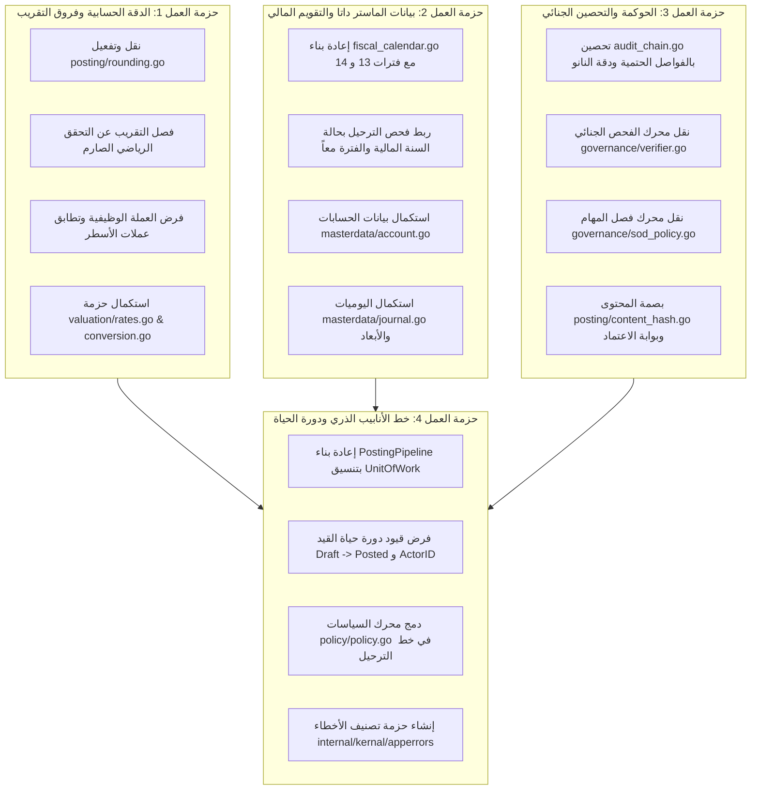

# الخطة التنفيذية الشاملة لمعالجة ثغرات النواة المحاسبية واستكمال النواقص

## (Kernel Hardening & Comprehensive Gap Completion Plan)

- **كود الوثيقة:** `AE-PLAN-KERNEL-HARDENING`
- **الإصدار:** `1.0.0`
- **التاريخ:** 2026-11-20
- **المشروع المستهدف:** `accountant_engine` (`/home/osm/StudioProjects/cashflow_system/accountant_engine/`)
- **المشروع المرجعي:** `accounting_engine` (`/home/osm/StudioProjects/cashflow_system/accounting_engine/`)
- **الحالة:** معتمدة وموجهة للتنفيذ الهندسي الفوري

---

## 1. الملخص التنفيذي والهدف (Executive Summary & Objectives)

بناءً على المراجعة الدقيقة والمقارنة الهيكلية المعمقة بين المشروع المرجعي `accounting_engine` والمشروع الجديد `accountant_engine`، وتفحص حزم النواة الحتمية (`internal/kernal/`)، هدفت هذه الخطة إلى:

1. **معالجة وحسم المشاكل الست الحرجة** التي تم تشخيصها في خط أنابيب الترحيل، وفروق التقريب، والعملة الوظيفية، والتقويم المالي، ودورة حياة القيد، وسلسلة التدقيق الجنائي.
2. **سد كافة النواقص المعمارية والوظيفية** التي كانت موجودة في النواة الصرفة بالمشروع المرجعي ولم تُنقل أو نُقلت بصورة منقوصة إلى المشروع الجديد.
3. **ترسيخ مبدأ النواة الصرفة (Embeddable Pure Kernel)**: خالية 100% من أي شوائب خارجية (لا اتصال شبكي، لا قواعد بيانات مباشرة SQL، لا مكتبات خارجية محظورة، ولا استخدام للفاصلة العائمة `float32/64`)، مع الاعتماد الحصري على واجهات وموانئ الخدمات (`pkg/spi/`).

---

## 2. نتائج المراجعة الشاملة لجميع حزم النواة (Kernel Gap Analysis)

تم إجراء فحص شامل لكل ملفات ومجلدات `accounting_engine/internal/` وتحديد ما يقع داخل نطاق النواة الصرفة (Kernel Domain) وما يقع خارجها (Orbitals / Storage Adapters / Applications):

### جدول مقارنة الملفات والحزم بين المرجعي والهدف

| الحزمة (Package) | الملفات في المرجعي `accounting_engine` | الملفات الحالية في `accountant_engine` | المكونات الناقصة الواجب نقلها/إكمالها في النواة |
| :--- | :--- | :--- | :--- |
| **`posting`** | 30 ملفاً (محرك الترحيل، التقريب، التحقق، القيود العكسية، الأبعاد، التجزئة، الإقفال) | 8 ملفات (`pipeline.go`, `entry_validation.go`, `reversal.go`, `adjusting.go`, `lock_manager.go`, ...) | - `rounding.go`: معالجة فروق التقريب المصرفي وحساب الفروق الصريح.<br>- `content_hash.go`: التجزئة الشاملة للقيد لاعتماد البصمة ومنع التلاعب.<br>- `dimensions.go`: محرك التحقق من أبعاد التكلفة والمشاريع.<br>- `error_classification.go`: تصنيف الأخطاء المحاسبية تصنيفاً معيارياً.<br>- `reversal_validation.go` & `reversal_request.go`: طلبات التحقق من القيود العكسية.<br>- استكمال خط الأنابيب الذري وربطه بـ `UnitOfWork`. |
| **`masterdata`** | 17 ملفاً (الحسابات، الفترات، الشركات، اليوميات، مراكز التكلفة، الأبعاد، التقويم المالي، الخدمات) | 7 ملفات (`coa.go`, `company_scope.go`, `fiscal_calendar.go`, `ports.go`, `types.go`, ...) | - `fiscal_calendar.go`: دالة `Contains(date)`، فصل فترات التسوية 13 و 14، التحقق من حالة السنة المالية، وتجنب انزياح الأشهر.<br>- `account.go`: التصنيفات الفرعية الكاملة (`SubClassifications`) ودوال الفحص (`IsCurrent`, `EffectiveIsCashEquivalent`, `Validate`).<br>- `account_version.go`: دعم سجل تاريخ الحسابات (`Effective-Dating`).<br>- `journal.go`: أنواع اليوميات، تقييد الحسابات والعملات المسموحة.<br>- `cost_center.go`: مراكز التكلفة وهيكليتها.<br>- `dimension.go`: الأبعاد التحليلية وقيمها. |
| **`governance`** | 18 ملفاً (سلاسل التدقيق، الاعتمادات، فصل الصلاحيات SoD، أدوار RBAC، الفاحص الجنائي، WORM) | 4 ملفات (`approvals.go`, `audit_chain.go`, `audit_test.go`, `doc.go`) | - `verifier.go`: محرك التحقق الجنائي الشامل من صحة السلسلة (`VerifyAuditIntegrity`).<br>- `sod_policy.go`: محرك فصل المهام والصلاحيات (`Segregation of Duties`).<br>- `approval_gate.go`: واجهات بوابة الاعتماد والتحقق من بصمة المحتوى.<br>- `approval.go`: دورة حياة الاعتمادات متعددة الخطوات.<br>- `rbac.go`: الأدوار المحاسبية والصلاحيات المالية.<br>- تحصين `audit_chain.go` بالفواصل الهيكلية ومنع التلاعب الخلفي. |
| **`policy`** | ملفان (`policy.go`, `policy_test.go`) | 4 ملفات (`posting_rules.go`, `eligibility.go`, ...) | - `policy.go`: نقل نموذج السياسات الكامل (`CurrencyPolicy`, `PostingPolicy`) بما يشمل سياسة التسوية التلقائية للتقريب (`AutoSettleRoundingDifferences`). |
| **`valuation`** | 9 ملفات (إعادة التقييم، محرك التحويل، أسعار الصرف، معيار IAS 21) | 4 ملفات (`exchange_rate.go`, `revaluation.go`, ...) | - `conversion.go`: محرك التحويل المالي الصريح بين العملات.<br>- `rates.go`: إدارة وتحديد أسعار الصرف المتعددة (فوري، متوسط شهري، إقفال).<br>- `spi.go`: واجهة مزود أسعار الصرف (`RateProviderSPI`). |
| **`apperrors`** | ملفان (`errors.go`, `errors_test.go`) | غير موجود (الأخطاء مبعثرة بين الحزم) | - إنشاء حزمة `internal/kernal/apperrors` لتصنيف الأخطاء المحاسبية بأكواد موحدة (`CodedError`) مثل `ERR_UNBALANCED_ENTRY`, `ERR_PERIOD_CLOSED`. |

---

## 3. المعالجة التفصيلية للمشاكل الست الحرجة (The 6 Critical Problems Remediation)

### المشكلة الأولى: عدم فرض العملة الوظيفية للشركة وتطابق عملات الأسطر (حرجة جداً)

#### 1. توصيف الخلل

- في `internal/kernal/posting/pipeline.go`، يتم جلب بيانات الشركة والتحقق من نشاطها فقط، دون التحقق من أن العملة الوظيفية للقيد وأسطره تطابق `company.FunctionalCurrency`.
- في `entry_validation.go`، تتم مقارنة العملة الوظيفية بين أسطر القيد داخلياً فقط، مما يسمح لشركة عملتها USD بتمرير قيد وظيفي متوازن بعملة EUR.
- لا يتم فحص تطابق `line.TransactionAmount.Currency()` مع `line.TransactionCurrency` في نفس السطر.

#### 2. الحل الهندسي المقترح

- إضافة فحص إلزامي في رأس دالة التحقق وفي خط الأنابيب:

  ```go
  func (p *PostingPipeline) validateFunctionalCurrency(entry *ledger.JournalEntry, expectedCurrency string) error {
      if expectedCurrency == "" {
          return types.ErrInvalidCurrencyCode
      }
      for i, line := range entry.Lines {
          if line.FunctionalDebit.Currency() != expectedCurrency || line.FunctionalCredit.Currency() != expectedCurrency {
              return types.ErrFunctionalCurrencyMismatch
          }
          if line.TransactionAmount.Currency() != line.TransactionCurrency {
              return types.ErrTransactionCurrencyMismatch
          }
      }
      return nil
  }
  ```

- دمج الفحص كخطوة إلزامية أولى في `PostingPipeline.PostEntry()` بعد جلب بيانات الشركة مباشرة.

---

### المشكلة الثانية: احتمال فقدان فروق التقريب (حرجة جداً)

#### 1. توصيف الخلل

- دالة `ValidateEntryLine` تقوم بتقريب المبلغ المتوقع والمبلغ الفعلي بالتقريب المصرفي قبل المقارنة، مما يسقط فروق الكسور (مثل 0.004) بصمت دون قيد تسوية.
- الخطأ `ErrRoundingAccountRequired` معرف ولكنه لا يُستخدم أو يُفرض، مما يخالف المعايير المحاسبية التي تشترط ترحيل فروق التقريب لحساب تسوية معتمد.

#### 2. الحل الهندسي المقترح

- فصل التحقق الرياضي الصارم عن التقريب: التحقق الرياضي يفحص تطابق الأرقام بدقة الحساب العشري.
- استعادة ونقل حزمة التقريب الصريحة من `accounting_engine/internal/posting/rounding.go` إلى `internal/kernal/posting/rounding.go`:

  ```go
  func RoundEntryWithRoundingPolicy(
      entry *ledger.JournalEntry,
      roundingAccountID types.AccountID,
      round func(types.Money) (types.Money, error),
  ) error {
      // 1. حساب صافي متبقي التقريب لجميع الأسطر:
      // residual = Σ round(functional debit) - Σ round(functional credit)
      // 2. إذا كان residual != 0:
      //    إذا كان roundingAccountID فارغاً -> إرجاع ErrRoundingAccountRequired فوراً.
      //    إذا كان الحساب معرفاً -> إنشاء سطر موازنة صريح (JournalEntryLine) للمتبقي.
      // 3. إعادة التحقق من توازن القيد بعد التسوية.
  }
  ```

- تفعيل خيار التسوية التلقائية للتقريب داخل سياسة العملات (`CurrencyPolicy.AutoSettleRoundingDifferences`).

---

### المشكلة الثالثة: خط أنابيب الترحيل ليس ذرياً (حرجة جداً)

#### 1. توصيف الخلل

- `internal/kernal/posting/pipeline.go` يقوم بالتحقق ثم يستدعي المنفذ دون وجود غلاف ذري تنفيذي ينسق:
  1. حجز أقفال الحسابات بترتيب تصاعدي لمنع Deadlock.
  2. فحص مفتاح عدم التكرار (Idempotency Key).
  3. حجز الرقم التسلسلي للقيد (Entry Number Sequencing).
  4. تحديث أرصدة الحسابات المتأثرة.
  5. حفظ رأس القيد وأسطره.
  6. إضافة القيد لسلسلة التدقيق الجنائي غير القابلة للتعديل.
  7. تثبيت مفتاح عدم التكرار.
- `lock_manager.go` يرتب المعرفات فقط في الذاكرة دون ربطها بحجز أقفال حقيقي عبر واجهة التخزين.

#### 2. الحل الهندسي المقترح

- إعادة هيكلة `PostingPipeline` داخل النواة ليعمل كـ Transactional Coordinator يعتمد على واجهة `UnitOfWork` و `TransactionRunner` من `pkg/spi/storage`:

  ```go
  type PostingUnitOfWork interface {
      storage.UnitOfWork
      Accounts() storage.AccountRepository
      Entries() storage.JournalEntryRepository
      Audit() storage.AuditRepository
      Idempotency() storage.IdempotencyRepository
  }
  ```

- تنفيذ التسلسل الذري الصارم داخل المعاملة (In-Transaction Flow):
  1. ترتيب معرفات الحسابات تصاعدياً واستدعاء `uow.Accounts().LockAccounts(ctx, sortedAccountIDs)`.
  2. فحص مفتاح منع التكرار وإرجاع القيد المسجل مسبقاً إذا وُجد.
  3. التحقق النهائي من أهلية الحسابات ورصيد الفترة وحالة السنة المالية.
  4. تطبيق حركات المدين والدائن على أرصدة الحسابات.
  5. توليد البصمة المشفرة وإدراج سجل التدقيق في سلسلة الهاش.
  6. حفظ القيد بالحالة `Posted`.
  7. تثبيت المعاملة الذرية (Commit).

---

### المشكلة الرابعة: دورة حياة القيد والاعتماد (حرجة جداً)

#### 1. توصيف الخلل

- غياب التحقق من أن القيد في حالة `Draft` قبل الترحيل (قد يرحل قيد ملغى أو مرحل مسبقاً).
- عدم اشتراط وجود هوية المنفذ `ActorID` / `PosterID`.
- عدم استدعاء `PolicyEngine` أو التحقق المزدوج (`Maker-Checker`).
- دالة `EnsureImmutable` معزولة ولا يتم فرضها تلقائياً عند أي محاولة تعديل.

#### 2. الحل الهندسي المقترح

- فرض آلة حالات القيد (Entry State Machine):

  ```go
  if entry.Status != ledger.EntryStatusDraft {
      return fmt.Errorf("%w: entry must be in draft status to post (current: %s)", ErrInvalidEntryState, entry.Status)
  }
  if strings.TrimSpace(posterID) == "" {
      return ErrPosterIDRequired
  }
  ```

- دمج فحص السياسات وبوابة الاعتماد (`ApprovalGate`):
  - فحص حد الصانع والمتحقق (`MakerCheckerThreshold`): إذا تجاوز مبلغ القيد الحد الأدنى، يجب ألا يكون `PosterID == CreatorID`، ويجب وجود سجل اعتماد سارٍ مطابق لبصمة محتوى القيد (`ContentHash`).
- تفعيل `EnsureImmutable` كفحص قبلي في أي عملية تحديث أو تعديل للقيد.

---

### المشكلة الخامسة: تصميم الفترات المالية والتقويم المالي (عالية الأهمية)

#### 1. توصيف الخلل

- الفترتان 13 و 14 تشتركان في نفس تاريخ نهاية السنة مع الفترة 12، مما يسبب تداخلاً يمنع التحديد الحتمي للفترة عبر التاريخ.
- غياب دالة `Contains(date)` على مستوى `FiscalPeriod`.
- احتمال انزياح حدود الأشهر عند استخدام `AddDate` إذا لم تكن البداية في اليوم الأول من الشهر.
- فحص فتح الفترة لا يتحقق من حالة السنة المالية ككل (`FiscalYearState`).

#### 2. الحل الهندسي المقترح

- إضافة منطق استبعاد فترات التسوية من البحث الزمني:

  ```go
  func (p FiscalPeriod) Contains(date time.Time) bool {
      // فترات التسوية (13 و 14) لا تستجيب للبحث بالتواريخ إطلاقاً
      if p.Type == FiscalPeriodTypeYearEndAdjustment || p.Type == FiscalPeriodTypeAuditAdjustment {
          return false
      }
      date = date.UTC()
      return !date.Before(p.StartDate.UTC()) && !date.After(p.EndDate.UTC())
  }
  ```

  - فرض أن فترات التسوية 13 و 14 يتم استهدافها صراحة عبر رقم الفترة (`TargetPeriodNumber: 13/14`) وليس بالتاريخ.
- تصحيح خوارزمية توليد الأشهر لضبط النهايات بدقة (نهاية الشهر الحقيقية لكل شهر ميلادي).
- تعديل `ValidatePeriodForPosting` ليشمل:

  ```go
  if year.State != FiscalYearOpen {
      return ErrClosedFiscalYear
  }
  if period.State != PeriodOpen {
      return ErrClosedPeriod
  }
  ```

- نقل وتفعيل دوال التحقق من تحول الحالات وإعادة فتح الفترات المشروطة بالاعتماد والتدقيق (`ValidatePeriodReopenWithApproval`, `ValidateFiscalYearTransition`).

---

### المشكلة السادسة: سجل التدقيق غير محصن بما يكفي (عالية الأهمية)

#### 1. توصيف الخلل

- دمج حقول السجل لحساب الهاش يتم بسلسلة نصية مباشرة دون فواصل (Delimiter-Free) مما يفتح ثغرة التباس الحقول (Hash Collision).
- القفل `sync.Mutex` يحمي الذاكرة المحلية فقط ولا يمنع التزامن في البيئات الموزعة.
- غياب آلية كشف الحذف الخلفي لآخر السجلات (Tail-Truncation Vulnerability).
- اقتطاع الطابع الزمني للميكروثانية بدلاً من النانوثانية.

#### 2. الحل الهندسي المقترح

- اعتماد ترميز حتمي موحد (Canonical Delimited Framing) مثل `|` أو البادئات الطولية (Length-Prefixed):

  ```go
  func ComputeAuditHash(entry AuditRecord) string {
      h := sha256.New()
      // استخدام فاصل صريح غير قابل للالتباس وموثوق
      fmt.Fprintf(h, "v1|%s|%s|%s|%s|%d|%s|%s",
          entry.CompanyID,
          entry.EntityID,
          entry.Action,
          entry.ActorID,
          entry.Timestamp.UnixNano(), // دقة النانو ثانية الكاملة
          entry.PayloadHash,
          entry.PreviousHash,
      )
      return hex.EncodeToString(h.Sum(nil))
  }
  ```

- إضافة حقل الرقم التسلسلي التراكمي المفرط (`SequenceNumber: uint64`) لكل شركة/دفتر لكشف أي ثغرة أو حذف في أي نقطة من السلسلة.
- توفير واجهة فحص السلسلة الجنائية `VerifyAuditIntegrity` التي تفحص ترابط وتتابع الهاشات والترقيم التسلسلي.

---

## 4. خطة استكمال المكونات الناقصة من النواة (Missing Kernel Components Roadmap)

سنقوم بتقسيم المهام التنفيذية إلى 4 حزم عمل فرعية متكاملة ومترابطة:



---

## 5. مصفوفة المهام التنفيذية التفصيلية (Detailed Task Breakdown)

### المهام التنفيذية للمرحلة P2-FIX

| رقم المهمة | الحزمة والملف | طبيعة المهمة | متطلبات الإنجاز والقبول |
| :--- | :--- | :--- | :--- |
| **`P2-FIX-01`** | `internal/kernal/posting/entry_validation.go` | تعديل | - التحقق من تطابق `TransactionAmount.Currency()` مع `TransactionCurrency`.<br>- التحقق من تطابق العملة الوظيفية للأسطر مع عملة الشركة الوظيفية.<br>- إزالة التقريب المبكر من مقارنة الأسطر لعدم ابتلاع الفروق. |
| **`P2-FIX-02`** | `internal/kernal/posting/rounding.go` | بناء جديد (نقل وملاءمة) | - كتابة دالة `RoundEntryWithRoundingPolicy` و `RoundEntryToMinorUnits`.<br>- احتساب متبقي التقريب بدقة وطلب حساب التسوية عبر `ErrRoundingAccountRequired`.<br>- إضافة سطر تسوية المتبقي تلقائياً إذا كان الحساب محدداً. |
| **`P2-FIX-03`** | `internal/kernal/masterdata/fiscal_calendar.go` | تعديل جوهري | - إضافة دالة `Contains(date)` وتخصيص الفترتين 13 و 14 لتكونا فترات تسوية إجرائية لا تخضع للتاريخ.<br>- فحص حالة السنة المالية (`FiscalYearOpen`) بجانب حالة الفترة في `ValidatePeriodForPosting`.<br>- ضبط انزياح نهايات الشهور وتوفير دوال الانتقال المعتمدة. |
| **`P2-FIX-04`** | `internal/kernal/governance/audit_chain.go` | تعديل جوهري | - تطبيق الترميز الحتمي بالفواصل الصريحة لمنع التباس الهاش.<br>- رفع دقة الوقت إلى النانو ثانية `UnixNano()`.<br>- دعم الترقيم التسلسلي الأحادي الصاعد لكشف الحذف الخلفي للسجلات. |
| **`P2-FIX-05`** | `internal/kernal/governance/verifier.go` | بناء جديد (نقل وملاءمة) | - نقل محرك التحقق الجنائي `VerifyAuditIntegrity` لاختبار سلامة ترابط السلسلة بالكامل.<br>- اختبار كشف التلاعب (Tamper Detection) في السجلات والتسلسل. |
| **`P2-FIX-06`** | `internal/kernal/posting/content_hash.go` | بناء جديد (نقل وملاءمة) | - حساب بصمة المحتوى الثابتة للقيد (SHA-256) لاستخدامها في بوابات الاعتماد ومنع التعديل بعد الموافقة. |
| **`P2-FIX-07`** | `internal/kernal/posting/pipeline.go` | إعادة هيكلة شاملة | - فرض حالة القيد `Draft` ووجود `ActorID`.<br>- التحقق من العملة الوظيفية للشركة.<br>- ربط خط الترحيل بـ `UnitOfWork` وحجز الأقفال تصاعدياً.<br>- تطبيق فحص السياسات والاعتماد المزدوج.<br>- فرض الحرمة التامة `EnsureImmutable`. |
| **`P2-FIX-08`** | `internal/kernal/masterdata/account.go` | استكمال | - نقل التصنيفات الفرعية المعيارية ودوال التحقق `Account.Validate()` و `IsCurrent()`. |
| **`P2-FIX-09`** | `internal/kernal/masterdata/journal.go` | بناء جديد (نقل وملاءمة) | - إدارة كائنات اليوميات المحاسبية وقيود الحسابات والعملات المصرح بها. |
| **`P2-FIX-10`** | `internal/kernal/policy/policy.go` | نقل وملاءمة | - توفير نموذج السياسات الشامل بما يشمل `CurrencyPolicy` و `AutoSettleRoundingDifferences`. |
| **`P2-FIX-11`** | `internal/kernal/valuation/conversion.go` | استكمال | - توفير محرك التحويل المالي واسترجاع أسعار الصرف التاريخية وفق معيار IAS 21. |
| **`P2-FIX-12`** | `internal/kernal/apperrors/` | بناء جديد | - توفير الأخطاء المحاسبية ذات الأكواد الموحدة والتصنيف المعياري. |

---

## 6. معايير القبول وبوابة الاعتماد (Acceptance Criteria & Phase Gate)

لإعلان اكتمال النواة المحاسبية بنسبة 100%، يجب استيفاء الشروط التالية:

1. **اجتياز الاختبارات بنسبة 100%**: تشغيل `go test -v ./internal/kernal/...` مع نجاح كافة الاختبارات دون أي فشل أو تخطٍ.
2. **تغطية اختبارية عالية ($\ge 85\%$)** لجميع حزم النواة مع التركيز على الحالات الحدية للتقريب، وتوازن القيد المزدوج، وسلسلة التدقيق الجنائي.
3. **نقاء النواة (Purity Guarantee)**: فحص ساكن يؤكد عدم وجود أي استخدام لأنواع `float32` أو `float64`، وخلو حزم النواة من أي مكتبات لقواعد البيانات (مثل `pgx`, `sql`) أو الاتصالات الشبكية (HTTP, AWS SDK).
4. **تأكيد معالجة المشاكل الست**:
   - وجود اختبار يثبت رفض الترحيل إذا اختلفت العملة الوظيفية عن عملة الشركة.
   - وجود اختبار يثبت كشف فرق التقريب (0.004) وطلب حساب التقريب أو توليد سطر تسوية متوازن.
   - وجود اختبار يثبت الترحيل الذري الكامل مع حجز الأقفال وتحديث السلسلة.
   - وجود اختبار يثبت منع ترحيل أي قيد ليس في حالة `Draft` أو بدون `ActorID`.
   - وجود اختبار يثبت أن فترات التسوية 13 و 14 لا يتم اختيارها بالبحث التاريخي التلقائي، ورفض الترحيل في سنة مالية مقفلة.
   - وجود اختبار يثبت كشف التلاعب أو الحذف في سلسلة التدقيق الجنائي عند فحصها بمحرك `verifier`.
