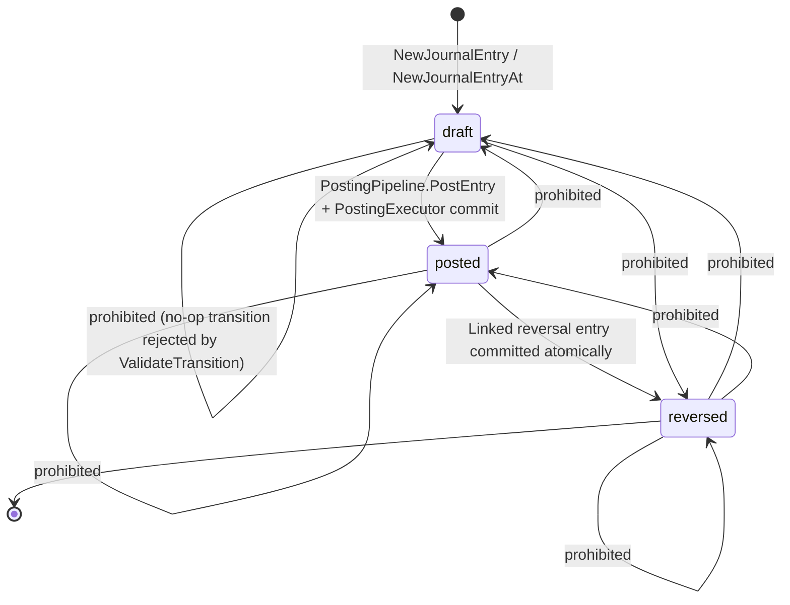

# KERNEL Phase 4 Execution Report — Journal, Ledger, and Source of Truth

**Status: PASS**  
**Execution date:** 2026-11-22  
**Repository commit baseline:** `94054d9c9a5f8d8419c9871b2d61b17b44d5b556`  
**Scope:** `internal/kernal/journal/**`, `internal/kernal/ledger/**`, related kernel contracts/docs, and narrowly required storage immutability hardening for phase 4 evidence.

---

## 1. Objective

This report records the execution and verification of Phase 4 (*القيد ودفتر الأستاذ ومصدر الحقيقة*) of `docs/KERNEL_REMEDIATION_EXECUTION_PLAN.md`.

Phase 4 formalizes the journal lifecycle state machine, strengthens posted-entry immutability at the domain/contract level, preserves reversal linkage rules, and implements a deterministic GL projection/rebuild path from canonical posted journal entries without introducing a materialized balance store inside `internal/kernal`.

---

## 2. Preconditions

| Gate | Evidence | Result |
|---|---|---|
| Phase 0 baseline complete | `docs/KERNEL_REMEDIATION_BASELINE.md` — PASS | ✅ |
| Phase 1 architecture/source-of-truth decision complete | `docs/KERNEL_REMEDIATION_PHASE1_REPORT.md`, ADR P1-01/P1-02/P1-03 | ✅ |
| Phase 2 monetary precision complete | `docs/KERNEL_REMEDIATION_PHASE2_REPORT.md` — PASS | ✅ |
| Phase 3 master-data/fiscal-calendar complete | `docs/KERNEL_REMEDIATION_PHASE3_REPORT.md` — PASS | ✅ |
| No Phase 5+ domain expansion started | No policy-engine behavior redesign, no posting atomicity/idempotency contract expansion beyond phase 4 scope, no valuation/reporting engine | ✅ |

---

## 3. Task Coverage (Plan → Evidence)

| # | Required task | Execution evidence |
|---|---|---|
| 1 | Formal journal state machine | `journal.EntryStatus` lifecycle methods, `AllowedTransitions`, `ValidateTransition`; `TestEntryStatusStateMachine`, `TestEntryStatusTransitions`, `TestAllowedTransitions` |
| 2 | Allowed/prohibited transitions with error cases | `ErrInvalidEntryStatus`, `ErrInvalidStatusTransition`; transition matrix tests cover all allowed/prohibited cases |
| 3 | Mutable draft vs fixed posted fields | `EntryStatus.IsMutable`, `JournalEntry.EnsureMutable`, `ValidateImmutability`; tests reject posted/reversed mutation |
| 4 | Review Clone and defensive copy | Existing `Clone` retained; reflection-based deep-clone alias test added in `TestCloneIsDeepAndCoversPointerFields` |
| 5 | Prevent modification after posting at domain/contract/storage levels | Domain: `ValidateImmutability`/`EnsureMutable`; Contract/docs updated; Storage: memory `SaveDraft` and normal `CommitPosting` reject overwriting non-draft entries; postgres already enforces status-guarded transitions in `saveEntryTx` |
| 6 | Original/reversal identity, linkage, and no-duplication rules | `journal.ValidateReversalLinkage`; `TestValidateReversalLinkage`; existing posting reversal tests remain green |
| 7 | Apply Phase 1 canonical source-of-truth decision | Journal/ledger docs and ADR P1-02 addendum reaffirm posted `JournalEntry + EntryLine` as canonical fact |
| 8 | Define posted movement model | `ledger.PostedMovement` projection struct includes company/journal/period/entry/line/account, dates, dimensions, transaction/functional amounts/currencies, exchange rate, classification/source, and reversal links |
| 9 | Ensure every movement traceable to JournalEntry and no orphan movement | `ProjectPostedMovements` rejects missing company/entry/line/account/functional currency; tests cover orphan/identity rejection |
| 10 | Deterministic GL rebuild path without materialized balance store | `ComparePostedEntries`, `ProjectPostedMovements`, `RebuildAccountBalances`; deterministic ordering `(EffectiveDate UTC, SequenceNumber, JournalEntryID, EntryLine.ID)`; pure in-memory projection only |
| 11 | Correction rules: reversal/correction linked entries only | Immutability helpers reject posted mutation; docs state corrections only via linked reversal/correction entries |
| 12 | Ledger/Book scope keys future consistency, no multi-book implementation | CompanyID carried in projections/contracts; no BookID/LedgerID added to kernel posting contract; docs explicitly reserve multi-book for future ADR |
| 13 | Public compatibility review, especially `AccountTypeRevenue` | `TestAccountTypeRevenueCompatibilityAlias` confirms `AccountTypeRevenue == AccountTypeIncome == "income"` |
| 14 | State machine, immutability, rebuild determinism tests | Added `journal/state_machine_test.go` and `ledger/projection_test.go` |
| 15 | Update journal/ledger docs and traceability matrix | Updated `journal/doc.go`, `ledger/doc.go`, `KERNEL_ACCOUNTING_INVARIANTS.md` Phase 4 clarifications, `KERNEL_TRACEABILITY_MATRIX.md` rows 009/011/012 and appendix 1.3, `KERNEL_ARCHITECTURE_MAP.md`, ADR P1-01/P1-02 addenda |

---

## 4. Production Changes

### 4.1 Journal lifecycle and immutability

- `internal/kernal/journal/entry.go`
  - Added status helpers: `IsValid`, `IsMutable`, `IsTerminal`, `CanTransitionTo`.
  - Added transition validation: `AllowedTransitions`, `ValidateTransition`.
  - Added domain errors: `ErrInvalidEntryStatus`, `ErrInvalidStatusTransition`, `ErrImmutableEntry`, `ErrInvalidReversalLinkage`.
  - Added immutability helpers: `JournalEntry.EnsureMutable`, `ValidateImmutability`.
  - Added reversal linkage validation: `ValidateReversalLinkage`.

### 4.2 Ledger projection and deterministic rebuild

- `internal/kernal/ledger/projection.go` (new)
  - Added `PostedMovement` as a deterministic projection, not a stored independent entity.
  - Added `ComparePostedEntries` / `CompareEntryLines` for canonical rebuild ordering.
  - Added `ProjectPostedMovements` and `RebuildAccountBalances`.
  - Rebuild is pure and deterministic; no materialized balance store, no reporting engine.

- `internal/kernal/ledger/doc.go`
  - Updated boundaries to allow pure projection/rebuild helpers while preserving the canonical-source and no-materialized-store rules.

### 4.3 Narrow storage hardening (phase 4 necessity)

- `storage/memory/posting.go`
  - `SaveDraft` now rejects overwriting a non-draft entry.
  - Normal `CommitPosting` now rejects overwriting a non-draft existing entry and rejects reversal of already-reversed originals.

This is a narrow immutability hardening aligned with task 5; it does not add a new storage feature outside kernel contract enforcement.

---

## 5. State Machine

---

## 6. Test-First / Verification Evidence

All commands were run from repository root on 2026-11-22.

| Check | Command | Result |
|---|---|---|
| Formatting | `gofmt -l internal/kernal/` | PASS — no output |
| New/affected package tests | `go test ./internal/kernal/journal ./internal/kernal/ledger -count=1` | PASS |
| Kernel tests | `go test ./internal/kernal/... -count=1` | PASS — all 10 kernel packages |
| Race detector | `go test -race ./internal/kernal/... -count=1` | PASS — all 10 kernel packages |
| Architecture gate | `./scripts/verify_architecture.sh` | PASS — 11/11 checks |
| Memory adapter smoke (narrow hardening) | `go test ./storage/memory/... -count=1` | PASS |

New phase 4 tests:

- `internal/kernal/journal/state_machine_test.go`
  - `TestEntryStatusStateMachine`
  - `TestEntryStatusTransitions`
  - `TestAllowedTransitions`
  - `TestJournalEntryEnsureMutable`
  - `TestValidateImmutabilityRejectsPostedChanges`
  - `TestValidateImmutabilityDetectsLineChanges`
  - `TestCloneIsDeepAndCoversPointerFields`
  - `TestValidateReversalLinkage`
- `internal/kernal/ledger/projection_test.go`
  - `TestProjectPostedMovementsIsDeterministic`
  - `TestRebuildAccountBalancesDeterministic`
  - `TestPostedMovementIncludesRequiredFields`
  - `TestRebuildExcludesDraftsAndRejectsOrphanPostedLine`
  - `TestAccountTypeRevenueCompatibilityAlias`
  - `TestRebuildIncludesReversedEntriesAndReversalNetImpact`
  - `TestProjectPostedMovementsRejectsOrphanIdentity`

---

## 7. Documentation / ADR / Gap Updates

| File | Change |
|---|---|
| `docs/ard/P1_01_kernel_package_map.md` | Addendum for ledger projection dependency (`ledger -> journal, types`) |
| `docs/ard/P1_02_gl_source_of_truth.md` | Addendum for `PostedMovement` projection and deterministic rebuild |
| `docs/KERNEL_ARCHITECTURE_MAP.md` | Updated dependency graph/layer table for ledger projection edge |
| `internal/kernal/journal/doc.go` | State machine, immutability, reversal linkage responsibilities |
| `internal/kernal/ledger/doc.go` | Canonical projection/rebuild boundaries; no materialized balance store |
| `internal/kernal/KERNEL_ACCOUNTING_INVARIANTS.md` | Phase 4 non-normative lifecycle/projection clarifications |
| `internal/kernal/KERNEL_TRACEABILITY_MATRIX.md` | Updated rules 009/011/012 evidence and added appendix 1.3 |
| `docs/KERNEL_REMEDIATION_GAP_REGISTER.md` | Updated G-004 to Partially Closed — Phase 4 with executable kernel rebuild evidence |

---

## 8. Residual Risks

1. **G-004 still not fully closed:** Kernel-side deterministic rebuild is implemented and tested, but phase 12 still needs full release-scope evidence across adapters/environments.
2. **G-017 reversal field naming conflict:** Kernel uses `ReversalOfID/ReversedByID`; PostgreSQL trigger/schema naming still needs dedicated contract/adapter verification in phases 7/11.
3. **Storage contract parity not fully proven:** Memory received narrow immutability hardening; full posting/idempotency/atomicity contract parity remains Phase 7/11 work.
4. **No multi-book implementation:** CompanyID scope is preserved; BookID/LedgerID remain reserved only.

---

## 9. Gate Decision

All Phase 4 tasks 1–15 are implemented and verified at kernel scope. Required kernel tests, race checks, and architecture verification pass. No materialized balance store or reporting engine was added to `internal/kernal`.

**PHASE 4 GATE: PASS**

No commit or push was performed. Changes remain in the working tree for review.
