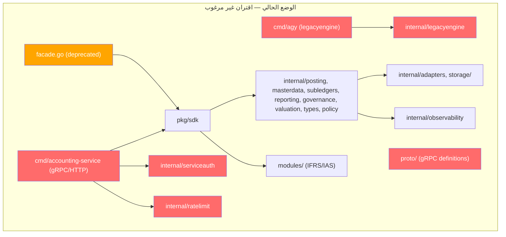
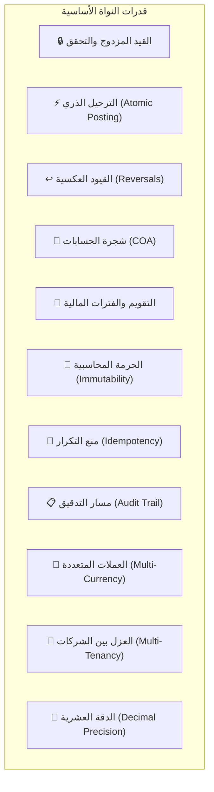
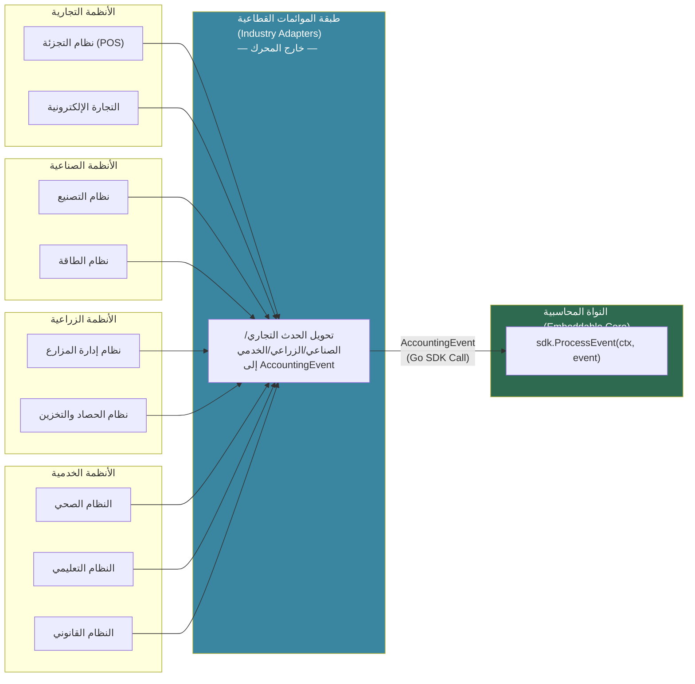
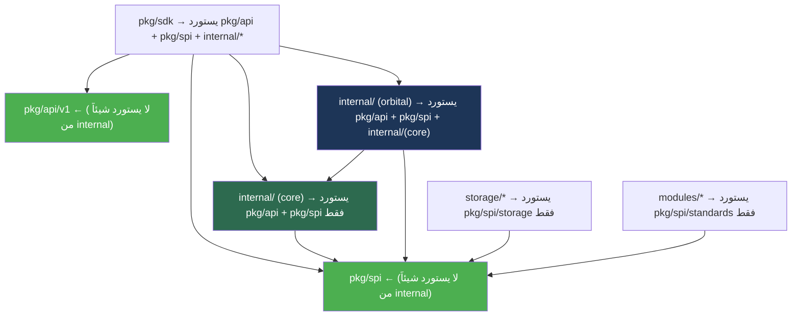

# وثيقة بدء مشروع إعادة هيكلة Accounting Engine (PID)

# فصل النواة المحاسبية القابلة للتضمين (Embeddable Core Engine)

> **حالة الوثيقة:** مسودة أولية مبنية على مراجعة الهيكل الحالي لمشروع `accounting_engine` ووثائقه المعتمدة (`project_specification_and_architecture.md` v1.0.0 و `ACCOUNTING_ENGINE_PID.md` v0.1.0)، ومسترشدة بدليل إدارة المشاريع البريطاني BIS (نوفمبر 2010). لا تصبح هذه الوثيقة خط أساس معتمداً إلا بعد مراجعتها واعتمادها من المالك المسؤول الأول (SRO) ومجلس المشروع.

---

## ضبط الوثيقة (Document Control)

| العنصر | القيمة |
| --- | --- |
| اسم المشروع | إعادة هيكلة Accounting Engine — فصل النواة القابلة للتضمين |
| رمز المشروع | AE-RESTRUC-PID-001 |
| المالك المسؤول الأول (SRO) | لم يُحدد بعد — يتطلب تعييناً رسمياً |
| مدير المشروع | لم يُعيّن بعد |
| قائد الهندسة | لم يُعيّن رسمياً |
| المستودع المصدري | `github.com/osmai4603-collab/accounting_engine` |
| لغة التنفيذ | Go 1.26.0 / toolchain go1.26.3 |
| خط الأساس الوظيفي والمعماري | `project_specification_and_architecture.md` v1.0.0 |
| المنهجية | دورة حياة BIS ذات المراحل الخمس (PRINCE2-aligned) |
| تاريخ الوثيقة | 19 نوفمبر 2026 |
| حالة الاعتماد | **غير معتمدة — مسودة** |

### سجل التعديلات

| الإصدار | التاريخ | التغيير | الحالة |
| --- | --- | --- | --- |
| 1.0.0-draft | 2026-11-19 | إعداد PID لإعادة الهيكلة بناءً على مراجعة الهيكل الحالي والوثائق المعتمدة | للمراجعة |

---

# 1. تعريف المشروع (Project Definition)

## 1.1 ما هو هذا المشروع؟

هذا المشروع هو **إعادة هيكلة معمارية** (Architectural Restructuring) لمشروع Accounting Engine القائم، بهدف **فصل النواة المحاسبية الأساسية** (Core Accounting Kernel) عن جميع المكونات المحيطة بها، لتصبح النواة وحدة مستقلة تماماً، **موثوقة وعالية الأداء وقابلة للتضمين** (Embeddable Core Engine) في أي نظام مضيف عبر Go SDK فقط.

**ما ليس هذا المشروع:**

- ليس بناء نظام جديد من الصفر.
- ليس إضافة ميزات وظيفية جديدة.
- ليس مشروع تكامل أو نشر خدمة.

## 1.2 الغرض من إعادة الهيكلة (Purpose)

الهيكل الحالي للمحرك يحتوي على تشابك بين مكونات متعددة:



> [!WARNING]
> المكونات باللون الأحمر (`cmd/accounting-service`, `cmd/agy`, `internal/serviceauth`, `internal/ratelimit`, `proto/`, `internal/legacyengine`) تمثل اقتراناً مع مسؤوليات خارج نطاق النواة المحاسبية (مصادقة، تفويض، نقل شبكي، rate limiting)، ووجودها داخل نفس المستودع يلوّث حدود النواة ويعيق التضمين النظيف.

## 1.3 الرؤية المستهدفة (Target Vision)

```mermaid
flowchart TD
    subgraph Target["الهيكل المستهدف — النواة المحاسبية المفصولة"]
        subgraph CoreKernel["🟢 النواة المحاسبية (Accounting Core Kernel)"]
            POSTING["posting — محرك الترحيل والقيد المزدوج"]
            MASTER["masterdata — الحسابات والعملات والفترات"]
            TYPES["types — الأموال والعملات والقيم الدقيقة"]
            VALUATION["valuation — أسعار الصرف والتقييم"]
            POLICY["policy — السياسات والاعتماد المحاسبي"]
            GOVERNANCE["governance — التدقيق والموافقات"]
        end

        subgraph Orbit["🔵 المكونات المدارية حول النواة (Orbital Components)"]
            SUBLEDGERS["subledgers — الدفاتر الفرعية"]
            REPORTING["reporting — التقارير والقوائم المالية"]
            RECON["reconciliation — المطابقة والتسويات"]
            EVENTS["events — استيعاب الأحداث الاقتصادية"]
            CONSOLIDATION["consolidation — توحيد القوائم"]
        end

        subgraph Extensions["🟣 الامتدادات الاختيارية (Optional Extensions)"]
            MODULES["modules/ — IFRS 15, 16, 9, IAS 12"]
        end

        subgraph PublicSurface["📦 السطح العام (Public Surface)"]
            SDK_PUB["pkg/sdk — EngineBuilder, Engine, Services"]
            API_PUB["pkg/api/v1 — العقود والنماذج"]
            SPI_PUB["pkg/spi — موانئ التخزين والمعايير"]
        end

        subgraph StorageAdapters["⚙️ موائمات التخزين (Storage Adapters)"]
            PG["storage/postgres"]
            MEM["storage/memory"]
        end
    end

    SDK_PUB --> CoreKernel
    SDK_PUB --> Orbit
    SDK_PUB --> Extensions
    Orbit --> CoreKernel
    Extensions --> SPI_PUB
    CoreKernel --> SPI_PUB
    SPI_PUB --> StorageAdapters

    style CoreKernel fill:#2d6a4f,color:#fff
    style Orbit fill:#1d3557,color:#fff
    style Extensions fill:#6a0572,color:#fff
```



## 1.4 المبدأ الجوهري: الأحداث الاقتصادية لا البروتوكولات

> [!IMPORTANT]
> المحرك لا يتحدث gRPC أو HTTP أو REST. المحرك يتحدث **أحداثاً اقتصادية** (Economic Events). أي نظام مضيف يرغب في استخدام المحرك يجب أن يحوّل أحداثه التجارية (فاتورة بيع، شحنة، دفعة بنكية) إلى **حدث اقتصادي معياري** (`AccountingEvent`) ويمرره للمحرك عبر Go SDK. طبقات النقل (gRPC, HTTP) تعيش **خارج المحرك** في مشروع مستقل إذا دعت الحاجة.

---

# 2. النطاق (Scope)

## 2.1 ما يقع داخل النطاق (In-Scope)

### 2.1.1 فصل النواة المحاسبية

| البند | الوصف |
| --- | --- |
| **تحديد حدود النواة** | تعريف دقيق لأي حزم `internal/` تُشكّل النواة المحاسبية الصرفة وأيها مكونات مدارية |
| **إزالة الاقتران غير المرغوب** | فصل كل ما يتعلق بـ gRPC/HTTP/Authentication/Authorization/RateLimiting من النواة |
| **تنظيف المسارات القديمة** | معالجة `facade.go` (deprecated)، `internal/legacyengine`، `cmd/agy` |
| **توحيد مسار البناء** | مسار واحد عبر `sdk.NewBuilder(sdk.WithStoragePorts(...))` بدلاً من مسارين |
| **إعادة تنظيم الحزم** | ضمان أن كل حزمة `internal/` تعتمد فقط على عقود `pkg/spi` ولا تستورد حزم نقل أو بنية تحتية |

### 2.1.2 المكونات الأساسية للنواة المحاسبية (Core Kernel Components)

هذه المكونات تُشكّل **قلب النواة** غير القابل للاستخراج:

| المكون | المسار الحالي | المسؤولية |
| --- | --- | --- |
| محرك الترحيل والقيد المزدوج | `internal/posting` | التحقق، التوازن، الترحيل الذري، العكس، الحرمة |
| البيانات المالية الرئيسية | `internal/masterdata` | شجرة الحسابات، العملات، الفترات، السنوات المالية |
| الأنواع والقيم المالية | `internal/types` | الأموال، العملات، الدقة العشرية، القيم غير العائمة |
| التقييم والعملات | `internal/valuation` | أسعار الصرف، التحويل، إعادة التقييم |
| السياسات المحاسبية | `internal/policy` | قواعد الاعتماد، ضوابط الترحيل |
| الحوكمة والتدقيق | `internal/governance` | مسار التدقيق، الموافقات، سلسلة التجزئة |

### 2.1.3 المكونات المدارية حول النواة (Orbital Components)

تعتمد على النواة ولكنها **قابلة للتفعيل الاختياري**:

| المكون | المسار الحالي | العلاقة بالنواة |
| --- | --- | --- |
| الدفاتر الفرعية | `internal/subledgers` | تستهلك أحداث الترحيل وتوسّع التتبع |
| التقارير المالية | `internal/reporting` | تقرأ من الأرصدة والقيود لتوليد القوائم |
| المطابقة والتسويات | `internal/reconciliation` | تقارن بين مصادر مالية |
| استيعاب الأحداث | `internal/events` و`pkg/sdk/event_ingestion.go` | يحوّل الأحداث الاقتصادية إلى قيود |
| توحيد القوائم | `internal/consolidation` | يوحّد القوائم المالية لمجموعة شركات |

### 2.1.4 تحديث الوثائق والاختبارات

- تحديث مصفوفة التتبع المعمارية بعد الفصل.
- تحديث اختبارات العقود (`contract_parity`) والمستهلك الخارجي.
- تحديث وثائق SDK والعقود العامة.

## 2.2 ما يقع خارج النطاق (Strictly Out of Scope)

| البند | السبب |
| --- | --- |
| **إضافة ميزات وظيفية جديدة** | هذا مشروع هيكلة لا تطوير وظيفي |
| **بناء خدمة gRPC/HTTP جديدة** | المحرك نواة قابلة للتضمين فقط؛ خدمات النقل مشروع مستقل مستقبلي |
| **المصادقة والتفويض (Authentication & Authorization)** | لا يدعم المحرك عمليات IAM؛ هذه مسؤولية النظام المضيف بالكامل |
| **تكامل خارجي عبر gRPC أو HTTP** | المحرك يستقبل أحداثاً اقتصادية عبر SDK فقط |
| **واجهات المستخدم الرسومية** | المحرك headless بالكامل |
| **الاتصال بالبنوك وبوابات الدفع** | خارج حدود المحرك |
| **تخزين مستندات ومرفقات** | خارج حدود المحرك |
| **تغيير قواعد العمل المحاسبية** | الهيكلة لا تُغيّر المنطق المحاسبي |
| **ترقية Go أو PostgreSQL** | مشروع مستقل إذا لزم الأمر |
| **بناء موائمات قطاعية** | المحرك محايد قطاعياً؛ الموائمات مسؤولية المضيف |

---

# 3. المسؤوليات وحدودها (Responsibilities & Boundaries)

## 3.1 مصفوفة المسؤولية بين المحرك والنظام المضيف (بعد الهيكلة)

| المجال | مسؤولية النواة المحاسبية | مسؤولية النظام المضيف |
| --- | --- | --- |
| **القيد المزدوج والترحيل** | التحقق الصارم والترحيل الذري والحرمة | تحضير القيد/الحدث المتوازن |
| **شجرة الحسابات والفترات** | الإدارة والتحقق والإقفال | اتخاذ قرار الإقفال وتمرير الأمر |
| **المصادقة والتفويض** | ❌ **لا يدعمها المحرك مطلقاً** | إدارة الهوية والجلسات والأدوار بالكامل |
| **بروتوكول النقل** | ❌ **لا يوفر gRPC/HTTP** | إنشاء طبقة نقل خارجية إذا لزم الأمر |
| **سياق الفاعل الموثوق** | يقبل `Principal` ممرراً في `context` ويسجّله في التدقيق | يضمن أن `Principal` مصادق عليه قبل استدعاء SDK |
| **العزل بين الشركات** | يفرض `CompanyID` في كل عملية ويرفض التجاوز | يمرر `CompanyID` الصحيح ولا يسمح للمستخدم بتغييره |
| **تخزين البيانات** | يحدد عقود `SPI/storage` | يوفر `Ports` ملموسة (PostgreSQL أو غيرها) |
| **الأحداث الاقتصادية** | يستقبلها ويحوّلها إلى قيود | يبني Industry Adapter لتحويل أحداثه التجارية |
| **التقارير المالية** | يولّدها من الأرصدة والقيود | يعرضها في واجهاته |

## 3.2 مصفوفة RACI لمشروع إعادة الهيكلة

| النشاط | SRO/المجلس | مدير المشروع | قائد الهندسة | المراجع المحاسبي | ضمان مستقل |
| --- | --- | --- | --- | --- | --- |
| اعتماد نطاق الفصل وحدوده | **A** | R | C | C | C |
| تحديد مكونات النواة vs المدارية | I | C | **A/R** | C | C |
| تنفيذ الفصل الهندسي | I | C | **R** | I | C |
| اختبارات العقود والتكامل | I | C | R | R | **A/C** |
| مراجعة عدم كسر القواعد المحاسبية | I | C | C | **A/R** | C |
| اعتماد خط الأساس الجديد | **A** | R | C | C | C |

`R` منفذ، `A` مسؤول نهائي، `C` مستشار، `I` مطلع.

---

# 4. قواعد العمل الهندسية والمحاسبية (Engineering & Accounting Rules)

## 4.1 قواعد العمل المحاسبية — ثوابت لا تتأثر بالهيكلة (Accounting Invariants)

> [!CAUTION]
> إعادة الهيكلة **لا تُغيّر ولا تُخفّف** أياً من القواعد المحاسبية التالية. هذه ثوابت حتمية (Invariants) يجب أن تبقى صحيحة قبل وأثناء وبعد إعادة الهيكلة.

| المعرف | القاعدة | الالتزام |
| --- | --- | --- |
| **BR-ACC-01** | التوازن الحتمي للقيد المزدوج: $\sum \text{Debit} - \sum \text{Credit} = 0.0000$ | رفض فوري لأي قيد غير متوازن دون فتح معاملة تخزين |
| **BR-ACC-02** | حظر الترحيل على الحسابات التجميعية (Header Accounts) | الترحيل على الحسابات الطرفية (Leaf) فقط |
| **BR-ACC-03** | حرمة الفترات المحاسبية المغلقة والمقفلة | رفض أي قيد في فترة مغلقة أو مقفلة نهائياً |
| **BR-ACC-04** | عدم قابلية التعديل أو الحذف (Strict Immutability) | لا `UPDATE` ولا `DELETE` على القيود المرحّلة |
| **BR-ACC-05** | التصحيح بالقيد العكسي الحصري | التصحيح عبر قيد عكسي مرتبط بالأصل فقط |
| **BR-ACC-06** | سلامة قيود العملات الأجنبية | توفير سعر الصرف المعتمد وتحقق التوازن بالعملة الوظيفية |
| **BR-ACC-07** | مطابقة دفاتر المراقبة مع الدفاتر الفرعية | تطابق حتمي بين الدفاتر الفرعية وحسابات المراقبة |

## 4.2 قواعد العمل الهندسية — ضوابط إعادة الهيكلة (Engineering Rules)

| المعرف | القاعدة | التطبيق |
| --- | --- | --- |
| **BR-ENG-01** | الحفظ الذري الكامل (All-or-Nothing UoW) | يجب أن يبقى كل ترحيل ذرياً شاملاً |
| **BR-ENG-02** | منع تكرار المعاملات (Idempotency) | مفتاح `Idempotency-Key` لكل عملية |
| **BR-ENG-03** | عزل الشركات عبر `CompanyID` في السياق | لا ثقة بالمعرف في المتن وحده |
| **BR-ENG-04** | منع تسريب منطق المحاسبة خارج النواة | لا تصدير لدوال تعديل الأرصدة مباشرة |
| **BR-ENG-05** | **حظر استيراد `internal/` من خارج المستودع** | المستهلك الخارجي يستخدم `pkg/sdk`, `pkg/api`, `pkg/spi` فقط |
| **BR-ENG-06** | **حظر استيراد حزم النقل أو المصادقة من النواة** | `internal/posting`, `internal/masterdata` وغيرها لا تستورد gRPC, HTTP, JWT |
| **BR-ENG-07** | **مسار بناء واحد** | `sdk.NewBuilder(sdk.WithStoragePorts(...))` هو المسار الوحيد المدعوم |
| **BR-ENG-08** | الدقة العشرية وحظر Floating-point | `Int64` أو `shopspring/decimal` حصراً |
| **BR-ENG-09** | **الحياد القطاعي المطلق** | لا توجد مفاهيم تجارية (فاتورة، شحنة، مخزون) داخل النواة |

---

# 5. القدرات المحاسبية (Accounting Capabilities)

## 5.1 قدرات النواة الأساسية (Core Capabilities — MUST HAVE)



## 5.2 قدرات مدارية (Orbital Capabilities — Opt-in)

| القدرة | الحالة بعد الهيكلة |
| --- | --- |
| الدفاتر الفرعية (AR, AP, Cash, Fixed Assets) | قابلة للتفعيل عبر `EngineBuilder` |
| التقارير المالية (TB, BS, P&L, Cash Flow) | قابلة للتفعيل عبر `WithReporting()` |
| المطابقة والتسويات | قابلة للتفعيل عبر option مخصص |
| استيعاب الأحداث الاقتصادية | قابلة للتفعيل عبر `ProcessEvent()` |
| إقفال نهاية السنة | قابلة للتفعيل عبر `YearEndClosing()` |
| وحدات IFRS/IAS | قابلة للتفعيل عبر `WithStandard()` |
| توحيد القوائم | قابل للتفعيل اختيارياً |

---

# 6. المتطلبات الوظيفية وغير الوظيفية (Requirements)

## 6.1 المتطلبات الوظيفية لمشروع الهيكلة

| المعرف | المتطلب | معيار القبول |
| --- | --- | --- |
| **RFR-01** | فصل حزم النقل (gRPC/HTTP) عن النواة | `internal/*` لا يستورد أي حزمة `google.golang.org/grpc` أو `net/http` |
| **RFR-02** | إزالة المصادقة والتفويض من النواة | لا وجود لـ JWT/HMAC/OAuth validation في `internal/*` أو `pkg/sdk` |
| **RFR-03** | توحيد مسار بناء المحرك | `WithCoreStorage` محذوف أو مؤشر على deprecated، والمسار الوحيد هو `WithStoragePorts` |
| **RFR-04** | معالجة `internal/legacyengine` | نقلها خارج النواة أو حذفها مع توفير بديل عبر SDK |
| **RFR-05** | معالجة `cmd/accounting-service` | نقلها إلى مستودع مستقل أو مجلد `examples/` |
| **RFR-06** | معالجة `cmd/agy` | فك الاعتماد على `legacyengine` واستخدام `pkg/sdk` |
| **RFR-07** | معالجة `proto/` | نقل تعريفات gRPC خارج النواة |
| **RFR-08** | إزالة `internal/serviceauth` من النواة | نقلها إلى طبقة المضيف |
| **RFR-09** | إزالة `internal/ratelimit` من النواة | نقلها إلى طبقة المضيف |
| **RFR-10** | ضمان سلامة اختبارات العقود بعد الفصل | اجتياز `contract_parity` و`external_consumer` و`external_adapter_consumer` |
| **RFR-11** | ضمان استقلالية الحزم الداخلية | لا حزمة في `internal/` تستورد حزمة `internal/` أخرى خارج نطاقها المباشر |

## 6.2 المتطلبات غير الوظيفية

| المعرف | التصنيف | المتطلب | معيار القياس |
| --- | --- | --- | --- |
| **RNFR-01** | Maintainability | فصل واضح بين الطبقات | لا اعتماد دائري، ولا استيراد عكسي من Domain إلى Infrastructure |
| **RNFR-02** | Portability | النواة تعمل دون أي خادم شبكي | بناء واختبار ناجح في وضع المكتبة فقط |
| **RNFR-03** | Testability | الاختبارات تعمل دون PostgreSQL أو gRPC | اجتياز كل اختبارات الوحدة بموائم الذاكرة |
| **RNFR-04** | Backward Compatibility | عدم كسر العقود العامة (`pkg/api`, `pkg/spi`) | نجاح `check_api_compat.sh` مع خط الأساس |
| **RNFR-05** | Performance | لا تدهور في أداء الترحيل | P95 ≤ 50ms (نفس الهدف السابق) |
| **RNFR-06** | Data Integrity | لا تغيير في سلوك ACID | اجتياز `test/acid/` و`test/atomic/` و`test/concurrency/` |

---

# 7. تكامل المحرك مع الأنظمة الخارجية (Integration with External Systems)

## 7.1 نموذج التكامل: الأحداث الاقتصادية (Event-Driven Integration)

> [!IMPORTANT]
> المحرك لا يتكامل عبر بروتوكولات شبكية (gRPC, HTTP). التكامل يتم حصراً عبر **أحداث اقتصادية معيارية** (`AccountingEvent`) تُمرر للمحرك عبر Go SDK.



## 7.2 مصفوفة التكامل القطاعي

| القطاع | مثال الحدث التجاري | الحدث الاقتصادي المعياري للمحرك | المسؤول عن التحويل |
| --- | --- | --- | --- |
| **التجاري** | فاتورة بيع مكتملة | قيد مدين/دائن: المدينون ← الإيرادات | Industry Adapter (خارج المحرك) |
| **الصناعي** | إنتاج دفعة منتجات | قيد مدين/دائن: المخزون ← تحت التصنيع | Industry Adapter (خارج المحرك) |
| **الزراعي** | بيع محصول بالطن | قيد مدين/دائن: النقد ← إيراد المحصول | Industry Adapter (خارج المحرك) |
| **الخدمي** | فاتورة خدمة صحية | قيد مدين/دائن: المدينون ← إيراد الخدمة | Industry Adapter (خارج المحرك) |

---

# 8. معايير القبول (Acceptance Criteria)

| المعرف | معيار القبول | طريقة التحقق |
| --- | --- | --- |
| **AC-01** | لا يوجد `import` لـ `google.golang.org/grpc` أو `net/http` في أي ملف داخل `internal/` | سكربت فحص آلي `grep -r` |
| **AC-02** | لا يوجد `import` لـ `internal/serviceauth` أو `internal/ratelimit` في النواة | سكربت فحص آلي |
| **AC-03** | مسار `cmd/accounting-service` غير موجود في مستودع النواة أو منقول إلى `examples/standalone-service/` | فحص هيكل المجلدات |
| **AC-04** | مسار `proto/` غير موجود في مستودع النواة أو منقول | فحص هيكل المجلدات |
| **AC-05** | `facade.go` محذوف أو يحمل deprecation notice مع تاريخ إزالة | مراجعة الكود |
| **AC-06** | بناء ناجح لمستهلك خارجي يستخدم `pkg/sdk` فقط دون أي `internal/` | اختبار `test/external_consumer/` |
| **AC-07** | اجتياز جميع اختبارات `test/contract_parity/` | تقرير CI |
| **AC-08** | اجتياز جميع اختبارات `test/acid/` و `test/atomic/` و `test/concurrency/` | تقرير CI |
| **AC-09** | اجتياز جميع اختبارات `test/external_adapter_consumer/` | تقرير CI |
| **AC-10** | اجتياز `go vet ./...` و `go build ./...` بدون أخطاء | تقرير CI |
| **AC-11** | لا اعتمادات دائرية (Circular Dependencies) بين حزم `internal/` | `go vet` أو أداة تحليل الاعتماديات |
| **AC-12** | التغطية لا تقل عن الحد الحالي (54.1%) ولا تتراجع | تقرير `coverage.out` |

---

# 9. معايير النجاح (Success Criteria)

| المعرف | معيار النجاح | مؤشر القياس |
| --- | --- | --- |
| **SC-01** | النواة قابلة للتضمين فعلاً | مستهلك خارجي يبني ويشغّل المحرك كمكتبة Go بدون gRPC/HTTP |
| **SC-02** | لا تدهور في السلوك المحاسبي | اجتياز 100% من السيناريوهات الذهبية الحالية |
| **SC-03** | لا كسر في العقود العامة | نجاح فحص التوافق العكسي (`api_compat`) |
| **SC-04** | تقليل سطح الاعتماديات | انخفاض عدد الاعتماديات المباشرة في `go.mod` بعد فصل gRPC وAWS وHTTP |
| **SC-05** | وضوح الحدود المعمارية | مخطط اعتمادية الحزم لا يُظهر أي سهم من `internal/posting` إلى `cmd/` أو `proto/` |
| **SC-06** | مسار بناء واحد موحّد | عدم وجود مسارين متباعدين للتركيب |

---

# 10. الفرضيات (Assumptions)

| المعرف | الفرضية | الأثر إذا لم تتحقق |
| --- | --- | --- |
| **ASM-01** | الشيفرة الحالية قابلة للبناء على Go 1.26.3 | يلزم ترقية أو إصلاح قبل بدء الهيكلة |
| **ASM-02** | الاختبارات الحالية تمثل سلوكاً صحيحاً يُعتمد عليه | يلزم مراجعة واعتماد قبل اعتبارها خط أساس |
| **ASM-03** | المكونات في `cmd/` و`proto/` لا يستخدمها مستهلكون خارجيون حالياً | يلزم خطة ترحيل إذا وُجد مستهلكون |
| **ASM-04** | `WithCoreStorage` و`legacyengine` مستخدمان داخلياً فقط | يلزم فحص المستودعات المرتبطة |
| **ASM-05** | الموارد الهندسية الكافية متوفرة لإجراء الهيكلة | تأخر الجدول الزمني إذا لم تتوفر |
| **ASM-06** | قواعد البيانات والترحيلات (migrations) لا تتأثر بالفصل الهيكلي | يلزم مراجعة إذا كانت الترحيلات مرتبطة بحزم النقل |

---

# 11. المخاطر (Risks)

| المعرف | المخاطرة | الاحتمال | الأثر | التخفيف |
| --- | --- | --- | --- | --- |
| **RSK-01** | كسر العقود العامة (`pkg/api`, `pkg/spi`) أثناء الفصل | متوسط | عالي | إنشاء خط أساس API snapshot قبل البدء؛ فحص التوافق في كل PR |
| **RSK-02** | تدهور أداء الترحيل بسبب إعادة توجيه الاعتماديات | منخفض | عالي | قياس benchmark قبل وبعد كل تغيير هيكلي |
| **RSK-03** | اكتشاف اقتران خفي بين النواة وطبقة النقل | متوسط | متوسط | تحليل اعتمادية شامل بأداة `go mod graph` و`depaware` قبل البدء |
| **RSK-04** | فقدان تغطية اختبارية أثناء نقل الحزم | متوسط | عالي | لا يُقبل أي PR يخفض التغطية؛ تشغيل CI بعد كل تغيير |
| **RSK-05** | مقاومة التغيير من المطورين المعتادين على المسار القديم | منخفض | متوسط | توثيق دليل الترحيل وتوفير أمثلة واضحة |
| **RSK-06** | عدم اعتماد PID من SRO مما يعطّل بدء العمل | متوسط | عالي | تصعيد عبر مجلس المشروع وفق منهجية BIS |
| **RSK-07** | تلف بيانات الترحيلات (migrations) عند نقل الحزم | منخفض | حرج | عدم تعديل ملفات migrations؛ فقط نقل المسار مع تحديث المرجع |

---

# 12. تصميم المعمارية والمبادئ الملزمة (Architecture Design & Principles)

## 12.1 النمط المعماري: Hexagonal / Ports & Adapters

```text
+-----------------------------------------------------------------------------------+
|                        HOST SYSTEM (In-Process SDK Caller)                        |
+-----------------------------------------------------------------------------------+
                                         │
                                         ▼ (AccountingEvent / JournalEntry)
+===================================================================================+
|                     PUBLIC SURFACE (pkg/sdk, pkg/api, pkg/spi)                    |
|   ┌───────────────────────────────────────────────────────────────────────────┐   |
|   │ Engine | LedgerService | ReportingService | GovernanceService | Ingestion │   |
|   └───────────────────────────────────────────────────────────────────────────┘   |
+===================================================================================+
                                         │
                                         ▼
+===================================================================================+
|                     CORE ACCOUNTING KERNEL (internal/)                            |
|   ┌───────────────────────────────────────────────────────────────────────────┐   |
|   │ posting | masterdata | types | valuation | policy | governance            │   |
|   └───────────────────────────────────────────────────────────────────────────┘   |
+===================================================================================+
                                         │
                                         ▼
+===================================================================================+
|                     ORBITAL COMPONENTS (internal/)                                |
|   ┌───────────────────────────────────────────────────────────────────────────┐   |
|   │ subledgers | reporting | reconciliation | events | consolidation          │   |
|   └───────────────────────────────────────────────────────────────────────────┘   |
+===================================================================================+
                                         │
                                         ▼
+===================================================================================+
|                     STORAGE PORTS (pkg/spi/storage)                               |
|   ┌───────────────────────────────────────────────────────────────────────────┐   |
|   │ UnitOfWork | AccountStore | EntryStore | BalanceStore | AuditStore         │   |
|   └───────────────────────────────────────────────────────────────────────────┘   |
+===================================================================================+
                                         │
                                         ▼
+-----------------------------------------------------------------------------------+
|                     STORAGE ADAPTERS (storage/postgres, storage/memory)            |
+-----------------------------------------------------------------------------------+

╔═══════════════════════════════════════════════════════════════════════════════════╗
║  🚫 خارج المستودع: cmd/accounting-service, proto/, serviceauth, ratelimit      ║
╚═══════════════════════════════════════════════════════════════════════════════════╝
```

## 12.2 المبادئ المعمارية الملزمة (Mandatory Architectural Principles)

| المبدأ | الوصف | التطبيق في المشروع |
| --- | --- | --- |
| **P-01: Library-First** | النواة مكتبة Go أولاً وأخيراً | لا `main.go` في النواة؛ لا خادم شبكي |
| **P-02: Dependency Inversion** | النواة تعتمد على العقود لا على التنفيذ | `internal/posting` يعتمد على `pkg/spi/storage` ولا يعرف PostgreSQL |
| **P-03: Industry Independence** | لا مفاهيم قطاعية في النواة | لا "فاتورة" ولا "شحنة" ولا "مريض" — فقط قيود وحسابات وأحداث |
| **P-04: Transport Agnosticism** | لا بروتوكول نقل في النواة | لا gRPC، لا HTTP، لا WebSocket |
| **P-05: Auth-Free Core** | لا مصادقة ولا تفويض في النواة | المحرك يقبل سياقاً موثوقاً (`Principal`) ويسجّله فقط |
| **P-06: Event-Driven Input** | المدخل هو حدث اقتصادي لا طلب شبكي | `AccountingEvent` هو الواجهة العامة للمدخلات |
| **P-07: Single Build Path** | مسار بناء واحد عبر `EngineBuilder` | لا مسارات بديلة أو legacy |
| **P-08: Immutable Records** | لا تعديل ولا حذف للقيود المرحّلة | الحرمة ثابت معماري لا قابل للتفاوض |
| **P-09: Decimal-Only Math** | لا أرقام عائمة | `Int64` أو `shopspring/decimal` |
| **P-10: Testable in Isolation** | كل مكون قابل للاختبار منفرداً | اختبارات الوحدة بموائم الذاكرة دون PostgreSQL |
| **P-11: Explicit Capability Opt-in** | كل قدرة مدارية تُفعّل صراحة | `WithReporting()`, `WithStandard()`, `WithGovernance()` |
| **P-12: Zero Side Effects on Build** | بناء المحرك لا يبدأ خادماً أو اتصالاً | `Build(ctx)` يُنشئ الكائن فقط دون أثر جانبي |

## 12.3 قواعد الاعتمادية (Dependency Rules)



> [!CAUTION]
> **الأسهم المحظورة:** لا يجوز لأي سهم أن يتجه من `pkg/api` أو `pkg/spi` إلى `internal/`. ولا يجوز لأي مكون في `internal/` أن يستورد `cmd/` أو `proto/` أو `google.golang.org/grpc` أو `net/http`.

---

# 13. المراجع والمعايير (References & Standards)

## 13.1 مراجع إدارة المشروع

| المرجع | الوصف |
| --- | --- |
| **Guidelines for Managing Projects (BIS, Nov 2010)** | دليل إدارة المشاريع البريطاني — المصدر الرئيسي لهيكل هذه الوثيقة PID |
| **PRINCE2® Methodology** | الإطار المتوافق مع دليل BIS لحوكمة المشاريع |

## 13.2 مراجع هندسية

| المرجع | الوصف |
| --- | --- |
| **ISO/IEC 25010:2023** | نموذج جودة المنتج البرمجي (Reliability, Maintainability, Portability, Security) |
| **ISO/IEC 25040:2024** | منهجية تقييم جودة المنتج البرمجي |
| **Hexagonal Architecture (Ports & Adapters)** | النمط المعماري الأساسي للمحرك |
| **SOLID Principles** | مبادئ التصميم الكائني (SRP, OCP, LSP, ISP, DIP) |
| **Clean Architecture (Robert C. Martin)** | مبدأ فصل الطبقات واتجاه الاعتمادية |
| **NIST SSDF** | إطار تطوير البرمجيات الآمنة |

## 13.3 مراجع محاسبية

| المرجع | الوصف |
| --- | --- |
| **IFRS Conceptual Framework** | الإطار المفاهيمي للتقارير المالية الدولية |
| **IAS 1 — Presentation of Financial Statements** | عرض القوائم المالية |
| **IAS 8 — Accounting Policies, Changes in Estimates and Errors** | السياسات المحاسبية |
| **IAS 21 — Effects of Changes in Foreign Exchange Rates** | آثار التغيرات في أسعار الصرف |
| **IFRS 15 — Revenue from Contracts with Customers** | الاعتراف بالإيراد |
| **IFRS 16 — Leases** | عقود الإيجار |
| **IFRS 9 — Financial Instruments** | الأدوات المالية |
| **IAS 12 — Income Taxes** | ضرائب الدخل |

## 13.4 وثائق المشروع المعتمدة

| الوثيقة | المسار |
| --- | --- |
| وثيقة هوية ونطاق ومعمارية المشروع | `docs/project_specification_and_architecture.md` v1.0.0 |
| وثيقة بدء المشروع السابقة | `docs/ACCOUNTING_ENGINE_PID.md` v0.1.0-draft |
| دليل إدارة المشاريع المرجعي | `docs/guidelines_for_managing_projects_complete.md` |
| معيار تقييم المحرك | `docs/accounting_engine_evaluation_standard.md` |
| سجل التغييرات | `CHANGELOG.md` |
| ملاحظات الإصدار | `RELEASE_NOTES.md` |

---

# 14. خطة التنفيذ المقترحة (Proposed Execution Plan)

> [!NOTE]
> هذه خطة أولية بدون تواريخ أو مدد، لأن تقدير الموارد والجدول الزمني يتطلب اعتماد PID أولاً وتعيين فريق العمل.

| المرحلة | الهدف | حزم العمل الأساسية | بوابة الانتقال |
| --- | --- | --- | --- |
| **S0 — التحليل والتخطيط** | فهم الاقتران الحالي | تحليل اعتمادية الحزم، خريطة الاقتران، تحديد نقاط الفصل | خريطة اعتمادية معتمدة |
| **S1 — إنشاء خط الأساس** | تثبيت نقطة البداء | API snapshot، تقرير تغطية، benchmark baseline، تثبيت CI | خط أساس موثق ومعتمد |
| **S2 — فصل الطبقة الخارجية** | إزالة cmd/ و proto/ | نقل `cmd/accounting-service` و`proto/` و`cmd/agy` | لا `main.go` في مسار النواة |
| **S3 — فصل البنية التحتية الأمنية** | إزالة auth/rate limit | نقل `internal/serviceauth` و`internal/ratelimit` | لا `import` أمني في النواة |
| **S4 — توحيد مسار البناء** | مسار واحد عبر SDK | إزالة `WithCoreStorage`، معالجة `legacyengine` | مسار بناء واحد يعمل |
| **S5 — التحقق والتحصين** | ضمان عدم التراجع | تشغيل جميع الاختبارات، قياس الأداء، فحص التوافق | جميع بوابات القبول AC-01 إلى AC-12 ناجحة |
| **S6 — التوثيق والإغلاق** | تحديث الوثائق | مصفوفة التتبع، دليل SDK، أمثلة المستهلك الخارجي | وثائق محدثة ومعتمدة |

---

# 15. الموافقة والاعتماد (Approval)

> هذه الوثيقة تتطلب مراجعة واعتماد من:

| الدور | الاسم | التوقيع | التاريخ |
| --- | --- | --- | --- |
| المالك المسؤول الأول (SRO) | ____________ | ____________ | ****/****/____ |
| مدير المشروع | ____________ | ____________ | ****/****/____ |
| قائد الهندسة | ____________ | ____________ | ****/****/____ |
| المراجع المحاسبي | ____________ | ____________ | ****/****/____ |
| ضمان المشروع | ____________ | ____________ | ****/****/____ |

---

> **خاتمة:**
> تُشكّل هذه الوثيقة العقد التأسيسي لمشروع إعادة هيكلة Accounting Engine. الغرض الوحيد هو فصل النواة المحاسبية كمكتبة قابلة للتضمين بدون أي اقتران ببروتوكولات نقل أو مصادقة أو تفويض. لا يجوز البدء في التنفيذ قبل اعتماد هذه الوثيقة من المالك المسؤول الأول ومجلس المشروع.
