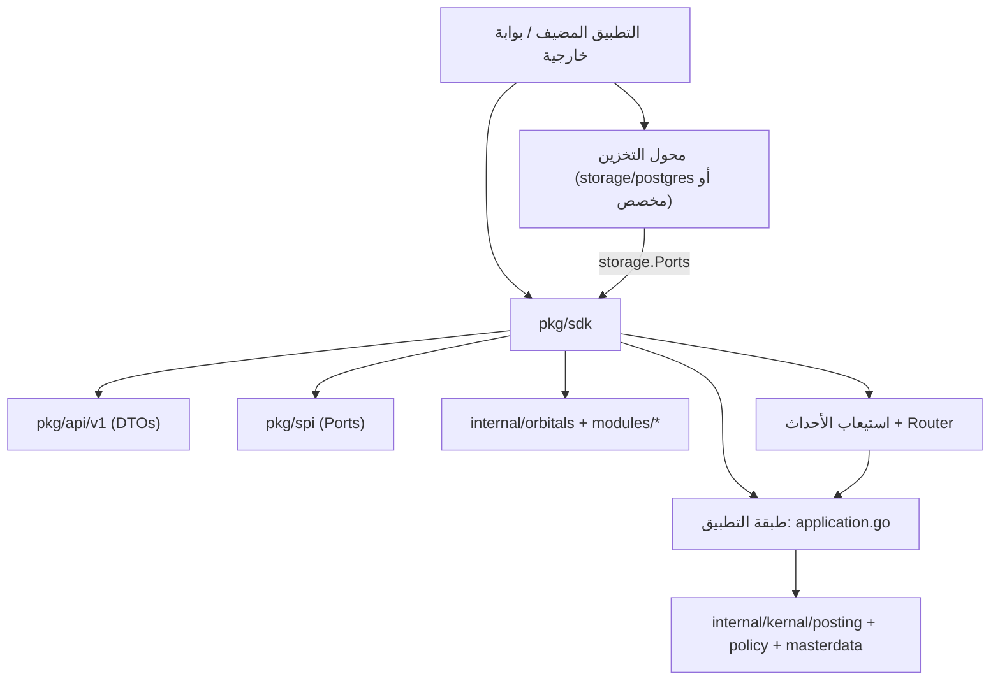
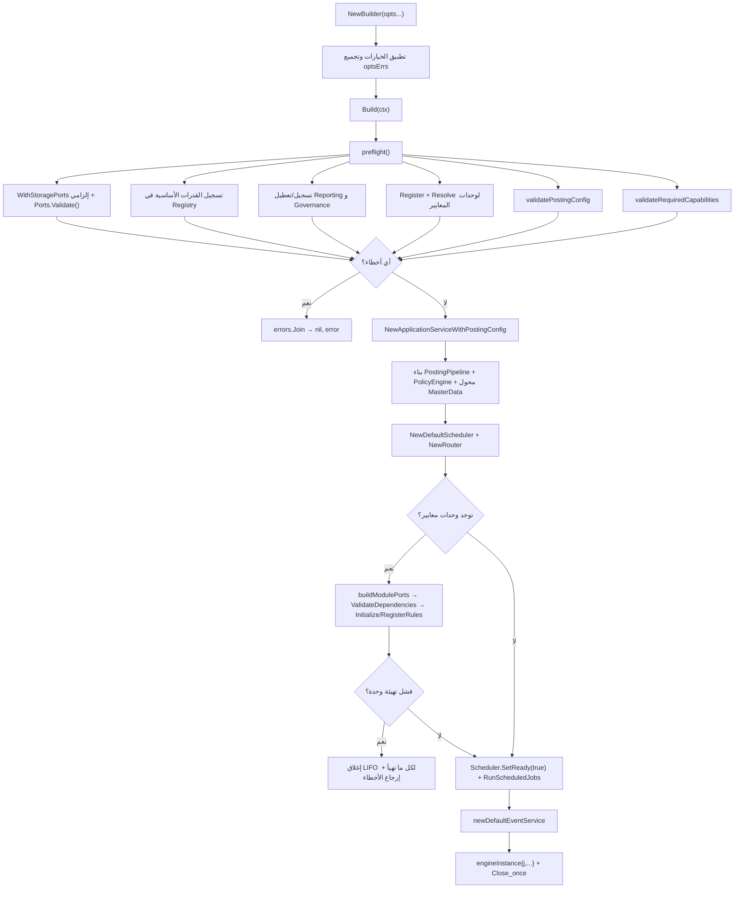
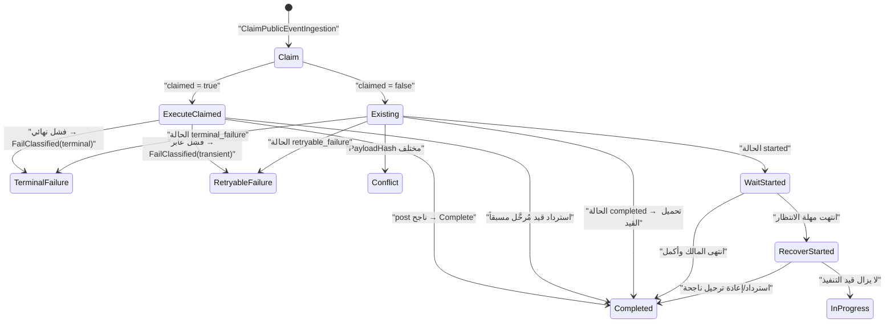

# دليل حزمة `pkg/sdk`: ما هي، دورها، آلية عملها، هيكليتها، وتفاصيلها الداخلية

> **نوع الوثيقة:** توثيق معماري وتشغلي للحزمة `pkg/sdk` (نقطة الدخول العامة للمحرك القابل للتضمين).
> **المرجعية:** مبني على القراءة المباشرة لشفرة المصدر في هذه المستودع (ملفات `pkg/sdk/*`، `pkg/sdk/templates/*`، `internal/orbitals/sdkapplication/*`) وعلى `ARCHITECTURAL_PRINCIPLES_CHARTER.md` و`NEW_PROJECT_STRUCTURE.md` واختبارات المستهلك الخارجي.
> **آخر تحديث:** 2026-11-21.
> **اصطلاح:** تُكتب أسماء الحزم والأنواع والدوال كما هي في Go بين backticks؛ الشرح بالعربية.

---

## 0. فهرس سريع

| القسم | الموضوع |
| --- | --- |
| [1](#1-الخلاصة-التنفيذية) | الخلاصة التنفيذية |
| [2](#2-التعريف-الرسمي-ما-هي-الـ-sdk-وماذا-تعمل) | التعريف الرسمي: ما هي الـ SDK وماذا تعمل؟ |
| [3](#3-الموقع-المعماري-وحدود-الاستيراد) | الموقع المعماري وحدود الاستيراد |
| [4](#4-خريطة-الملفات) | خريطة الملفات ووظيفة كل ملف |
| [5](#5-دورة-حياة-البناء-من-newbuilder-إلى-engine) | دورة حياة البناء `NewBuilder → Engine` |
| [6](#6-سطح-engine-والخدمات-الست) | سطح `Engine` والخدمات |
| [7](#7-طبقة-التطبيق-applicationgo) | طبقة التطبيق `application.go` |
| [8](#8-استيعاب-الأحداث-event_ingestiongo) | استيعاب الأحداث `event_ingestion.go` |
| [9](#9-الخيارات-options-والقدرات-القلاعية-bootstrap-capabilities) | الخيارات والقدرات القلاعية |
| [10](#10-الحزمة-الفرعية-sdktemplates) | الحزمة الفرعية `sdk/templates` |
| [11](#11-مرجع-الأخطاء) | مرجع الأخطاء |
| [12](#12-أمثلة-استخدام-عملية) | أمثلة استخدام عملية |
| [13](#13-الاختبارات-وماذا-تثبت) | الاختبارات وماذا تثبت |
| [14](#14-الحالة-الراهنة-والفجوات-الموثقة) | الحالة الراهنة والفجوات الموثقة |
| [15](#15-قواعد-الصيانة-والتطوير) | قواعد الصيانة والتطوير |
| [16](#16-المراجع) | المراجع |

---

## 1. الخلاصة التنفيذية

`pkg/sdk` هي **الواجهة العامة الوحيدة** التي يستخدمها النظام المضيف (Host Application) للتحدث مع المحرك المحاسبي. هي:

- **مكتبة Go مضمنة (In-Process Library):** لا خادم HTTP، ولا gRPC، ولا منافذ شبكية، ولا بروتوكولات نقل داخلها. كل شيء يتم باستدعاء دوال Go مباشرة داخل عملية التطبيق المضيف.
- **منشئ مركزي (Builder):** تجمع الاعتماديات عبر `sdk.NewBuilder(opts...).Build(ctx)`، ولا يوجد مسار بناء بديل.
- **واجهة تعتمد على المنافذ (Ports):** لا تأخذ خياراً يُسمى `WithPostgres` أو `WithMemory`؛ بل تأخذ `storage.Ports` مجردة يوفّرها محوّل التخزين (Adapter) الذي يختاره المضيف.
- **سطح خدمات مقسّم:** `Ledger()`، `Reporting()`، `Governance()`، `Events()`، `Standards()`، `Scheduler()`، و`Close()`.
- **نظام قدرات صريح (Explicit Opt-in):** التقارير، الحوكمة، المعايير الدولية، الأحداث، والدفاتر المساعدة لا تُفعّل صامتة؛ إما تُقدَّم بشكل صريح أو تُعيد `ErrCapabilityNotImplemented` صراحة.
- **حارسة للثوابت المحاسبية:** تمنع المرور إلى طبقة التطبيق إذا كانت القيود غير مكتملة، وتتحقق من القدرات المطلوبة قبل بناء المحرك (Fail-fast).
- **طبقة تكييف بين عالمين:** تحوّل أنواع `pkg/api/v1` العامة إلى أنواع `internal/kernal`، وتمرّر الأوامر إلى `pkg/spi/application.Service` ثم إلى `internal/kernal/posting`.

الحجم الحالي: **18 ملف Go داخل `pkg/sdk` + 1 ملف توثيق في `internal/orbitals/sdkapplication`**، بإجمالي ~3,827 سطراً شاملاً للاختبارات.

---

## 2. التعريف الرسمي: ما هي الـ SDK وماذا تعمل؟

تُعرّف `pkg/sdk/doc.go` الحزمة هكذا:

> `Package sdk: Unified embeddable entry point (Engine, Builder, options, event ingestion).`

أي أنها **نقطة الدخول الموحّدة القابلة للتضمين**، وتتحمل أربع مسؤوليات كبرى:

1. **التركيب (Composition):** تجميع النواة المحاسبية `internal/kernal/posting`، وطبقة التطبيق، والمكونات المدارية `internal/orbitals`، ومodules المعايير `modules/*` داخل كائن `Engine` واحد.
2. **التجريد (Facade):** إخفاء التعقيد الداخلي خلف واجهات صغيرة (`LedgerService`، `EventIngestionService`، …).
3. **الحراسة (Guard):** التحقق من اكتمال المنافذ، وصحة القدرات، ووجود هوية موثّقة (Principal) عند تركيب Authorizer، ورفض القيود غير الصالحة قبل الترحيل.
4. **الاستيعاب (Ingestion):** تحويل الأحداث الاقتصادية (`events.AccountingEvent`) إلى قيود يومية (`journal.JournalEntry`) وترحيلها مع ديمومة منع التكرار (Idempotency) واسترداد بعد الأعطال.

**ما لا تفعله الـ SDK:** لا تُعرّف قواعد محاسبية جديدة، لا تُعيد تنفيذ التحقق من التوازن (تستدعي `posting.PostingPipeline`)، لا تتحدث مع قاعدة بيانات مباشرة، لا تُدير هو المستخدمين أو JWT، لا تُعرّف مسارات REST/gRPC.

---

## 3. الموقع المعماري وحدود الاستيراد

### 3.1 قاعدة الاستيراد (Import Charter)

النص الحرفي في `pkg/sdk/doc.go`:

```go
// Import charter: May import pkg/api/v1/*, pkg/spi/*, internal/kernal/* and internal/orbitals/*; never storage/* directly.
```

| الحزمة | مسموح لـ `pkg/sdk`؟ | الغرض |
| --- | --- | --- |
| `pkg/api/v1/*` | ✅ | أنواع البيانات العامة (DTOs): `journal`، `events`، `reporting`، `types` |
| `pkg/spi/*` | ✅ | عقود المنافذ: `storage.Ports`، `application.Service`، `standards.*`، `events.*`، `subledger.*` |
| `internal/kernal/*` | ✅ | النواة: `posting`، `policy`، `journal`، `masterdata`، `types` (داخل الحزمة فقط، لا تُعرَض في التوقيعات العامة) |
| `internal/orbitals/*` | ✅ | المكونات المدارية (يُستخدم الآن عبر `sdkapplication` كمساحة محجوزة) |
| `storage/*` | ❌ | محظور قطعاً؛ المضيف هو من يمرّر `Ports` الجاهزة |
| `cmd/*`, بوابات الشبكة | ❌ | غير موجودة أصلاً في هذا المستودع |

**القاعدة الذهبية للمستهلك:** يستطيع التطبيق الخارجي استيراد `pkg/sdk` و`pkg/api/v1` و`pkg/spi` فقط. يثبت ذلك `test/external_consumer/doc.go`:

```go
// Black-box consumer proving that pkg/sdk alone is sufficient for embedding.
// Import charter: Must never import internal/* or storage/*.
```

> ملاحظة: ملف `test/external_consumer/consumer_test.go` يستورد `storage/memory` لأنه اختبار داخل نفس المستودع يوفّر منافذ وهمية؛ أما قاعدة "لا internal / لا storage" فتُفرَض على **كود المستهلك الحقيقي**، وتتحقق منها اختبارات تحليل AST داخل نفس الملف.

### 3.2 مخطط التبعيات



---

## 4. خريطة الملفات

```text
pkg/sdk/
├── doc.go                       # تعريف الحزمة + ميثاق الاستيراد
├── engine.go                    # واجهة Engine والخدمات + ملحق القدرات الاختيارية
├── builder.go                   # EngineBuilder وBuild ودورة الحياة والخدمات الافتراضية
├── options.go                   # كل خيارات WithXXX
├── posting_config.go            # إعلان ضوابط الترحيل المطلوبة والتحقق منها
├── bootstrap_capabilities.go    # القدرات القلاعية المطلوبة (Fail-fast)
├── module_ports.go              # تحويل Ports إلى standards.ModulePorts
├── application.go               # طبقة التطبيق: أوامر/استعلامات + PostingPipeline
├── event_ingestion.go           # استيعاب الأحداث + idempotency + recovery (أكبر ملف)
├── cash_flow.go                 # ملحق GetCashFlow على خدمة التقارير
├── errors.go                    # أخطاء عامة موحّدة
├── templates/
│   ├── doc.go
│   ├── adapters.go              # محولات قطاعية: retail / agriculture / SaaS
│   └── adapters_test.go
├── application_test.go
├── builder_test.go
├── consumer_contract_test.go
└── event_ingestion_test.go

internal/orbitals/sdkapplication/
└── doc.go                       # حزمة محجوزة لمحولات الاستخدام القابلة لإعادة الاستخدام (لا يوجد كود بعد)
```

### جدول المسؤوليات التفصيلية

| الملف | الأسطر تقريباً | المسؤولية الدقيقة |
| --- | ---: | --- |
| `doc.go` | 7 | تعريف الحزمة وميثاق الاستيراد والمرجعية (`AE-PLAN-STEP-P0/P0-02`) |
| `engine.go` | 82 | تعريف `Engine` و`StandardsService` و`LedgerService` و`ReportingService` و`GovernanceService` و`EventIngestionService`، ودالتَي الوصول الاختياريتين `YearEndClosing` / `SubledgerARAP` |
| `builder.go` | 560 | `EngineBuilder`، `NewBuilder`، `Build`، `preflight`، دورة حياة الوحدات، `engineInstance` وكل تطبيقات الخدمات الافتراضية/المعطلة |
| `options.go` | 130 | 9 خيارات `Option` مع تحقق من الـ nil ونوعه |
| `posting_config.go` | 63 | `PostingConfig` + `validatePostingConfig` + كشف القيم nil المُغلَّفة (typed-nil) |
| `bootstrap_capabilities.go` | 140 | 6 قدرات قلاعية + رسائل خطأ قابلة للتنفيذ |
| `module_ports.go` | 31 | بناء `standards.ModulePorts` من `storage.Ports` + `useCases` |
| `application.go` | 622 | مُنشئات خدمة التطبيق، محوّل master data، `PostingPipeline`، `Authorize`، الأوامر الخمسة، السياسات الافتراضية، تصنيف الأخطاء |
| `event_ingestion.go` | 895 | بصمة الحدث، بناء القيد، اختيار القاعدة، آلة حالات idempotency، الاسترداد، تصنيف الفشل، سياق الطلب |
| `cash_flow.go` | 24 | `GetCashFlow` عبر تحقق من واجهة اختيارية على `ReportingStore` |
| `errors.go` | 31 | أخطاء `ErrIdempotency*` و`ErrEvent*` وأخطاء المنشئ |
| `templates/adapters.go` | 249 | ثلاثة محولات قطاعية تنفّذ `standards.StandardModule` |
| الاختبارات | ~787 | تغطية العقد الخارجي، البناء، الترخيص، idempotency، البصمة، المحولات |

---

## 5. دورة حياة البناء: من `NewBuilder` إلى `Engine`



### 5.1 `NewBuilder` (`builder.go:50`)

- يهيّئ زمن الانتظار الافتراضي لمنع تكرار الأحداث:
  - `defaultEventIdempotencyWaitTimeout = 2s`
  - `defaultEventIdempotencyWaitInterval = 25ms`
- يمرّ على الخيارات بالترتيب:
  - خيار `nil` يُسجَّل كـ `ErrBuilderOptionNil` ولا يُوقف البناء فوراً.
  - خطأ الخيار يُخزَّن في `b.optsErrs`، ويُعاد لاحقاً عبر `errors.Join` في `Build`.
  - هذا يسمح بإظهار **كل** أخطاء التهيئة دفعة واحدة.

### 5.2 `preflight()` (`builder.go:143`)

| الخطوة | التفاصيل |
| --- | --- |
| المنافذ | `WithStoragePorts` إلزامي وإلا `ErrStoragePortsRequired`. ثم `ports.Validate()` يتطلب 5 منافذ: `Drafts`، `Entries`، `Posting`، `Sequences`، `MasterData`. الباقي اختياري: `Balance`، `Audit`، `Idempotency`، `TxRunner`، `UOWRunner`، `Events`، `Private`. |
| السجل | يُنشأ `standards.NewRegistry()` إذا لم يوجد، ثم يُسجَّل `CapLedgerPosting` و`CapMasterData` باسم المزوّد `engine_core`. |
| التقارير | تُسجَّل `CapReporting` إذا وُجد `WithReporting` **أو** توفرت `Balance + MasterData + Entries`؛ وإلا يُسجَّل سبب التعطيل `reporting data sources missing`. |
| الحوكمة | تُسجَّل `CapGovernance` و`CapAuditTrail` إذا وُجد `WithGovernance` أو منفذ `Audit`؛ وإلا سبب التعطيل `governance required stores missing`. |
| المعايير | كل `StandardModule` يُسجَّل في `Registry` ثم `Resolve()` يرتبها طوبولوجياً حسب `Dependencies()`، وتُستبدل `b.standards` بالقائمة المرتّبة. |
| ضوابط الترحيل | `validatePostingConfig()` (انظر القسم 9.2). |
| القدرات القلاعية | `validateRequiredCapabilities()` (انظر القسم 9.3). |

### 5.3 التهيئة الفعلية (`builder.go:68`)

1. **`NewApplicationServiceWithPostingConfig(b.ports, b.postingConfig, b.authorizer)`**
   - يعيد التحقق من `ports.Validate()` ثم يستدعي `newApplication`.
2. **`newApplication` (`application.go:154`)**
   - ينشئ `policy.NewPolicyEngine()`.
   - يلفّ `ports.MasterData` داخل `masterDataReaderAdapter` لتحويل النوع العام إلى `kernalmasterdata`.
   - ينشئ `posting.NewPostingPipeline(mdAdapter, app.executePosting, posting.WithPolicyEngine(...), posting.WithReversalExecutor(app.executeReversalPosting))`.
3. **جدولة وأحداث**
   - `standards.NewDefaultScheduler()` و`events.NewRouter()`.
4. **وحدات المعايير (فقط إذا وُجدت)**
   - `b.buildModulePorts(publicMasterData)` يبني `standards.NewModulePorts(entries, balance, md, b.useCases)`. لاحظ أن `useCases` يُمرَّر دائماً، بينما قراءات `Entries/Balance/MasterData` تُمرَّر فقط إن وُجدت في `Ports`.
   - `validateStandardModules()` يستدعي `mod.ValidateDependencies(b.modulePorts)`.
   - `initializeStandards()` يستدعي `Initialize` ثم `RegisterRules(router)` لكل وحدة. عند أي فشل يُنفَّذ **rollback بترتيب عكسي (LIFO)** عبر `mod.Close(ctx)` لكل وحدة نجحت، وتُجمع الأخطاء.
   - `scheduler.SetReady(true)` ثم `mod.RunScheduledJobs(ctx, scheduler)` لكل وحدة. **فشل الوظائف المجدولة لا يُفشل البناء**؛ يُسجَّل فقط كـ disabled reason بصيغة `module:<name>:jobs`.
5. **خدمة الأحداث**
   - `newDefaultEventService(b.ports.Events.Idempotency, b.ports.Events.Mappings, eventRouter, publicMasterData, b.useCases, b.authorizer != nil, waitTimeout, waitInterval)`.
   - Logical AND مهم: وجود `Authorizer` يجعل `requirePrincipal = true` في كل من خدمة الأحداث وخدمة القيود.
6. **`engineInstance`** يُجمَّع مع كل المراجع، ويُكتشف `yearEndClosing` عبر تحقق نوعي من `useCases`.

---

## 6. سطح `Engine` والخدمات الست

### 6.1 الواجهة (`engine.go:18`)

```go
type Engine interface {
    Ledger() LedgerService
    Reporting() ReportingService
    Governance() GovernanceService
    Events() EventIngestionService
    Standards() StandardsService
    Scheduler() standards.SchedulerPort
    Close() error
    CloseWithContext(ctx context.Context) error
}
```

| الخدمة | التوقيع | التنفيذ عند توفر القدرة | التنفيذ عند غيابها |
| --- | --- | --- | --- |
| `Ledger()` | `PostEntry` / `GetEntry` / `ReverseEntry` | `defaultLedgerService{useCases, requirePrincipal}` | دائماً متاحة لأن `useCases` إلزامي |
| `Reporting()` | 6 دوال تقارير | `defaultReportingService{store}` | `disabledReportingService` → `ErrCapabilityNotImplemented` |
| `Governance()` | `RecordAuditLog` / `GetApprovalFingerprint` | `defaultGovernanceService{store}` | `disabledGovernanceService` → نفس الخطأ |
| `Events()` | `ProcessEvent` | `defaultEventService` | متاحة دائماً، لكنها ترفض مفاتيح idempotency إذا لم تُوفَّر المخازن |
| `Standards()` | `Registry` / `Diagnostics` / `HasCapability` / `Scheduler` | `defaultStandardsService` | دائماً متاحة |
| `Scheduler()` | `standards.SchedulerPort` | نفس مجدول `Standards()` | دائماً متاحة |

### 6.2 `LedgerService` — مسار الترحيل (`builder.go:359`)

**`PostEntry(ctx, entry)`:**

1. `validatePostingEntry(entry)` يمنع المرور إذا: CompanyID صفرية، JournalID صفرية، عدد الأسطر < 2، أو لا يوجد تاريخ effective/posting. الخطأ من نوع `publicapplication.ErrValidation`.
2. `commandContext(ctx, companyID, "sdk", "sdk", requirePrincipal)` يبني سياق الأمر:
   - يقرأ `Principal` من `ctx` إن وُجد.
   - إن لم يوجد وتم تركيب `Authorizer` → يبقى فارغاً فيُرفض بـ `ErrUnauthorized` داخل `applicationService.authorize`.
   - إن لم يوجد ولم يوجد Authorizer → يُنشأ principal احتياطي `{ActorID: "sdk", CompanyIDs: [companyID]}`.
   - يقرأ `RequestMetadata` من السياق: `CorrelationID` و`IdempotencyKey` و`SourceSystem` (افتراض `"sdk"`).
3. يحول القيد إلى `CreateDraftCommand` ويستدعي `CreateDraftWithID` إن كان القيد يحمل ID وخدمة التطبيق تنفّذ `DeterministicDraftCreator`، وإلا `CreateDraft`.
4. يستدعي `Post(ctx, PostEntryCommand{EntryID: draftResult.Entry.ID})` ويعيد القيد المرحَّل.

**`ReverseEntry`:** يبني `ReverseEntryCommand` بـ `Reason` و`EffectiveDate = time.Now().UTC()` ثم يستدعي `useCases.Reverse` (الذي يستدعي بدوره `posting.BuildReversalEntry`).

> ملاحظة أمنية: `CreatedBy` القادم من حمولة القيد **لا يُوثَق به**؛ سياق الطلب (`ctx`) هو من يحدد `Principal` الفعلي (انظر اختبار `TestLedgerPostUsesVerifiedPrincipalAndRequestMetadata`).

### 6.3 `ReportingService` (`builder.go:478` + `cash_flow.go`)

| الدالة | السلوك |
| --- | --- |
| `GetTrialBalance`, `GetBalanceSheet`, `GetIncomeStatement`, `GetGeneralLedger` | تفويض مباشر إلى `storage.ReportingStore` |
| `GetCashFlow` | ملف منفصل `cash_flow.go`: ينجح فقط إذا كان `ReportingStore` ينفّذ واجهة إضافية تحمل نفس التوقيع؛ وإلا `ErrCapabilityNotImplemented` |
| `GetDisclosures` | في كلا التنفيذين (المفعّل والمعطّل) يُعيد `ErrCapabilityNotImplemented` دائماً في هذه النسخة |

### 6.4 `GovernanceService` (`builder.go:535`)

يفوّض `RecordAuditLog` و`GetApprovalFingerprint` إلى `storage.GovernanceStore`. اختبار `TestBuilder_OptionalCapabilitiesFailExplicitly` يضمن أن غياب القدرة يعطي خطأ صريحاً وليس صمتاً.

### 6.5 `StandardsService` والقدرات الاختيارية

- `Diagnostics()` يُعيد `standards.EngineDiagnostics`: الوحدات النشطة، القدرات الفعّالة، مزوّد كل قدرة، ترتيب التبعية، وأسباب التعطيل.
- `YearEndClosing(engine)` و`SubledgerARAP(engine)` في `engine.go:60` يستخدمان **type assertion على واجهة مجهولة (duck typing)**:

  ```go
  provider, ok := engine.(interface{ YearEndClosing() publicapplication.YearEndClosingService })
  ```

  إن لم يُنفّذ المحرك هذه الدالة أو أعاد `nil` → `ErrCapabilityNotImplemented`. (راجع القسم 14 بخصوص الحالة الراهنة).

### 6.6 الإغلاق (`builder.go:304`)

- `Close()` يستدعي `CloseWithContext(context.Background())`.
- `sync.Once` يضمن إغلاقاً واحداً فقط.
- يُغلق كل وحدة بترتيب عكسي، وتُجمع الأخطاء بـ `errors.Join`.
- إذا كان `ctx` ملغىً أصلاً يُضاف خطأ السياق إلى النتيجة.

---

## 7. طبقة التطبيق (`application.go`)

هذه الطبقة هي **القناة الإلزامية الوحيدة** إلى النواة؛ لا يوجد أي مسار مباشر من SDK إلى `CommitPosting` عداها.

### 7.1 المُنشئات والواجهات المُعلَنة

| الدالة | السلوك |
| --- | --- |
| `NewApplicationService(ports)` | يستدعي `WithAuthorizer(nil)` ثم `WithPostingConfig(PostingConfig{}, nil)` |
| `NewApplicationServiceWithAuthorizer(ports, authorizer)` | كما سبق مع Authorizer |
| `NewApplicationServiceWithPostingConfig(ports, config, authorizer)` | `ports.Validate()` ثم `newApplication` |

`applicationService` يُعلن التزامه بـ 4 واجهات:

```go
var _ publicapplication.Service = (*applicationService)(nil)
var _ publicapplication.TransactionalService = (*applicationService)(nil)
var _ publicapplication.IdempotentPostingLookup = (*applicationService)(nil)
var _ publicapplication.DeterministicDraftCreator = (*applicationService)(nil)
```

### 7.2 `masterDataReaderAdapter` — جسر الأنواع

يحوّل `publicmasterdata.Company` إلى `kernalmasterdata.Company`، و`publicmasterdata.Journal` إلى `kernalmasterdata.Journal` (بـ `EffectiveFrom = 2000-01-01`)، ويمرّر الحسابات والفترات كما هي.

استراتيجيات خاصة:

| الدالة | الاستراتيجية |
| --- | --- |
| `GetJournalByID` | يجرب أولاً منفذاً خاصاً يُعيد نوع kernal، ثم منفذاً يُعيد النوع العام، ثم `GetJournalByCode("GENERAL")` إذا طابق الـ ID، وإلا يُعيد مجلة تركيبية باسم `GENERAL` و`tarikh 2000-01-01` دون خطأ. |
| `GetPeriodByNumber` | يتطلب منفذاً خاصاً؛ وإلا يعطي `errors.New("adjustment periods not supported")`. |

### 7.3 `executePosting` و`executeReversalPosting` (`application.go:176`)

1. `ports.Sequences.NextSequence(ctx, companyID, journalID)` → تحديد `SequenceNumber`، و`EntryNumber` إن كان فارغاً.
2. بناء `storage.PostingCommit`:
   - `Operation: storage.OperationPost` أو `storage.OperationReverse`.
   - `OriginalEntryID` يُرسل فقط في حالة العكس.
   - `ActorID` / `Reason` / `CorrelationID` من `PostOptions`.
3. `ports.Posting.CommitPosting(ctx, commit)` — الذرية مسؤولية المحوّل.
4. إلحاق سجل تدقيق عبر `ports.Audit.AppendAudit` إن وُجد. بعد المرحلة 11 يُلحق Adapter سجل التدقيق ذرياً في نفس معاملة القيد؛ إلحاق SDK منفصل كان قد يترك دليلاً غير متوازن.

### 7.4 `ensurePolicies` (`application.go:260`)

عند غياب السياسات عن `PolicyEngine`، تُشتق سياسات افتراضية من بيانات الشركة:

| السياسة | القيم الافتراضية |
| --- | --- |
| `CurrencyPolicy` | `FunctionalCurrency` و`PresentationCurrency` من الشركة، `RoundingBankers`، عملات مسموح بهما فقط، `AutoSettleRoundingDifferences = false`، سريان من 2000-01-01 |
| `PostingPolicy` | سياسة فارغة للشركة، سريان من 2000-01-01 |

هذا المسار **للتوافق فقط** عندما لا يوفّر المضيف مخزن سياسات، أو عندما يكون المخزن موجوداً بصفر نسخة لهذه الشركة (أي أنها لم تشترك بعد في السياسات المؤرخة). أخطاء `SetCurrencyPolicy` / `SetPolicy` **تُعاد ولا تُبتلع** بعد المرحلة 11 (`G-021`). بمجرد إلحاق أول نسخة يصبح المخزن مصدر الحقيقة ولا يعود المسار القدامي متاحاً.

عند وجود `ports.Private[storage.PolicyStoreExtensionKey]` (`G-020`) تُحمَّل كل نسخ الشركة مرة واحدة (`loadVersionedPolicies`) وتُسجَّل بنوافذها الأصلية؛ لا تُشتق سياسة اصطناعية، والغياب عن تاريخ القيد يُفشل مغلقاً (`ensureVersionedPoliciesIsEffective`). تعارض الإصدارات يُترجم إلى `ErrConflict` وغياب النسخة إلى `ErrNotFound`. التفاصيل في [ADR P11-04](./ard/P11_04_versioned_policy_store.md).

### 7.4.1 منافذ master data الاختيارية (المرحلة 11، `G-019`/`G-022`)

يربط SDK قارئ النسخة النافذة ومراكز التكلفة والأبعاد التحليلية انتقائياً إن وفّرها المحول عبر `Ports.Private`. غيابها يُبقي النواة في وضع الفشل المغلق؛ لا تُوسَّع `storage.Ports` المستقرة، ولا تظهر أنواع `internal/kernal` في التوقيعات العامة.

### 7.5 `authorize` (`application.go:290`)

ترتيب الفحوص:

1. إذا وُجد Authorizer → `ActorID` لا يمكن أن يكون فارغاً → `ErrUnauthorized`.
2. `CompanyID` صفرية → `ErrValidation`.
3. إذا كان Principal يملك قائمة شركات → يجب أن تكون الشركة ضمنها → `ErrForbidden`.
4. استدعاء `authorizer.Authorize(ctx, AuthorizationRequest{...})` → أي خطأ يُغلَّف `ErrForbidden`.

### 7.6 الأوامر الخمسة

| الأمر | أهم التفاصيل |
| --- | --- |
| `CreateDraft` / `CreateDraftWithID` | ID تلقائي إن لم يُعطَ؛ تاريخ effective ← now، posting ← effective؛ مجلة افتراضية عبر بحث `GENERAL` ثم `RETAIL, AGRICULTURE, SAAS, DEFAULT`؛ توليد ID لكل سطر؛ تصنيف افتراضي `EntryClassRegular`؛ تحليل `ExchangeRate` بـ decimal؛ حفظ عبر `Drafts.SaveDraft`. |
| `Validate` | يتطلب حالة `draft`، يضمن السياسات، ثم `posting.ValidateEntryDoubleEntry`. |
| `Post` | `Idempotency.Claim` (من `storage.Ports`) → إذا كانت الحالة `completed` فيُعاد القيد مع `IdempotentReplay: true`، وإلا `ErrIdempotencyInProgress`؛ ثم `pipeline.PostEntry`؛ عند الفشل يُعلَّم المفتاح `terminal_failure`، وعند النجاح `Complete`. |
| `Reverse` | `posting.BuildReversalEntry` ثم نفس الـ pipeline مع `Reason` و`PostOptions`. |
| `GetEntry` | تفويض إلى `Entries.GetEntry` بعد التفويض. |

أخيراً `classifyError` يحوّل أخطاء النواة/MasterData إلى تصنيف `publicapplication` (`ErrNotFound`، `ErrValidation`) ويمرّر ما سبق تصنيفه كما هو.

---

## 8. استيعاب الأحداث (`event_ingestion.go`)

هذا هو أكبر وأدق ملف في SDK: **895 سطراً**، ويتضمن آلة حالات كاملة لمنع التكرار والتعافي.

### 8.1 الأنواع العامة المستعارة

```go
type PublicEventIngestion = publicevents.Ingestion
type PublicEventAccountMapping = publicevents.AccountMapping
type PublicEventIdempotencyStore = publicevents.IdempotencyStore
type PublicEventScopedIdempotencyStore = publicevents.ScopedIdempotencyStore
type PublicEventMappingStore = publicevents.MappingStore
```

ولا تُعرَّف أنواع تخزين جديدة؛ كل شيء يعود إلى `pkg/spi/events`.

### 8.2 بصمة الحدث (`publicEventFingerprint`, السطر 42)

- تُحسب `SHA-256` لـ JSON حتمي يضم: `hash_version = "v1"`، `EventType`، `EventID`، `CompanyID`، `LedgerID` (بعد trim)، `EffectiveDate` (بصيغة UTC)، `Amount`، `Dimensions`، `Payload`، `JournalDraft`، و`PostingRule` كاملة.
- الهدف: اكتشاف إعادة استخدام نفس مفتاح idempotency **بحمولة مختلفة** → `ErrIdempotencyKeyConflict`.
- الحقول غير القابلة للتسلسل (مثل `chan`) تُرفض بخطأ.
- `encoding/json` يرتب مفاتيح الخرائط، لذا البصمة حتمية عبر الطلبات.

### 8.3 `ProcessEvent`: التحقق الأولي (السطر 131)

| الشرط | الخطأ |
| --- | --- |
| `useCases == nil` | `ErrDependencyUnavailable` مغلّفاً بـ `ErrCapabilityNotImplemented` |
| `EventType` فارغ / `CompanyID` صفرية / `EventID` فارغ | `ErrValidation` |
| لا `JournalDraft` و المبلغ سالب أو صفر | `ErrValidation` |
| `Dimensions` غير فارغة | `ErrEventDimensionsUnsupported` (غير مدعوم حالياً) |
| `JournalDraft` + `Payload` معاً | `ErrEventPayloadUnsupported` |
| لا تاريخ سريان (EffectiveDate) ولا تاريخ ترحيل في المسودة | `ErrValidation` |

### 8.4 سياق الطلب (`eventCommandContext`, السطر 837)

أولويات دقيقة:

| الحقل | الأولوية |
| --- | --- |
| `Principal` | من `ctx`؛ إن غاب ولم يكن Authorizer مركّباً → `{ActorID:"event-ingestion", CompanyIDs:[event.CompanyID]}`؛ إن كان مطلوباً → يبقى فارغاً (لا هوية مُخترَعة) |
| `CorrelationID` | `RequestMetadata` ← `event.CorrelationID` ← `event.EventID` |
| `IdempotencyKey` | `event.IdempotencyKey` ← `RequestMetadata` |
| `SourceSystem` | `RequestMetadata` ← `event.SourceSystem` ← `"event"` |

### 8.5 طريقتان لإدخال القيد

**المسار A — `JournalDraft` جاهز (مفضّل للمحوّلات ذات السياق المحاسبي الكامل):**

- يُنسخ القيد، وتُملأ `CompanyID` من الحدث إن كانت صفرية، ويُرفض أي تعارض في الشركة.
- `SourceModule` ← EventType، `ReferenceID` ← EventID، التواريخ تُكمل بعضها.
- يُرفض أي status غير `draft`.
- `normalizeLedgerEntryIDs` يولّد IDs مفقودة ويُكمل التواريخ والحالة.

**المسار B — قاعدة ربط/تعيين:**

1. `MappingStore.GetPublicEventAccountMapping(companyID, eventType, LedgerID)`، ومحاولة ثانية بـ `LedgerID = ""` إن لم تُوجد نتيجة.
2. إن لم يُوجد → `router.GetRules(eventType)` وأول قاعدة تُستخدم.
3. إن لم يُوجد شيء → `no account mapping/rule registered for event type "<...>"`.
4. `constructEventEntry` يبني قيداً من سطرين (مدين/دائن) بمعدل صرف 1 وصفرية العملة المقابلة.

### 8.6 `constructEventEntry` (السطر 306) — تفاصيل دقيقة

- العملة يجب أن تساوي **العملة الوظيفية للشركة**؛ وإلا `ErrExchangeRateUnavailable` (لا يوجد مصدر FX داخل SDK).
- `resolveDefaultJournalIDForStore`: `JournalCode` من القاعدة أو `GENERAL`؛ إن لم تُوجد مجلة غير `GENERAL` → خطأ؛ إن لم تُوجد `GENERAL` → **تُنشأ تلقائياً** عبر `MasterData.CreateJournal` مع معالجة سباق الازدواج.
- وجود `Payload` يتطلب أن يحتوي `DescriptionTemplate` على النص `.Payload`، وإلا `ErrEventPayloadUnsupported`.
- `resolveRuleAccount`: `GetAccountByCode` أولاً؛ إن فشل والكود UUID صالح → يُستخدم كـ AccountID مباشرة؛ وإلا الخطأ الأصلي.
- `renderEventDescription`: قالب `text/template` مع `missingkey=error`؛ قالب افتراضي `Event: <type> (<id>)`؛ إذا لم يحتوِ القالب على `{{` يُضاف لاحقة `type (id)`؛ النتيجة الفارغة خطأ.
- `CreatedBy = "event:" + EventType`.

### 8.7 آلة حالات idempotency



تفاصيل مهمة:

- **بدون مفتاح idempotency** (`key == ""`): يُرحَّل مباشرة دون أي سجل ديمومة.
- **بمفتاح بدون مخزن**: `ErrIdempotencyStateUnavailable` → `ErrDependencyUnavailable`.
- **مصدر غير افتراضي**: يتطلب أن ينفّذ المخزن `ScopedIdempotencyStore`؛ وإلا خطأ `does not support source-system scoping`. المصدر الافتراضي `"event"` يحافظ على المفتاح الخام للتوافق مع السجلات القديمة.
- **الحالة `started`:** انتظار مقيّد بـ `WithEventIdempotencyWaitPolicy` (افتراضي 2s/25ms) عبر `waitForIngestion`؛ بعد انتهاء المهلة يُحاول `recoverStartedIngestion`.
- **الاسترداد (`recoverPostedEntry`):** يبحث أولاً عن قيد مُرحَّل بالـ `EntryID` المخزَّن؛ إن وُجد يكتفى به ولا يعيد الترحيل. هذا هو جوهر منع الترحيل المزدوج بعد انهيار العملية.
- **تصنيف الفشل (`classifyEventFailure`):** عابر إذا كان `storage.IsRetryable` أو `ErrTransactionAborted` أو `ErrDependencyUnavailable` أو `context.DeadlineExceeded/Canceled` أو `net.Error`؛ وإلا نهائي.
- **ترتيب تفضيل الواجهات:** `ClassifiedIdempotencyStore` ← `ScopedIdempotencyStore` ← الواجهة الأساسية (لـ `failIngestion`)، و`Scoped` ← الأساسية (لـ `get/complete`).
- `postEventEntry` يستدعي `CreateDraft` ثم `Post` بـ **نفس** `requestContext` لضمان بقاء الهوية والارتباط.

---

## 9. الخيارات (`options`) والقدرات القلاعية (Bootstrap Capabilities)

### 9.1 جدول الخيارات (`options.go`)

| الخيار | الأثر | التحقق |
| --- | --- | --- |
| `WithStoragePorts(ports)` | يضبط المنافذ ويجعل `portsConfigured = true` | يُتحقق في `preflight` |
| `WithReporting(store)` | يفعّل خدمة التقارير | store ≠ nil |
| `WithGovernance(store)` | يفعّل خدمة الحوكمة | store ≠ nil |
| `WithAuthorizer(authorizer)` | يفرض Principal موثّقاً ويجعل `requirePrincipal = true` | authorizer ≠ nil |
| `WithPostingConfig(config)` | **يعلن** ضوابط مطلوبة | يُتحقق في Build |
| `WithPostingCapabilities(caps)` | يوفّر القدرات التي تتحقق منها PostingConfig | لا تحقق هنا |
| `WithEventIdempotencyWaitPolicy(timeout, interval)` | يضبط زمن انتظار مالك المفتاح | لا قيمة سالبة |
| `WithStandard(module)` | يضيف وحدة معيار/قطاع | module ≠ nil |
| `WithSubledgerARAP(stores)` | يعلن توفّر مخازن AR/AP | يجب توفّر `Receivables` و`Payables` و`Balance` (كشف typed-nil عبر `reflect`) |
| `WithRequiredCapabilities(caps...)` | يفرض توفر قدرات قبل البناء | أسماء معروفة فقط، إزالة التكرار |

### 9.2 `PostingConfig` (`posting_config.go`)

> تعليق الكود الحرفي: *"Requirements are checked during Build; they are not enabled by setting these flags alone."*

| الحقل | ما الذي يتحقق منه Build |
| --- | --- |
| `RequireApproval` | `postingCaps.ApprovalGate` غير nil |
| `RequireFinancialDimensions` | `postingCaps.FinancialDimensions` غير nil |
| `RequireMakerCheckerPolicy` | `postingCaps.MakerCheckerPolicy` غير nil |
| `RequirePolicy` | وجود `ports.Private["accounting_engine.posting_policy"]` |

`isNilCapability` يستخدم `reflect` لكشف **typed-nil** (مؤشر داخل واجهة)، اختبار `TestBuilderTreatsTypedNilPostingCapabilityAsMissing` يثبت ذلك.

### 9.3 القدرات القلاعية (`bootstrap_capabilities.go`)

المبدأ: `Enabled(capability) ⇒ Available(capability)`. هذه القدرات **مُتطلبات فشل سريع** وليست مفاتيح تفعيل؛ يعني ذلك أنك إن طلبت `BootstrapReporting` ولم تمرّر `WithReporting` أو المنافذ اللازمة، يفشل `Build` برسالة تخبرك بالخيار المطلوب.

| القدرة | شرط التوفر الوارد في الخطأ |
| --- | --- |
| `BootstrapReporting` | `WithReporting` أو `Balance + MasterData + Entries` |
| `BootstrapGovernance` | `WithGovernance` أو منفذ `Audit` |
| `BootstrapStandards` | وجود وحدة واحدة على الأقل عبر `WithStandard` |
| `BootstrapEventIngestion` | `Ports.Events.Idempotency` و`Ports.Events.Mappings` معاً |
| `BootstrapSubledgers` | `WithSubledgerARAP` |
| `BootstrapPostingPolicy` | `Private["accounting_engine.posting_policy"]` أو إحدى قدرات postingCaps |

يتم تجميع كل الأخطاء معاً عبر `errors.Join` في `preflight`.

---

## 10. الحزمة الفرعية `sdk/templates`

توفّر **محولات قطاعية جاهزة الشكل لكنها لا تحتوي على قواعد محاسبية مخفية** — القواعد يقدّمها المستهلك صراحةً.

| المحول | التأثيرات (`Effect`) |
| --- | --- |
| `RetailAdapter` | `sale`، `refund`، `inventory_receipt` |
| `AgricultureAdapter` | `harvest`، `produce_sale`، `livestock` |
| `SaaSAdapter` | `subscription_charge`، `renewal`، `cancellation` |

مدخل موحّد:

```go
type EventInput struct {
    EventID, LedgerID, IdempotencyKey string
    CompanyID types.CompanyID
    EffectiveDate time.Time
    Amount types.Money
}
```

قواعد البناء (`newAdapter`, السطر 173):

- يجب توفّر قاعدة واحدة على الأقل.
- كل تأثير يحتاج `EventType` و`DebitAccountCode` و`CreditAccountCode` (بعد trim).
- منع تكرار `EventType` بين تأثيرات نفس المحول.
- اسم الوحدة = `"sector-" + name`، الإصدار `1.0.0`، لا تبعيات.
- تنفّذ `standards.StandardModule` بالكامل: `ValidateDependencies` و`Initialize` يستدعيان `standards.ValidateStandardModulePorts`، `RegisterRules` يسجّل القواعد، و`RunScheduledJobs` / `Close` لا-op.
- `Event(effect, input)` يتحقق من EventID والشركة والمبلغ الموجب ثم يبني `events.AccountingEvent`.

> **نقطة دقيقة:** قواعد المحول تُسجَّل في `events.Router` عبر `WithStandard`، لكن `ProcessEvent` يستشير **`Events.Mappings` أولاً** ثم Router. لذلك في التطبيقات العملية يجب حفظ التعيين في `MappingStore` (كما يفعل `adapters_test.go`)، وإلا استُخدمت قواعد المحول كحل احتياطي.

---

## 11. مرجع الأخطاء

| الخطأ | المصدر | متى يظهر |
| --- | --- | --- |
| `ErrCapabilityNotImplemented` (= `types.ErrCapabilityNotImplemented`) | `errors.go` | قدرة غير مفعّلة/غير متوفرة |
| `ErrStoragePortsRequired` | `errors.go` | `Build` بدون `WithStoragePorts` |
| `ErrBuilderOptionNil` | `errors.go` | خيار `nil` في `NewBuilder` |
| `ErrIdempotencyKeyConflict` | `errors.go` | نفس المفتاح بحمولة/بصمة مختلفة |
| `ErrIdempotencyInProgress` | `errors.go` | مالك المفتاح لا يزال يعمل |
| `ErrIdempotencyTerminalFailure` | `errors.go` | المفتاح فشل نهائياً سابقاً |
| `ErrIdempotencyStateUnavailable` | `errors.go` | مخزن idempotency غائب/لا يدعم النطاق |
| `ErrEventMappingNotFound` | `errors.go` | لا يوجد ربط لنوع الحدث |
| `ErrExchangeRateUnavailable` | `errors.go` | عملة الحدث ≠ العملة الوظيفية |
| `ErrEventDimensionsUnsupported` | `errors.go` | أبعاد الحدث غير مدعومة حالياً |
| `ErrEventPayloadUnsupported` | `errors.go` | payload بلا قالب يمرّر `.Payload` |
| `ErrIdempotencyRecordNotFound` / `ErrIdempotencyStateConflict` | `pkg/spi/events` | أخطاء مخزن الأحداث |

**تصنيف الأخطاء العام** في `publicapplication`: `ErrUnauthorized`, `ErrForbidden`, `ErrValidation`, `ErrNotFound`, `ErrConflict`, `ErrDependencyUnavailable`. SDK يغلّف أخطاءه دائماً عبر `publicapplication.NewError` أو `wrapEventError` كي يبقى التصنيف موحّداً عبر كل بوابات النقل.

---

## 12. أمثلة استخدام عملية

### 12.1 بناء أدنى + ترحيل قيد

```go
driver := memory.New() // للاختبار فقط؛ في الإنتاج مرّر Ports محول PostgreSQL
engine, err := sdk.NewBuilder(
    sdk.WithStoragePorts(driver.Ports()),
).Build(ctx)
if err != nil { return err }
defer engine.Close()

amount, _ := types.NewMoneyFromString("125.00", "USD")
zero, _ := types.NewMoneyFromString("0", "USD")

posted, err := engine.Ledger().PostEntry(ctx, journal.JournalEntry{
    CompanyID: companyID, JournalID: journalID,
    EffectiveDate: date, PostingDate: date,
    Description: "SDK example",
    Lines: []journal.EntryLine{
        {AccountID: cashID, TransactionAmount: amount, TransactionCurrency: "USD",
         ExchangeRate: decimal.NewFromInt(1), FunctionalDebit: amount, FunctionalCredit: zero},
        {AccountID: revenueID, TransactionAmount: amount, TransactionCurrency: "USD",
         ExchangeRate: decimal.NewFromInt(1), FunctionalDebit: zero, FunctionalCredit: amount},
    },
})
```

### 12.2 حدث بمسودة جاهزة (لا يحتاج ربط حسابات)

```go
entry, err := engine.Events().ProcessEvent(ctx, events.AccountingEvent{
    EventID: "evt-1", EventType: "invoice.created",
    CompanyID: companyID, IdempotencyKey: "inv-1-v1",
    JournalDraft: &journal.JournalEntry{ /* سطران متوازنان */ },
})
```

### 12.3 حدث بربط الحسابات + هوية موثّقة

```go
ctx = publicapplication.WithPrincipal(ctx, publicapplication.Principal{
    ActorID: "host-user", CompanyIDs: []types.CompanyID{companyID},
})
ctx = publicapplication.WithRequestMetadata(ctx, publicapplication.RequestMetadata{
    CorrelationID: "req-42", SourceSystem: "billing-api",
})

entry, err := engine.Events().ProcessEvent(ctx, events.AccountingEvent{
    EventID: "evt-2", EventType: "retail.sale",
    CompanyID: companyID, EffectiveDate: time.Now(),
    Amount: amount, IdempotencyKey: "sale-2-v1",
})
```

### 12.4 اشتراط قدرات قبل الإقلاع

```go
engine, err := sdk.NewBuilder(
    sdk.WithStoragePorts(ports),
    sdk.WithReporting(reportingStore),
    sdk.WithStandard(ifrs15Module),
    sdk.WithRequiredCapabilities(
        sdk.BootstrapReporting,
        sdk.BootstrapStandards,
        sdk.BootstrapEventIngestion,
    ),
).Build(ctx)
// أي قدرة مفقودة => خطأ يحتوي على الخيار المطلوب إضافته.
```

### 12.5 فحص التشخيص والإغلاق

```go
diag := engine.Standards().Diagnostics()
for _, note := range diag.DisabledReasons {
    log.Printf("capability disabled: %s", note)
}
if err := engine.CloseWithContext(ctx); err != nil { log.Print(err) }
```

---

## 13. الاختبارات وماذا تثبت

| الملف | أهم ما يثبت |
| --- | --- |
| `builder_test.go` | `Build` يفشل بدون منافذ؛ النجاح مع `memory.Ports()`؛ دورة حياة الوحدة `ValidateDependencies/Initialize` تسمى مرة واحدة؛ `ModulePorts` تحتوي قراءات وخدمة تطبيق؛ القدرات الغائبة تُعيد `ErrCapabilityNotImplemented`؛ `WithRequiredCapabilities` يفشل سريعاً. |
| `application_test.go` | وجود Authorizer يمنع هوية غير موثّقة ولا يستدعي الـ Authorizer؛ ضوابط الترحيل المطلوبة تُرفض عند غيابها وتُقبل عند توفيرها؛ **typed-nil** يُعدّ غائباً. |
| `event_ingestion_test.go` | البصمة تغيّر مع EventID/Payload/Dimensions/Rule وتثبت مع تكرار نفس المدخل؛ رفض payload غير قابل للتسلسل؛ قالب الوصف يقرأ `.Payload`؛ عملة غير وظيفية مرفوضة؛ سياق الطلب الموثّق يصل إلى أوامر التطبيق دون اختراع Principal. |
| `consumer_contract_test.go` | رحلة كاملة: إنشاء بيانات master → `PostEntry` → `GetEntry` → تطابق لقطة القيد (ID، المبالغ، التواريخ، الحالة). |
| `templates/adapters_test.go` | المحولات القطاعية الثلاثة تستخدم القواعد المقدمة من المستهلك + `MappingStore` + master data لترحيل قيود متوازنة؛ رفض القواعد الفارغة/الناقصة. |
| `test/external_consumer/*` | مستهلك خارجي يبني المحرك ويترحل باستخدام `pkg/sdk` فقط (مع فحص AST لمنع `internal/*` و`storage/*`). |

نتيجة تشغيل `go test ./pkg/sdk/...` في هذه الحالة: **OK**.

---

## 14. الحالة الراهنة والفجوات الموثقة

هذه ملاحظات **قراءة شفرة فعلية**، وليست افتراضات تصميمية؛ تهمّ من يخطط للاعتماد على هذه القدرات:

| # | الملاحظة | الأثر العملي |
| --- | --- | --- |
| 1 | `engineInstance` لا يُعرّف دالة `YearEndClosing()` ولا `SubledgerARAP()` رغم وجود الحقلين `yearEndClosing` و`arapService` | الدالتان `sdk.YearEndClosing(engine)` و`sdk.SubledgerARAP(engine)` تُعيدان `ErrCapabilityNotImplemented` دائماً مع المحرك الخرساني الحالي؛ `arapService` لا يُعيَّن في `Build`. |
| 2 | `optionalYearEndClosingService(b.useCases)` يعتمد على type assertion، و`applicationService` لا تنفّذ `YearEndClosingService` | الحقل `yearEndClosing` يبقى `nil` حتى مع توفر `TxRunner`. |
| 3 | `WithSubledgerARAP` يتحقق من المتاجر ويحفظها لكن لا يبني خدمة AR/AP | `BootstrapSubledgers` قد ينجح بينما لا توجد خدمة فعلية يمكن الوصول إليها عبر `Engine`. |
| 4 | `preflight` يسجّل `CapReporting` عند توفر `Balance+MasterData+Entries`، لكن `Engine.Reporting()` يتحقق من `reportingStore` فقط | قد تُظهر `Diagnostics` قدرة reporting متاحة بينما `Reporting().GetTrialBalance` يُعيد `ErrCapabilityNotImplemented` ما لم يُستدعَ `WithReporting`. |
| 5 | نفس النمط في الحوكمة: منفذ `Audit` يكفي لتسجيل القدرة، بينما `defaultGovernanceService` يُبنى بـ `store = nil` | `RecordAuditLog` قد يُعيد `ErrCapabilityNotImplemented` رغم ظهور القدرة في التشخيص. |
| 6 | `GetDisclosures` في `defaultReportingService` و`disabledReportingService` يعيد دائماً `ErrCapabilityNotImplemented` | لا توجد إفصاحات عبر SDK حالياً رغم وجود أنواع `reporting.DisclosureQuery`. |
| 7 | `FindPostedEntryByIdempotencyKey` يُعيد `false, nil` دائماً | لا يمكن استخدامه لاكتشاف replay خارج مسار `Post` نفسه. |
| 8 | `ProcessEvent` يرفض `Dimensions` تماماً ويتطلب عملة = العملة الوظيفية | لا تحويل FX ولا أبعاد تحليلية عبر هذا المسار حالياً. |
| 9 | فشل `RunScheduledJobs` لا يُفشل `Build` | يُسجَّل كـ disabled reason فقط؛ راقب `Diagnostics().DisabledReasons`. |
| 10 | `internal/orbitals/sdkapplication` يحتوي على `doc.go` فقط | الحزمة محجوزة معمارياً لكنها لا تحتوي محولات استخدام بعد. |
| 11 | أخطاء `AppendAudit` و`setPolicy` (مغلقة جزئياً في المرحلة 11) | `setPolicy` لم يَعُد مُهمَلاً، والتدقيق يُلحق ذرياً في Adapter؛ يبقى تأكيد تغطية كل مسارات الاستيعاب مرتبطاً بتشغيل بوابة العقد الكاملة. |
| 12 | `GetJournalByID` في محول البيانات الوصفية قد يُعيد مجلة `GENERAL` تركيبية | تحقق من وجود المجلات فعلياً في master data قبل الاعتماد على هذا المسار. |

> هذه القائمة يجب مراجعتها عند كل تحديث للمحرك؛ الهدف منها منع الافتراض الخاطئ بأن "التسجيل في Diagnostics" يعني "خدمة قابلة للاستدعاء".

---

## 15. قواعد الصيانة والتطوير

1. **لا تستورد `storage/*` داخل `pkg/sdk`.** مرّر `storage.Ports` فقط.
2. **لا تُعرّض أنواع `internal/kernal/*` في توقيعات عامة.** استخدم `pkg/api/v1` و`pkg/spi` دائماً.
3. **أي قدرة جديدة تحتاج ثلاثة أجزاء:** خيار `WithXXX`، تحقق في `preflight`، وخدمة تُعيد `ErrCapabilityNotImplemented` عند الغياب.
4. **أضف اختباراً خارجياً** في `test/external_consumer` يثبت أن المستهلك لا يحتاج `internal/*` عند استخدام القدرة الجديدة.
5. **حافظ على Fail-fast:** أخطاء التهيئة تُجمع ولا تُبتلع؛ لا تُفعَّل قدرة صامتة.
6. **أي تغيير في `publicEventFingerprint` يحتاج رفع `PublicEventPayloadHashVersion`** وإلا ستُعدّ الحمولات القديمة متعارضة.
7. **احفظ ترتيب الإغلاق العكسي** للوحدات، واستخدم `sync.Once` لأي مورد جديد في `engineInstance`.
8. **لا تضف منطقاً محاسبياً في SDK**؛ ضعه في `internal/kernal` واستدعِه من طبقة التطبيق.

---

## 16. المراجع

- `pkg/sdk/doc.go`, `engine.go`, `builder.go`, `options.go`, `posting_config.go`, `bootstrap_capabilities.go`, `module_ports.go`, `application.go`, `event_ingestion.go`, `cash_flow.go`, `errors.go`
- `pkg/sdk/templates/{doc.go,adapters.go}`
- `internal/orbitals/sdkapplication/doc.go`
- `pkg/spi/storage/ports.go` — عقود التخزين ومجموعة المنافذ الإلزامية
- `pkg/spi/application/application.go` — الأوامر والاستعلامات والتصنيف
- `pkg/spi/events/ingestion.go` — حالات idempotency وواجهات المخازن
- `pkg/spi/standards/{module.go,ports.go,registry.go,diagnostics.go}` — دورة حياة الوحدة
- `pkg/api/v1/events/{event.go,rules.go}` — الحدث وقواعد الربط
- `test/external_consumer/*` — إثبات الاكتفاء بـ `pkg/sdk`
- `docs/ARCHITECTURAL_PRINCIPLES_CHARTER.md` — المبادئ `PRIN-ENG-01..05`
- `docs/NEW_PROJECT_STRUCTURE.md` — قسم "طبقة السطح العام `pkg/`"
