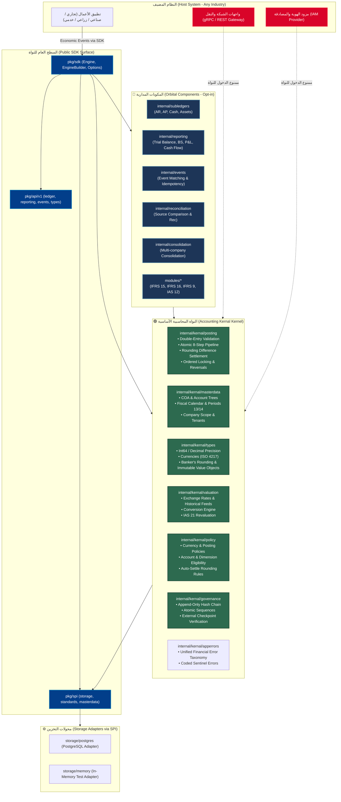

# النواة المحاسبية للرؤية المستهدفة (Target Accounting Kernal Kernel)

> **بيان الرؤية والمعمارية:**  
> تُحدد هذه الوثيقة الهيكل المفاهيمي والحزمي الدقيق لـ **النواة المحاسبية الصرفة (Kernal Accounting Kernel)** في الرؤية المستهدفة لمشروع `accounting_engine`، مع حصر مكوناتها وحزمها الجوهرية وفصلها فصلاً تاماً عن المكونات المدارية، ومحولات التخزين، وطبقات النقل والمصادقة، لتعمل بوصفها **نواة محاسبية موثوقة وعالية الأداء وقابلة للتضمين (Embeddable Kernal Engine)** فقط.
> قواعد الترحيل المحاسبية الملزمة موثقة في [قواعد العمل المحاسبية](./ACCOUNTING_BUSINESS_RULES.md)؛ وتصف هذه الوثيقة الحد المعماري بين مسؤوليات النواة والمضيف.

---

## فهرس المحتويات

1. [الرؤية والهدف المعماري المستهدف](#1-الرؤية-والهدف-المعماري-المستهدف)
2. [الهيكل المعماري للنواة والمكونات المدارية (Kernel & Orbitals)](#2-الهيكل-المعماري-للنواة-والمكونات-المدارية-kernel--orbitals)
3. [المكونات الأساسية للنواة المحاسبية (Kernal Kernel Components)](#3-المكونات-الأساسية-للنواة-المحاسبية-kernal-kernel-components)
4. [المكونات المدارية حول النواة (Orbital Components)](#4-المكونات-المدارية-حول-النواة-orbital-components)
5. [السطح البرمجي العام المجرد (Public Surface)](#5-السطح-البرمجي-العام-المجرد-public-surface)
6. [موانئ التخزين وعقود العزل (Persistence Ports)](#6-موانئ-التخزين-وعقود-العزل-persistence-ports)
7. [ما تم استبعاده وفصله تماماً عن النواة (Decoupled & Out of Kernel)](#7-ما-تم-استبعاده-وفصله-تماماً-عن-النواة-decoupled--out-of-kernel)
8. [مصفوفة الحزم والمسؤوليات (Package Responsibility Matrix)](#8-مصفوفة-الحزم-والمسؤوليات-package-responsibility-matrix)

---

## 1. الرؤية والهدف المعماري المستهدف

### 1.1 ما هي النواة المحاسبية المستهدفة؟

النواة المحاسبية هي **نظام قياس مالي حتمي نقي (Deterministic Financial Measurement Engine)**، مكتوب بلغة Go، يعمل كـ Embedded Library داخل الأنظمة المضيفة. مسؤوليته الحصرية هي:

* استيعاب الأحداث الاقتصادية وتحويلها إلى أثر مالي متوازن.
* فرض قواعد القيد المزدوج، الترحيل الذري، والحرمة المحاسبية.
* إدارة شجرة الحسابات والعملات وتقويم الفترات المالية.
* ضمان صحة الأرصدة وإثبات مسار التدقيق غير القابل للتلاعب.

### 1.2 فلسفة الفصل المعماري

* **النواة في المركز (Kernal at the Center):** تمثل أصغر مجموعة برمجية حتمية لا غنى عنها لتحقيق السلامة المحاسبية.
* **المدارات حول النواة (Orbitals around Kernal):** وظائف وموديلات مالية اختيارية تعتمد على النواة ولا تؤثر على سلامتها.
* **الخارج المطرود (Decoupled Periphery):** حظر كامل لتضمين المصادقة (Auth)، بروتوكولات الشبكة (HTTP/gRPC)، أو العمليات التشغيلية التجارية داخل النواة.

---

## 2. الهيكل المعماري للنواة والمكونات المدارية (Kernel & Orbitals)



---

## 3. المكونات الأساسية للنواة المحاسبية (Kernal Kernel Components)

تتألف النواة المحاسبية الصرفة حصراً من الحزم والمسؤوليات السبع التالية:

### 3.1 محرك الترحيل والقيد المزدوج (`internal/kernal/posting`)

* **قلب النواة الحسابي:**
  * التحقق الرياضي الصارم من توازن القيد المزدوج ومطابقة العملة الوظيفية للشركة وعملات الأسطر.
  * جعل `PostingPipeline.PostEntry` نقطة التحقق الإلزامية: لا يفوض الحفظ إلا بعد التحقق من هوية القيد، والشركة واليومية، والسياسات والعملات والفترة والحسابات والأبعاد.
  * حجز أقفال الصفوف المرتبة تصاعدياً (`SELECT FOR UPDATE by AccountID ASC`) لمنع الـ Deadlocks.
  * تطبيع مبالغ المعاملة والعملة الوظيفية إلى الوحدات النقدية الصغرى قبل ترحيل القيد، وفق سياسة العملة النافذة؛ ولا تُسوّى الفروق إلا عند تفعيل `AutoSettleRoundingDifferences` وضبط حسابها، وإلا يُرفض القيد.
  * فرض سعر صرف يساوي `1` عندما تتطابق عملة المعاملة والعملة الوظيفية، والتحقق من هوية القيد ومعرفات الأسطر وعدم تكرارها.
  * إنشاء القيود العكسية كمسودات، وإعادة تحديد الفترة من تاريخ العكس، ثم تسليمها إلى منفذ عكس ذري مستقل يربطها بالقيد الأصلي ويمنع العكس المكرر.
  * فرض الحرمة المطلقة للقيود المرحلة ومنع التعديل أو الحذف (`Immutability`).

> **حدود المسؤولية:** ضمان الذرية عند الحفظ مسؤولية منفذ الترحيل/العكس الذي يوفره المضيف؛ ويتطلب العكس `WithReversalExecutor` ولا يجوز تمريره إلى منفذ الترحيل الاعتيادي. لا تحتوي النواة على RBAC أو أدوار أو صلاحيات أو تفويض أو موافقات معاملاتية؛ تقع المصادقة والتفويض وإجراءات الموافقة خارجها. تحتفظ النواة بهوية المنشئ والمرحل وسبب العملية كبيانات نسبة وتدقيق فقط، ولا تستخدمها لمنح الإذن.

### 3.2 البيانات المالية الرئيسية (`internal/kernal/masterdata`)

* **هيكل الحسابات والفترات:**
  * إدارة شجرة الحسابات المتدرجة (COA)، والتصنيفات الفرعية، والتاريخ الفعلي (`Effective-Dating`).
  * فحص أهلية الحساب للترحيل وحظر الترحيل على الحسابات التجميعية (Header Accounts).
  * تقويم الفترات المالية (Fiscal Calendar) والفصل الإجرائي الصارم لفترات التسوية 13 و 14 واستبعادها من البحث بالتواريخ (`Contains == false`).
  * التحقق الدفاعي من حدود الفترة والسنة المالية وحالاتهما واتساقهما، والتحقق من أن فترة التسوية تقع على نهاية السنة المالية.
  * فحص أهلية الحساب بحسب تاريخ الترحيل ومتطلبات مركز التكلفة الخاصة بالحساب.
  * إدارة اليوميات وقيود العملات والحسابات المسموحة بها وصلاحيتها الزمنية؛ ويرفض الترحيل اليوميات غير الموجودة أو غير التابعة للشركة أو غير النافذة.
  * لا يتطلب الترحيل في فترة أو سنة `Soft Closed` موافقة؛ لا يقبل إلا إذا أجازت سياسة الترحيل النافذة ذلك.

### 3.3 الأنواع والقيم المالية الدقيقة (`internal/kernal/types`)

* **الأمان الرقمي والدقة:**
  * تمثيل العملات والمبالغ المالية بدقة الأعداد الصحيحة الصغرى أو الحساب العشري الدقيق (`shopspring/decimal`).
  * الحظر البات لاستخدام أرقام الفاصلة العائمة (`float32 / float64`).
  * خوارزمية التقريب المصرفي (`Banker's Rounding / Half to Even`).
  * كائنات القيمة المعرفة بالأنواع الصلبة (Typed Identifiers): `CompanyID`, `AccountID`, `FiscalYearID`, `FiscalPeriodID`, `JournalID`.

### 3.4 التقييم وأسعار الصرف (`internal/kernal/valuation`)

* **التعامل مع العملات المتعددة:**
  * إدارة أسعار الصرف التاريخية الموجبة، مع منع تكرار الزوج/النوع/التاريخ وتحديد نوع السعر صراحة في طلب التحويل.
  * تسجيل تاريخ نفاذ السعر المرجعي المستخدم بصورة مستقلة عن تاريخ التقييم في نتائج إعادة التقييم.
  * محرك التحويل المالي الصريح (`ConversionEngine`) بين عملات المعاملات والعملة الوظيفية.
  * سياسات إعادة التقييم الدوري واحتساب فروق أسعار الصرف المحققة وغير المحققة (IAS 21).

### 3.5 سياسات الترحيل والأهلية المحاسبية (`internal/kernal/policy`)

* **سياسات الترحيل والأهلية المحاسبية:**
  * اختيار سياسة الترحيل وسياسة العملة المسجلتين للشركة والنافذتين بتاريخ القيد؛ عدم وجود سياسة نافذة يمنع الترحيل.
  * فحص التأريخ السابق والعملات المسموحة ومتطلبات الأبعاد وحالة الإقفال الناعم قبل التنفيذ.
  * سياسات العملات (`CurrencyPolicy`) بما فيها طريقة التقريب والتسوية الصريحة (`AutoSettleRoundingDifferences`).
  * تُعاد شرائح العملات المسموحة بنسخ مستقلة حتى لا يستطيع المستدعي تعديل السياسة المخزنة عبر مرجع مشترك.
  * لا تنفذ هذه الحزمة موافقات أو أدواراً أو صلاحيات؛ النظام المضيف مسؤول عن المصادقة والتفويض وإجراءات الموافقة.

### 3.6 سجل التدقيق والحوكمة الجنائية (`internal/kernal/governance`)

* **إثبات الحركات والنزاهة الرياضية:**
  * إنشاء سجل تدقيق دائم (Append-Only Audit Log) وربط السجلات بتجزئة وتتابع ذري.
  * التحقق من سلامة السلسلة عبر `VerifyAuditIntegrity`.
  * كشف حذف الذيل عند توافر نقطة تحقق مستقلة محفوظة خارج سجل التدقيق عبر `VerifyAuditIntegrityWithCheckpoint`؛ لا يكفي التحقق الداخلي من السلسلة وحده لاكتشاف حذف آخر السجلات.

### 3.7 الأخطاء المالية المعيارية (`internal/kernal/apperrors`)

* **التصنيف الموحد للأخطاء:**
  * أخطاء محاسبية مصنفة ومكودة بدقة (`CodedError`).
  * تصنيف أخطاء التوازن، الفترات، الحسابات، الأقفال، والتزامن لتسهيل معالجتها برمجياً دون غموض.

---

## 4. المكونات المدارية حول النواة (Orbital Components)

مكونات وموديلات مالية تتواجد في مدار النواة وتتفاعل معها عبر العقود العامة (`Public SPI / SDK`)، وتتميز بأنها **قابلة للتفعيل الاختياري (Opt-in)**:

| المكون المداري | المسار البرمجي | طبيعة العلاقة بالنواة |
| :--- | :--- | :--- |
| **دفاتر الأستاذ المساعدة** | `internal/subledgers` | تستهلك أحداث الترحيل لتحديث أرصدة العملاء (AR)، الموردين (AP)، النقدية، والأصول الثابتة، مع فرض المطابقة مع حساب الرقابة في الأستاذ العام. |
| **التقارير المالية** | `internal/reporting` | تقرأ من أرصدة الأستاذ العام والقيود المرحلة لتوليد ميزان المراجعة، قائمة الدخل، قائمة المركز المالي، وقائمة التدفقات النقدية. |
| **استيعاب الأحداث ومنع التكرار** | `internal/events` و `pkg/sdk/event_ingestion.go` | تستقبل الأحداث الاقتصادية من النظام المضيف، تتحقق من عدم التكرار (`Idempotency`)، وتوجهها للنواة للترحيل. |
| **المطابقة والتسويات** | `internal/reconciliation` | تقارن بين السجلات الداخلية للأستاذ العام ومصادر بيانات خارجية (مثل كشوف الحسابات المصرفية). |
| **توحيد القوائم المالية** | `internal/consolidation` | تجميع القوائم المالية لمجموعة شركات واستبعاد المعاملات البينية وفروق الترجمة. |
| **وحدات المعايير الدولية** | `modules/ifrs9`, `ifrs15`, `ifrs16`, `ias12` | إضافات معيارية مستقلة تحقق عقود `pkg/spi/standards` وتولد قيوداً واستحقاقات معيارية ترحلها النواة. |

---

## 5. السطح البرمجي العام المجرد (Public Surface)

السطح العام هو النافذة الشرعية الوحيدة للمستهلكين والأنظمة المضيفة للتعامل مع النواة:

1. **`pkg/sdk` (مكتبة التضمين والتطبيق):**
   * كائن المحرك الموحد `sdk.Engine`.
   * نمط المنشئ الصارم `sdk.EngineBuilder` وخيارات التهيئة (`WithStoragePorts`, `WithReporting`, `WithStandard`).
   * خدمات الأعمال العامة: `LedgerService`, `ReportingService`, `GovernanceService`, `EventIngestionService`.
2. **`pkg/api/v1` (النماذج والعقود المعيارية):**
   * نماذج البيانات المالية العامة المجردة وغير القابلة للتعديل (`Entry`, `Account`, `Period`, `Report`).
3. **`pkg/spi` (منافذ مزودي الخدمة):**
   * عقود التخزين والمعايير التي تحققها الطبقات التحتية.

---

## 6. موانئ التخزين وعقود العزل (Persistence Ports)

* **عقود مجردة بالكامل (`pkg/spi/storage`):**
  * النواة لا تتصل بأي قاعدة بيانات مباشرة ولا تصدر أوامر SQL في طبقة الـ Domain.
  * التعامل يتم عبر موانئ محددة:
    * `UnitOfWork`: إدارة بدء وتأكيد وإلغاء المعاملات الذرية.
    * `AccountStore`: استرجاع وتحديث بيانات شجرة الحسابات.
    * `EntryStore`: حفظ واسترجاع القيود وأسطرها.
    * `BalanceStore`: تحديث واسترجاع أرصدة الحسابات.
    * `AuditStore`: حفظ سلاسل التدقيق.
* **المحولات الملموسة (Adapters):**
  * `storage/postgres`: المحول الإنتاجي المعتمد، يطبق RLS و WORM Triggers.
  * `storage/memory`: المحول الخفيف للاختبارات السريعة في بيئات التطوير.

---

## 7. ما تم استبعاده وفصله تماماً عن النواة (Decoupled & Out of Kernel)

لضمان نقاء واستقلالية النواة المحاسبية، تم إخراج المكونات التالية خارج مستودع وحدود النواة كلياً:

```text
┌──────────────────────────────────────────────────────────────────────────────┐
│  المكونات المستبعدة قطعياً من النواة المحاسبية (Non-Kernel Components)         │
├───────────────────────────────┬──────────────────────────────────────────────┤
│ المكون المستبعد               │ سبب الاستبعاد المعماري                       │
├───────────────────────────────┼──────────────────────────────────────────────┤
│ 1. خوادم النقل الشبكي         │ النواة مكتبة Go قابلة للتضمين؛ تضمين خوادم   │
│    (cmd/accounting-service,   │ HTTP أو gRPC يفرض تبعيات شبكية غير مرغوبة    │
│    proto/, gRPC handlers)     │ ويقيد نمط النشر.                             │
├───────────────────────────────┼──────────────────────────────────────────────┤
│ 2. المصادقة وإدارة المستخدمين │ إدارة الهويات والجلسات (IAM) مسؤولية مركزية  │
│    (internal/serviceauth,     │ للمنشأة والنظام المضيف؛ خلطها بالمحرك يحدث   │
│    JWT/OAuth validations)     │ ازدواجية أمنية واقتراناً ضاراً.              │
├───────────────────────────────┼──────────────────────────────────────────────┤
│ 3. تحديد معدل الطلبات         │ Rate Limiting مسؤولية بوابات النقل وحافة     │
│    (internal/ratelimit)       │ الشبكة (API Gateway)، وليس النواة الحسابية.  │
├───────────────────────────────┼──────────────────────────────────────────────┤
│ 4. العمليات التجارية للقطاعات │ دورات المبيعات، المخازن، عروض الأسعار،       │
│    (ERP, Orders, Inventory)   │ والمستشفيات تخص النظام المضيف؛ النواة تقيس   │
│                               │ الأثر المالي المجرد فقط.                      │
├───────────────────────────────┼──────────────────────────────────────────────┤
│ 5. واجهات المستخدم الرسومية   │ النواة Headless Kernal بالكامل ولا تحتوي على    │
│    (UI, Web, Mobile)          │ أي شاشات أو قوالب عرض.                       │
└───────────────────────────────┴──────────────────────────────────────────────┘
```

---

## 8. مصفوفة الحزم والمسؤوليات (Package Responsibility Matrix)

| الحزمة | النطاق المعماري | المسؤولية الرئيسية | الاعتماديات المسموحة |
| :--- | :--- | :--- | :--- |
| `internal/posting` | **Kernal Kernel** | الترحيل، القيد المزدوج، العكس، الأقفال | `types`, `masterdata`, `spi/storage` |
| `internal/masterdata` | **Kernal Kernel** | الحسابات، التقويم، الفترات، الشركات | `types`, `spi/storage` |
| `internal/types` | **Kernal Kernel** | المبالغ، العملات، المعرفات، الحساب العشري | لا يعتمد على أي حزمة داخلية |
| `internal/valuation` | **Kernal Kernel** | أسعار الصرف، تحويل العملات | `types`, `spi/storage` |
| `internal/policy` | **Kernal Kernel** | سياسات الترحيل والعملات وأهلية الحسابات والأبعاد | `types`, `masterdata` |
| `internal/governance` | **Kernal Kernel** | سلسلة التدقيق والتحقق مقابل نقطة تحقق خارجية | `types`, `spi/storage` |
| `internal/subledgers` | **Orbital** | الدفاتر المساعدة (AR/AP/Cash/Assets) | `posting`, `types`, `masterdata` |
| `internal/reporting` | **Orbital** | القوائم المالية وميزان المراجعة | `types`, `masterdata`, `spi/storage` |
| `internal/events` | **Orbital** | استيعاب الأحداث ومطابقتها ومنع التكرار | `posting`, `types`, `spi/storage` |
| `internal/reconciliation` | **Orbital** | مطابقة الأرصدة والسجلات الخارجية | `reporting`, `types` |
| `internal/consolidation` | **Orbital** | توحيد القوائم المالية للمجموعات | `reporting`, `types`, `valuation` |
| `modules/*` | **Orbital** | معايير IFRS/IAS المتخصصة | `spi/standards`, `api/v1` |

---

> **خلاصة وتأكيد:**  
> تُثبّت هذه الوثيقة النواة المحاسبية المستهدفة ككيان مستقل ومحمي، محاط بالمكونات المدارية الاختيارية، وتمنع بصورة حاسمة تلوث النواة ببروتوكولات النقل، المصادقة، أو المنطق التجاري للقطاعات.
