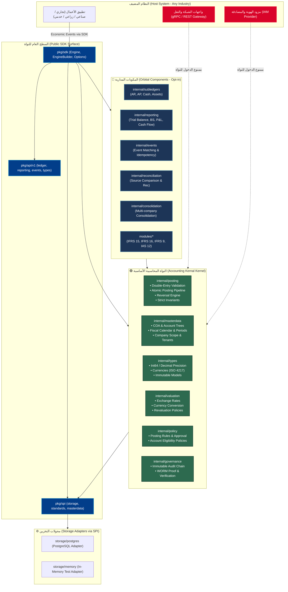

# النواة المحاسبية للرؤية المستهدفة (Target Accounting Kernal Kernel)

> **بيان الرؤية والمعمارية:**  
> تُحدد هذه الوثيقة الهيكل المفاهيمي والحزمي الدقيق لـ **النواة المحاسبية الصرفة (Kernal Accounting Kernel)** في الرؤية المستهدفة لمشروع `accounting_engine`، مع حصر مكوناتها وحزمها الجوهرية وفصلها فصلاً تاماً عن المكونات المدارية، ومحولات التخزين، وطبقات النقل والمصادقة، لتعمل بوصفها **نواة محاسبية موثوقة وعالية الأداء وقابلة للتضمين (Embeddable Kernal Engine)** فقط.

---

## فهرس المحتويات

1. [الرؤية والهدف المعماري المستهدف](#1-الرؤية-والهدف-المعماري-المستهدف)
2. [الهيكل المعماري للنواة والمكونات المدارية (Kernel & Orbitals)](#2-الهيكل-المعماري-للنواة-والمكونات-المدارية-kernel--orbitals)
3. [المكونات الأساسية للنواة المحاسبية (Kernal Kernel Components)](#3-المكونات-الأساسية-للنواة-المحاسبية-kernal-kernel-components)
4. [المكونات المدارية حول النواة (Orbital Components)](#4-المكونات-المدارية-حول-النواة-orbital-components)
5. [السطح البرمجي العام المجرد (Public Surface)](#5-السطح-البرمجي-العام-المجرد-public-surface)
6. [موانئ التخزين وعقود العزل (Persistence Ports)](#6-موانئ-التخزين-وعقود-العزل-persistence-ports)
7. [ما تم استبعاده وفصله تماماً عن النواة (Decoupled & Out of Kernel)](#7-ما-تم-استبعاده-وفصله-تماماً-عن-النواة-decoupled--out-of-kernel)
8. [مصفوفة الحزم والمسؤوليات (Package Responsibility Matrix)](#8-مصفوفة-الحزم-والمسؤوليات-package-responsibility-matrix)

---

## 1. الرؤية والهدف المعماري المستهدف

### 1.1 ما هي النواة المحاسبية المستهدفة؟

النواة المحاسبية هي **نظام قياس مالي حتمي نقي (Deterministic Financial Measurement Engine)**، مكتوب بلغة Go، يعمل كـ Embedded Library داخل الأنظمة المضيفة. مسؤوليته الحصرية هي:

* استيعاب الأحداث الاقتصادية وتحويلها إلى أثر مالي متوازن.
* فرض قواعد القيد المزدوج، الترحيل الذري، والحرمة المحاسبية.
* إدارة شجرة الحسابات والعملات وتقويم الفترات المالية.
* ضمان صحة الأرصدة وإثبات مسار التدقيق غير القابل للتلاعب.

### 1.2 فلسفة الفصل المعماري

* **النواة في المركز (Kernal at the Center):** تمثل أصغر مجموعة برمجية حتمية لا غنى عنها لتحقيق السلامة المحاسبية.
* **المدارات حول النواة (Orbitals around Kernal):** وظائف وموديلات مالية اختيارية تعتمد على النواة ولا تؤثر على سلامتها.
* **الخارج المطرود (Decoupled Periphery):** حظر كامل لتضمين المصادقة (Auth)، بروتوكولات الشبكة (HTTP/gRPC)، أو العمليات التشغيلية التجارية داخل النواة.

---

## 2. الهيكل المعماري للنواة والمكونات المدارية (Kernel & Orbitals)



---

## 3. المكونات الأساسية للنواة المحاسبية (Kernal Kernel Components)

تتألف النواة المحاسبية حصراً من الحزم والمسؤوليات الست التالية:

### 3.1 محرك الترحيل والقيد المزدوج (`internal/posting`)

* **قلب النواة الحسابي:**
  * التحقق الرياضي الصارم من توازن القيد المزدوج ($\sum D = \sum C$).
  * خط أنابيب الترحيل الذري (Atomic Posting Pipeline).
  * حجز أقفال الصفوف المرتبة تصاعدياً (`SELECT FOR UPDATE by AccountID ASC`) لمنع الـ Deadlocks.
  * إدارة القيود العكسية (Reversals) والربط التوثيقي الدلالي بالقيد الأصلي.
  * فرض الحرمة المطلقة للقيود المرحلة ومنع التعديل أو الحذف (`Immutability`).

### 3.2 البيانات المالية الرئيسية (`internal/masterdata`)

* **هيكل الحسابات والفترات:**
  * إدارة شجرة الحسابات المتدرجة (COA) ومنع العلاقات الدائرية.
  * فحص أهلية الحساب للترحيل وحظر الترحيل على الحسابات التجميعية (Header Accounts).
  * تقويم الفترات المالية (Fiscal Calendar) وإدارة حالات الفترات (`OPEN`, `SOFT_LOCKED`, `CLOSED`).
  * عزل وتحديد سياق الشركة المستأجرة (`Company Scope`).

### 3.3 الأنواع والقيم المالية الدقيقة (`internal/types`)

* **الأمان الرقمي والدقة:**
  * تمثيل العملات والمبالغ المالية بدقة الأعداد الصحيحة الصغرى (`Int64 minor units`) أو الحساب العشري الدقيق (`shopspring/decimal`).
  * حظر استخدام أرقام الفاصلة العائمة (`float32 / float64`).
  * تعريف كائنات القيمة غير القابلة للتغيير (Immutable Value Objects): `Money`, `Currency`, `CompanyID`, `AccountID`, `JournalEntryID`.

### 3.4 التقييم وأسعار الصرف (`internal/valuation`)

* **التعامل مع العملات المتعددة:**
  * إدارة أسعار الصرف التاريخية المعتمدة وتاريخ سريانها.
  * تحويل مبالغ العملات الأجنبية بدقة إلى العملة الوظيفية وفق قواعد التقريب المصرفي (`Banker's Rounding`).
  * سياسات إعادة التقييم الدوري واحتساب فروق أسعار الصرف المحققة وغير المحققة (IAS 21).

### 3.5 السياسات وضوابط الاعتماد (`internal/policy`)

* **حوكمة قواعد الترحيل:**
  * التحقق من استيفاء القيد للسياسات المالية قبل السماح بترحيله.
  * فحص قواعد التوقيع المزدوج أو الموافقات المطلوبة للقيود الاستثنائية.
  * منع أي التفاف أو تجاوز لقواعد القيود المعتمدة.

### 3.6 سجل التدقيق والحوكمة الجنائية (`internal/governance`)

* **إثبات الحركات المالية:**
  * إنشاء سجل التدقيق الدائم (Append-Only Audit Log) لكل حركة مالية.
  * ربط الحركات بسلسلة تجزئة رياضية غير قابلة للكسر (Cryptographic Hash Chaining).
  * التحقق من بصمات الاعتماد والنزاهة وتصدير أدلة التدقيق للجهات الرقابية.

---

## 4. المكونات المدارية حول النواة (Orbital Components)

مكونات وموديلات مالية تتواجد في مدار النواة وتتفاعل معها عبر العقود العامة (`Public SPI / SDK`)، وتتميز بأنها **قابلة للتفعيل الاختياري (Opt-in)**:

| المكون المداري | المسار البرمجي | طبيعة العلاقة بالنواة |
| :--- | :--- | :--- |
| **دفاتر الأستاذ المساعدة** | `internal/subledgers` | تستهلك أحداث الترحيل لتحديث أرصدة العملاء (AR)، الموردين (AP)، النقدية، والأصول الثابتة، مع فرض المطابقة مع حساب الرقابة في الأستاذ العام. |
| **التقارير المالية** | `internal/reporting` | تقرأ من أرصدة الأستاذ العام والقيود المرحلة لتوليد ميزان المراجعة، قائمة الدخل، قائمة المركز المالي، وقائمة التدفقات النقدية. |
| **استيعاب الأحداث ومنع التكرار** | `internal/events` و `pkg/sdk/event_ingestion.go` | تستقبل الأحداث الاقتصادية من النظام المضيف، تتحقق من عدم التكرار (`Idempotency`)، وتوجهها للنواة للترحيل. |
| **المطابقة والتسويات** | `internal/reconciliation` | تقارن بين السجلات الداخلية للأستاذ العام ومصادر بيانات خارجية (مثل كشوف الحسابات المصرفية). |
| **توحيد القوائم المالية** | `internal/consolidation` | تجميع القوائم المالية لمجموعة شركات واستبعاد المعاملات البينية وفروق الترجمة. |
| **وحدات المعايير الدولية** | `modules/ifrs9`, `ifrs15`, `ifrs16`, `ias12` | إضافات معيارية مستقلة تحقق عقود `pkg/spi/standards` وتولد قيوداً واستحقاقات معيارية ترحلها النواة. |

---

## 5. السطح البرمجي العام المجرد (Public Surface)

السطح العام هو النافذة الشرعية الوحيدة للمستهلكين والأنظمة المضيفة للتعامل مع النواة:

1. **`pkg/sdk` (مكتبة التضمين والتطبيق):**
   * كائن المحرك الموحد `sdk.Engine`.
   * نمط المنشئ الصارم `sdk.EngineBuilder` وخيارات التهيئة (`WithStoragePorts`, `WithReporting`, `WithStandard`).
   * خدمات الأعمال العامة: `LedgerService`, `ReportingService`, `GovernanceService`, `EventIngestionService`.
2. **`pkg/api/v1` (النماذج والعقود المعيارية):**
   * نماذج البيانات المالية العامة المجردة وغير القابلة للتعديل (`Entry`, `Account`, `Period`, `Report`).
3. **`pkg/spi` (منافذ مزودي الخدمة):**
   * عقود التخزين والمعايير التي تحققها الطبقات التحتية.

---

## 6. موانئ التخزين وعقود العزل (Persistence Ports)

* **عقود مجردة بالكامل (`pkg/spi/storage`):**
  * النواة لا تتصل بأي قاعدة بيانات مباشرة ولا تصدر أوامر SQL في طبقة الـ Domain.
  * التعامل يتم عبر موانئ محددة:
    * `UnitOfWork`: إدارة بدء وتأكيد وإلغاء المعاملات الذرية.
    * `AccountStore`: استرجاع وتحديث بيانات شجرة الحسابات.
    * `EntryStore`: حفظ واسترجاع القيود وأسطرها.
    * `BalanceStore`: تحديث واسترجاع أرصدة الحسابات.
    * `AuditStore`: حفظ سلاسل التدقيق.
* **المحولات الملموسة (Adapters):**
  * `storage/postgres`: المحول الإنتاجي المعتمد، يطبق RLS و WORM Triggers.
  * `storage/memory`: المحول الخفيف للاختبارات السريعة في بيئات التطوير.

---

## 7. ما تم استبعاده وفصله تماماً عن النواة (Decoupled & Out of Kernel)

لضمان نقاء واستقلالية النواة المحاسبية، تم إخراج المكونات التالية خارج مستودع وحدود النواة كلياً:

```text
┌──────────────────────────────────────────────────────────────────────────────┐
│  المكونات المستبعدة قطعياً من النواة المحاسبية (Non-Kernel Components)         │
├───────────────────────────────┬──────────────────────────────────────────────┤
│ المكون المستبعد               │ سبب الاستبعاد المعماري                       │
├───────────────────────────────┼──────────────────────────────────────────────┤
│ 1. خوادم النقل الشبكي         │ النواة مكتبة Go قابلة للتضمين؛ تضمين خوادم   │
│    (cmd/accounting-service,   │ HTTP أو gRPC يفرض تبعيات شبكية غير مرغوبة    │
│    proto/, gRPC handlers)     │ ويقيد نمط النشر.                             │
├───────────────────────────────┼──────────────────────────────────────────────┤
│ 2. المصادقة وإدارة المستخدمين │ إدارة الهويات والجلسات (IAM) مسؤولية مركزية  │
│    (internal/serviceauth,     │ للمنشأة والنظام المضيف؛ خلطها بالمحرك يحدث   │
│    JWT/OAuth validations)     │ ازدواجية أمنية واقتراناً ضاراً.              │
├───────────────────────────────┼──────────────────────────────────────────────┤
│ 3. تحديد معدل الطلبات         │ Rate Limiting مسؤولية بوابات النقل وحافة     │
│    (internal/ratelimit)       │ الشبكة (API Gateway)، وليس النواة الحسابية.  │
├───────────────────────────────┼──────────────────────────────────────────────┤
│ 4. العمليات التجارية للقطاعات │ دورات المبيعات، المخازن، عروض الأسعار،       │
│    (ERP, Orders, Inventory)   │ والمستشفيات تخص النظام المضيف؛ النواة تقيس   │
│                               │ الأثر المالي المجرد فقط.                      │
├───────────────────────────────┼──────────────────────────────────────────────┤
│ 5. واجهات المستخدم الرسومية   │ النواة Headless Kernal بالكامل ولا تحتوي على    │
│    (UI, Web, Mobile)          │ أي شاشات أو قوالب عرض.                       │
└───────────────────────────────┴──────────────────────────────────────────────┘
```

---

## 8. مصفوفة الحزم والمسؤوليات (Package Responsibility Matrix)

| الحزمة | النطاق المعماري | المسؤولية الرئيسية | الاعتماديات المسموحة |
| :--- | :--- | :--- | :--- |
| `internal/posting` | **Kernal Kernel** | الترحيل، القيد المزدوج، العكس، الأقفال | `types`, `masterdata`, `spi/storage` |
| `internal/masterdata` | **Kernal Kernel** | الحسابات، التقويم، الفترات، الشركات | `types`, `spi/storage` |
| `internal/types` | **Kernal Kernel** | المبالغ، العملات، المعرفات، الحساب العشري | لا يعتمد على أي حزمة داخلية |
| `internal/valuation` | **Kernal Kernel** | أسعار الصرف، تحويل العملات | `types`, `spi/storage` |
| `internal/policy` | **Kernal Kernel** | السياسات وضوابط الاعتماد المالي | `types`, `masterdata` |
| `internal/governance` | **Kernal Kernel** | سلسلة التدقيق، WORM، بصمات الاعتماد | `types`, `spi/storage` |
| `internal/subledgers` | **Orbital** | الدفاتر المساعدة (AR/AP/Cash/Assets) | `posting`, `types`, `masterdata` |
| `internal/reporting` | **Orbital** | القوائم المالية وميزان المراجعة | `types`, `masterdata`, `spi/storage` |
| `internal/events` | **Orbital** | استيعاب الأحداث ومطابقتها ومنع التكرار | `posting`, `types`, `spi/storage` |
| `internal/reconciliation` | **Orbital** | مطابقة الأرصدة والسجلات الخارجية | `reporting`, `types` |
| `internal/consolidation` | **Orbital** | توحيد القوائم المالية للمجموعات | `reporting`, `types`, `valuation` |
| `modules/*` | **Orbital** | معايير IFRS/IAS المتخصصة | `spi/standards`, `api/v1` |

---

> **خلاصة وتأكيد:**  
> تُثبّت هذه الوثيقة النواة المحاسبية المستهدفة ككيان مستقل ومحمي، محاط بالمكونات المدارية الاختيارية، وتمنع بصورة حاسمة تلوث النواة ببروتوكولات النقل، المصادقة، أو المنطق التجاري للقطاعات.
