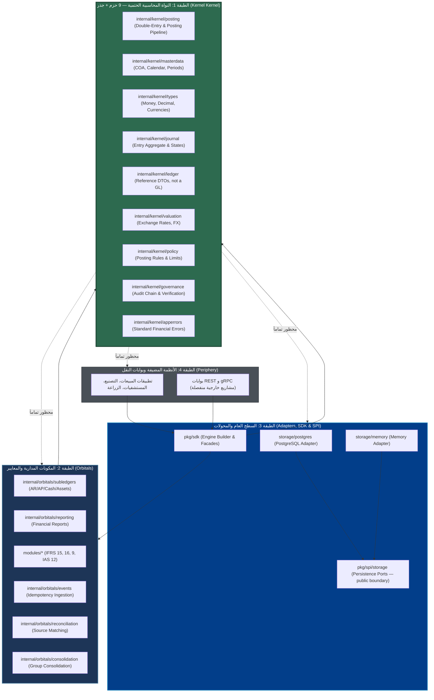

# ميثاق المبادئ المعمارية الحاكمة (Architectural Principles Charter)

> **بيان الإلزام والهدف:**  
> يُحدد هذا الميثاق **المبادئ المعمارية الحاكمة والقواعد الإلزامية غير القابلة للتفاوض (Architectural Principles & Invariants)** لمشروع `accounting_engine`.  
> صُممت هذه المبادئ لضمان أن تكون النواة المحاسبية **محوراً مركزياً نقياً ومستقلاً** (Pure Central Kernel)، بحيث تعتمد جميع المكونات الأخرى (المدارية، ومحولات التخزين، والأنظمة المضيفة) على النواة، بينما **لا تعتمد النواة المحاسبية إطلاقاً على أي تفاصيل تقنية أو قطاعية أو بروتوكولية خارجية**.
>
> **ملاحظة توثيقية (2026-11-27):** هذا الميثاق وثيقة مرجعية تاريخية؛ التوضيحات الواردة أدناه تُطابق لقطة المرحلة 1 مع القرارات اللاحقة في [سجل ADR](./KERNEL_ARCHITECTURE_DECISION_RECORDS.md) (خصوصاً P1-01/P1-02، P7-01، P8-01) ولا تنشئ اعتماداً جديداً. عند التعارض يُرجع إلى الـ ADR وسجل الفجوات لا إلى صياغة قديمة هنا.

---

## فهرس المحتويات

1. [المبادئ الأربعة الكبرى لاستقلالية النواة المحاسبية](#1-المبادئ-الأربعة-الكبرى-لاستقلالية-النواة-المحاسبية)
   - [المبدأ الأول: استقلال البنية التحتية والتخزين (Infrastructure Independence)](#المبدأ-الأول-استقلال-البنية-التحتية-والتخزين-infrastructure-independence)
   - [المبدأ الثاني: استقلال التكامل والنقل (Integration & Transport Independence)](#المبدأ-الثاني-استقلال-التكامل-والنقل-integration--transport-independence)
   - [المبدأ الثالث: استقلال المجال والحياد القطاعي (Domain Independence)](#المبدأ-الثالث-استقلال-المجال-والحياد-القطاعي-domain-independence)
   - [المبدأ الرابع: قدسية وسلامة القيد المحاسبي (Double-Entry & Ledger Sanctity)](#المبدأ-الرابع-قدسية-وسلامة-القيد-المحاسبي-double-entry--ledger-sanctity)
2. [المبادئ المعمارية الإضافية الحاكمة للتصميم البرمجي](#2-المبادئ-المعمارية-الإضافية-الحاكمة-للتصميم-البرمجي)
3. [مخطط اتجاه التبعيات المعمارية (Architectural Dependency Hierarchy)](#3-مخطط-اتجاه-التبعيات-المعمارية-architectural-dependency-hierarchy)
4. [قواعد منع الانحراف المعماري (Anti-Corruption & Enforcement Rules)](#4-قواعد-منع-الانحراف-المعماري-anti-corruption--enforcement-rules)
5. [مصفوفة الامتثال للمبادئ المعمارية (Principles Compliance Matrix)](#5-مصفوفة-الامتثال-للمبادئ-المعمارية-principles-compliance-matrix)

---

## 1. المبادئ الأربعة الكبرى لاستقلالية النواة المحاسبية

```text
┌──────────────────────────────────────────────────────────────────────────────┐
│  المبادئ الأربعة الكبرى الحاكمة للنواة المحاسبية (The 4 Fundamental Pillars) │
├──────────────────────────────────┬───────────────────────────────────────────┤
│ المبدأ المعماري                  │ جوهر القاعدة المعمارية الملزمة            │
├──────────────────────────────────┼───────────────────────────────────────────┤
│ 1. استقلال البنية التحتية        │ النواة لا تعرف شيئاً عن SQL أو قواعد      │
│    (Infrastructure Independence) │ البيانات؛ التخزين عبر موانئ مجردة (SPI).  │
├──────────────────────────────────┼───────────────────────────────────────────┤
│ 2. استقلال التكامل والنقل        │ النواة لا تتحدث gRPC أو HTTP؛ التخاطب     │
│    (Transport Independence)      │ يتم حصراً عبر أحداث اقتصادية في Go SDK.   │
├──────────────────────────────────┼───────────────────────────────────────────┤
│ 3. استقلال المجال والحياد        │ النواة محايدة قطاعياً؛ لا توجد فواتير أو   │
│    (Domain Independence)         │ شحنات أو أطنان قمح داخل كود النواة.       │
├──────────────────────────────────┼───────────────────────────────────────────┤
│ 4. قدسية وسلامة القيد المحاسبي   │ التوازن الحتمي الصارم والذرية والحرمة     │
│    (Ledger & Posting Sanctity)   │ التامة؛ لا تعديل ولا حذف ولا أرصدة مباشرة. │
└──────────────────────────────────┴───────────────────────────────────────────┘
```

---

### المبدأ الأول: استقلال البنية التحتية والتخزين (Infrastructure Independence)

- **[PRIN-INFRA-01] التجريد التام لطبقة البيانات (Storage-Agnostic Kernel):**
  - النواة المحاسبية (`internal/kernel/posting`, `internal/kernel/masterdata`, `internal/kernel/types`) لا تعلم شيئاً عن PostgreSQL، أو محركات SQL، أو ملفات التخزين، أو جداول قواعد البيانات.
  - كل عمليات القراءة والكتابة والحفظ تتم عبر عقود وموانئ تخزين مجردة بالكامل (`pkg/spi/storage`).
- **[PRIN-INFRA-02] حظر استيراد مكتبات التخزين في النواة:**
  - يُحظر تماماً استيراد `database/sql`, `github.com/jackc/pgx`, أو أي حزمة قاعدة بيانات داخل طبقة الـ Kernel Domain.
- **[PRIN-INFRA-03] قابلية استبدال التخزين (Pluggable Persistence):**
  - يجب أن تكون النواة قادرة على العمل والاجتياز الكامل لكافة اختباراتها الحسابية باستخدام موائم الذاكرة المؤقتة (`storage/memory`) تماماً كما تعمل مع محول PostgreSQL الإنتاجي (`storage/postgres`) دون تعديل سطر واحد في كود النواة.
- **[PRIN-INFRA-04] عزل منطق الأعمال عن استعلامات SQL:**
  - تُحظر الإجراءات المخزنة (Stored Procedures) أو Triggers التي تحتوي على قواعد أو حسابات محاسبية داخل قاعدة البيانات. المنطق المحاسبي يقطن حصراً في كود النواة؛ وقاعدة البيانات تحفظ البيانات الهيكلية والنزاهة فقط. **استثناء:** يُسمح بـ Triggers من نوع WORM (الكتابة مرة واحدة) التي تحمي حرمة السجلات المرحّلة من التعديل والحذف، شرط ألا تحتوي على أي منطق محاسبي أو حسابي (وفق `KERNEL_AUDIT_THREAT_MODEL.md` T-07).

---

### المبدأ الثاني: استقلال التكامل والنقل (Integration & Transport Independence)

- **[PRIN-INTEG-01] حظر بروتوكولات النقل الشبكي داخل النواة (Transport-Agnostic Kernel):**
  - النواة المحاسبية ليست خادماً شبكياً (Server)، بل هي مكتبة برمجية نقية مضمنة (`Embedded Go Library`).
  - يُحظر منعاً باتاً تضمين أي كود يتعلق بـ HTTP REST, gRPC, Protobuf, WebSockets داخل النواة المحاسبية الصرفة. **استثناء:** يُسمح بـ `encoding/json` حصراً لتنفيذ `MarshalJSON`/`UnmarshalJSON` على أنواع النواة (`Money`, `Decimal`, `Currency`) لدعم التسلسل الحتمي، شرط عدم تضمين أي منطق نقل شبكي.
- **[PRIN-INTEG-02] التكامل الحصري عبر الأحداث الاقتصادية المعيارية (Event-Driven Integration):**
  - الطريقة الوحيدة التي يتخاطب بها العالم الخارجي مع المحرك هي تمرير **أحداث اقتصادية مجردة (`AccountingEvent`)** أو قيود محاسبية عبر استدعاءات دوال Go مباشرة داخل المعالج (`In-Process SDK Call`).
  - مسؤولية تحويل بروتوكولات الشبكة (REST Requests أو gRPC Streams) إلى أحداث اقتصادية تقع على عاتق بوابات النقل الخارجية المستقلة (Gateways/Adapters) خارج النواة.
- **[PRIN-INTEG-03] تجريد عمليات المصادقة وإدارة الهويات (Auth-Free Kernel):**
  - لا يدير المحرك جداول للمستخدمين، أو كلمات المرور، أو جلسات تسجيل الدخول، أو رموز JWT/OAuth.
  - تتلقى النواة سياق أمان موثوقاً ومجرداً (`Context Security Principal`) يمرره النظام المضيف عبر `context.Context` وتثبته النواة في سجل التدقيق دون إدارة هويات.

---

### المبدأ الثالث: استقلال المجال والحياد القطاعي (Domain Independence)

- **[PRIN-DOMAIN-01] الحياد القطاعي المطلق (Complete Industry Neutrality):**
  - النواة المحاسبية محايدة تماماً تجاه نوع النشاط التجاري (تجزئة، تجارة إلكترونية، تصنيع صناعي، زراعة ومحاصيل، رعاية صحية، خدمات مهنية).
  - لا توجد كلمة "فاتورة بيع"، "بوليصة شحن"، "مريض"، "طن أسمنت"، أو "أمر عمل" داخل كود النواة المحاسبية؛ بل قيود، حسابات، مراكز تكلفة، أطراف مقابلة، ومبالغ مالية.
- **[PRIN-DOMAIN-02] الموائمات القطاعية خارج النواة (Industry Adapters on the Edge):**
  - ترجمة المفاهيم التشغيلية الخاصة بالقطاعات (مثل دورة حياة المبيعات أو استهلاك المواد الخام) إلى أثر مالي تتم في طبقة موائمات خارجية (Industry Adapters) يبنيها النظام المضيف، لتغذي النواة بالأثر المالي المجرد فقط.
- **[PRIN-DOMAIN-03] استقلال السياسات المالية عن المنطق التجاري:**
  - لا تتأثر قواعد القيد المزدوج والترحيل بأي تغير في السياسات التجارية للنظام المضيف (مثل سياسات العروض، الخصومات، أو شروط الشحن).

---

### المبدأ الرابع: قدسية وسلامة القيد المحاسبي (Double-Entry & Ledger Sanctity)

- **[PRIN-SANCT-01] التوازن الحتمي ومطابقة العملة الوظيفية ($\sum \text{Debit} = \sum \text{Credit}$):**
  - التوازن المحاسبي بالعملة الوظيفية هو قانون فيزيائي حتمي داخل النواة. يُرفض أي قيد غير متوازن فوراً في مرحلة التحقق وقبل فتح أي معاملة تخزين.
  - تطابق العملة الوظيفية لكافة أسطر القيد مع العملة الوظيفية المعتمدة للشركة إلزامي؛ وأي اختلاف يُعد خرقاً معمارياً يرفض بـ `ErrFunctionalCurrencyMismatch`.
- **[PRIN-SANCT-02] الحفظ الذري الشامل للمعاملات (Strict Atomicity & Ordered Locking):**
  - ترحيل القيد، ترتيب مفاتيح الأقفال تصاعدياً (القفل الفعلي في Adapter/Host وفق ADR P8-01)، تخصيص رقم القيد، وحفظ مسار التدقيق المشفر تحدث معاً كوحدة عمل واحدة (`Unit of Work`) أو تتراجع بالكامل فوراً عند حدوث أي خلل.
  - **خارج وحدة عمل النواة:** الأرصدة المشتقة وحركات الدفاتر المساعدة مملوكة للمضيف/المدارات (`internal/orbitals/*`)؛ لا تُحدَّث أرصدة مادية ولا تُسجَّل حركات دفاتر فرعية داخل `internal/kernel` (ADR P1-02).
- **[PRIN-SANCT-03] الحرمة الأبدية للقيود المرحلة (Strict Immutability):**
  - القيد المرحّل لا يمكن تعديله أو حذفه إطلاقاً. لا يوجد أمر `UPDATE` أو `DELETE` في قاعدة البيانات يمس القيود المرحلة.
  - التصحيح يتم حصراً بقيد عكسي مستقل يرتبط دلالياً بالقيد الأصلي.
- **[PRIN-SANCT-04] حظر التعديل المباشر للأرصدة (No Direct Balance Mutation):**
  - لا توجد دالة أو واجهة لتعديل الأرصدة يدوياً (`SetBalance`). الأرصدة هي ناتج حتمي مشتق من مجموع أسطر القيود المرحلة.
- **[PRIN-SANCT-05] حرمة الحسابات التجميعية والفترات والسنوات المقفلة:**
  - منع الترحيل قطعياً على الحسابات التجميعية (Header Accounts) وفي الفترات أو السنوات المالية المقفلة (`CLOSED`).
  - فترات التسوية 13 و 14 تعامل كأوعية إجرائية وتستبعد تماماً من البحث بالتواريخ.
- **[PRIN-SANCT-06] الدقة الرقمية وحظر الإسقاط الصامت لفروق التقريب (No Floats & Zero Silent Residual Loss):**
  - حظر استخدام `float32` و `float64` في العمليات المالية، والاعتماد الحصري على الأعداد الصحيحة الصغرى أو مكتبات الحساب العشري الدقيق.
  - حظر إسقاط أو ابتلاع فروق التقريب بصمت؛ وأي متبقي ناتج عن التقريب للوحدة الصغرى يجب تسويته بحساب تسوية معتمد (`ErrRoundingAccountRequired`).

---

## 2. المبادئ المعمارية الإضافية الحاكمة للتصميم البرمجي

- **[PRIN-ENG-01] مبدأ المكتبة أولاً (Library-First Paradigm):**
  - يُبنى المحرك كحزمة Go قابلة للاستيراد والتضمين المباشر في أي تطبيق، دون اشتراط وجود بنية تحتية موزعة أو خوادم وسيطة.
- **[PRIN-ENG-02] التفعيل الصريح للقدرات (Explicit Opt-in Capabilities):**
  - النواة الأساسية خفيفة وصغيرة؛ وكل قدرة مدارية (تقارير، معايير دولية، دفاتر مساعدة) تتطلب تفعيلاً صريحاً ومتحققاً منه إقلاعياً عبر المنشئ:

    ```go
    sdk.NewBuilder(
        sdk.WithStoragePorts(ports),
        sdk.WithReporting(reportingStore),
        sdk.WithStandard(ifrs15Module),
    )
    ```

- **[PRIN-ENG-03] الحتمية البرمجية (Execution Determinism):**
  - عند إعطاء نفس المدخلات (الحدث، التاريخ، أسعار الصرف)، يجب أن تنتج النواة نفس القيد ونفس الأثر المالي دائماً وبصورة حتمية متطابقة.

- **[PRIN-ENG-04] انعدام الآثار الجانبية عند الإنشاء (Zero Side-Effects on Construction):**
  - استدعاء دالة بناء المحرك لا يبدأ خيوط معالجة دورية (Goroutines) خفية ولا يفتح اتصالات شبكية ما لم يُطلب ذلك صراحة وموثقاً.
- **[PRIN-ENG-05] التدقيق غير القابل للتلاعب (Tamper-Evident by Design):**
  - كل عملية مالية تولد أثراً تدقيقياً لا يمكن فصله عنها، ومحمياً بسلاسل التجزئة الرياضية (Hash Chaining).

---

## 3. مخطط اتجاه التبعيات المعمارية (Architectural Dependency Hierarchy)

تلتزم معمارية المحرك الصارمة بقاعدة ذهبية: **"الاعتماديات تتجه دائماً نحو النواة، والنواة لا تعتمد على شيء خارجها"**.



> **توضيح الحدود (ADR P7-01):** `pkg/spi/storage` منافذ عامة على الحدود ولا يدخل طبقة النواة؛ النواة لا تستورد أي حزمة `pkg/*`. الاستثناء الوحيد هو جسر إعادة التصدير في `pkg/api/v1/*` عبر أسماء مستعارة (`type X = kernel...X`)؛ `pkg/spi/*` يبقى ممنوعاً من استيراد أي `internal/*`.

---

## 4. قواعد منع الانحراف المعماري (Anti-Corruption & Enforcement Rules)

- **[ENF-01] حظر التبعيات الدائرية (No Circular Dependencies):**
  - يمنع منعاً باتاً وجود أي تبعية دائرية بين حزم المشروع الداخلية، ويتم التحقق من ذلك آلياً عبر أدوات فحص الحزم في الـ CI.
- **[ENF-02] حظر تسرب أنواع الـ Internal للخارج (No Internal Types Leakage):**
  - لا يجوز لأي دالة أو واجهة في السطح العام (`pkg/sdk`, `pkg/api/v1`, `pkg/spi`) أن تستقبل أو ترجع نوع بيانات مُعرف داخل `internal/*`.
  - **استثناء صريح (ADR P7-01):** يُسمح لـ `pkg/api/v1/*` وحدها باستيراد `internal/kernel/*` لإعادة التصدير عبر أسماء مستعارة (`type X = kernel...X`)؛ لا يشمل الاستثناء `pkg/spi/*` ولا توقيعات `pkg/sdk` المُصدّرة غير المُعاد تصديرها.
- **[ENF-03] حظر الاستيراد العكسي (No Inward-Outward Imports):**
  - يُمنع على أي ملف داخل `internal/kernel/posting` استيراد `internal/orbitals/reporting` أو `internal/orbitals/subledgers` أو أي حزمة `pkg/*`؛ النواة مستقلة تماماً عن مداراتها وسطحها العام.

---

## 5. مصفوفة الامتثال للمبادئ المعمارية (Principles Compliance Matrix)

| المبدأ المعماري | آلية التحقق البرمجية (Verification Mechanism) | موقع الفحص في الشيفرة | المسؤول عن الحوكمة |
| :--- | :--- | :--- | :--- |
| **استقلال البنية التحتية** | خلو حزم النواة من استيراد مكتبات SQL وقواعد البيانات | سكربت فحص الاعتماديات CI | مهندس معمارية البرمجيات |
| **استقلال التكامل والنقل** | خلو النواة من `net/http` و `grpc` وعدم وجود سيرفر شبكي | فحص شجرة الحزم `go list` | مهندس معمارية البرمجيات |
| **استقلال المجال** | خلو النواة من المصطلحات التشغيلية للقطاعات التجارية | مراجعة الكود وفحص النماذج | قائد هندسة النواة |
| **قدسية القيد المزدوج** | اختبارات الوحدة والحالات الحدية للتوازن الرياضي | `internal/kernel/posting/entry_validation.go` | المراجع المحاسبي المعتمد |
| **الحرمة المحاسبية** | غياب أوامر `UPDATE`/`DELETE` وتطبيق Triggers مانعة | محولات PostgreSQL واختبارات الحرمة | مسؤول قواعد البيانات (DBA) |
| **الذرية التامة (ACID)** | اختبارات حقن الأعطال (Fault-injection) والتراجع الشامل | `test/atomic/atomicity_test.go` | مهندس ضمان الجودة والأمان |
| **الدقة العشرية** | حظر `float` واستخدام `shopspring/decimal` و `Int64` | فحص الكود الآلي (Static Linter) | قائد الهندسة البرمجية |
| **المكتبة القابلة للتضمين** | اختبارات المستهلك الخارجي المستقل | `test/external_consumer/` | فريق تطوير SDK |

---

> **ميثاق ملزم:**  
> يُعد هذا الميثاق الدستور المعماري الأعلى لمشروع `accounting_engine`. ولا يجوز لأي تعديل برمجي أو إضافة ميزة خرق هذه المبادئ أو إضعاف استقلالية وقدسية النواة المحاسبية تحت أي مبرر كان.
