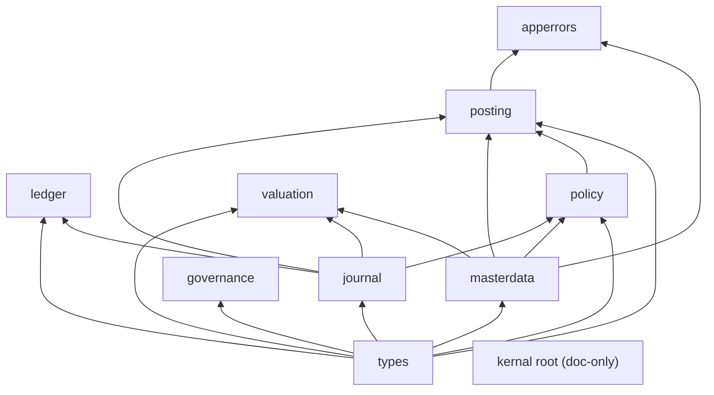
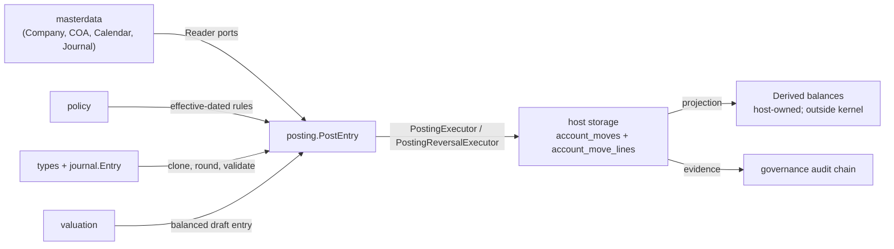

# خريطة معمارية النواة المحاسبية (المرحلة 1)

> هذه الوثيقة هي الخريطة التنفيذية المطابقة للكود، المرجعية لكل من [وثيقة الرؤية المستهدفة](TARGET_ACCOUNTING_KERNEL.md) و~~الخطة~~ *(حُذف مجلد `plans/`)*. تُستمد الحقائق فيها من `go list` وجرد الملفات ومخطط التدفق الفعلي، لا من الادعاءات المحفوظة. القرارات ملحقة في [P1-01](./KERNEL_ARCHITECTURE_DECISION_RECORDS.md#adr-p1-01) و[P1-02](./KERNEL_ARCHITECTURE_DECISION_RECORDS.md#adr-p1-02) و[P1-03](./KERNEL_ARCHITECTURE_DECISION_RECORDS.md#adr-p1-03).

## 1. الحزم التسع + حزمة الجذر

| الحزمة | الملفات غير الاختبارية | المسؤولية | لا يملك |
| --- | --- | --- | --- |
| `internal/kernal` | `doc.go` (+ `doc_test.go`) | charter الاستيراد والفحوص المعمارية | أي منطق مجال |
| `internal/kernal/types` | `money.go`, `currency.go`, `errors.go`, `identifiers.go`, `idempotency.go`, `rounding.go`, `doc.go` | Money/double-entry primitives، ISO 4217، المعرفات، عقود Idempotency، التقريب | تحقق القيد أو حفظ |
| `internal/kernal/apperrors` | `errors.go`, `doc.go` | `CodedError`, `IsCode` وتغليف أخطاء المجال القانونية | استخداماً داخل النواة حالياً |
| `internal/kernal/journal` | `entry.go`, `errors.go`, `doc.go` | aggregate القيد: الحقول/الحالات/الروابط/`Clone`/أخطاء دورة الحياة | التوازن، الحفظ |
| `internal/kernal/ledger` | `account.go`, `period.go`, `projection.go`, `doc.go` | DTO مرجعي لـ `pkg/api/v1/ledger` + إسقاطات قراءة حتمية مُشتقة من القيود المرحلة | تخزين حركة/رصيد مادي، تقارير، تحقق أهلية |
| `internal/kernal/masterdata` | `types.go`, `account.go`, `coa.go`, `company_scope.go`, `cost_center.go`, `dimension.go`, `errors.go`, `fiscal_calendar.go`, `journal.go`, `ports.go`, `doc.go` | الحقيقة المخولة لـ Company/COA/Journal/Calendar/Dimensions + Reader ports + أخطاء المجال | حفظ ملموس أو تقارير |
| `internal/kernal/governance` | `audit_chain.go`, `verifier.go`, `doc.go` | سلسلة تدقيق ذرية ولقطة تحقق/checkpoint خارجي | أرصدة أو قيود |
| `internal/kernal/policy` | `eligibility.go`, `posting_rules.go`, `doc.go` | سياسات نافذة زمنياً ومحصورة بالشركة، أهلية الحساب/الأبعاد | موافقات مستخدمين أو RBAC |
| `internal/kernal/posting` | `entry_validation.go`, `errors.go`, `pipeline.go`, `rounding.go`, `reversal.go`, `adjusting.go`, `lock_manager.go`, `valuation_adapter.go`, `doc.go` | `PostEntry` كنقطة تحقق مركزية، التقريب، العكس، ترتيب المفاتيح، تفويض الحفظ، محولات `valuation` | SQL/أقفال فعلية/تخزين رصيد |
| `internal/kernal/valuation` | `exchange_rate.go`, `conversion.go`, `errors.go`, `revaluation.go`, `doc.go` | أسعار صرف وتحويل وإعادة تقييم وتوليد قيد (معزولة عن `posting` عبر واجهات) | مزود أسعار خارجي أو شبكة |

### 1.1 عقود Reader بعد المرحلة 3

| المنفذ | الحالة | الغرض |
| --- | --- | --- |
| `masterdata.Reader` | إلزامي | قراءة companies/accounts/journals/periods بمعرّف شركة موثوق؛ لا يُضاف إليه `asOf` حفاظاً على توافق المحولات. |
| `masterdata.EffectiveAccountReader` | اختياري (جديد في P3-01) | `GetAccountAsOf` يُرجع نسخة الحساب النافذة في تاريخ القيد؛ غيابه لا يكسر المحول لكنه يترك عبء النسخ المؤرخة على المضيف (`G-019`). |
| `masterdata.AdjustmentPeriodReader` | اختياري | مطلوب للفترتين 13 و14. |
| `masterdata.JournalRepository` | إلزامي ل`PostEntry` | قراءة اليومية بمعرّف مستقر؛ تُفحص الهوية بـ`ValidateJournalScope`. |
| `masterdata.CostCenterRepository` / `AnalyticalDimensionRepository` | اختياريان | مطلوبان عند وجود أبعاد على السطر. |

كل مسار يرفض `CompanyID` صفرياً قبل استدعاء أي Reader. انظر [ADR P3-01](./KERNEL_ARCHITECTURE_DECISION_RECORDS.md#adr-p3-01).

## 2. مخطط الاعتماد الفعلي

المصدر: `go list -f '{{.ImportPath}} -> {{join .Imports " "}}' ./internal/kernal/...`. لا دورات استيراد؛ البنية DAG صارمة.

| الطبقة | الحزم | قاعدة الاعتماد |
| --- | --- | --- |
| L0 | `types` | بلا اعتماد على حزم kernel أخرى |
| L1 | `journal`, `masterdata`, `governance` | تعتمد على `types` فقط |
| L2 | `ledger`, `policy`, `valuation` | `ledger→{journal,types}`؛ `policy→{journal,masterdata,types}`؛ `valuation→{types,journal,masterdata}` (بلا `posting`) |
| L3 | `posting` | `journal` + `masterdata` + `policy` + `types` |
| L4 | `apperrors` | تغلّف أخطاء المجال (`posting`, `masterdata`) دون أن تستوردها أي حزمة نواة أخرى |

الاعتماد الخارجي المسموح: `github.com/google/uuid` و`github.com/shopspring/decimal` plus package القياسية. أي استيراد لـ `pkg/*` أو `storage/*` أو `orbitals/*` أو `modules/*` أو `database/sql`/`pgx` أو شبكة مخالفة (`R1`, `R3a–R3d`).

## 3. مسار الحقيقة والتدفق المحاسبي

- **Canonical:** Posted `JournalEntry` + `EntryLine` (ADR P1-02). لا يوجد نوع `LedgerMovement`/`LedgerTransaction` ولا جدول `gl_*` في النواة أو مسار الترحيل.
- **النطاق:** `CompanyID` هو مفتاح النطاق الملزم داخل النواة؛ `JournalID` يقيد اليومية والتسلسل. لا `BookID` ولا `LedgerID` في عقد الترحيل.
- **الإعادة البناء:** ترتيب كلي `(EffectiveDate, SequenceNumber, JournalEntryID)` ثم `(EntryLine.ID)`؛ تجميع `FunctionalDebit − FunctionalCredit` لكل حساب/عملة. النتيجة مشتقة ولا تُخزَّن في النواة.
- **التصحيح:** قيود عكسية/تصحيحية مرتبطة فقط (`ReversalOfID`, `ReversedByID`)؛ لا تعديل ولا حذف للقيد المرحّل.

## 4. حدود السطح العام وفق ADR P7-01

| المسار | الحكم | دليل التنفيذ |
| --- | --- | --- |
| `pkg/api/v1/...` | الجسر الوحيد المسموح له باستيراد `internal/kernal/*` لإعادة التصدير | `R2b` + `docs/api/v1.snapshot` |
| `pkg/spi/**` | ممنوع استيراد أي `internal/*` | `R2a` |
| `pkg/sdk/**` | يسمح بالاستيراد كتفصيل تنفيذي فقط؛ لا تسريب نوع غير مُعاد تصديره في التوقيعات المُصدّرة | `R2c` |
| `internal/kernal/**` | نظيف من التخزين والشبكة والسطح العام | `R1`, `R3a–R3d`, `doc_test.go` |

نتيجة التشغيل في المرحلة 1: `./scripts/verify_architecture.sh` → `PASS` بـ11 قاعدة (لا تخفيض).

> **تنبيه زمني:** سطر `PASS` هذا **لقطة المرحلة 1** (حالة الوثيقة: «معتمد في المرحلة 1 من خطة المعالجة») وليس نتيجة تشغيلية حالية؛ الحالة الراهنة تُقاس بإعادة تشغيل `scripts/verify_architecture.sh`، لا بالاعتماد على هذه اللقطة. انظر [سجل ADR](./KERNEL_ARCHITECTURE_DECISION_RECORDS.md) للتحديثات اللاحقة.

## 5. الفجوات المرتبطة بهذه الخريطة

| الفجوة | الحالة بعد المرحلة 1 |
| --- | --- |
| `G-003` خريطة الحزم في الوثيقة المعمارية | مغلقة: هذه الوثيقة + تحديث Target Kernel |
| `G-004` مصدر حقيقة GL | مغلقة من جانب القرار/التوثيق؛ إثبات إعادة البناء التنفيذي يبقى في المرحلة 4/12 |
| `G-008` غياب `doc.go` في `apperrors` | مغلقة: `internal/kernal/apperrors/doc.go` |
| `G-016` انحراف النماذج المرجعية (جديدة) | مغلقة جزئياً/أُضيف اختبار انعكاسي (Medium، المرحلة 3/11): `TestReferenceModelsDoNotDriftSilently` يربط `masterdata` و`ledger` |
