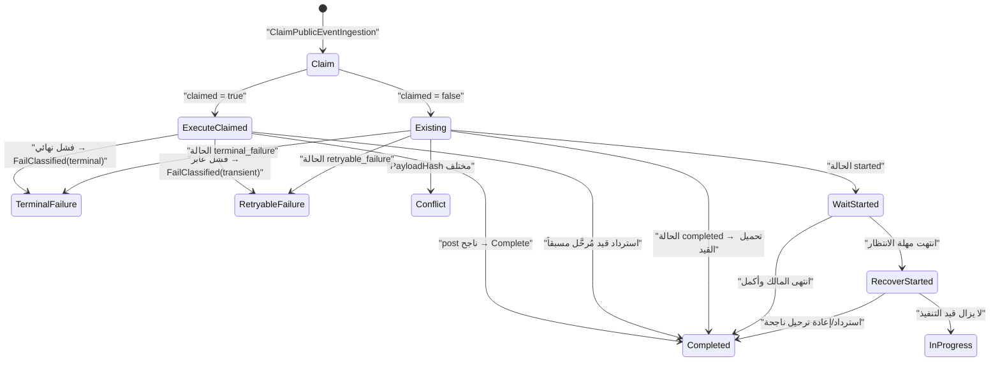

# دليل حزمة `pkg/sdk` — التفاصيل الداخلية ودورة الحياة (`SDK Internals & Lifecycle`)

> **وثيقة مكملة:** للتعريف العام والمعمارية وخريطة الملفات وسطح `Engine`، راجع [النظرة العامة لحزمة `pkg/sdk`](./SDK_OVERVIEW.md).

## 7. طبقة التطبيق (`application.go`)

هذه الطبقة هي **القناة الإلزامية الوحيدة** إلى النواة؛ لا يوجد أي مسار مباشر من SDK إلى `CommitPosting` عداها.

### 7.1 المُنشئات والواجهات المُعلَنة

| الدالة | السلوك |
| --- | --- |
| `NewApplicationService(ports)` | يستدعي `WithAuthorizer(nil)` ثم `WithPostingConfig(PostingConfig{}, nil)` |
| `NewApplicationServiceWithAuthorizer(ports, authorizer)` | كما سبق مع Authorizer |
| `NewApplicationServiceWithPostingConfig(ports, config, authorizer)` | `ports.Validate()` ثم `newApplication` |

`applicationService` يُعلن التزامه بـ 4 واجهات:

```go
var _ publicapplication.Service = (*applicationService)(nil)
var _ publicapplication.TransactionalService = (*applicationService)(nil)
var _ publicapplication.IdempotentPostingLookup = (*applicationService)(nil)
var _ publicapplication.DeterministicDraftCreator = (*applicationService)(nil)
```

### 7.2 `masterDataReaderAdapter` — جسر الأنواع

يحوّل `publicmasterdata.Company` إلى `kernalmasterdata.Company`، و`publicmasterdata.Journal` إلى `kernalmasterdata.Journal` (بـ `EffectiveFrom = 2000-01-01`)، ويمرّر الحسابات والفترات كما هي.

استراتيجيات خاصة:

| الدالة | الاستراتيجية |
| --- | --- |
| `GetJournalByID` | يجرب أولاً منفذاً خاصاً يُعيد نوع kernal، ثم منفذاً يُعيد النوع العام، ثم `GetJournalByCode("GENERAL")` إذا طابق الـ ID؛ وإلا يُعيد مجلة تركيبية باسم `GENERAL` وتاريخ `2000-01-01` **فقط كمسار توافق قديمي** حين لا يوفّر المحول متجراً مؤرخاً/منفذاً خاصاً للمجلات (انظر الملاحظة أدناه). |
| `GetPeriodByNumber` | يتطلب منفذاً خاصاً؛ وإلا يعطي `errors.New("adjustment periods not supported")`. |

> **المجلة التركيبية `GENERAL` (توافق قديمي، ADR P11-04):** القيمة `2000-01-01` كانت تُستخدم تاريخياً كعنصر افتراضي؛ بعد ADR P3-01/P11-04 لا يُعدّ بديلاً صامتاً عن متجر مؤرخ. إذا وفّر المضيف متجر يوميات/سياسات مؤرخاً، يُعتمد عليه ويُفشل مغلقاً عند غياب اليومية أو غياب نسخة تغطي التاريخ؛ المسار التركيبي محصور في المحولات القديمة التي لا تعرض منفذاً مؤرخاً، ولا يجوز أن يتقدّم على متجر فعلي. لا علاقة له بسياسات `2000-01-01` الاصطناعية المذكورة في §7.4.

### 7.3 `executePosting` و`executeReversalPosting` (`application.go:176`)

1. `ports.Sequences.NextSequence(ctx, companyID, journalID)` → تحديد `SequenceNumber`، و`EntryNumber` إن كان فارغاً.
2. بناء `storage.PostingCommit`:
   - `Operation: storage.OperationPost` أو `storage.OperationReverse`.
   - `OriginalEntryID` يُرسل فقط في حالة العكس.
   - `ActorID` / `Reason` / `CorrelationID` من `PostOptions`.
   - `Idempotency` من `commitIdempotency`: ينسخ نطاق النواة الخاتم والبصمة المستقرة لمساري `post`/`reverse`؛ التلميح المحقَّق `revaluation` يُحفظ كما هو ولا يُعاد تعيينه إلى `post`. لا يوجد use-case عام لإعادة التقييم في SDK (المرحلة 11، `G-024`، ADR P11-01).
3. `ports.Posting.CommitPosting(ctx, commit)` — الذرية مسؤولية المحوّل.
4. إلحاق سجل تدقيق عبر `ports.Audit.AppendAudit` إن وُجد. بعد المرحلة 11 يُلحق Adapter سجل التدقيق **ذرياً في نفس معاملة القيد** (`UnitOfWork`)؛ إلحاق SDK منفصل أُزيل لمنع دليل غير متوازن.

### 7.4 `ensurePolicies` (`application.go:260`)

عند غياب السياسات عن `PolicyEngine`، تُشتق سياسات افتراضية من بيانات الشركة:

| السياسة | القيم الافتراضية |
| --- | --- |
| `CurrencyPolicy` | `FunctionalCurrency` و`PresentationCurrency` من الشركة، `RoundingBankers`، عملات مسموح بهما فقط، `AutoSettleRoundingDifferences = false`، سريان من 2000-01-01 |
| `PostingPolicy` | سياسة فارغة للشركة، سريان من 2000-01-01 |

هذا المسار **للتوافق فقط** عندما لا يوفّر المضيف مخزن سياسات، أو عندما يكون المخزن موجوداً بصفر نسخة لهذه الشركة (أي أنها لم تشترك بعد في السياسات المؤرخة). أخطاء `SetCurrencyPolicy` / `SetPolicy` **تُعاد ولا تُبتلع** بعد المرحلة 11 (`G-021`). بمجرد إلحاق أول نسخة يصبح المخزن مصدر الحقيقة ولا يعود المسار القدامي متاحاً؛ تُمسَح السياسات الاصطناعية المسجَّلة سابقاً لهذه الشركة قبل تسجيل النسخ المخزَّنة، حتى لا تُجيب التواريخ غير المغطاة ولا يتعارض أول إصدار يبدأ عند 2000-01-01. التحميل محمي بقفل لكل شركة لمنع التسجيل المزدوج عند التزامن.

عند وجود `ports.Private[storage.PolicyStoreExtensionKey]` (`G-020`) تُحمَّل كل نسخ الشركة مرة واحدة (`loadVersionedPolicies`) وتُسجَّل بنوافذها الأصلية؛ لا تُشتق سياسة اصطناعية، والغياب عن تاريخ القيد يُفشل مغلقاً (`ensureVersionedPoliciesIsEffective`). تعارض الإصدارات يُترجم إلى `ErrConflict` وغياب النسخة إلى `ErrNotFound`. التفاصيل في [ADR P11-04](./KERNEL_ARCHITECTURE_DECISION_RECORDS.md#adr-p11-04).

### 7.4.1 منافذ master data الاختيارية (المرحلة 11، `G-019`/`G-022`)

يربط SDK قارئ النسخة النافذة ومراكز التكلفة والأبعاد التحليلية انتقائياً إن وفّرها المحول؛ التنفيذ في `newApplication` (`application.go`) يستخدم **type assertions على `ports.MasterData`** لـ `publicmasterdata.EffectiveAccountReader` و`CostCenterReader` و`AnalyticalDimensionReader`، ثم يغلّفها في قارئ مركّب قبل تمريره إلى `posting.NewPostingPipeline` (وفق [ADR P11-02](./KERNEL_ARCHITECTURE_DECISION_RECORDS.md#adr-p11-02)). أما `Ports.Private[PolicyStoreExtensionKey]` فيُستخدم لمخزن السياسات المؤرخ (ADR P11-04)، وليس لاكتشاف منافذ master data. غياب القدرات يُبقي النواة في وضع الفشل المغلق؛ لا تُوسَّع `storage.Ports` المستقرة، ولا تظهر أنواع `internal/kernal` في التوقيعات العامة.

### 7.5 `authorize` (`application.go:290`)

ترتيب الفحوص:

1. إذا وُجد Authorizer → `ActorID` لا يمكن أن يكون فارغاً → `ErrUnauthorized`.
2. `CompanyID` صفرية → `ErrValidation`.
3. إذا كان Principal يملك قائمة شركات → يجب أن تكون الشركة ضمنها → `ErrForbidden`.
4. استدعاء `authorizer.Authorize(ctx, AuthorizationRequest{...})` → أي خطأ يُغلَّف `ErrForbidden`.

### 7.6 الأوامر الخمسة

| الأمر | أهم التفاصيل |
| --- | --- |
| `CreateDraft` / `CreateDraftWithID` | ID تلقائي إن لم يُعطَ؛ تاريخ effective ← now، posting ← effective؛ مجلة افتراضية عبر بحث `GENERAL` ثم `RETAIL, AGRICULTURE, SAAS, DEFAULT`؛ توليد ID لكل سطر؛ تصنيف افتراضي `EntryClassRegular`؛ تحليل `ExchangeRate` بـ decimal؛ حفظ عبر `Drafts.SaveDraft`. |
| `Validate` | يتطلب حالة `draft`، يضمن السياسات، ثم `posting.ValidateEntryDoubleEntry`. |
| `Post` | `Idempotency.Claim` (من `storage.Ports`) → إذا كانت الحالة `completed` فيُعاد القيد مع `IdempotentReplay: true`، وإلا `ErrIdempotencyInProgress`؛ ثم `pipeline.PostEntry`؛ عند الفشل يُعلَّم المفتاح `retryable_failure` (فشل عابر) أو `terminal_failure` (فشل نهائي) وفق تصنيف `posting.IsRetryable`، وعند النجاح `Complete`. |
| `Reverse` | `posting.BuildReversalEntry` ثم نفس الـ pipeline مع `Reason` و`PostOptions`. |
| `GetEntry` | تفويض إلى `Entries.GetEntry` بعد التفويض. |

أخيراً `classifyError` يحوّل أخطاء النواة/MasterData إلى تصنيف `publicapplication` (`ErrNotFound`، `ErrValidation`) ويمرّر ما سبق تصنيفه كما هو.

---

## 8. استيعاب الأحداث (`event_ingestion.go`)

هذا هو أكبر وأدق ملف في SDK: **895 سطراً**، ويتضمن آلة حالات كاملة لمنع التكرار والتعافي.

### 8.1 الأنواع العامة المستعارة

```go
type PublicEventIngestion = publicevents.Ingestion
type PublicEventAccountMapping = publicevents.AccountMapping
type PublicEventIdempotencyStore = publicevents.IdempotencyStore
type PublicEventScopedIdempotencyStore = publicevents.ScopedIdempotencyStore
type PublicEventMappingStore = publicevents.MappingStore
```

ولا تُعرَّف أنواع تخزين جديدة؛ كل شيء يعود إلى `pkg/spi/events`.

### 8.2 بصمة الحدث (`publicEventFingerprint`, السطر 42)

- تُحسب `SHA-256` لـ JSON حتمي يضم: `hash_version = "v1"`، `EventType`، `EventID`، `CompanyID`، `LedgerID` (بعد trim)، `EffectiveDate` (بصيغة UTC)، `Amount`، `Dimensions`، `Payload`، `JournalDraft`، و`PostingRule` كاملة.
- الهدف: اكتشاف إعادة استخدام نفس مفتاح idempotency **بحمولة مختلفة** → `ErrIdempotencyKeyConflict`.
- الحقول غير القابلة للتسلسل (مثل `chan`) تُرفض بخطأ.
- `encoding/json` يرتب مفاتيح الخرائط، لذا البصمة حتمية عبر الطلبات.

### 8.3 `ProcessEvent`: التحقق الأولي (السطر 131)

| الشرط | الخطأ |
| --- | --- |
| `useCases == nil` | `ErrDependencyUnavailable` مغلّفاً بـ `ErrCapabilityNotImplemented` |
| `EventType` فارغ / `CompanyID` صفرية / `EventID` فارغ | `ErrValidation` |
| لا `JournalDraft` و المبلغ سالب أو صفر | `ErrValidation` |
| `Dimensions` غير فارغة | `ErrEventDimensionsUnsupported` (غير مدعوم حالياً) |
| `JournalDraft` + `Payload` معاً | `ErrEventPayloadUnsupported` |
| لا تاريخ سريان (EffectiveDate) ولا تاريخ ترحيل في المسودة | `ErrValidation` |

### 8.4 سياق الطلب (`eventCommandContext`, السطر 837)

أولويات دقيقة:

| الحقل | الأولوية |
| --- | --- |
| `Principal` | من `ctx`؛ إن غاب ولم يكن Authorizer مركّباً → `{ActorID:"event-ingestion", CompanyIDs:[event.CompanyID]}`؛ إن كان مطلوباً → يبقى فارغاً (لا هوية مُخترَعة) |
| `CorrelationID` | `RequestMetadata` ← `event.CorrelationID` ← `event.EventID` |
| `IdempotencyKey` | `event.IdempotencyKey` ← `RequestMetadata` |
| `SourceSystem` | `RequestMetadata` ← `event.SourceSystem` ← `"event"` |

### 8.5 طريقتان لإدخال القيد

**المسار A — `JournalDraft` جاهز (مفضّل للمحوّلات ذات السياق المحاسبي الكامل):**

- يُنسخ القيد، وتُملأ `CompanyID` من الحدث إن كانت صفرية، ويُرفض أي تعارض في الشركة.
- `SourceModule` ← EventType، `ReferenceID` ← EventID، التواريخ تُكمل بعضها.
- يُرفض أي status غير `draft`.
- `normalizeLedgerEntryIDs` يولّد IDs مفقودة ويُكمل التواريخ والحالة.

**المسار B — قاعدة ربط/تعيين:**

1. `MappingStore.GetPublicEventAccountMapping(companyID, eventType, LedgerID)`، ومحاولة ثانية بـ `LedgerID = ""` إن لم تُوجد نتيجة.
2. إن لم يُوجد → `router.GetRules(eventType)` وأول قاعدة تُستخدم.
3. إن لم يُوجد شيء → `no account mapping/rule registered for event type "<...>"`.
4. `constructEventEntry` يبني قيداً من سطرين (مدين/دائن) بمعدل صرف 1 وصفرية العملة المقابلة.

### 8.6 `constructEventEntry` (السطر 306) — تفاصيل دقيقة

- العملة يجب أن تساوي **العملة الوظيفية للشركة**؛ وإلا `ErrExchangeRateUnavailable` (لا يوجد مصدر FX داخل SDK).
- `resolveDefaultJournalIDForStore`: `JournalCode` من القاعدة أو `GENERAL`؛ إن لم تُوجد مجلة غير `GENERAL` → خطأ؛ إن لم تُوجد `GENERAL` → **تُنشأ تلقائياً** عبر `MasterData.CreateJournal` مع معالجة سباق الازدواج.
- وجود `Payload` يتطلب أن يحتوي `DescriptionTemplate` على النص `.Payload`، وإلا `ErrEventPayloadUnsupported`.
- `resolveRuleAccount`: `GetAccountByCode` أولاً؛ إن فشل والكود UUID صالح → يُستخدم كـ AccountID مباشرة؛ وإلا الخطأ الأصلي.
- `renderEventDescription`: قالب `text/template` مع `missingkey=error`؛ قالب افتراضي `Event: <type> (<id>)`؛ إذا لم يحتوِ القالب على `{{` يُضاف لاحقة `type (id)`؛ النتيجة الفارغة خطأ.
- `CreatedBy = "event:" + EventType`.

### 8.7 آلة حالات idempotency



تفاصيل مهمة:

- **بدون مفتاح idempotency** (`key == ""`): يُرفض بخطأ `ErrIdempotencyKeyRequired` في مسار `PostEntry`؛ أما في مسار استيعاب الأحداث (`ProcessEvent`) فيُرحَّل مباشرة دون سجل ديمومة.
- **بمفتاح بدون مخزن**: `ErrIdempotencyStateUnavailable` → `ErrDependencyUnavailable`.
- **مصدر غير افتراضي**: يتطلب أن ينفّذ المخزن `ScopedIdempotencyStore`؛ وإلا خطأ `does not support source-system scoping`. المصدر الافتراضي `"event"` يحافظ على المفتاح الخام للتوافق مع السجلات القديمة.
- **الحالة `started`:** انتظار مقيّد بـ `WithEventIdempotencyWaitPolicy` (افتراضي 2s/25ms) عبر `waitForIngestion`؛ بعد انتهاء المهلة يُحاول `recoverStartedIngestion`.
- **الاسترداد (`recoverPostedEntry`):** يبحث أولاً عن قيد مُرحَّل بالـ `EntryID` المخزَّن؛ إن وُجد يكتفى به ولا يعيد الترحيل. هذا هو جوهر منع الترحيل المزدوج بعد انهيار العملية.
- **تصنيف الفشل (`classifyEventFailure`):** عابر إذا كان `storage.IsRetryable` أو `ErrTransactionAborted` أو `ErrDependencyUnavailable` أو `context.DeadlineExceeded/Canceled` أو `net.Error`؛ وإلا نهائي.
- **ترتيب تفضيل الواجهات:** `ClassifiedIdempotencyStore` ← `ScopedIdempotencyStore` ← الواجهة الأساسية (لـ `failIngestion`)، و`Scoped` ← الأساسية (لـ `get/complete`).
- `postEventEntry` يستدعي `CreateDraft` ثم `Post` بـ **نفس** `requestContext` لضمان بقاء الهوية والارتباط.

---

## 9. الخيارات (`options`) والقدرات القلاعية (Bootstrap Capabilities)

### 9.1 جدول الخيارات (`options.go` + `bootstrap_capabilities.go`)

| الخيار | الأثر | التحقق |
| --- | --- | --- |
| `WithStoragePorts(ports)` | يضبط المنافذ ويجعل `portsConfigured = true` | يُتحقق في `preflight` |
| `WithReporting(store)` | يفعّل خدمة التقارير | store ≠ nil |
| `WithGovernance(store)` | يفعّل خدمة الحوكمة | store ≠ nil |
| `WithAuthorizer(authorizer)` | يفرض Principal موثّقاً ويجعل `requirePrincipal = true` | authorizer ≠ nil |
| `WithPostingConfig(config)` | **يعلن** ضوابط مطلوبة | يُتحقق في Build |
| `WithPostingCapabilities(caps)` | يوفّر القدرات التي تتحقق منها PostingConfig | لا تحقق هنا |
| `WithEventIdempotencyWaitPolicy(timeout, interval)` | يضبط زمن انتظار مالك المفتاح | لا قيمة سالبة |
| `WithStandard(module)` | يضيف وحدة معيار/قطاع | module ≠ nil |
| `WithSubledgerARAP(stores)` | يعلن توفّر مخازن AR/AP | يجب توفّر `Receivables` و`Payables` و`Balance` (كشف typed-nil عبر `reflect`) |
| `WithRequiredCapabilities(caps...)` | يفرض توفر قدرات قبل البناء | أسماء معروفة فقط، إزالة التكرار |

> **موقع الخيار:** `WithRequiredCapabilities` مُعرَّف فعلياً في `bootstrap_capabilities.go` (ويُطبَّق أثناء `Build`/`preflight` عبر `builder.go`)، **وليس في `options.go`** الذي يحمل بقية خيارات `WithXXX`.

### 9.2 `PostingConfig` (`posting_config.go`)

> تعليق الكود الحرفي: *"Requirements are checked during Build; they are not enabled by setting these flags alone."*

| الحقل | ما الذي يتحقق منه Build |
| --- | --- |
| `RequireApproval` | `postingCaps.ApprovalGate` غير nil |
| `RequireFinancialDimensions` | `postingCaps.FinancialDimensions` غير nil |
| `RequireMakerCheckerPolicy` | `postingCaps.MakerCheckerPolicy` غير nil |
| `RequirePolicy` | وجود `ports.Private["accounting_engine.posting_policy"]` |

`isNilCapability` يستخدم `reflect` لكشف **typed-nil** (مؤشر داخل واجهة)، اختبار `TestBuilderTreatsTypedNilPostingCapabilityAsMissing` يثبت ذلك.

### 9.3 القدرات القلاعية (`bootstrap_capabilities.go`)

المبدأ: `Enabled(capability) ⇒ Available(capability)`. هذه القدرات **مُتطلبات فشل سريع** وليست مفاتيح تفعيل؛ يعني ذلك أنك إن طلبت `BootstrapReporting` ولم تمرّر `WithReporting` أو المنافذ اللازمة، يفشل `Build` برسالة تخبرك بالخيار المطلوب.

| القدرة | شرط التوفر الوارد في الخطأ |
| --- | --- |
| `BootstrapReporting` | `WithReporting` أو `Balance + MasterData + Entries` |
| `BootstrapGovernance` | `WithGovernance` أو منفذ `Audit` |
| `BootstrapStandards` | وجود وحدة واحدة على الأقل عبر `WithStandard` |
| `BootstrapEventIngestion` | `Ports.Events.Idempotency` و`Ports.Events.Mappings` معاً |
| `BootstrapSubledgers` | `WithSubledgerARAP` |
| `BootstrapPostingPolicy` | `Private["accounting_engine.posting_policy"]` أو إحدى قدرات postingCaps |

يتم تجميع كل الأخطاء معاً عبر `errors.Join` في `preflight`.

---

## 10. الحزمة الفرعية `sdk/templates`

توفّر **محولات قطاعية جاهزة الشكل لكنها لا تحتوي على قواعد محاسبية مخفية** — القواعد يقدّمها المستهلك صراحةً.

| المحول | التأثيرات (`Effect`) |
| --- | --- |
| `RetailAdapter` | `sale`، `refund`، `inventory_receipt` |
| `AgricultureAdapter` | `harvest`، `produce_sale`، `livestock` |
| `SaaSAdapter` | `subscription_charge`، `renewal`، `cancellation` |

مدخل موحّد:

```go
type EventInput struct {
    EventID, LedgerID, IdempotencyKey string
    CompanyID types.CompanyID
    EffectiveDate time.Time
    Amount types.Money
}
```

قواعد البناء (`newAdapter`, السطر 173):

- يجب توفّر قاعدة واحدة على الأقل.
- كل تأثير يحتاج `EventType` و`DebitAccountCode` و`CreditAccountCode` (بعد trim).
- منع تكرار `EventType` بين تأثيرات نفس المحول.
- اسم الوحدة = `"sector-" + name`، الإصدار `1.0.0`، لا تبعيات.
- تنفّذ `standards.StandardModule` بالكامل: `ValidateDependencies` و`Initialize` يستدعيان `standards.ValidateStandardModulePorts`، `RegisterRules` يسجّل القواعد، و`RunScheduledJobs` / `Close` لا-op.
- `Event(effect, input)` يتحقق من EventID والشركة والمبلغ الموجب ثم يبني `events.AccountingEvent`.

> **نقطة دقيقة:** قواعد المحول تُسجَّل في `events.Router` عبر `WithStandard`، لكن `ProcessEvent` يستشير **`Events.Mappings` أولاً** ثم Router. لذلك في التطبيقات العملية يجب حفظ التعيين في `MappingStore` (كما يفعل `adapters_test.go`)، وإلا استُخدمت قواعد المحول كحل احتياطي.

---

## 11. مرجع الأخطاء

| الخطأ | المصدر | متى يظهر |
| --- | --- | --- |
| `ErrCapabilityNotImplemented` (= `types.ErrCapabilityNotImplemented`) | `errors.go` | قدرة غير مفعّلة/غير متوفرة |
| `ErrStoragePortsRequired` | `errors.go` | `Build` بدون `WithStoragePorts` |
| `ErrBuilderOptionNil` | `errors.go` | خيار `nil` في `NewBuilder` |
| `ErrIdempotencyKeyConflict` | `errors.go` | نفس المفتاح بحمولة/بصمة مختلفة |
| `ErrIdempotencyInProgress` | `errors.go` | مالك المفتاح لا يزال يعمل |
| `ErrIdempotencyTerminalFailure` | `errors.go` | المفتاح فشل نهائياً سابقاً |
| `ErrIdempotencyStateUnavailable` | `errors.go` | مخزن idempotency غائب/لا يدعم النطاق |
| `ErrEventMappingNotFound` | `errors.go` | لا يوجد ربط لنوع الحدث |
| `ErrExchangeRateUnavailable` | `errors.go` | عملة الحدث ≠ العملة الوظيفية |
| `ErrEventDimensionsUnsupported` | `errors.go` | أبعاد الحدث غير مدعومة حالياً |
| `ErrEventPayloadUnsupported` | `errors.go` | payload بلا قالب يمرّر `.Payload` |
| `ErrIdempotencyRecordNotFound` / `ErrIdempotencyStateConflict` | `pkg/spi/events` | أخطاء مخزن الأحداث |

**تصنيف الأخطاء العام** في `publicapplication`: `ErrUnauthorized`, `ErrForbidden`, `ErrValidation`, `ErrNotFound`, `ErrConflict`, `ErrDependencyUnavailable`. SDK يغلّف أخطاءه دائماً عبر `publicapplication.NewError` أو `wrapEventError` كي يبقى التصنيف موحّداً عبر كل بوابات النقل.

---

## 13. الاختبارات وماذا تثبت

| الملف | أهم ما يثبت |
| --- | --- |
| `builder_test.go` | `Build` يفشل بدون منافذ؛ النجاح مع `memory.Ports()`؛ دورة حياة الوحدة `ValidateDependencies/Initialize` تسمى مرة واحدة؛ `ModulePorts` تحتوي قراءات وخدمة تطبيق؛ القدرات الغائبة تُعيد `ErrCapabilityNotImplemented`؛ `WithRequiredCapabilities` يفشل سريعاً. |
| `application_test.go` | وجود Authorizer يمنع هوية غير موثّقة ولا يستدعي الـ Authorizer؛ ضوابط الترحيل المطلوبة تُرفض عند غيابها وتُقبل عند توفيرها؛ **typed-nil** يُعدّ غائباً. |
| `event_ingestion_test.go` | البصمة تغيّر مع EventID/Payload/Dimensions/Rule وتثبت مع تكرار نفس المدخل؛ رفض payload غير قابل للتسلسل؛ قالب الوصف يقرأ `.Payload`؛ عملة غير وظيفية مرفوضة؛ سياق الطلب الموثّق يصل إلى أوامر التطبيق دون اختراع Principal. |
| `consumer_contract_test.go` | رحلة كاملة: إنشاء بيانات master → `PostEntry` → `GetEntry` → تطابق لقطة القيد (ID، المبالغ، التواريخ، الحالة). |
| `templates/adapters_test.go` | المحولات القطاعية الثلاثة تستخدم القواعد المقدمة من المستهلك + `MappingStore` + master data لترحيل قيود متوازنة؛ رفض القواعد الفارغة/الناقصة. |
| `test/external_consumer/*` | مستهلك خارجي يبني المحرك ويترحل باستخدام `pkg/sdk` فقط (مع فحص AST لمنع `internal/*` و`storage/*`). |

نتيجة تشغيل `go test ./pkg/sdk/...` في هذه الحالة: **OK**.

---

## 14. الحالة الراهنة والفجوات الموثقة

هذه ملاحظات **قراءة شفرة فعلية**، وليست افتراضات تصميمية؛ تهمّ من يخطط للاعتماد على هذه القدرات:

| # | الملاحظة | الأثر العملي |
| --- | --- | --- |
| 1 | `engineInstance` لا يُعرّف دالة `YearEndClosing()` ولا `SubledgerARAP()` رغم وجود الحقلين `yearEndClosing` و`arapService` | الدالتان `sdk.YearEndClosing(engine)` و`sdk.SubledgerARAP(engine)` تُعيدان `ErrCapabilityNotImplemented` دائماً مع المحرك الخرساني الحالي؛ `arapService` لا يُعيَّن في `Build`. |
| 2 | `optionalYearEndClosingService(b.useCases)` يعتمد على type assertion، و`applicationService` لا تنفّذ `YearEndClosingService` | الحقل `yearEndClosing` يبقى `nil` حتى مع توفر `TxRunner`. |
| 3 | `WithSubledgerARAP` يتحقق من المتاجر ويحفظها لكن لا يبني خدمة AR/AP | `BootstrapSubledgers` قد ينجح بينما لا توجد خدمة فعلية يمكن الوصول إليها عبر `Engine`. |
| 4 | `preflight` يسجّل `CapReporting` عند توفر `Balance+MasterData+Entries`، لكن `Engine.Reporting()` يتحقق من `reportingStore` فقط | قد تُظهر `Diagnostics` قدرة reporting متاحة بينما `Reporting().GetTrialBalance` يُعيد `ErrCapabilityNotImplemented` ما لم يُستدعَ `WithReporting`. |
| 5 | نفس النمط في الحوكمة: منفذ `Audit` يكفي لتسجيل القدرة، بينما `defaultGovernanceService` يُبنى بـ `store = nil` | `RecordAuditLog` قد يُعيد `ErrCapabilityNotImplemented` رغم ظهور القدرة في التشخيص. |
| 6 | `GetDisclosures` في `defaultReportingService` و`disabledReportingService` يعيد دائماً `ErrCapabilityNotImplemented` | لا توجد إفصاحات عبر SDK حالياً رغم وجود أنواع `reporting.DisclosureQuery`. |
| 7 | `FindPostedEntryByIdempotencyKey` يُعيد `false, nil` دائماً | لا يمكن استخدامه لاكتشاف replay خارج مسار `Post` نفسه. |
| 8 | `ProcessEvent` يرفض `Dimensions` تماماً ويتطلب عملة = العملة الوظيفية | لا تحويل FX ولا أبعاد تحليلية عبر هذا المسار حالياً. |
| 9 | فشل `RunScheduledJobs` لا يُفشل `Build` | يُسجَّل كـ disabled reason فقط؛ راقب `Diagnostics().DisabledReasons`. |
| 10 | `internal/orbitals/sdkapplication` يحتوي على `doc.go` فقط | الحزمة محجوزة معمارياً لكنها لا تحتوي محولات استخدام بعد. |
| 11 | أخطاء `AppendAudit` و`setPolicy` (`G-021` **مغلقة** في المرحلة 11) | `setPolicy` لم يَعُد مُهمَلاً، والتدقيق يُلحق ذرياً في Adapter؛ الأخطاء تُعاد ولا تُبتلع. تأكيد التغطية يتم بتشغيل بوابة العقد الكاملة، لا بتصنيف الفجوة مفتوحة/جزئية. |
| 12 | `GetJournalByID` في محول البيانات الوصفية قد يُعيد مجلة `GENERAL` تركيبية (`2000-01-01`) | مسار توافق قديمي فقط عند غياب متجر مؤرخ؛ مع متجر مؤرخ يفشل مغلقاً (ADR P11-04). تحقق من وجود المجلات فعلياً قبل الاعتماد عليه. |

> هذه القائمة يجب مراجعتها عند كل تحديث للمحرك؛ الهدف منها منع الافتراض الخاطئ بأن "التسجيل في Diagnostics" يعني "خدمة قابلة للاستدعاء".

---

## 15. قواعد الصيانة والتطوير

1. **لا تستورد `storage/*` داخل `pkg/sdk`.** مرّر `storage.Ports` فقط.
2. **لا تُعرّض أنواع `internal/kernal/*` في توقيعات عامة.** استخدم `pkg/api/v1` و`pkg/spi` دائماً.
3. **أي قدرة جديدة تحتاج ثلاثة أجزاء:** خيار `WithXXX`، تحقق في `preflight`، وخدمة تُعيد `ErrCapabilityNotImplemented` عند الغياب.
4. **أضف اختباراً خارجياً** في `test/external_consumer` يثبت أن المستهلك لا يحتاج `internal/*` عند استخدام القدرة الجديدة.
5. **حافظ على Fail-fast:** أخطاء التهيئة تُجمع ولا تُبتلع؛ لا تُفعَّل قدرة صامتة.
6. **أي تغيير في `publicEventFingerprint` يحتاج رفع `PublicEventPayloadHashVersion`** وإلا ستُعدّ الحمولات القديمة متعارضة.
7. **احفظ ترتيب الإغلاق العكسي** للوحدات، واستخدم `sync.Once` لأي مورد جديد في `engineInstance`.
8. **لا تضف منطقاً محاسبياً في SDK**؛ ضعه في `internal/kernal` واستدعِه من طبقة التطبيق.

---

