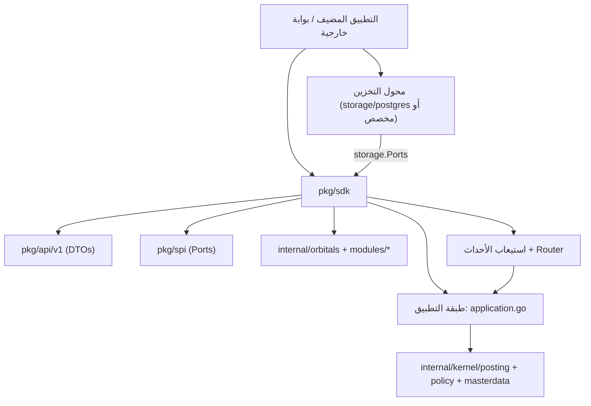
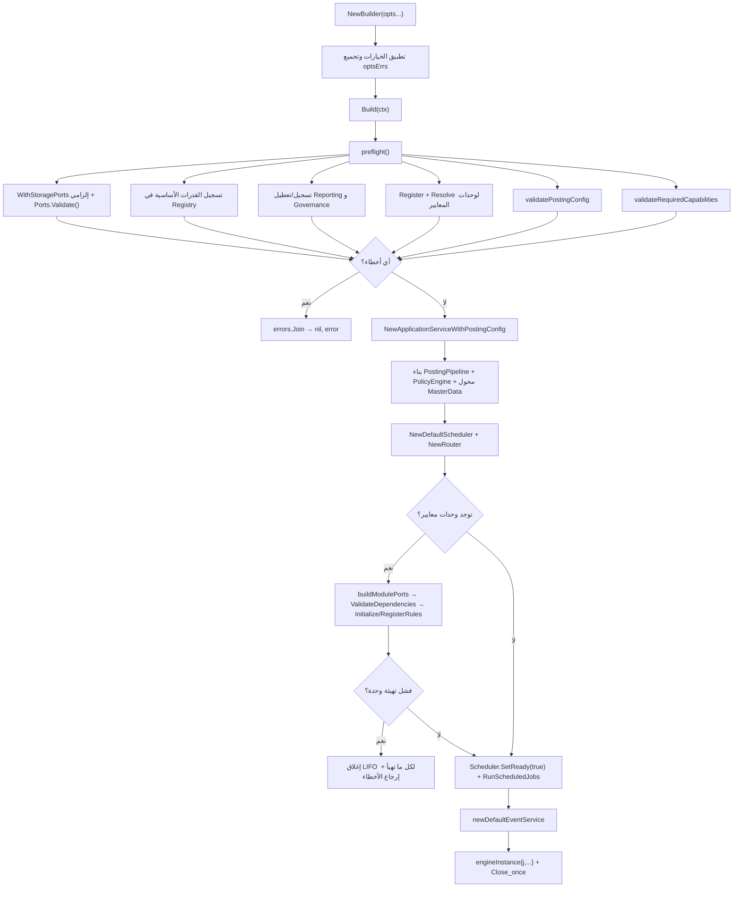

# دليل حزمة `pkg/sdk` — النظرة العامة والمعمارية (`SDK Overview`)

> **وثيقة مكملة:** للتفاصيل الداخلية (`application.go`، استيعاب الأحداث، الخيارات، الأخطاء، والاختبارات)، راجع [دليل التفاصيل الداخلية ودورة الحياة](./SDK_INTERNALS_AND_LIFECYCLE.md).

## 1. الخلاصة التنفيذية

`pkg/sdk` هي **الواجهة العامة الوحيدة** التي يستخدمها النظام المضيف (Host Application) للتحدث مع المحرك المحاسبي. هي:

- **مكتبة Go مضمنة (In-Process Library):** لا خادم HTTP، ولا gRPC، ولا منافذ شبكية، ولا بروتوكولات نقل داخلها. كل شيء يتم باستدعاء دوال Go مباشرة داخل عملية التطبيق المضيف.
- **منشئ مركزي (Builder):** تجمع الاعتماديات عبر `sdk.NewBuilder(opts...).Build(ctx)`، ولا يوجد مسار بناء بديل.
- **واجهة تعتمد على المنافذ (Ports):** لا تأخذ خياراً يُسمى `WithPostgres` أو `WithMemory`؛ بل تأخذ `storage.Ports` مجردة يوفّرها محوّل التخزين (Adapter) الذي يختاره المضيف.
- **سطح خدمات مقسّم:** `Ledger()`، `Reporting()`، `Governance()`، `Events()`، `Standards()`، `Scheduler()` (ست خدمات)، إضافةً إلى `Close()` و`CloseWithContext()` لإدارة دورة الحياة لا كخدمات مجال.
- **نظام قدرات صريح (Explicit Opt-in):** التقارير، الحوكمة، المعايير الدولية، الأحداث، والدفاتر المساعدة لا تُفعّل صامتة؛ إما تُقدَّم بشكل صريح أو تُعيد `ErrCapabilityNotImplemented` صراحة.
- **حارسة للثوابت المحاسبية:** تمنع المرور إلى طبقة التطبيق إذا كانت القيود غير مكتملة، وتتحقق من القدرات المطلوبة قبل بناء المحرك (Fail-fast).
- **طبقة تكييف بين عالمين:** تحوّل أنواع `pkg/api/v1` العامة إلى أنواع `internal/kernel`، وتمرّر الأوامر إلى `pkg/spi/application.Service` ثم إلى `internal/kernel/posting`.

الحجم الحالي (جرد 2026-11-27): **21 ملف Go داخل `pkg/sdk`** (18 في الجذر + 3 في `templates/`)، بإجمالي **4,684 سطراً** شاملاً للاختبارات، إضافةً إلى ملف توثيق واحد (`doc.go`) في `internal/orbitals/sdkapplication`.

---

## 2. التعريف الرسمي: ما هي الـ SDK وماذا تعمل؟

تُعرّف `pkg/sdk/doc.go` الحزمة هكذا:

> `Package sdk: Unified embeddable entry point (Engine, Builder, options, event ingestion).`

أي أنها **نقطة الدخول الموحّدة القابلة للتضمين**، وتتحمل أربع مسؤوليات كبرى:

1. **التركيب (Composition):** تجميع النواة المحاسبية `internal/kernel/posting`، وطبقة التطبيق، والمكونات المدارية `internal/orbitals`، ومodules المعايير `modules/*` داخل كائن `Engine` واحد.
2. **التجريد (Facade):** إخفاء التعقيد الداخلي خلف واجهات صغيرة (`LedgerService`، `EventIngestionService`، …).
3. **الحراسة (Guard):** التحقق من اكتمال المنافذ، وصحة القدرات، ووجود هوية موثّقة (Principal) عند تركيب Authorizer، ورفض القيود غير الصالحة قبل الترحيل.
4. **الاستيعاب (Ingestion):** تحويل الأحداث الاقتصادية (`events.AccountingEvent`) إلى قيود يومية (`journal.JournalEntry`) وترحيلها مع ديمومة منع التكرار (Idempotency) واسترداد بعد الأعطال.

**ما لا تفعله الـ SDK:** لا تُعرّف قواعد محاسبية جديدة، لا تُعيد تنفيذ التحقق من التوازن (تستدعي `posting.PostingPipeline`)، لا تتحدث مع قاعدة بيانات مباشرة، لا تُدير هو المستخدمين أو JWT، لا تُعرّف مسارات REST/gRPC.

---

## 3. الموقع المعماري وحدود الاستيراد

### 3.1 قاعدة الاستيراد (Import Charter)

النص الحرفي في `pkg/sdk/doc.go`:

```go
// Import charter: May import pkg/api/v1/*, pkg/spi/*, internal/kernel/* and internal/orbitals/*; never storage/* directly.
```

| الحزمة | مسموح لـ `pkg/sdk`؟ | الغرض |
| --- | --- | --- |
| `pkg/api/v1/*` | ✅ | أنواع البيانات العامة (DTOs): `journal`، `events`، `reporting`، `types`، `ledger`، `governance`، `subledger` |
| `pkg/spi/*` | ✅ | عقود المنافذ: `storage.Ports`، `application.Service`، `standards.*`، `events.*`، `subledger.*` |
| `internal/kernel/*` | ✅ | النواة: `posting`، `policy`، `journal`، `masterdata`، `types` (داخل الحزمة فقط، لا تُعرَض في التوقيعات العامة) |
| `internal/orbitals/*` | ✅ | المكونات المدارية (يُستخدم الآن عبر `sdkapplication` كمساحة محجوزة) |
| `storage/*` | ❌ | محظور قطعاً؛ المضيف هو من يمرّر `Ports` الجاهزة |
| `cmd/*`, بوابات الشبكة | ❌ | غير موجودة أصلاً في هذا المستودع |

**القاعدة الذهبية للمستهلك:** يستطيع التطبيق الخارجي استيراد `pkg/sdk` و`pkg/api/v1` و`pkg/spi` فقط. يثبت ذلك `test/external_consumer/doc.go`:

```go
// Black-box consumer proving that pkg/sdk alone is sufficient for embedding.
// Import charter: Must never import internal/* or storage/*.
```

> ملاحظة: ملف `test/external_consumer/consumer_test.go` يستورد `storage/memory` لأنه اختبار داخل نفس المستودع يوفّر منافذ وهمية؛ أما قاعدة "لا internal / لا storage" فتُفرَض على **كود المستهلك الحقيقي**، وتتحقق منها اختبارات تحليل AST داخل نفس الملف.

### 3.2 مخطط التبعيات



---

## 4. خريطة الملفات

```text
pkg/sdk/
├── doc.go                       # تعريف الحزمة + ميثاق الاستيراد
├── engine.go                    # واجهة Engine والخدمات + ملحق القدرات الاختيارية
├── builder.go                   # EngineBuilder وBuild ودورة الحياة والخدمات الافتراضية
├── options.go                   # كل خيارات WithXXX
├── posting_config.go            # إعلان ضوابط الترحيل المطلوبة والتحقق منها
├── bootstrap_capabilities.go    # القدرات القلاعية المطلوبة (Fail-fast)
├── module_ports.go              # تحويل Ports إلى standards.ModulePorts
├── application.go               # طبقة التطبيق: أوامر/استعلامات + PostingPipeline
├── event_ingestion.go           # استيعاب الأحداث + idempotency + recovery (أكبر ملف)
├── policy_store.go              # مخزن السياسات المؤرخ عبر Ports.Private (ADR P11-04)
├── cash_flow.go                 # ملحق GetCashFlow على خدمة التقارير
├── errors.go                    # أخطاء عامة موحّدة
├── templates/
│   ├── doc.go
│   ├── adapters.go              # محولات قطاعية: retail / agriculture / SaaS
│   └── adapters_test.go
├── application_test.go
├── builder_test.go
├── classify_error_phase8_test.go
├── consumer_contract_test.go
├── event_ingestion_test.go
└── policy_store_test.go

internal/orbitals/sdkapplication/
└── doc.go                       # حزمة محجوزة لمحولات الاستخدام القابلة لإعادة الاستخدام (لا يوجد كود بعد)
```

### جدول المسؤوليات التفصيلية

| الملف | الأسطر تقريباً | المسؤولية الدقيقة |
| --- | ---: | --- |
| `doc.go` | 7 | تعريف الحزمة وميثاق الاستيراد والمرجعية (`AE-PLAN-STEP-P0/P0-02`) |
| `engine.go` | 82 | تعريف `Engine` و`StandardsService` و`LedgerService` و`ReportingService` و`GovernanceService` و`EventIngestionService`، ودالتَي الوصول الاختياريتين `YearEndClosing` / `SubledgerARAP` |
| `builder.go` | 560 | `EngineBuilder`، `NewBuilder`، `Build`، `preflight`، دورة حياة الوحدات، `engineInstance` وكل تطبيقات الخدمات الافتراضية/المعطلة |
| `options.go` | 130 | 9 خيارات `Option` مع تحقق من الـ nil ونوعه |
| `posting_config.go` | 63 | `PostingConfig` + `validatePostingConfig` + كشف القيم nil المُغلَّفة (typed-nil) |
| `bootstrap_capabilities.go` | 140 | 6 قدرات قلاعية + رسائل خطأ قابلة للتنفيذ |
| `module_ports.go` | 31 | بناء `standards.ModulePorts` من `storage.Ports` + `useCases` |
| `application.go` | 848 | مُنشئات خدمة التطبيق، محوّل master data، `PostingPipeline`، `Authorize`، الأوامر الخمسة، السياسات الافتراضية/المؤرخة، تصنيف الأخطاء |
| `event_ingestion.go` | 895 | بصمة الحدث، بناء القيد، اختيار القاعدة، آلة حالات idempotency، الاسترداد، تصنيف الفشل، سياق الطلب |
| `policy_store.go` | 170 | تحميل نسخ السياسات المؤرخة من `Ports.Private` ومسح السياسات الاصطناعية (ADR P11-04) |
| `cash_flow.go` | 24 | `GetCashFlow` عبر تحقق من واجهة اختيارية على `ReportingStore` |
| `errors.go` | 31 | أخطاء `ErrIdempotency*` و`ErrEvent*` وأخطاء المنشئ |
| `templates/adapters.go` | 249 | ثلاثة محولات قطاعية تنفّذ `standards.StandardModule` |
| الاختبارات | ~787 | تغطية العقد الخارجي، البناء، الترخيص، idempotency، البصمة، المحولات |

---

## 5. دورة حياة البناء: من `NewBuilder` إلى `Engine`



### 5.1 `NewBuilder` (`builder.go:50`)

- يهيّئ زمن الانتظار الافتراضي لمنع تكرار الأحداث:
  - `defaultEventIdempotencyWaitTimeout = 2s`
  - `defaultEventIdempotencyWaitInterval = 25ms`
- يمرّ على الخيارات بالترتيب:
  - خيار `nil` يُسجَّل كـ `ErrBuilderOptionNil` ولا يُوقف البناء فوراً.
  - خطأ الخيار يُخزَّن في `b.optsErrs`، ويُعاد لاحقاً عبر `errors.Join` في `Build`.
  - هذا يسمح بإظهار **كل** أخطاء التهيئة دفعة واحدة.

### 5.2 `preflight()` (`builder.go:143`)

| الخطوة | التفاصيل |
| --- | --- |
| المنافذ | `WithStoragePorts` إلزامي وإلا `ErrStoragePortsRequired`. ثم `ports.Validate()` يتطلب 5 منافذ: `Drafts`، `Entries`، `Posting`، `Sequences`، `MasterData`. الباقي اختياري: `Balance`، `Audit`، `Idempotency`، `TxRunner`، `UOWRunner`، `Events`، `Private`. |
| السجل | يُنشأ `standards.NewRegistry()` إذا لم يوجد، ثم يُسجَّل `CapLedgerPosting` و`CapMasterData` باسم المزوّد `engine_core`. |
| التقارير | تُسجَّل `CapReporting` إذا وُجد `WithReporting` **أو** توفرت `Balance + MasterData + Entries`؛ وإلا يُسجَّل سبب التعطيل `reporting data sources missing`. |
| الحوكمة | تُسجَّل `CapGovernance` و`CapAuditTrail` إذا وُجد `WithGovernance` أو منفذ `Audit`؛ وإلا سبب التعطيل `governance required stores missing`. |
| المعايير | كل `StandardModule` يُسجَّل في `Registry` ثم `Resolve()` يرتبها طوبولوجياً حسب `Dependencies()`، وتُستبدل `b.standards` بالقائمة المرتّبة. |
| ضوابط الترحيل | `validatePostingConfig()` (انظر القسم 9.2). |
| القدرات القلاعية | `validateRequiredCapabilities()` (انظر القسم 9.3). |

### 5.3 التهيئة الفعلية (`builder.go:68`)

1. **`NewApplicationServiceWithPostingConfig(b.ports, b.postingConfig, b.authorizer)`**
   - يعيد التحقق من `ports.Validate()` ثم يستدعي `newApplication`.
2. **`newApplication` (`application.go:154`)**
   - ينشئ `policy.NewPolicyEngine()`.
   - يلفّ `ports.MasterData` داخل `masterDataReaderAdapter` لتحويل النوع العام إلى `kernelmasterdata`.
   - ينشئ `posting.NewPostingPipeline(mdAdapter, app.executePosting, posting.WithPolicyEngine(...), posting.WithReversalExecutor(app.executeReversalPosting))`.
3. **جدولة وأحداث**
   - `standards.NewDefaultScheduler()` و`events.NewRouter()`.
4. **وحدات المعايير (فقط إذا وُجدت)**
   - `b.buildModulePorts(publicMasterData)` يبني `standards.NewModulePorts(entries, balance, md, b.useCases)`. لاحظ أن `useCases` يُمرَّر دائماً، بينما قراءات `Entries/Balance/MasterData` تُمرَّر فقط إن وُجدت في `Ports`.
   - `validateStandardModules()` يستدعي `mod.ValidateDependencies(b.modulePorts)`.
   - `initializeStandards()` يستدعي `Initialize` ثم `RegisterRules(router)` لكل وحدة. عند أي فشل يُنفَّذ **rollback بترتيب عكسي (LIFO)** عبر `mod.Close(ctx)` لكل وحدة نجحت، وتُجمع الأخطاء.
   - `scheduler.SetReady(true)` ثم `mod.RunScheduledJobs(ctx, scheduler)` لكل وحدة. **فشل الوظائف المجدولة لا يُفشل البناء**؛ يُسجَّل فقط كـ disabled reason بصيغة `module:<name>:jobs`.
5. **خدمة الأحداث**
   - `newDefaultEventService(b.ports.Events.Idempotency, b.ports.Events.Mappings, eventRouter, publicMasterData, b.useCases, b.authorizer != nil, waitTimeout, waitInterval)`.
   - Logical AND مهم: وجود `Authorizer` يجعل `requirePrincipal = true` في كل من خدمة الأحداث وخدمة القيود.
6. **`engineInstance`** يُجمَّع مع كل المراجع، ويُكتشف `yearEndClosing` عبر تحقق نوعي من `useCases`.

---

## 6. سطح `Engine` والخدمات الست

### 6.1 الواجهة (`engine.go:18`)

```go
type Engine interface {
    Ledger() LedgerService
    Reporting() ReportingService
    Governance() GovernanceService
    Events() EventIngestionService
    Standards() StandardsService
    Scheduler() standards.SchedulerPort
    Close() error
    CloseWithContext(ctx context.Context) error
}
```

| الخدمة | التوقيع | التنفيذ عند توفر القدرة | التنفيذ عند غيابها |
| --- | --- | --- | --- |
| `Ledger()` | `PostEntry` / `GetEntry` / `ReverseEntry` | `defaultLedgerService{useCases, requirePrincipal}` | دائماً متاحة لأن `useCases` إلزامي |
| `Reporting()` | 6 دوال تقارير | `defaultReportingService{store}` | `disabledReportingService` → `ErrCapabilityNotImplemented` |
| `Governance()` | `RecordAuditLog` / `GetApprovalFingerprint` | `defaultGovernanceService{store}` | `disabledGovernanceService` → نفس الخطأ |
| `Events()` | `ProcessEvent` | `defaultEventService` | متاحة دائماً، لكنها ترفض مفاتيح idempotency إذا لم تُوفَّر المخازن |
| `Standards()` | `Registry` / `Diagnostics` / `HasCapability` / `Scheduler` | `defaultStandardsService` | دائماً متاحة |
| `Scheduler()` | `standards.SchedulerPort` | نفس مجدول `Standards()` | دائماً متاحة |

> `Close()` و`CloseWithContext(ctx)` طريقتا دورة حياة (لا تُعدّان خدمة سابعة)؛ `Close()` يفوّض إلى `CloseWithContext(context.Background())` انظر §6.6.

### 6.2 `LedgerService` — مسار الترحيل (`builder.go:359`)

**`PostEntry(ctx, entry)`:**

1. `validatePostingEntry(entry)` يمنع المرور إذا: CompanyID صفرية، JournalID صفرية، عدد الأسطر < 2، أو لا يوجد تاريخ effective/posting. الخطأ من نوع `publicapplication.ErrValidation`.
2. `commandContext(ctx, companyID, "sdk", "sdk", requirePrincipal)` يبني سياق الأمر:
   - يقرأ `Principal` من `ctx` إن وُجد.
   - إن لم يوجد وتم تركيب `Authorizer` → يبقى فارغاً فيُرفض بـ `ErrUnauthorized` داخل `applicationService.authorize`.
   - إن لم يوجد ولم يوجد Authorizer → يُنشأ principal احتياطي `{ActorID: "sdk", CompanyIDs: [companyID]}`.
   - يقرأ `RequestMetadata` من السياق: `CorrelationID` و`IdempotencyKey` و`SourceSystem` (افتراض `"sdk"`).
3. يحول القيد إلى `CreateDraftCommand` ويستدعي `CreateDraftWithID` إن كان القيد يحمل ID وخدمة التطبيق تنفّذ `DeterministicDraftCreator`، وإلا `CreateDraft`.
4. يستدعي `Post(ctx, PostEntryCommand{EntryID: draftResult.Entry.ID})` ويعيد القيد المرحَّل.

**`ReverseEntry`:** يبني `ReverseEntryCommand` بـ `Reason` و`EffectiveDate = time.Now().UTC()` ثم يستدعي `useCases.Reverse` (الذي يستدعي بدوره `posting.BuildReversalEntry`).

> ملاحظة أمنية: `CreatedBy` القادم من حمولة القيد **لا يُوثَق به**؛ سياق الطلب (`ctx`) هو من يحدد `Principal` الفعلي (انظر اختبار `TestLedgerPostUsesVerifiedPrincipalAndRequestMetadata`).

### 6.3 `ReportingService` (`builder.go:478` + `cash_flow.go`)

| الدالة | السلوك |
| --- | --- |
| `GetTrialBalance`, `GetBalanceSheet`, `GetIncomeStatement`, `GetGeneralLedger` | تفويض مباشر إلى `storage.ReportingStore` |
| `GetCashFlow` | ملف منفصل `cash_flow.go`: ينجح فقط إذا كان `ReportingStore` ينفّذ واجهة إضافية تحمل نفس التوقيع؛ وإلا `ErrCapabilityNotImplemented` |
| `GetDisclosures` | في كلا التنفيذين (المفعّل والمعطّل) يُعيد `ErrCapabilityNotImplemented` دائماً في هذه النسخة |

### 6.4 `GovernanceService` (`builder.go:535`)

يفوّض `RecordAuditLog` و`GetApprovalFingerprint` إلى `storage.GovernanceStore`. اختبار `TestBuilder_OptionalCapabilitiesFailExplicitly` يضمن أن غياب القدرة يعطي خطأ صريحاً وليس صمتاً.

### 6.5 `StandardsService` والقدرات الاختيارية

- `Diagnostics()` يُعيد `standards.EngineDiagnostics`: الوحدات النشطة، القدرات الفعّالة، مزوّد كل قدرة، ترتيب التبعية، وأسباب التعطيل.
- `YearEndClosing(engine)` و`SubledgerARAP(engine)` في `engine.go:60` يستخدمان **type assertion على واجهة مجهولة (duck typing)**:

  ```go
  provider, ok := engine.(interface{ YearEndClosing() publicapplication.YearEndClosingService })
  ```

  إن لم يُنفّذ المحرك هذه الدالة أو أعاد `nil` → `ErrCapabilityNotImplemented`. (راجع القسم 14 بخصوص الحالة الراهنة).

### 6.6 الإغلاق (`builder.go:304`)

- `Close()` يستدعي `CloseWithContext(context.Background())`.
- `sync.Once` يضمن إغلاقاً واحداً فقط.
- يُغلق كل وحدة بترتيب عكسي، وتُجمع الأخطاء بـ `errors.Join`.
- إذا كان `ctx` ملغىً أصلاً يُضاف خطأ السياق إلى النتيجة.

---

## 12. أمثلة استخدام عملية

### 12.1 بناء أدنى + ترحيل قيد

```go
driver := memory.New() // للاختبار فقط؛ في الإنتاج مرّر Ports محول PostgreSQL
engine, err := sdk.NewBuilder(
    sdk.WithStoragePorts(driver.Ports()),
).Build(ctx)
if err != nil { return err }
defer engine.Close()

amount, _ := types.NewMoneyFromString("125.00", "USD")
zero, _ := types.NewMoneyFromString("0", "USD")

posted, err := engine.Ledger().PostEntry(ctx, journal.JournalEntry{
    CompanyID: companyID, JournalID: journalID,
    EffectiveDate: date, PostingDate: date,
    Description: "SDK example",
    Lines: []journal.EntryLine{
        {AccountID: cashID, TransactionAmount: amount, TransactionCurrency: "USD",
         ExchangeRate: decimal.NewFromInt(1), FunctionalDebit: amount, FunctionalCredit: zero},
        {AccountID: revenueID, TransactionAmount: amount, TransactionCurrency: "USD",
         ExchangeRate: decimal.NewFromInt(1), FunctionalDebit: zero, FunctionalCredit: amount},
    },
})
```

### 12.2 حدث بمسودة جاهزة (لا يحتاج ربط حسابات)

```go
entry, err := engine.Events().ProcessEvent(ctx, events.AccountingEvent{
    EventID: "evt-1", EventType: "invoice.created",
    CompanyID: companyID, IdempotencyKey: "inv-1-v1",
    JournalDraft: &journal.JournalEntry{ /* سطران متوازنان */ },
})
```

### 12.3 حدث بربط الحسابات + هوية موثّقة

```go
ctx = publicapplication.WithPrincipal(ctx, publicapplication.Principal{
    ActorID: "host-user", CompanyIDs: []types.CompanyID{companyID},
})
ctx = publicapplication.WithRequestMetadata(ctx, publicapplication.RequestMetadata{
    CorrelationID: "req-42", SourceSystem: "billing-api",
})

entry, err := engine.Events().ProcessEvent(ctx, events.AccountingEvent{
    EventID: "evt-2", EventType: "retail.sale",
    CompanyID: companyID, EffectiveDate: time.Now(),
    Amount: amount, IdempotencyKey: "sale-2-v1",
})
```

### 12.4 اشتراط قدرات قبل الإقلاع

```go
engine, err := sdk.NewBuilder(
    sdk.WithStoragePorts(ports),
    sdk.WithReporting(reportingStore),
    sdk.WithStandard(ifrs15Module),
    sdk.WithRequiredCapabilities(
        sdk.BootstrapReporting,
        sdk.BootstrapStandards,
        sdk.BootstrapEventIngestion,
    ),
).Build(ctx)
// أي قدرة مفقودة => خطأ يحتوي على الخيار المطلوب إضافته.
```

### 12.5 فحص التشخيص والإغلاق

```go
diag := engine.Standards().Diagnostics()
for _, note := range diag.DisabledReasons {
    log.Printf("capability disabled: %s", note)
}
if err := engine.CloseWithContext(ctx); err != nil { log.Print(err) }
```

---

## 16. المراجع

- `pkg/sdk/doc.go`, `engine.go`, `builder.go`, `options.go`, `posting_config.go`, `bootstrap_capabilities.go`, `module_ports.go`, `application.go`, `event_ingestion.go`, `cash_flow.go`, `errors.go`
- `pkg/sdk/templates/{doc.go,adapters.go}`
- `internal/orbitals/sdkapplication/doc.go`
- `pkg/spi/storage/ports.go` — عقود التخزين ومجموعة المنافذ الإلزامية
- `pkg/spi/application/application.go` — الأوامر والاستعلامات والتصنيف
- `pkg/spi/events/ingestion.go` — حالات idempotency وواجهات المخازن
- `pkg/spi/standards/{module.go,ports.go,registry.go,diagnostics.go}` — دورة حياة الوحدة
- `pkg/api/v1/events/{event.go,rules.go}` — الحدث وقواعد الربط
- `test/external_consumer/*` — إثبات الاكتفاء بـ `pkg/sdk`
- `docs/architecture/ARCHITECTURAL_PRINCIPLES_CHARTER.md` — المبادئ `PRIN-ENG-01..05`
- `docs/architecture/NEW_PROJECT_STRUCTURE.md` — قسم "طبقة السطح العام `pkg/`"
