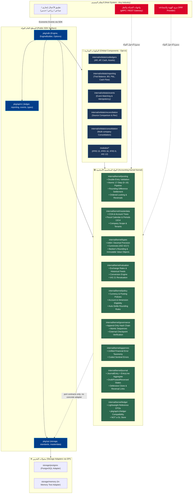
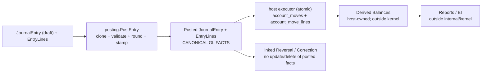

# النواة المحاسبية للرؤية المستهدفة (Target Accounting Kernel Kernel)

> **تحديث المرحلة 1 (2026-11-21):** النسخة 1.1.0 تطابق التنفيذ الفعلي: تسع حزم نواة + حزمة جذر، وتضيف `journal` و`ledger` إلى قائمة المكونات، وتحسم مصدر الحقيقة المحاسبي. انظر [خريطة المعمارية](./KERNEL_ARCHITECTURE_MAP.md) و[ADR P1-01](./KERNEL_ARCHITECTURE_DECISION_RECORDS.md#adr-p1-01) و[ADR P1-02](./KERNEL_ARCHITECTURE_DECISION_RECORDS.md#adr-p1-02) و[ADR P1-03](./KERNEL_ARCHITECTURE_DECISION_RECORDS.md#adr-p1-03). القائمة "السبع حزم" في النسخة 1.0.0 **متجاوزة (Superseded)**.
>
> **ملاحظة نطاق/زمن (2026-11-27):** هذه الوثيقة **لقطة Phase-1 (النسخة 1.1.0)** للمراجعة، لا اعتماد نهائي مستقل. القرارات اللاحقة تُحدِّث تفاصيلها أو تحل محلها: [ADR P7-01](./KERNEL_ARCHITECTURE_DECISION_RECORDS.md#adr-p7-01) (حدود `pkg/api/v1` و`pkg/spi`)، [ADR P8-01](./KERNEL_ARCHITECTURE_DECISION_RECORDS.md#adr-p8-01) (النواة ترتّب مفاتيح الأقفال ولا تُقفل)، و[ADR P11-02](./KERNEL_ARCHITECTURE_DECISION_RECORDS.md#adr-p11-02)/[P11-03](./KERNEL_ARCHITECTURE_DECISION_RECORDS.md#adr-p11-03)/[P11-04](./KERNEL_ARCHITECTURE_DECISION_RECORDS.md#adr-p11-04) (الحساب النافذ، دلالة `BalanceReader`، السياسات المؤرخة). عند التعارض يُرجع إلى سجل ADR.
>
> **بيان الرؤية والمعمارية:**  
> تُحدد هذه الوثيقة الهيكل المفاهيمي والحزمي الدقيق لـ **النواة المحاسبية الصرفة (Kernel Accounting Kernel)** في الرؤية المستهدفة لمشروع `accounting_engine`، مع حصر مكوناتها وحزمها الجوهرية وفصلها فصلاً تاماً عن المكونات المدارية، ومحولات التخزين، وطبقات النقل والمصادقة، لتعمل بوصفها **نواة محاسبية موثوقة وعالية الأداء وقابلة للتضمين (Embeddable Kernel Engine)** فقط.
> قواعد الترحيل المحاسبية الملزمة موثقة في [قواعد العمل المحاسبية](../rules/ACCOUNTING_BUSINESS_RULES.md)؛ وتصف هذه الوثيقة الحد المعماري بين مسؤوليات النواة والمضيف.

---

## فهرس المحتويات

1. [الرؤية والهدف المعماري المستهدف](#1-الرؤية-والهدف-المعماري-المستهدف)
2. [الهيكل المعماري للنواة والمكونات المدارية (Kernel & Orbitals)](#2-الهيكل-المعماري-للنواة-والمكونات-المدارية-kernel--orbitals)
3. [المكونات الأساسية للنواة المحاسبية (Kernel Kernel Components)](#3-المكونات-الأساسية-للنواة-المحاسبية-kernel-kernel-components)
4. [المكونات المدارية حول النواة (Orbital Components)](#4-المكونات-المدارية-حول-النواة-orbital-components)
5. [السطح البرمجي العام المجرد (Public Surface)](#5-السطح-البرمجي-العام-المجرد-public-surface)
6. [موانئ التخزين وعقود العزل (Persistence Ports)](#6-موانئ-التخزين-وعقود-العزل-persistence-ports)
7. [ما تم استبعاده وفصله تماماً عن النواة (Decoupled & Out of Kernel)](#7-ما-تم-استبعاده-وفصله-تماماً-عن-النواة-decoupled--out-of-kernel)
8. [مصفوفة الحزم والمسؤوليات (Package Responsibility Matrix)](#8-مصفوفة-الحزم-والمسؤوليات-package-responsibility-matrix)

---

## 1. الرؤية والهدف المعماري المستهدف

### 1.1 ما هي النواة المحاسبية المستهدفة؟

النواة المحاسبية هي **نظام قياس مالي حتمي نقي (Deterministic Financial Measurement Engine)**، مكتوب بلغة Go، يعمل كـ Embedded Library داخل الأنظمة المضيفة. مسؤوليته الحصرية هي:

* استيعاب الأحداث الاقتصادية وتحويلها إلى أثر مالي متوازن.
* فرض قواعد القيد المزدوج، الترحيل الذري، والحرمة المحاسبية.
* إدارة شجرة الحسابات والعملات وتقويم الفترات المالية.
* ضمان صحة الأرصدة **المشتقة** القابلة لإعادة البناء من الحقائق المرحلة، وإثبات مسار التدقيق غير القابل للتلاعب؛ لا تخزّن النواة رصيداً مادياً ولا تقارير مالية.

### 1.2 فلسفة الفصل المعماري

* **النواة في المركز (Kernel at the Center):** تمثل أصغر مجموعة برمجية حتمية لا غنى عنها لتحقيق السلامة المحاسبية.
* **المدارات حول النواة (Orbitals around Kernel):** وظائف وموديلات مالية اختيارية تعتمد على النواة ولا تؤثر على سلامتها.
* **الخارج المطرود (Decoupled Periphery):** حظر كامل لتضمين المصادقة (Auth)، بروتوكولات الشبكة (HTTP/gRPC)، أو العمليات التشغيلية التجارية داخل النواة.

---

## 2. الهيكل المعماري للنواة والمكونات المدارية (Kernel & Orbitals)



---

## 3. المكونات الأساسية للنواة المحاسبية (Kernel Kernel Components)

تتألف النواة المحاسبية الصرفة حصراً من **تسع حزم تنفيذية**، إضافة إلى حزمة جذر `internal/kernel` التي تحمل charter الاستيراد والفحوص المعمارية فقط. ترتيب الحزم أدناه هو ترتيب تقديمي؛ خريطة الاعتماد الفعلية ومسؤوليات كل حزمة مُثبّتة في [KERNEL_ARCHITECTURE_MAP.md](./KERNEL_ARCHITECTURE_MAP.md):

| # | الحزمة | الدور |
| --- | --- | --- |
| 1 | `internal/kernel/types` | القيم والمعرفات (أساس بلا تبعية نواة) |
| 2 | `internal/kernel/journal` | aggregate القيد (تعريف لا تحقق ولا حفظ) |
| 3 | `internal/kernel/ledger` | DTO مرجعي للسطح العام (ليس GL) |
| 4 | `internal/kernel/masterdata` | الحقيقة المخولة للحسابات والفترات |
| 5 | `internal/kernel/governance` | سلسلة التدقيق والتحقق |
| 6 | `internal/kernel/policy` | سياسات نافذة وأهلية |
| 7 | `internal/kernel/posting` | أنبوب الترحيل والتحقق والعكس |
| 8 | `internal/kernel/valuation` | أسعار الصرف وإعادة التقييم |
| 9 | `internal/kernel/apperrors` | تصنيف أخطاء للتوافق العام |

### 3.1 محرك الترحيل والقيد المزدوج (`internal/kernel/posting`)

> **طول الأنبوب:** خط أنابيب الترحيل مكوّن من **17 مرحلة (0–16)** في اللقطة الحالية؛ وصف «الأنبوب الثماني» في الوثائق الأقدم لقطة متجاوزة (راجع [NEW_PROJECT_STRUCTURE.md](./NEW_PROJECT_STRUCTURE.md)).

* **قلب النواة الحسابي:**
  * التحقق الرياضي الصارم من توازن القيد المزدوج ومطابقة العملة الوظيفية للشركة وعملات الأسطر.
  * جعل `PostingPipeline.PostEntry` نقطة التحقق الإلزامية: لا يفوض الحفظ إلا بعد التحقق من هوية القيد، والشركة واليومية، والسياسات والعملات والفترة والحسابات والأبعاد.
  * إنتاج مفاتيح حسابات فريدة بترتيب حتمي (`OrderedAccountKeys`، و`ExtractAndSortAccountIDs` للتوافق) ليطبّق المحول المضيف أقفال الصفوف بذلك الترتيب؛ النواة نفسها لا تحجز أقفالاً ولا تصدر SQL. أُغلقت `G-002` في المرحلة 8 بعقد قفل محايد وحجز فعلي مُرصَد في المحولين (انظر [عقد القفل](../contracts/KERNEL_LOCKING_CONTRACT.md)).
  * تطبيع مبالغ المعاملة والعملة الوظيفية إلى الوحدات النقدية الصغرى قبل ترحيل القيد، وفق سياسة العملة النافذة؛ ولا تُسوّى الفروق إلا عند تفعيل `AutoSettleRoundingDifferences` وضبط حسابها، وإلا يُرفض القيد.
  * فرض سعر صرف يساوي `1` عندما تتطابق عملة المعاملة والعملة الوظيفية، والتحقق من هوية القيد ومعرفات الأسطر وعدم تكرارها.
  * إنشاء القيود العكسية كمسودات، وإعادة تحديد الفترة من تاريخ العكس، ثم تسليمها إلى منفذ عكس ذري مستقل يربطها بالقيد الأصلي ويمنع العكس المكرر.
  * فرض الحرمة المطلقة للقيود المرحلة ومنع التعديل أو الحذف (`Immutability`).

> **حدود المسؤولية:** ضمان الذرية عند الحفظ مسؤولية منفذ الترحيل/العكس الذي يوفره المضيف؛ ويتطلب العكس `WithReversalExecutor` ولا يجوز تمريره إلى منفذ الترحيل الاعتيادي. لا تحتوي النواة على RBAC أو أدوار أو صلاحيات أو تفويض أو موافقات معاملاتية؛ تقع المصادقة والتفويض وإجراءات الموافقة خارجها. تحتفظ النواة بهوية المنشئ والمرحل وسبب العملية كبيانات نسبة وتدقيق فقط، ولا تستخدمها لمنح الإذن.

### 3.2 البيانات المالية الرئيسية (`internal/kernel/masterdata`)

* **هيكل الحسابات والفترات:**
  * إدارة شجرة الحسابات المتدرجة (COA)، والتصنيفات الفرعية، والتاريخ الفعلي (`Effective-Dating`).
  * فحص أهلية الحساب للترحيل وحظر الترحيل على الحسابات التجميعية (Header Accounts).
  * تقويم الفترات المالية (Fiscal Calendar) والفصل الإجرائي الصارم لفترات التسوية 13 و 14 واستبعادها من البحث بالتواريخ (`Contains == false`).
  * التحقق الدفاعي من حدود الفترة والسنة المالية وحالاتهما واتساقهما، والتحقق من أن فترة التسوية تقع على نهاية السنة المالية.
  * فحص أهلية الحساب بحسب تاريخ الترحيل ومتطلبات مركز التكلفة الخاصة بالحساب.
  * إدارة اليوميات وقيود العملات والحسابات المسموحة بها وصلاحيتها الزمنية؛ ويرفض الترحيل اليوميات غير الموجودة أو غير التابعة للشركة أو غير النافذة.
  * لا يتطلب الترحيل في فترة أو سنة `Soft Closed` موافقة؛ لا يقبل إلا إذا أجازت سياسة الترحيل النافذة ذلك.

### 3.3 الأنواع والقيم المالية الدقيقة (`internal/kernel/types`)

* **الأمان الرقمي والدقة:**
  * تمثيل العملات والمبالغ المالية بدقة الأعداد الصحيحة الصغرى أو الحساب العشري الدقيق (`shopspring/decimal`).
  * الحظر البات لاستخدام أرقام الفاصلة العائمة (`float32 / float64`).
  * خوارزمية التقريب المصرفي (`Banker's Rounding / Half to Even`).
  * كائنات القيمة المعرفة بالأنواع الصلبة (Typed Identifiers): `CompanyID`, `AccountID`, `FiscalYearID`, `FiscalPeriodID`, `JournalID`.

### 3.4 التقييم وأسعار الصرف (`internal/kernel/valuation`)

* **التعامل مع العملات المتعددة:**
  * إدارة أسعار الصرف التاريخية الموجبة، مع منع تكرار الزوج/النوع/التاريخ وتحديد نوع السعر صراحة في طلب التحويل.
  * تسجيل تاريخ نفاذ السعر المرجعي المستخدم بصورة مستقلة عن تاريخ التقييم في نتائج إعادة التقييم.
  * محرك التحويل المالي الصريح (`ConversionEngine`) بين عملات المعاملات والعملة الوظيفية.
  * سياسات إعادة التقييم الدوري واحتساب فروق أسعار الصرف غير المحققة للبنود النقدية (IAS 21.23(a), 21.28)؛ أما الفروق المحققة عند التسوية فتُعالج في الدفاتر المساعدة المدارية.

### 3.5 سياسات الترحيل والأهلية المحاسبية (`internal/kernel/policy`)

* **سياسات الترحيل والأهلية المحاسبية:**
  * اختيار سياسة الترحيل وسياسة العملة المسجلتين للشركة والنافذتين بتاريخ القيد؛ عدم وجود سياسة نافذة يمنع الترحيل.
  * فحص التأريخ السابق والعملات المسموحة ومتطلبات الأبعاد وحالة الإقفال الناعم قبل التنفيذ.
  * سياسات العملات (`CurrencyPolicy`) بما فيها طريقة التقريب والتسوية الصريحة (`AutoSettleRoundingDifferences`).
  * تُعاد شرائح العملات المسموحة بنسخ مستقلة حتى لا يستطيع المستدعي تعديل السياسة المخزنة عبر مرجع مشترك.
  * لا تنفذ هذه الحزمة موافقات أو أدواراً أو صلاحيات؛ النظام المضيف مسؤول عن المصادقة والتفويض وإجراءات الموافقة.

### 3.6 سجل التدقيق والحوكمة الجنائية (`internal/kernel/governance`)

* **إثبات الحركات والنزاهة الرياضية:**
  * إنشاء سجل تدقيق دائم (Append-Only Audit Log) وربط السجلات بتجزئة وتتابع ذري.
  * التحقق من سلامة السلسلة عبر `VerifyAuditIntegrity`.
  * كشف حذف الذيل عند توافر نقطة تحقق مستقلة محفوظة خارج سجل التدقيق عبر `VerifyAuditIntegrityWithCheckpoint`؛ لا يكفي التحقق الداخلي من السلسلة وحده لاكتشاف حذف آخر السجلات.

### 3.7 الأخطاء المالية المعيارية (`internal/kernel/apperrors`)

* **التصنيف الموحد للأخطاء:**
  * أخطاء محاسبية مصنفة ومكودة بدقة (`CodedError`).
  * تصنيف أخطاء التوازن، الفترات، الحسابات، الأقفال، والتزامن لتسهيل معالجتها برمجياً دون غموض.
  * حزمة توافق عام معزولة؛ لا تستوردها حزم النواة حالياً، ولا تُحذف دون ADR هجرة.

### 3.8 نموذج القيد (`internal/kernel/journal`)

* **تعريف الaggregate المحاسبي:**
  * `JournalEntry` و`EntryLine` يحملان الهوية، الحالة (`draft`/`posted`/`reversed` مع توثيق `cancelled` للمسودات قبل الترحيل في `JRN-007`)، التصنيف، بيانات الفترة والتاريخ، مبالغ المعاملة والوظيفة، الأبعاد، وبيانات النسبة.
  * روابط العكس (`ReversalOfID`, `ReversedByID`, `ReversalReason`) و`Clone` الدفاعي للشرائح والمؤشرات.
  * **ملاحظة الحالة (`JRN-007`):** يسمح [JRN-007](../specifications/kernel/JOURNAL_ENTRY_DOMAIN_SPECIFICATION_v1.2.0.md#jrn-007) صراحةً بالانتقال `Draft → Cancelled` قبل الترحيل (بـ `ActorID` وسبب وختم `CancelledAt`/`CancelledBy`/`CancellationReason`) دون أثر مالي؛ ولا يُلغى قيد `Posted`/`Reversed`. وعليه تُحدَّث [ADR P1-02](./KERNEL_ARCHITECTURE_DECISION_RECORDS.md#adr-p1-02) ليشمل هذا الانتقال إلى جانب `Draft → Posted → Reversed`. هذه لقطة توثيقية؛ لا يُستنتج منها أن الحالة مُعرَّضة في لقطة الكود الحالية.
* **الحدود:** لا يتحقق `journal` من التوازن، ولا يفرض انتقال الحالة، ولا يحفظ؛ هذه المسؤوليات في `posting` ومنفذ المضيف على التوالي.

### 3.9 النماذج المرجعية (`internal/kernel/ledger`)

* DTOs خفيفة (`Account`, `FiscalYear`, `FiscalPeriod`) تُعاد تصديرها عبر `pkg/api/v1/ledger` بموجب ADR P7-01.
* **ليست** سجل GL ولا مخزن حركة ولا مصدراً للأرصدة أو التقارير؛ `masterdata` هو المصدر المخول لقواعد الحساب والتقويم (ADR P1-03).
* `AccountTypeRevenue` اسم مستعار موثّق لـ `AccountTypeIncome` (`"income"`) ويبقى للتوافق.

### 3.10 مصدر الحقيقة وإعادة بناء GL



* **Canonical:** القيود المرحلة (`posted`/`reversed`) مع أسطرها. `account_moves.entry` هو الكائن الكامل المخزن، و`account_move_lines` هو الإسقاط العلائقي للأسطر؛ كلاهما يمثل الحقائق المرحلة ذاتها، ولا يوجد سجل GL ثالث.
* **الرصيد:** مشتق حتمياً من `FunctionalDebit − FunctionalCredit`؛ trigger قاعدة البيانات أو خريطة الذاكرة مجرد إسقاط مضيف، وليس مصدر حقيقة (انظر `RULE-ACC-023` و`RULE-ACC-036`).
* **إعادة البناء:** ترتيب كلي `(EffectiveDate UTC, SequenceNumber, JournalEntryID)` ثم `(EntryLine.ID)` داخل نطاق `CompanyID`؛ لا يعتمد على ترتيب Map. التنفيذ والإثبات في المرحلتين 4 و12.
* **النطاق:** `CompanyID` هو مفتاح النطاق داخل النواة؛ لا `BookID`/`LedgerID` في عقد الترحيل، وأي Multi-Book يحتاج ADR منفصلاً.

---

## 4. المكونات المدارية حول النواة (Orbital Components)

مكونات وموديلات مالية تتواجد في مدار النواة وتتفاعل معها عبر العقود العامة (`Public SPI / SDK`)، وتتميز بأنها **قابلة للتفعيل الاختياري (Opt-in)**:

| المكون المداري | المسار البرمجي | طبيعة العلاقة بالنواة |
| :--- | :--- | :--- |
| **دفاتر الأستاذ المساعدة** | `internal/orbitals/subledgers` | تستهلك أحداث الترحيل لتحديث أرصدة العملاء (AR)، الموردين (AP)، النقدية، والأصول الثابتة (مملوكة للمضيف)، مع فرض المطابقة مع حساب الرقابة في الأستاذ العام. |
| **التقارير المالية** | `internal/orbitals/reporting` | تقرأ من أرصدة الأستاذ العام المشتقة والقيود المرحلة لتوليد ميزان المراجعة، قائمة الدخل، قائمة المركز المالي، وقائمة التدفقات النقدية. |
| **استيعاب الأحداث ومنع التكرار** | `internal/orbitals/events` و `pkg/sdk/event_ingestion.go` | تستقبل الأحداث الاقتصادية من النظام المضيف، تتحقق من عدم التكرار (`Idempotency`)، وتوجهها للنواة للترحيل. |
| **المطابقة والتسويات** | `internal/orbitals/reconciliation` | تقارن بين السجلات الداخلية للأستاذ العام ومصادر بيانات خارجية (مثل كشوف الحسابات المصرفية). |
| **توحيد القوائم المالية** | `internal/orbitals/consolidation` | تجميع القوائم المالية لمجموعة شركات واستبعاد المعاملات البينية وفروق الترجمة. |
| **وحدات المعايير الدولية** | `modules/ifrs9`, `ifrs15`, `ifrs16`, `ias12` | إضافات معيارية مستقلة تحقق عقود `pkg/spi/standards` وتولد قيوداً واستحقاقات معيارية ترحلها النواة. |

---

## 5. السطح البرمجي العام المجرد (Public Surface)

السطح العام هو النافذة الشرعية الوحيدة للمستهلكين والأنظمة المضيفة للتعامل مع النواة:

1. **`pkg/sdk` (مكتبة التضمين والتطبيق):**
   * كائن المحرك الموحد `sdk.Engine`.
   * نمط المنشئ الصارم `sdk.EngineBuilder` وخيارات التهيئة (`WithStoragePorts`, `WithReporting`, `WithStandard`).
   * خدمات الأعمال العامة: `LedgerService`, `ReportingService`, `GovernanceService`, `EventIngestionService`.
2. **`pkg/api/v1` (النماذج والعقود المعيارية):**
   * نماذج البيانات المالية العامة المجردة وغير القابلة للتعديل (`Entry`, `Account`, `Period`, `Report`).
3. **`pkg/spi` (منافذ مزودي الخدمة):**
   * عقود التخزين والمعايير التي تحققها الطبقات التحتية.

---

## 6. موانئ التخزين وعقود العزل (Persistence Ports)

* **عقود مجردة بالكامل (`pkg/spi/storage`):**
  * النواة لا تتصل بأي قاعدة بيانات مباشرة ولا تصدر أوامر SQL في طبقة الـ Domain.
  * التعامل يتم عبر موانئ محددة:
    * `UnitOfWork`: إدارة بدء وتأكيد وإلغاء المعاملات الذرية.
    * `AccountStore`: استرجاع وتحديث بيانات شجرة الحسابات.
    * `EntryStore`: حفظ واسترجاع القيود وأسطرها.
    * `BalanceStore`: تحديث واسترجاع أرصدة الحسابات **كمشتقات مضيفة قابلة لإعادة البناء من الحقائق المرحلة**؛ ليست جزءاً من `internal/kernel` ولا مصدر حقيقة.
    * `AuditStore`: حفظ سلاسل التدقيق.
* الذرية وربط مفتاح منع التكرار بالنتيجة مسؤولية المحول/المضيف، وتُختبر عبر Contract Tests في المرحلتين 7 و11؛ وجود `IdempotencyKey` في طلب النواة وحده لا يثبت منع التكرار.
* **المحولات الملموسة (Adapters):**
  * `storage/postgres`: المحول الإنتاجي المعتمد، يطبق RLS و WORM Triggers.
  * `storage/memory`: المحول الخفيف للاختبارات السريعة في بيئات التطوير.

---

## 7. ما تم استبعاده وفصله تماماً عن النواة (Decoupled & Out of Kernel)

لضمان نقاء واستقلالية النواة المحاسبية، تم إخراج المكونات التالية خارج مستودع وحدود النواة كلياً:

```text
┌──────────────────────────────────────────────────────────────────────────────┐
│  المكونات المستبعدة قطعياً من النواة المحاسبية (Non-Kernel Components)         │
├───────────────────────────────┬──────────────────────────────────────────────┤
│ المكون المستبعد               │ سبب الاستبعاد المعماري                       │
├───────────────────────────────┼──────────────────────────────────────────────┤
│ 1. خوادم النقل الشبكي         │ النواة مكتبة Go قابلة للتضمين؛ تضمين خوادم   │
│    (cmd/accounting-service,   │ HTTP أو gRPC يفرض تبعيات شبكية غير مرغوبة    │
│    proto/, gRPC handlers)     │ ويقيد نمط النشر.                             │
├───────────────────────────────┼──────────────────────────────────────────────┤
│ 2. المصادقة وإدارة المستخدمين │ إدارة الهويات والجلسات (IAM) مسؤولية مركزية  │
│    (internal/serviceauth,     │ للمنشأة والنظام المضيف؛ خلطها بالمحرك يحدث   │
│    JWT/OAuth validations)     │ ازدواجية أمنية واقتراناً ضاراً.              │
├───────────────────────────────┼──────────────────────────────────────────────┤
│ 3. تحديد معدل الطلبات         │ Rate Limiting مسؤولية بوابات النقل وحافة     │
│    (internal/ratelimit)       │ الشبكة (API Gateway)، وليس النواة الحسابية.  │
├───────────────────────────────┼──────────────────────────────────────────────┤
│ 4. العمليات التجارية للقطاعات │ دورات المبيعات، المخازن، عروض الأسعار،       │
│    (ERP, Orders, Inventory)   │ والمستشفيات تخص النظام المضيف؛ النواة تقيس   │
│                               │ الأثر المالي المجرد فقط.                      │
├───────────────────────────────┼──────────────────────────────────────────────┤
│ 5. واجهات المستخدم الرسومية   │ النواة Headless Kernel بالكامل ولا تحتوي على    │
│    (UI, Web, Mobile)          │ أي شاشات أو قوالب عرض.                       │
└───────────────────────────────┴──────────────────────────────────────────────┘
```

---

## 8. مصفوفة الحزم والمسؤوليات (Package Responsibility Matrix)

> الاعتماديات أدناه هي الاعتماديات **الفعلية المستخرجة من `go list`** داخل النواة. لا تُدرج `spi/storage` كاعتمادية نواة؛ النواة تعتمد على عقود مجردة يوفرها المضيف ولا تستورد أي حزمة تخزين.

| الحزمة | النطاق المعماري | المسؤولية الرئيسية | اعتماديات kernel الفعلية |
| :--- | :--- | :--- | :--- |
| `internal/kernel` | **Kernel (doc-only)** | charter الاستيراد والفحوص المعمارية | none |
| `internal/kernel/types` | **Kernel Kernel** | المبالغ، العملات، المعرفات، الحساب العشري | none |
| `internal/kernel/apperrors` | **Kernel Kernel** | أخطاء مصنفة للتوافق العام | none (معزولة) |
| `internal/kernel/journal` | **Kernel Kernel** | تعريف القيد وحالته وروابط العكس والنسخ الدفاعي | `types` |
| `internal/kernel/ledger` | **Kernel Kernel** | DTOs مرجعية لـ `pkg/api/v1/ledger`؛ بلا GL أو أرصدة | `journal`, `types` |
| `internal/kernel/masterdata` | **Kernel Kernel** | الحسابات، التقويم، الفترات، الشركات،Reader ports | `types` |
| `internal/kernel/governance` | **Kernel Kernel** | سلسلة التدقيق والتحقق مقابل نقطة تحقق خارجية | `types` |
| `internal/kernel/policy` | **Kernel Kernel** | سياسات الترحيل والعملات وأهلية الحسابات والأبعاد | `journal`, `masterdata`, `types` |
| `internal/kernel/posting` | **Kernel Kernel** | الترحيل، القيد المزدوج، العكس، ترتيب مفاتيح الأقفال، تفويض الحفظ | `journal`, `masterdata`, `policy`, `types` |
| `internal/kernel/valuation` | **Kernel Kernel** | أسعار الصرف، التحويل، إعادة التقييم | `journal`, `posting`, `types` |
| `internal/orbitals/subledgers` | **Orbital** | الدفاتر المساعدة (AR/AP/Cash/Assets) | `posting`, `types`, `masterdata` |
| `internal/orbitals/reporting` | **Orbital** | القوائم المالية وميزان المراجعة (مشترك من الحقائق المرحلة) | `types`, `masterdata`, storage ports |
| `internal/orbitals/events` | **Orbital** | استيعاب الأحداث ومطابقتها ومنع التكرار | `posting`, `types`, storage ports |
| `internal/orbitals/reconciliation` | **Orbital** | مطابقة الأرصدة والسجلات الخارجية | `reporting`, `types` |
| `internal/orbitals/consolidation` | **Orbital** | توحيد القوائم المالية للمجموعات | `reporting`, `types`, `valuation` |
| `modules/*` | **Orbital** | معايير IFRS/IAS المتخصصة | `spi/standards`, `api/v1` |

---

> **خلاصة وتأكيد:**  
> تُثبّت هذه الوثيقة النواة المحاسبية المستهدفة ككيان مستقل ومحمي، محاط بالمكونات المدارية الاختيارية، وتمنع بصورة حاسمة تلوث النواة ببروتوكولات النقل، المصادقة، أو المنطق التجاري للقطاعات.
