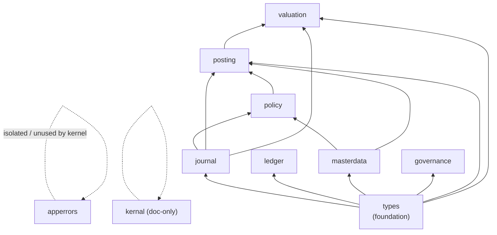

# ADR P1-01 — خريطة حزم النواة التسع وحدود المسؤولية

- **الحالة:** مقبول (Accepted) — يُطبَّق بالوثائق وبفحوص النقاء المعماري القائمة.
- **التاريخ (UTC):** 2026-11-21T21:04:06Z
- **المالك:** مالك معمارية النواة
- **المرجع:** [خطة المعالجة، المرحلة 1](../plans/KERNEL_REMEDIATION_EXECUTION_PLAN.md)، [خط الأساس المرحلة 0](../plans/KERNEL_REMEDIATION_BASELINE.md)، الفجوة `G-003` في [سجل الفجوات](../plans/KERNEL_REMEDIATION_GAP_REGISTER.md)، [ADR P7-01](./P7_01_public_surface_decision.md)
- **يُحل محل:** القائمة المكوّنة من سبع حزم في [TARGET_ACCOUNTING_KERNAL.md](../architecture/TARGET_ACCOUNTING_KERNEL.md) (النسخة 1.0.0).

## السياق

كانت الوثيقة المعمارية تسرد سبع حزم أساسية وتحذف `journal` و`ledger` من قائمة المكونات، وتستخدم مسارات `internal/posting` بدل `internal/kernal/posting`. في المقابل، جرد المرحلة 0 أثبت وجود **تسع حزم فعلية** تحت `internal/kernal/**` إضافة إلى حزمة جذر تحمل charters الاستيراد فقط. مخطط الاعتماد المستخرج من `go list` (لا من التصور النظري) يثبت أن البنية DAG بلا دورات، وأن `journal` و`ledger` ليست حزمًا زائدة بل تؤديان أدوارًا مختلفة عن `masterdata` و`posting`.

قواعد الخطة الملزمة تمنع إنشاء حزمة جديدة قبل إثبات أن المسؤولية لا تنتمي إلى حزمة قائمة، وتمنع حذف أي نوع أو حقل قبل تحليل التوافق. لذلك يُحسم التنظيم الحالي بوثيقة معمارية مطابقة للكود، دون حذف أو دمج.

## القرار

### 1. الحزم المعتمدة (تسع + حزمة جذر)

| # | الحزمة | المسؤولية الواحدة | مدخلات من النواة | المخرجات/السطح |
|---|---|---|---|---|
| 0 | `internal/kernal` (doc-only) | إعلان charter الاستيراد وحفظ الثوائق الاسمية | none | `doc.go`, `doc_test.go` |
| 1 | `types` | القيم والمعرفات: Money، ISO 4217، التقريب، المعرفات الصلبة، الأخطاء المشتركة | none | `@foundation` |
| 2 | `apperrors` | تصنيف أخطاء مشفر (`CodedError`, `IsCode`) للتوافق العام | none | حزمة معزولة؛ لا تستوردها حزم النواة حالياً |
| 3 | `journal` | تعريف القيد كaggregate: الحقول، الحالات، التصنيفات، الروابط، `Clone` الدفاعي | `types` | `JournalEntry`, `EntryLine`, `EntryStatus` |
| 4 | `ledger` | نماذج مرجعية خفيفة (DTO) للتوافق مع `pkg/api/v1/ledger`؛ **ليس** سجل GL ولا مخزن حركة | `types` | `Account`, `FiscalYear`, `FiscalPeriod` (مرجعية فقط) |
| 5 | `masterdata` | مصدر الحقيقة للحسابات والشركات واليوميات والتقويم والأبعاد وReader ports | `types` | `Account`, `Company`, `FiscalPeriod`, `Reader` |
| 6 | `governance` | سلسلة التدقيق، اللقطات المتسقة، التحقق مقابل checkpoint خارجي | `types` | `AuditChain`, `AuditVerificationSnapshot` |
| 7 | `policy` | سياسات الترحيل والعملات والأهلية، نافذة زمنياً ومحصورة بالشركة | `journal`, `masterdata`, `types` | `PolicyEngine`, `CurrencyPolicy` |
| 8 | `posting` | نقطة التحقق المركزية: `PostEntry`، التقريب، العكس، ترتيب مفاتيح الأقفال، تفويض الحفظ | `journal`, `masterdata`, `policy`, `types` | `PostingPipeline`, `PostingExecutor`, `PostingReversalExecutor` |
| 9 | `valuation` | أسعار الصرف، التحويل، إعادة التقييم وتوليد قيد التقييم | `journal`, `posting`, `types` | `RateRegistry`, `RevaluationEngine` |

الوصف التفصيلي لكل حزمة مع ملفاتها وواجهاتها مُثبَّت في [خريطة معمارية المرحلة 1](../architecture/KERNEL_ARCHITECTURE_MAP.md).

### 2. مخطط الاعتماد الفعلي (من `go list`)

الحواف المؤكدة: `journal→types`، `ledger→types`، `governance→types`، `masterdata→types`، `policy→{journal,masterdata,types}`، `posting→{journal,masterdata,policy,types}`، `valuation→{journal,posting,types}`. الطبقات: `types` (أساس) → `{journal, ledger, governance, masterdata}` → `policy` → `posting` → `valuation`. لا دورات استيراد.

### 3. قواعد حدود ثابتة

1. لا تنشأ حزمة عشرية في هذه الخطة؛ أي مسؤولية جديدة تُدرَس أولاً في حزمة قائمة.
2. `journal` لا يتحقق من التوازن ولا يحفظ؛ `posting` هو المسار المركزي الوحيد للترحيل والعكس.
3. `ledger` لا يملك سجل حركات ولا أرصدة؛ دوره نقل مرجعي فقط (انظر ADR P1-02 وP1-03).
4. `apperrors` تبقى للتوافق العام؛ لا تُحذف ولا تُوسَّع دون ADR جديد.
5. charter الاستيراد الفعلي: **stdlib + uuid + decimal + حزم kernel الأخرى فقط**؛ صيغ `doc.go` التي حذفت stdlib صريحاً تُصحَّح في هذه المرحلة دون تغيير القاعدة.
6. حدود `pkg/api/v1` و`pkg/spi` و`pkg/sdk` تبقى كما ثبّتها ADR P7-01؛ لا استثناء جديد ولا تخفيض للقواعد `R2a–R2c`.

## البدائل المرفوضة

| البديل | سبب الرفض |
|---|---|
| حذف `journal` ودمج نموذجه في `posting` | يكسر التوافق العام ويزيل فصل "تعريف القيد" عن "تحقق الترحيل"؛ لا مبرر وظيفي. |
| حذف `ledger` بوصفه تكراراً | هو الجسر المعتمد لـ `pkg/api/v1/ledger`؛ حذفه كسر توافق عام دون خطة هجرة. |
| اعتبار `ledger` مالك GL | يتعارض مع الكود: لا يوجد أي سجل حركة أو رصيد فيه، ويؤدي إلى ازدواج مصادر الحقيقة. |
| إضافة حزمة `gl`/`transaction` جديدة | ممنوع صراحةً قبل إثبات عدم ملاءمة الحزم القائمة، ولم يثبت ذلك. |

## التنفيذ والتحقق

- تحديث `docs/TARGET_ACCOUNTING_KERNAL.md` و`docs/KERNEL_ARCHITECTURE_MAP.md`.
- تحديث `internal/kernal/**/doc.go` وإضافة `apperrors/doc.go` (إغلاق `G-008`) دون تغيير أي منطق مجال.
- بوابة التحقق: `./scripts/verify_architecture.sh` → PASS بـ11 قاعدة، بلا تخفيض.

## ملحق المرحلة 4 — اعتماد إسقاط القراءة (2026-11-22)

أضافت المرحلة 4 ملف `internal/kernal/ledger/projection.go` لتوفير إسقاطات قراءة حتمية مشتقة من القيود المرحلة. نتيجة ذلك أصبح اعتماد `ledger` هو `journal, types` بدلاً من `types` فقط. هذا لا يُنشئ دورة، ولا ينقل مسؤولية التخزين أو التحقق إلى `ledger`، ولا يغيّر مبدأ أن القيود المرحلة هي مصدر الحقيقة. تم تحديث `docs/KERNEL_ARCHITECTURE_MAP.md` ليعكس الحافة الجديدة.
