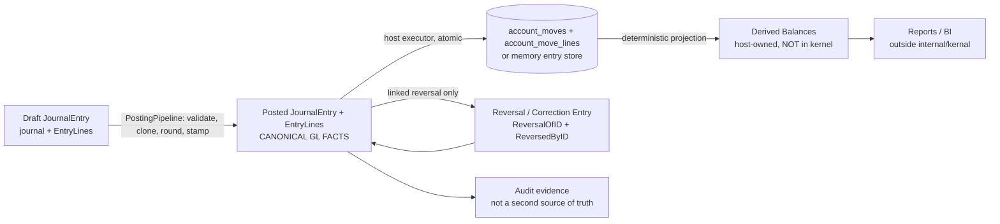

# ADR P1-02 — مصدر الحقيقة المحاسبي ومسار إعادة بناء GL

- **الحالة:** مقبول (Accepted) — قرار معماري ملزم؛ لا يغيّر قاعدة محاسبية قائمة.
- **التاريخ (UTC):** 2026-11-21T21:04:06Z
- **المالك:** مالك معمارية النواة + مالك عقود التخزين
- **المرجع:** [الخطة، المرحلة 1 مهام 5–8](../KERNEL_REMEDIATION_EXECUTION_PLAN.md)، [الخطة، المرحلة 4](../KERNEL_REMEDIATION_EXECUTION_PLAN.md)، الفجوة `G-004` في [سجل الفجوات](../KERNEL_REMEDIATION_GAP_REGISTER.md)، [ثوابت النواة](../../internal/kernal/KERNEL_ACCOUNTING_INVARIANTS.md)
- **ذو صلة:** [ADR P1-01](./P1_01_kernel_package_map.md)، [ADR P1-03](./P1_03_reference_model_duality.md)

## السياق

كان من غير المحسوم كتابةً: هل مصدر الحقيقة هو "القيود المرحلة" أم "حركات دفتر الأستاذ المرحلة"، وأين تُحفظ الحركة المحاسبية وكيف يُعاد بناء GL. كان ينبغي ألا يُستنتج من اسم حزمة `ledger` أنها تملك سجلاً، ولا من وجود أرصدة في طبقة التخزين أن النواة تملك رصيداً مادياً.

أثبت الفحص المادي (المرحلة 0 + فحص مسار الحفظ):

1. `journal.JournalEntry` هو **الaggregate الوحيد** للحركة المحاسبية داخل النواة (`internal/kernal/journal/entry.go:56-85`)، ويحتوي على الأسطر (`EntryLine`, `:39-54`) وعلى حقول الترحيل والربط بالعكس (`Status`, `PostedAt`, `ReversalOfID`, `ReversedByID`, `:64,81-84`).
2. `posting.PostingPipeline.PostEntry` هو المسار المركزي الوحيد الذي يحوّل المسودة إلى مرحّلة: ينسخ القيد، يتحقق، ثم يختم `Status = journal.EntryPosted` و`PostedBy`/`PostedAt` قبل تفويض الحفظ إلى منفذ المضيف (`internal/kernal/posting/pipeline.go:145,277-285`).
3. منفذا الحفظ معلنان كدوال مجردة: `PostingExecutor` و`PostingReversalExecutor` (`pipeline.go:36-47`)؛ النواة لا تنفذ حفظاً ولا تعرف شكل التخزين.
4. في المحول الفعلي: `storage/postgres/uow.go:119-152` يحفظ رأس `account_moves` (بما فيه عمود `entry` JSON) ويحدّث حالته، و`storage/postgres/posting.go:191-222` يحفظ الأسطر في `account_move_lines`؛ العكس يعيد استخدام الزوج نفسه مع تثبيت الربط والحالة (`uow.go:132-180`). محول الذاكرة يخزن `journal.JournalEntry` واحدة في `storage/memory/posting.go:159`.
5. **لا يوجد** نوع `LedgerMovement` أو `LedgerTransaction` أو `LedgerLine` أو جدول `gl_*`/`ledger_*` في النواة أو في مسار الترحيل. الأرصدة مشتقة في المضيف: trigger في `storage/postgres/migrations/202611100009_perpetual_account_balances.sql:33-64` يحدّث `account_balances`، وخريطة ذاكرة في `storage/memory/posting.go:140-142`. التدقيق يُحفظ في `financial_audit_logs`، ومفتاح منع التكرار في `posting_idempotency`؛ كلها أدلة/ضوابط تنفيذ وليست بديلاً عن القيد المرحّل.
6. لا يوجد `BookID` في المستودع، ولا `LedgerID` داخل النواة؛ `ledger_id` يظهر فقط في تعيينات الأحداث إلى الحسابات في طبقة المضيف (`storage/postgres/events.go:216-241`) ولا يوسّع نطاق الترحيل.

## القرار

### 1. المصدرCanonical

**القيود المرحلة (`journal.JournalEntry` بحالتي `posted`/`reversed` مع أسطرها `EntryLine`) هي مصدر الحقيقة المحاسبي الوحيد ضمن هذه الحدود.** في التنفيذ الحالي تُخزَّن هذه الحقيقة كزوج `account_moves` (الرأس/القيد) + `account_move_lines` (الأسطر) في PostgreSQL، أو كقيمة `JournalEntry` واحدة في محول الذاكرة. مصطلح "Posted Ledger Movement" يُستخدم في الوثائق بوصفه **الوجه المحاسبي للقيد المرحّل ذاته**، ولا يشير إلى كيان مستقل جديد.

لا تُعتبر الأرصدة المشتقة (`account_balances`، خريطة الذاكرة) أو سجل التدقيق أو سجل idempotency مصادر حقيقة للأثر المالي؛ الأرصدة قابلة لإعادة البناء، والتدقيق دليل، وidempotency ضابط تنفيذ.

### 2. العلاقة الرسمية

الانتقالات المسموحة: Draft → Posted → Reversed (عبر قيد عكسي مرتبط فقط). لا تحديث ولا حذف للقيد المرحّل؛ التصحيح يكون بعكس أو قيد تصحيحي مرتبط، وفق `RULE-KERNEL-011` و`RULE-KERNEL-012`.

### 3. إعادة بناء GL

1. تُقرأ القيود المرحلة (الحالة `posted` أو `reversed`) لكل نطاق شركة، مع أسطرها، من المخزن المعتمد.
2. يُطبَّق ترتيب كلي حتمي لا يعتمد على ترتيب Map: `(EffectiveDate UTC, SequenceNumber, JournalEntryID.String())` للقيود، و`EntryLine.ID.String()` للأسطر داخل القيد. أي محول يستخدم ترتيباً مكافئاً يجب أن يثبته في عقده الخاص.
3. تُجمع مبالغ `FunctionalDebit` و`FunctionalCredit` لكل `AccountID` ولكل عملة وظيفية؛ الرصيد المشتق = مجموع المدين − مجموع الدائن (مع احترام `NormalBalance` عند العرض فقط).
4. تُطبَّق القيود العكسية كأثر مالي إضافي بتاريخها الخاص، دون تعديل القيد الأصل.
5. النتيجة متطابقة عند إعادة التشغيل لأن المدخلات هي الحقائق المرحلة نفسها والترتيب كلي؛ لا تُخزَّن النتيجة داخل `internal/kernal`.

> هذه خطوات مواصفة على مستوى المجال؛ التنفيذ الفعلي وإثبات الحتمية وتكافؤ المحولات مضمّنة في المرحلة 4 (نموذج الحركة/إعادة البناء) والمرحلة 11 (Contract Tests) والمرحلة 12 (سيناريو Rebuild). لا يُنشأ الآن محرك أرصدة داخل النواة.

### 4. نطاق البيانات

- مفتاح النطاق الملزم في النواة اليوم هو **`CompanyID`**؛ كل عملية حساسة تتحقق من تطابق CompanyID للقيد والأسطر والحسابات واليومية والفترة (`masterdata.ValidateCompanyScope`, `pipeline.go:149,189,261`).
- `JournalID` يقيّد اليومية ورقم التسلسل داخل الشركة؛ ليس دفتراً مستقلاً.
- لا `BookID` ولا `LedgerID` في عقد الترحيل أو النواة. أي دعم Multi-Book مستقبلي يحتاج ADR جديداً وتغيير عقد صريح وفق القرار 2.4/7 من الخطة؛ لا يُفترض دفتر واحد إلى الأبد، لكن لا يُنفَّذ الآن.

## البدائل المرفوضة

| البديل | سبب الرفض |
|---|---|
| جعل `ledger` مالك حركة منفصلة | لا يوجد أي سجل حركة فيه؛ يخلق مصدر حقيقة ثانياً ويزدوج الأثر. |
| جعل `account_balances` هو المصدر | رصيد مشتق قابل لإعادة البناء، ويُحدَّث بـ trigger في المضيف؛ فقدانه لا يفقد التاريخ المحاسبي. |
| جعل سجل التدقيق هو مصدر المبالغ | التدقيق دليل على العملية وليس نموذجاً للحركة؛ الحقول الدلالية مشتقة من القيد. |
| إدخال BookID/LedgerID الآن | لا يوجد في النموذج الحالي؛ توسيع عقد بلا حاجة مثبتة يخالف القرار 2.4/7. |

## Consequences / التبعات

- تُحدَّث وثيقة Target Kernel ومخططاتها لتوضيح أن النواة تضمن "صحة الأرصدة المشتقة" لا تخزينها.
- تُحدَّث `ledger/doc.go` و`journal/doc.go` و`posting/doc.go` لتثبيت هذا القرار.
- تُغلق الفجوة `G-004` في المرحلة 1 من ناحية **القرار والتوثيق**؛ ويبقى إثبات إعادة البناء التنفيذي مرتبطاً بالمرحلة 4 والمرحلة 12، ويُسجَّل ذلك صراحةً في تقرير المرحلة.

## ملحق المرحلة 4 — نموذج إسقاط الحركة وإعادة البناء (2026-11-22)

نفّذت المرحلة 4 القرار أعلاه بإضافة `ledger.PostedMovement` كـ **إسقاط قراءة حتمي** مشتق من القيود المرحلة وأسطرها، وليس كياناً مخزناً مستقلاً أو مصدراً ثانياً للحقيقة. يوفر `ledger.ProjectPostedMovements` و`ledger.RebuildAccountBalances` إعادة بناء حتمية للأرصدة من الحقائق المرحلة وفق الترتيب الكلي `(EffectiveDate UTC, SequenceNumber, JournalEntryID, EntryLine.ID)`، دون تخزين رصيد مادي داخل `internal/kernal`.

أي تخزين فعلي للحركات يبقى مسؤولية المضيف/المحول، ويجب أن يظل متسقاً مع القيود المرحلة.

## ملحق المرحلة 6 — حدود الترحيل والعكس وقراءة البيانات الرئيسية (2026-11-22)

لم يغيّر هذا الملحق مصدر الحقيقة ولا يضيف كياناً محاسبياً جديداً. يثبت فقط كيف يحمي مسار `PostEntry` الحقائق المرحلة قبل التفويض:

1. **قراءة واحدة نافذة زمنياً:** لكل سطر يستدعي `PostEntry` الدالة `masterdata.ResolvePostableAccountAsOf` مرة واحدة، ويستخدم نفس `masterdata.Account` الذي تحقق منه لقرار الأهلية (`policy.CheckAccountEligibility`). لا توجد قراءة ثانية لـ `GetAccount` بعد التحقق. هذا يطبّق ADR P3-01 ويمنع موقفاً تُتحقق فيه نسخة وتُمرَّر نسخة مختلفة إلى Executor.
2. **نسخة مجمدة:** ينسخ `PostEntry` القيد دفاعياً قبل أي قراءة Reader. تغيير المتصل لـ `CompanyID` أو `AccountID` أو العملة أو رقم الفترة أثناء التحقق لا يصل إلى Executor؛ الدليل `TestPostEntryExecutesFrozenValidatedSnapshot`.
3. **العكس لا يكتب على الأصل:** `BuildReversalEntryAt` ينشئ قيداً جديداً بحالة `Draft` و`ReversalOfID`؛ لا ينسخ `FiscalPeriodID` من الأصل، ويُحسب period العكس من تاريخه في `PostEntry`. الأصل المرحّل لا يُعدَّل. مسودة تحمل `ReversedByID` مرفوضة بـ `ErrInvalidReversal` لأنها تصف دورة حياة مستحيلة.
4. **الوقت ضمن حدود صريحة:** وصول الشيفرة الإنتاجية في `posting` إلى الساعة الحقيقية يمر فقط عبر `systemClock{}.Now()`؛ الاختبارات والتدفقات الحتمية تستخدم `Clock` أو `BuildReversalEntryAt` / `NewJournalEntryAt`. لا تُقرأ العملة أو السياسة أو الأهلية بوقت مختلف عن تاريخ القيد.
5. **حد التزام النواة:** الذرية، وتخزين مفتاح منع التكرار، وقفل صف الأصل عند العكس، وسلوك unknown-outcome تبقى مسؤولية Host Executor/Adapter وفق `RULE-KERNEL-027`؛ كانت `G-002` (ترتيب الأقفال الفعلي) متروكة للمرحلة 8 وقد أُغلقت فيها بـ [ADR P8-01](./P8_01_locking_and_isolation.md). لا تُعتبر المرحلة 6 إثباتاً لتلك الضمانات.

المراجع التنفيذية: [Posting Flow Specification](../KERNEL_POSTING_FLOW_SPECIFICATION.md)، [Phase 6 report](../KERNEL_REMEDIATION_PHASE6_REPORT.md).

## ملحق المرحلة 7 — وحدة العمل الذرية دون تغيير مصدر الحقيقة (2026-11-22)

لم يغيّر هذا الملحق تعريف مصدر الحقيقة: القيد المرحّل وأسطره يظلان الحقيقة المحاسبية، ولا تُنشأ حركة GL مستقلة داخل النواة. أضاف فقط العقد القابل للاختبار الذي يلزم المضيف لحماية هذه الحقيقة عند الحفظ:

1. النواة تختم `IdempotencyScope` من `(CompanyID, Operation, Key)` وبصمتين: واحدة للطلب المجمد والأخرى لحمولة المتصل المستقرة. تُكتب فوق أي قيم يرسلها المتصل قبل استدعاء Executor.
2. وحدة عمل المحول تضم القيد وأسطره، والأثر المالي، وسجل idempotency بنتيجته، وأثر التدقيق، وعند العكس روابط الأصل وحالته. لا يوجد نجاح جزئي ولا تدقيق لاحق متجاهل الخطأ.
3. المفتاح نفسه بالحمولة نفسها يُعيد النتيجة المحفوظة؛ المفتاح نفسه بحمولة مختلفة تعارض صريح؛ الفشل بعد Commit يُحل باستعلام آمن لا بإنشاء قيد بديل.
4. العكس فائز واحد: الأصل يُقفل، والقيد العكسي والرابط وحالة الأصل تُكتب معاً، والمحاولة الثانية مرفوضة صراحةً.
5. لا يوجد SQL أو `pgx` أو قفل مادي داخل `internal/kernal`. المحول يختار التنفيذ؛ مجموعة العقد المحايدة تحكم النتيجة.

المراجع التنفيذية: [Posting Transaction Contract](../KERNEL_POSTING_TRANSACTION_CONTRACT.md)، [Idempotency Contract](../KERNEL_IDEMPOTENCY_CONTRACT.md)، [Reversal Atomicity Contract](../KERNEL_REVERSAL_ATOMICITY_CONTRACT.md)، [Phase 7 report](../KERNEL_REMEDIATION_PHASE7_REPORT.md).
