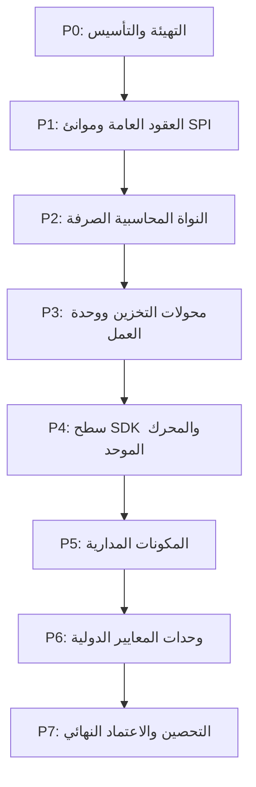

# الخطة التنفيذية الرئيسية — إعادة بناء النواة المحاسبية القابلة للتضمين

- **نوع الخطة:** `reengineering_embeddable_core`
- **الغرض:** تفكيك واقتطاع النواة المحاسبية من مشروع `accounting_engine` وإعادة بنائها داخل المشروع المستهدف `accountant_engine` كنواة نقية وقابلة للتضمين (Embeddable Library) خالية تماماً من بروتوكولات الشبكة (gRPC/HTTP) وخالية من إدارة الهويات والمصادقة، مع حصر ما يُنسخ وما يُعدل وما يُبنى من جديد.
- **المرجع:** وثيقة بدء المشروع [PID_RESTRUCTURING_EMBEDDABLE_CORE.md](../PID_RESTRUCTURING_EMBEDDABLE_CORE.md) وميثاق المبادئ المعمارية [ARCHITECTURAL_PRINCIPLES_CHARTER.md](../ARCHITECTURAL_PRINCIPLES_CHARTER.md).
- **تاريخ الإنشاء:** 2026-11-20
- **آخر تحديث:** 2026-11-20

---

## 1. المراحل (Phases)

| المرحلة | الهدف المحوري | المهام التابعة | الاعتماديات | ملف التفاصيل |
| :--- | :--- | :--- | :--- | :--- |
| **`P0`** | **التهيئة والتأسيس (Bootstrap & Setup):** إعداد المشروع المستهدف، ملف `go.mod` الرشيق، وهيكل المجلدات وأدوات السلامة. | `P0-01`, `P0-02`, `P0-03` | لا شيء | [01_PHASE_0_BOOTSTRAP_AND_SETUP.md](01_PHASE_0_BOOTSTRAP_AND_SETUP.md) |
| **`P1`** | **العقود العامة والموانئ المجردة (Public Contracts & SPI):** تأسيس النماذج العامة ومنافذ التخزين المجردة وسياق الأمان. | `P1-01`, `P1-02`, `P1-03` | `P0` (اكتمال واعتماد المرحلة) | [02_PHASE_1_PUBLIC_CONTRACTS_AND_SPI.md](02_PHASE_1_PUBLIC_CONTRACTS_AND_SPI.md) |
| **`P2`** | **بناء النواة المحاسبية الصرفة (Core Kernel Construction):** بناء حزم القلب المحاسبي (Types, MasterData, Posting, Valuation, Policy, Governance). | `P2-01`, `P2-02`, `P2-03`, `P2-04`, `P2-05`, `P2-06`, `P2-07` | `P1` (اكتمال واعتماد المرحلة) | [03_PHASE_2_CORE_KERNEL_CONSTRUCTION.md](03_PHASE_2_CORE_KERNEL_CONSTRUCTION.md) |
| **`P3`** | **محولات التخزين ووحدة العمل (Storage Adapters & UoW):** بناء محول الذاكرة المؤقتة (`storage/memory` للتطوير والاختبارات فقط)، ومحول PostgreSQL الإنتاجي الحصري (`storage/postgres`) مع سياسات RLS وقواعد الحرمة WORM. | `P3-01`, `P3-02`, `P3-03`, `P3-04` | `P2` (اكتمال واعتماد المرحلة) | [04_PHASE_3_STORAGE_ADAPTERS.md](04_PHASE_3_STORAGE_ADAPTERS.md) |
| **`P4`** | **السطح البرمجي العام للمكتبة (SDK Public Surface):** بناء `sdk.Engine` والمنشئ الموحد واستيعاب الأحداث وإثبات التضمين الخارجي. | `P4-01`, `P4-02`, `P4-03`, `P4-04` | `P3` (اكتمال واعتماد المرحلة) | [05_PHASE_4_SDK_PUBLIC_SURFACE.md](05_PHASE_4_SDK_PUBLIC_SURFACE.md) |
| **`P5`** | **المكونات المدارية الاختيارية (Orbital Components):** بناء الدفاتر المساعدة، محرك التقارير المالية، التسويات، وتوحيد القوائم. | `P5-01`, `P5-02`, `P5-03`, `P5-04` | `P4` (اكتمال واعتماد المرحلة) | [06_PHASE_5_ORBITAL_COMPONENTS.md](06_PHASE_5_ORBITAL_COMPONENTS.md) |
| **`P6`** | **وحدات المعايير الدولية المتخصصة (IFRS/IAS Standards):** بناء وحدات IFRS 15, IFRS 16, IFRS 9, و IAS 12 المفصولة كإضافات SPI. | `P6-01`, `P6-02`, `P6-03`, `P6-04` | `P5` (اكتمال واعتماد المرحلة) | [07_PHASE_6_STANDARDS_MODULES.md](07_PHASE_6_STANDARDS_MODULES.md) |
| **`P7`** | **التحصين والجودة والاعتماد النهائي (Hardening & Release):** فحوصات استقلالية النواة، اختبارات ACID والضغط، وتوقيع الجاهزية. | `P7-01`, `P7-02`, `P7-03` | `P6` (اكتمال واعتماد المرحلة) | [08_PHASE_7_TESTING_HARNESS_AND_RELEASE.md](08_PHASE_7_TESTING_HARNESS_AND_RELEASE.md) |

---

## 2. جدول حالة المهام (Task Status Matrix)

| المهمة | المرحلة | الحالة | الاعتماديات | سبب الحجب / الإجراء المطلوب | ملف ARD |
| :--- | :---: | :---: | :--- | :---: | :---: |
| `P0-01` | `P0` | مكتملة | لا شيء | — | — |
| `P0-02` | `P0` | مكتملة | `P0-01` | — | — |
| `P0-03` | `P0` | مكتملة | `P0-02` | — | — |
| `P1-01` | `P1` | مكتملة | `P0` (اعتماد المرحلة) | نجح بناء العقود العامة وفحص نقاء الاستيرادات | — |
| `P1-02` | `P1` | مكتملة | `P1-01` | نجح بناء التخزين والبيانات الرئيسية والمعايير؛ ولا توجد حزمة legacy | — |
| `P1-03` | `P1` | مكتملة | `P1-01` | نجحت اختبارات حقن واستخراج Principal و CompanyID | — |
| `P2-01` | `P2` | مكتملة | `P1` (اعتماد المرحلة) | نجاح بناء كائنات القيمة والحساب العشري الدقيق والتقريب المصرفي بنسبة 96.5% | — |
| `P2-02` | `P2` | مكتملة | `P2-01` | نجاح شجرة الحسابات والتقويم المالي وكشف الحلقات الدائرية | — |
| `P2-03` | `P2` | مكتملة | `P2-01`, `P2-02` | نجاح خط أنابيب الترحيل الذري والقيد المزدوج والقيود العكسية | — |
| `P2-04` | `P2` | مكتملة | `P2-03` | نجاح مدير أقفال الحسابات المتزامن واختبار 100 خيط معالجة دون Deadlock | — |
| `P2-05` | `P2` | مكتملة | `P2-01` | نجاح محرك العملات وفروق الصرف وقواعد IAS 21 | — |
| `P2-06` | `P2` | مكتملة | `P2-02`, `P2-03` | نجاح محرك السياسات والرقابة ومراكز التكلفة والتاريخ المسموح | — |
| `P2-07` | `P2` | مكتملة | `P2-03` | نجاح سجل التدقيق المشفر SHA-256 وكشف التلاعب وقواعد SoD | — |
| `P3-01` | `P3` | معلقة | `P2` (اعتماد المرحلة) | — | — |
| `P3-02` | `P3` | معلقة | `P2` (اعتماد المرحلة) | — | — |
| `P3-03` | `P3` | معلقة | `P3-01`, `P3-02` | — | — |
| `P3-04` | `P3` | معلقة | `P3-03` | — | — |
| `P4-01` | `P4` | معلقة | `P3` (اعتماد المرحلة) | — | — |
| `P4-02` | `P4` | معلقة | `P4-01` | — | — |
| `P4-03` | `P4` | معلقة | `P4-01`, `P4-02` | — | — |
| `P4-04` | `P4` | معلقة | `P4-02`, `P4-03` | — | — |
| `P5-01` | `P5` | معلقة | `P4` (اعتماد المرحلة) | — | — |
| `P5-02` | `P5` | معلقة | `P4` (اعتماد المرحلة) | — | — |
| `P5-03` | `P5` | معلقة | `P4` (اعتماد المرحلة) | — | — |
| `P5-04` | `P5` | معلقة | `P4` (اعتماد المرحلة), `P5-02` | — | — |
| `P6-01` | `P6` | معلقة | `P5` (اعتماد المرحلة) | — | — |
| `P6-02` | `P6` | معلقة | `P5` (اعتماد المرحلة) | — | — |
| `P6-03` | `P6` | معلقة | `P5` (اعتماد المرحلة) | — | — |
| `P6-04` | `P6` | معلقة | `P5` (اعتماد المرحلة) | — | — |
| `P7-01` | `P7` | معلقة | `P6` (اعتماد المرحلة) | — | — |
| `P7-02` | `P7` | معلقة | `P7-01` | — | — |
| `P7-03` | `P7` | معلقة | `P7-01`, `P7-02` | — | — |

---

## 3. تصنيف المهام بين النسخ والتعديل والبناء الجديد (Action Classification)

```text
┌──────────────────────────────────────────────────────────────────────────────┐
│ تصنيف استراتيجية العمل الهندسي للمشروع (Migration Action Taxonomy)          │
├─────────────────────┬───────────────────┬────────────────────────────────────┤
│ التصنيف             │ المعنى            │ أمثلة في الخطة                     │
├─────────────────────┼───────────────────┼────────────────────────────────────┤
│ 1. نسخ (Copy)       │ نقل كود نظيف ومطابق│ نماذج API v1، ملفات Types، ترحيلات│
│                     │ بدون تعديل في كنهه│ SQL الأساسية، واختبارات Parity     │
├─────────────────────┼───────────────────┼────────────────────────────────────┤
│ 2. تعديل (Modify)   │ تكييف الكود وإعادة│ تنظيف posting من التبعيات القديمة، │
│                     │ توجيه المسارات    │ إزالة WithCoreStorage من Builder،  │
│                     │ وتطهير الاعتماديات│ وإخراج serviceauth من التخزين      │
├─────────────────────┼───────────────────┼────────────────────────────────────┤
│ 3. بناء جديد (New)  │ كتابة مكونات نقية │ go.mod الرشيق، lock_manager مستقل، │
│                     │ من الصفر          │ محول application context المجرد،   │
│                     │                   │ واختبار المستهلك الخارجي النقي     │
└─────────────────────┴───────────────────┴────────────────────────────────────┘
```

---

## 4. الاعتماديات والتوازي (Dependencies & Concurrency)

### 4.1 خريطة الاعتماديات الكلية



### 4.2 مجموعات التنفيذ المتوازي المرشحة (Parallel Candidate Groups)

| المجموعة | المهام | شرط التوازي | التداخل والقيود | حالة السماح بالتوازي |
| :---: | :--- | :--- | :--- | :--- |
| **Grp-A** | `P1-02` و `P1-03` | بعد اكتمال `P1-01` | `pkg/spi/storage` مستقل عن `pkg/spi/application` | **مسموح بالتوازي** |
| **Grp-B** | `P2-05` و `P2-07` | بعد اكتمال `P2-01` و `P2-03` | `internal/core/valuation` مستقل عن `internal/core/governance` | **مسموح بالتوازي** |
| **Grp-C** | `P3-01` و `P3-02` | بعد اعتماد `P2` | `storage/memory` مستقل عن ملفات `storage/postgres/migrations` | **مسموح بالتوازي** |
| **Grp-D** | `P5-01`, `P5-02`, `P5-03` | بعد اعتماد `P4` | كل مكون مداري في مجلد مستقل ولا يعدل في الآخر | **مسموح بالتوازي** |
| **Grp-E** | `P6-01`, `P6-02`, `P6-03`, `P6-04` | بعد اعتماد `P5` | كل وحدة معيارية (`modules/*`) معزولة ومستقلة تماماً | **مسموح بالتوازي** |

### 4.3 جدول ملكية الملفات وحظر التعديل المتزامن (File Ownership Matrix)

| المهمة | الحزم/الملفات التي تملك حق إنشائها وتعديلها | الملفات المشتركة المحظور مساسها دون تنسيق |
| :--- | :--- | :--- |
| `P0-01`..`03` | `go.mod`, `go.sum`, `scripts/*`, شجرة المجلدات | لا يوجد |
| `P1-01`..`03` | `pkg/api/v1/*`, `pkg/spi/*` | `go.mod` |
| `P2-01`..`07` | `internal/core/*` | `pkg/api/v1/*`, `pkg/spi/*` |
| `P3-01`..`04` | `storage/postgres/*`, `storage/memory/*` | `pkg/spi/storage/*` |
| `P4-01`..`04` | `pkg/sdk/*`, `test/external_consumer/*` | `internal/core/*`, `storage/*` |
| `P5-01`..`04` | `internal/orbitals/*` | `pkg/sdk/*`, `internal/core/*` |
| `P6-01`..`04` | `modules/*` | `pkg/spi/standards/*` |
| `P7-01`..`03` | `test/*`, تقارير الاعتماد النهائية | كافة ملفات الكود (وضع قراءة واختبار) |

---

## 5. معايير اعتماد المراحل وسجل البوابات (Stage Gates & Verification)

### 5.1 بوابات المراحل

- **بوابة `P0`:** نجاح `go mod tidy` و `go vet ./...` على بيئة نظيفة.
- **بوابة `P1`:** نجاح فحص استقلالية عقود `pkg/api` و `pkg/spi` وعدم استيراد أي `internal`.
- **بوابة `P2`:** اجتياز 100% من اختبارات القيد المزدوج والتحقق الرياضي والذرية بالذاكرة.
- **بوابة `P3`:** اجتياز اختبارات التكافؤ التام (Contract Parity) بنسبة 22/22 بين الذاكرة و Postgres.
- **بوابة `P4`:** نجاح بناء وتشغيل مستهلك خارجي مستقل يستورد `pkg/sdk` فقط وينفذ قيوداً متوازنة.
- **بوابة `P5`:** مطابقة دفاتر الأستاذ المساعدة مع حسابات الرقابة واجتياز اختبارات القوائم المالية.
- **بوابة `P6`:** اجتياز اختبارات وحدات IFRS دون أي تسريب لداخليات النواة.
- **بوابة `P7`:** اجتياز فحوصات الأداء ($P95 \le 50\,\text{ms}$) والتغطية ($\ge 80\%$) وثبات سلسلة التدقيق.

### 5.2 سجل اعتماد المراحل

| المرحلة | الحالة | تاريخ التحقق | الأدلة والنتائج | النواقص / المخاطر |
| :---: | :---: | :---: | :---: | :---: |
| `P0` | معتمدة | 2026-11-20 | `go mod tidy` و `go vet ./...` و `go mod verify` ناجحة (all modules verified)؛ 4 تبعيات مباشرة؛ 45 حزمة بملف `doc.go`؛ `verify_architecture.sh` و `verify_integrity.sh`: PASS | مسار الموديول مُبقى على `github.com/osmai4603-collab/accounting_engine` وفق `NEW_PROJECT_STRUCTURE.md` لضمان نسخ الكود دون تعديل مسارات الاستيراد |
| `P1` | معتمدة | 2026-11-20 | `go build ./pkg/api/v1/...` و `go build ./pkg/spi/...` و اختبارات P1 ناجحة؛ `verify_architecture.sh` و `verify_integrity.sh` PASS | لا توجد نواقص حالية |
| `P2` | غير معتمدة | — | — | بانتظار اكتمال P1 |
| `P3` | غير معتمدة | — | — | بانتظار اكتمال P2 |
| `P4` | غير معتمدة | — | — | بانتظار اكتمال P3 |
| `P5` | غير معتمدة | — | — | بانتظار اكتمال P4 |
| `P6` | غير معتمدة | — | — | بانتظار اكتمال P5 |
| `P7` | غير معتمدة | — | — | بانتظار اكتمال P6 |

---

## 6. فهرس ملفات خطوات الخطة التنفيذية التفصيلية

تم تقسيم تفاصيل المهام وفقاً لمتطلبات مهارة `execute-plan-lifecycle` إلى ملفات مستقلة ومنظمة داخل مجلد `docs/execution_plan_steps/`:

1. [01_PHASE_0_BOOTSTRAP_AND_SETUP.md](01_PHASE_0_BOOTSTRAP_AND_SETUP.md) — مهام التهيئة وتأسيس المشروع.
2. [02_PHASE_1_PUBLIC_CONTRACTS_AND_SPI.md](02_PHASE_1_PUBLIC_CONTRACTS_AND_SPI.md) — مهام العقود العامة وموانئ SPI.
3. [03_PHASE_2_CORE_KERNEL_CONSTRUCTION.md](03_PHASE_2_CORE_KERNEL_CONSTRUCTION.md) — مهام بناء النواة المحاسبية الصرفة.
4. [04_PHASE_3_STORAGE_ADAPTERS.md](04_PHASE_3_STORAGE_ADAPTERS.md) — مهام محولات التخزين ووحدة العمل.
5. [05_PHASE_4_SDK_PUBLIC_SURFACE.md](05_PHASE_4_SDK_PUBLIC_SURFACE.md) — مهام السطح البرمجي العام للمكتبة SDK.
6. [06_PHASE_5_ORBITAL_COMPONENTS.md](06_PHASE_5_ORBITAL_COMPONENTS.md) — مهام المكونات المدارية حول النواة.
7. [07_PHASE_6_STANDARDS_MODULES.md](07_PHASE_6_STANDARDS_MODULES.md) — مهام وحدات المعايير الدولية المتخصصة.
8. [08_PHASE_7_TESTING_HARNESS_AND_RELEASE.md](08_PHASE_7_TESTING_HARNESS_AND_RELEASE.md) — مهام التحصين والجودة والاعتماد النهائي.
