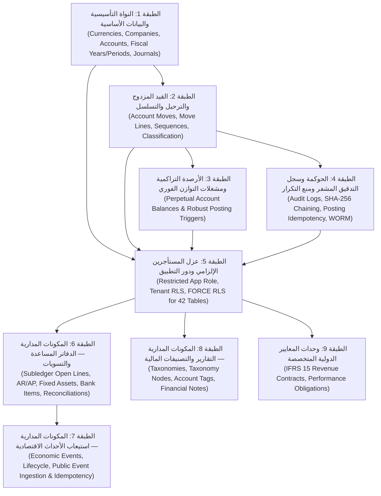

# المرحلة P3: محولات التخزين ووحدة العمل (Storage Adapters & UoW)

---

## 1. الفصل التشغيلي والمعماري الصارم: محول الذاكرة (Dev/Test) مقابل محول الإنتاج (PostgreSQL)

> [!CAUTION]
> **مبدأ الحظر المعماري والتشغيلي الصارم (Strict Architectural & Operational Prohibition):**  
> محول الذاكرة المؤقتة (`storage/memory`) مُصمم ومبني ومخصص **حصراً لأغراض التطوير المحلي السريع (Local Development)، واختبارات الوحدة (Unit Testing)، وبوابات التكامل المستمر (CI Pipelines)**.  
> **يُحظر منعاً باتاً وتشغيلياً استخدامه في بيئات الإنتاج الحقيقية (STRICTLY FORBIDDEN IN PRODUCTION ENVIRONMENTS)**.  
> **المحول الإنتاجي الوحيد المعتمد للمحرك المحاسبي هو محول PostgreSQL (`storage/postgres`).**

### مصفوفة المقارنة الهندسية الصارمة بين المحولين

| المعيار الهندسي | محول الذاكرة المؤقتة (`storage/memory`) | محول PostgreSQL الإنتاجي (`storage/postgres`) | النتيجة والقرار المعماري |
| :--- | :--- | :--- | :--- |
| **طبيعة التخزين (Durability)** | **متطاير (Volatile):** يُمحى بالكامل فور إيقاف العملية أو إعادة تشغيل التطبيق. | **دائم ومستدام (Durable):** محفوظ على القرص مع سجلات WAL المتوافقة مع ACID. | يُحظر استخدام الذاكرة لحفظ السجلات المالية الرسمية. |
| **عزل المستأجرين (Tenancy)** | **منطقي خيطي:** يعتمد على التصفية البرمجية في الكود فقط. | **جنائي ومفروض (Forced RLS):** مفروض بنسبة 100% على مستوى محرك قاعدة البيانات. | حماية البيانات في بيئة متعددة الشركات تتطلب RLS حصراً. |
| **التزامن والأقفال (Locking)** | **محلي داخل العملية:** أقفال `sync.RWMutex` لا تحمي من التزامن عبر خوادم متعددة. | **موزع وعابر للعمليات:** أقفال صفية واستشارية `pg_advisory_xact_lock` عابرة للخوادم. | تشغيل نُسخ متعددة (Horizontal Scaling) يتطلب PostgreSQL. |
| **الحرمة المحاسبية (WORM)** | **برمجية قابلة للالتفاف:** لا تمنع الوصول للذاكرة أو إعادة تهيئة الكائنات. | **مشغلات قاعدة بيانات حتمية (Triggers):** تمنع أي `UPDATE` أو `DELETE` جنائياً. | متطلبات المعايير المحاسبية وسلسلة التدقيق تتطلب WORM. |
| **أثر التدقيق الجنائي** | محفوظ في شرائح ذاكرية تتبخر مع انتهاء الفحص. | سجل مشفر بسلسلة تجزئة SHA-256 متصلة وغير قابلة للتراجع. | التدقيق المالي والقانوني يفرض وجود قاعدة بيانات إنتاجية. |
| **زمن استجابة الاختبارات** | **فائق السرعة:** دورة اختبار كاملة في أقل من $2\,\text{ms}$. | **متوسط إلى سريع:** يستغرق من $10\,\text{ms}$ إلى $50\,\text{ms}$ بسبب I/O والشبكة. | محول الذاكرة مثالي ومصمم لتمكين سرعة المطور واختبارات CI. |
| **الاستخدام المعتمد** | **بيئات التطوير واختبارات الوحدة والتكامل الداخلي فقط.** | **بيئات الإنتاج، التجارب الميدانية (Staging)، والإنتاج الفعلي.** | **فصل واضح وحاسم لا يقبل اللبس أو الاستثناء.** |

---

## 2. إعادة هيكلة ملفات الترحيل (Migrations) حسب شجرة الاعتماديات ومراحل الخطة

في المشروع المرجعي القديم `accounting_engine`، تراكمت ملفات الترحيل تاريخياً عبر 32 خطوة صاعدة ومثلها هابطة، وتضمنت رقعاً متعاقبة لتحسين المشغلات وإصلاح الأرصدة وإضافة جداول تدريجية.

في هذه الخطة، تتم **إعادة هيكلة وتصنيف الترحيلات حسب شجرة الاعتماديات الهندسية ومراحل الخطة التنفيذية (Dependency-Driven Architectural Tiers)**، بحيث تتسلسل الترحيلات منطقياً من النواة التأسيسية الصرفة، مروراً بالحوكمة والأمان، ووصولاً للمكونات المدارية ووحدات المعايير الدولية:

### 2.1 الرسم البياني لشجرة اعتماديات الترحيلات (Migration Dependency DAG)



---

### 2.2 جدول إعادة هيكلة وتوزيع ملفات الترحيل الـ 32 حسب الاعتماديات ومراحل الخطة

```text
┌────────────────────────────────────────────────────────────────────────────────────────────────────────┐
│ مصفوفة إعادة هيكلة الترحيلات حسب الاعتماديات المعمارية ومراحل التنفيذ (Migration Architecture Matrix) │
├───────┬────────────────────────────────────────┬────────────────────────────────┬──────────────────────┤
│ الطبقة│ مجال الترحيل والاعتمادية               │ الملفات المندرجة في الترحيل     │ مرحلة الخطة التنفيذية│
├───────┼────────────────────────────────────────┼────────────────────────────────┼──────────────────────┤
│ Tier 1│ النواة التأسيسية والبيانات الأساسية    │ 202611010001_baseline_schema   │ تتبع المرحلة P1 و P2 │
│       │ (العملات، الشركات، شجرة الحسابات،      │ 202611100004_control_accounts  │                      │
│       │ الفترات والسنوات المالية، الدفاتر)     │ 202611100011_currency_layers   │                      │
├───────┼────────────────────────────────────────┼────────────────────────────────┼──────────────────────┤
│ Tier 2│ القيد المزدوج، الأسطر، والتسلسل        │ 202611100001_phase0_integrity  │ تتبع المرحلة P2 (نواة│
│       │ (حركات الحسابات، تصنيف القيود،         │ 202611100002_entry_class       │ الترحيل والقيد المزدوج)│
│       │ القيود العكسية، وإحكام دورة الفترة)    │ 202611140001_reversal_idemp    │                      │
│       │                                        │ 202611140004_period_lifecycle  │                      │
│       │                                        │ 202611140005_reversal_integ    │                      │
│       │                                        │ 202611170001_period_reopen     │                      │
├───────┼────────────────────────────────────────┼────────────────────────────────┼──────────────────────┤
│ Tier 3│ الأرصدة التراكمية ومشغلات التوازن      │ 202611100009_perpetual_balance │ تتبع المرحلة P2 و P3 │
│       │ (جدول account_balances ومشغلات التحديث │ 202611100010_adj_period_lookup │                      │
│       │ الفوري على مستوى العبارة والصف)        │ 202611110001_fix_balance_trig  │                      │
│       │                                        │ 202611110002_bulk_posting_trig │                      │
│       │                                        │ 202611110003_robust_posting    │                      │
├───────┼────────────────────────────────────────┼────────────────────────────────┼──────────────────────┤
│ Tier 4│ الحوكمة وسجل التدقيق ومنع التكرار      │ 202611100005_phase3_governance │ تتبع المرحلة P2 و P3 │
│       │ (سجلات التدقيق المشفرة، حمولة bytea،   │ 202611110004_approval_binding  │                      │
│       │ جدول posting_idempotency، والسياسات)   │ 202611110005_audit_payload     │                      │
│       │                                        │ 202611110006_versioned_policy  │                      │
│       │                                        │ 202611140002_postgres_uow      │                      │
├───────┼────────────────────────────────────────┼────────────────────────────────┼──────────────────────┤
│ Tier 5│ عزل المستأجرين والحرمة الجنائية        │ 202611100007_force_tenant_rls  │ تتبع المرحلة P3      │
│       │ (إنشاء accounting_app_user، وتفعيل     │ 202611150001_force_event_rls   │ (أمان التخزين)       │
│       │ RLS و FORCE RLS على الـ 42 جدولاً،     │ scripts/create_app_role.sql    │                      │
│       │ ومشغلات منع التعديل والحذف WORM)       │ triggers_worm.sql              │                      │
├───────┼────────────────────────────────────────┼────────────────────────────────┼──────────────────────┤
│ Tier 6│ المكونات المدارية: الدفاتر والتسويات   │ 202611100003_event_acct_rules  │ تتبع المرحلة P5      │
│       │ (الأبعاد التحليلية، خطوط الذمم المفتوحة│ 202611100006_analytical_dim    │ (المكونات المدارية)  │
│       │ الأصول الثابتة، البنوك، وسجلات التسوية)│ 202611100012_subledger_recon   │                      │
│       │                                        │ 202611140006_recon_exceptions  │                      │
├───────┼────────────────────────────────────────┼────────────────────────────────┼──────────────────────┤
│ Tier 7│ المكونات المدارية: استيعاب الأحداث     │ 202611110030_econ_event_life   │ تتبع المرحلة P4 و P5 │
│       │ (أحداث الاستيعاب العامة، جداول التعيين،│ 202611120001_pub_event_idemp   │                      │
│       │ دورة حياة الأحداث، ومنع تكرارها)       │ 202611130001_pub_event_fail    │                      │
│       │                                        │ 202611140003_pub_event_scope   │                      │
├───────┼────────────────────────────────────────┼────────────────────────────────┼──────────────────────┤
│ Tier 8│ المكونات المدارية: التقارير والتصنيفات │ 202611100013_reporting_tax     │ تتبع المرحلة P5      │
│       │ (شجرة تصنيفات التقارير، العقد، وسجلات  │ 202611110040_report_trace      │ (محرك التقارير)      │
│       │ إفصاحات وملاحظات القوائم المالية)      │                                │                      │
├───────┼────────────────────────────────────────┼────────────────────────────────┼──────────────────────┤
│ Tier 9│ وحدات المعايير الدولية المتخصصة        │ 202611100008_ifrs15_contracts  │ تتبع المرحلة P6      │
│       │ (عقود معيار IFRS 15 والتزامات الأداء)  │                                │ (معايير IFRS)        │
└───────┴────────────────────────────────────────┴────────────────────────────────┴──────────────────────┘
```

---

## 3. مصفوفة حصر قدرات التخزين وموانئ SPI

طبقة التخزين المكتملة تحقق كافة المنافذ في `pkg/spi/storage` بدقة تامة:

| القدرة التخزينية | المنفذ في `pkg/spi/storage` | محول الذاكرة (`storage/memory`) | محول PostgreSQL (`storage/postgres`) | الجداول / الآلية في قاعدة البيانات |
| :--- | :--- | :--- | :--- | :--- |
| **المسودات (Drafts)** | `DraftStore` | خريطة ذاكرية آمنة خيطياً | استعلامات SQL ذرية | `account_moves`, `account_move_lines` |
| **قراءة القيود (Entries)** | `EntryReader` | قراءة محددة بنطاق الشركة | استعلامات مقيدة بـ RLS | `account_moves`, `account_move_lines` |
| **الترحيل الذري (Posting)** | `PostingWriter` | لقطة ذاكرية وتراجع فوري عند الخطأ | معاملة قاعدة بيانات متوافقة مع ACID | إدخال القيد + الأسطر + تحديث الأرصدة |
| **ترقيم القيود (Sequences)** | `SequenceAllocator` | عدادات تصاعدية مغلقة بـ Mutex | حجز برقم تسلسلي مع قفل صفي | قفل صفي على السجل في `journals` أو `account_moves` |
| **البيانات الرئيسية (MasterData)** | `MasterDataReader` + `masterdata.Store` | هياكل ذاكرية كاملة الشجرة | جداول مهيأة مع فهارس فريدة | `companies`, `accounts`, `fiscal_years`, `fiscal_periods`, `journals`, `currencies` |
| **الأرصدة التراكمية (Balances)** | `BalanceReader` | خريطة أرصدة تراكمية لحظية | جدول الأرصدة المستمرة المحمية | جدول `account_balances` مع Triggers التحديث الفوري |
| **سجل التدقيق الحصين (Audit)** | `AuditWriter` | مصفوفة سجلات غير قابلة للتعديل | جدول WORM بسلسلة تجزئة SHA-256 | `financial_audit_logs` محمي بـ Triggers تمنع UPDATE/DELETE |
| **منع التكرار (Idempotency)** | `IdempotencyStore` | خريطة حالات `(Claim, Complete, Fail)` | جدول مخصص بقيود فريدة | `posting_idempotency` مع قيد `UNIQUE(company_id, key)` |
| **وحدة العمل (Unit of Work)** | `UnitOfWorkRunner` + `TxRunner` | عزل عبر Snapshot والتراجع الذاتي | معاملات `pgx/v5` بمستويات عزل متعددة | `WithinTransaction`, `ExecuteWithOptions` (Read Committed / Serializable) |
| **قفل الحسابات المتزامن** | `PostingLocker` (Private Extension) | قفل مرتب للمعرفات لمنع Deadlock | أقفال استشارية على مستوى المعاملة | `pg_advisory_xact_lock(company_id, journal_id)` |
| **أحداث الاستيعاب (Events)** | `publicevents.Stores` | مخزن ذاكري للأحداث والتعيينات | جداول استيعاب مع منع التكرار | `public_event_ingestions`, `public_event_account_mappings` |
| **عزل المستأجرين (RLS)** | سياق المعاملة | عزل منطقي بالذاكرة عبر `company_id` | تفعيل وفرض RLS على كافة الجداول (42 جدولاً) | `ALTER TABLE ... FORCE ROW LEVEL SECURITY` مع `SET LOCAL app.current_company_id` |
| **الحرمة الجنائية (WORM)** | شروط برمجية تمنع التعديل | رفض برمجيات التعديل بعد الترحيل | مشغلات قاعدة بيانات حتمية (Triggers) | مشغلات تمنع `UPDATE` و `DELETE` على القيود وسجلات التدقيق |

---

## 4. الهيكل الفيزيائي للحزم ومسارات الملفات المستهدفة

```text
storage/
├── doc.go                                # توثيق معماري عام لحزمة التخزين وموانئ SPI
│
├── masterdatacontract/                    # 📋 جناح اختبارات عقود البيانات الأساسية الموحد
│   └── contract.go                       # فحص التكافؤ التام لأي مخزن masterdata.Store
│
├── memory/                               # 🧪 محول الذاكرة المؤقتة (للتطوير والاختبارات فقط)
│   ├── doc.go                            # توثيق الحزمة مع تحذير صريح من استخدامها في الإنتاج
│   ├── adapter.go                        # منشئ المحول memory.New() وتصدير Ports() مع GuaranteesDurability=false
│   ├── driver.go                         # المحرك الداخلي والهياكل وحماية التزامن (RWMutex)
│   ├── uow.go                            # إدارة وحدة العمل الذرية عبر تقنية لقطة الذاكرة (Snapshot Rollback)
│   ├── posting.go                        # ترحيل القيود وتخصيص التسلسل وحفظ المسودات
│   ├── masterdata.go                     # تنفيذ واجهات قراءة وإدارة البيانات الرئيسية
│   ├── balances.go                       # إدارة الأرصدة التراكمية بالذاكرة
│   ├── audit.go                          # ملحق سجل التدقيق وسلسلة التجزئة
│   ├── idempotency.go                    # مخزن منع التكرار ودورات حياة المفاتيح
│   ├── locks.go                          # مدير أقفال الحسابات المتزامن لمنع Deadlocks
│   ├── events.go                         # مخزن استيعاب الأحداث الاقتصادية العامة
│   └── adapter_test.go                   # اختبارات وحدة شاملة للذرية والتراجع ومنع التداخل
│
└── postgres/                             # 🚀 محول PostgreSQL الإنتاجي الكامل والحصري
    ├── doc.go                            # توثيق الحزمة والمتطلبات الإنتاجية
    ├── adapter.go                        # منشئ المحول الرسمي postgres.New() وتصدير Ports()
    ├── driver.go                         # إدارة مجمع اتصالات pgxpool وفحص الاتصال والإغلاق
    ├── uow.go                            # إدارة وحدة العمل والمعاملات وضبط سياق الشركة والفاعل
    ├── transactions.go                   # ترجمة أخطاء التزامن (40001/40P01) ودعم مستويات العزل
    ├── posting.go                        # الترحيل الذري، المسودات، واسترجاع القيود
    ├── sequences.go                      # الحجز التسلسلي غير المنقطع بأقفال صفية حتمية
    ├── balances.go                       # قراءة الأرصدة التراكمية والحسابات النقطية
    ├── masterdata.go                     # قراءة وإدارة شجرة الحسابات والشركات والفترات
    ├── audit.go                          # سجل التدقيق الحصين وسلسلة SHA-256
    ├── idempotency.go                    # قيد منع التكرار الذري وجداول المعالجة
    ├── locks.go                          # أقفال PostgreSQL الاستشارية Transaction-Scoped
    ├── events.go                         # استيعاب الأحداث الاقتصادية وجداول التعيين
    ├── migrations.go                     # محرك ترحيلات مؤتمت عبر embed.FS مع قفل استشاري
    ├── migrations/                       # سلسلة الترحيلات الـ 32 المرتبة حسب طبقات الاعتماديات
    │   ├── 202611010001_baseline_schema.sql
    │   ├── 202611010001_baseline_schema.down.sql
    │   └── ... (64 ملفاً كاملاً مرتبة حسب شجرة الاعتماديات)
    ├── scripts/
    │   └── create_app_role.sql           # سكربت إنشاء مستخدم التطبيق المقيد (NOBYPASSRLS)
    ├── rls_policies.sql                  # سياسات عزل المستأجرين المفروضة (FORCE RLS)
    ├── triggers_worm.sql                 # مشغلات الحرمة الجنائية (WORM Triggers)
    ├── migrations_test.go                # فحص تطبيق وتراجع الترحيلات الـ 32 وتطابق الـ Checksums
    ├── rls_test.go                       # اختبارات اختراق عزل الشركات ومنع التسريب العرضي
    ├── rls_coverage_test.go              # فحص شمولية RLS وفرضها بنسبة 100% على الـ 42 جدولاً
    └── immutability_test.go              # فحص فشل محاولات UPDATE و DELETE على القيود والتدقيق
```

---

## 5. تفاصيل مهام المرحلة P3

### `P3-01` — نقل وتكييف محول الذاكرة المؤقتة السريع للتطوير والاختبار (`storage/memory` + `storage/masterdatacontract`)

- **المشكلة التي تحلها:**  
  يحتاج المطورون وأنظمة الاختبار المؤتمتة (CI) إلى تشغيل دورات محاسبية كاملة واختبارات تكامل في أجزاء من الميلي ثانية دون الحاجة لتشغيل خادم PostgreSQL خارجي. كما يجب وجود عقد اختبار موحد وصارم لأي مخزن بيانات أساسية (`masterdata.Store`) لضمان عدم وجود سلوكيات غير متطابقة.

- **الهدف الذي تحققه:**  
  1. توفير محول الذاكرة المؤقتة الكامل داخل `storage/memory` يحقق كافة منافذ `pkg/spi/storage.Ports` مع تنفيذ تقنية لقطة الذاكرة (Snapshot Rollback) للتراجع التام في حال فشل أي خطوة في المعاملة.
  2. تصريح صريح بقدرات المحول عبر `Capabilities()` مع إرجاع `GuaranteesDurability: false` لمنع الخلط بينه وبين التخزين المستدام.
  3. نقل وتأسيس حزمة `storage/masterdatacontract` التي تحتوي على الاختبارات العقدية القياسية (`Run(t, store)`) للتحقق من سلامة إدارة الشركات، الحسابات، الدفاتر، السنوات والفترات المالية.

- **نطاق المهمة:**  
  - يشمل: كافة ملفات `storage/memory/*.go`، و `storage/masterdatacontract/contract.go`.
  - يستبعد: كود PostgreSQL أو ملفات SQL.

- **خطوات التنفيذ التفصيلية:**
  - **ما يجب نسخه (Copy):**
    - نسخ كود محول الذاكرة من `accounting_engine/internal/adapters/memory/`.
    - نسخ كود عقد البيانات الأساسية من `accounting_engine/storage/masterdatacontract/contract.go`.
  - **ما يجب تعديله وتطهيره (Modify):**
    - نقل مسار الحزمة من `internal/adapters/memory` لتصبح مباشرة داخل الحزمة العامة `storage/memory`.
    - تحديث استيرادات الحزم لترتبط حصرياً بالعقود الصرفة في `pkg/spi/storage`, `pkg/spi/masterdata`, `pkg/api/v1/*`.
    - إزالة أي مراجع قديمة لواجهات `internal/legacyengine` أو `internal/portbridge`.
    - ربط محول الذاكرة بمنظومة سياق التطبيق `pkg/spi/application.Context`.
  - **ما يجب بناؤه من جديد (Build New):**
    - دالة منشئ المحول العامة الصريحة:

      ```go
      func New() *Adapter
      ```

      والتي توفر دالة `Ports() storage.Ports` جاهزة للحقن في النواة.
    - وثيقة الحزمة `doc.go` متضمنة تحذيراً بارزاً (Deprecation/Testing Alert) يوضح أن المحول غير مخصص للإنتاج.
    - منظومة أقفال الحسابات المتزامنة `locks.go` لمنع التسابق الحسابي أثناء الترحيل المتزامن في الذاكرة.

- **الاعتماديات:** اعتماد المرحلة `P2`.
- **ملاحظة التوازي:** يمكن تنفيذها بالتوازي مع `P3-02`.

- **معايير القبول:**
  - [ ] محول الذاكرة يحقق 100% من واجهات `storage.Ports` دون أي دوال معلقة (`ErrNotImplemented`).
  - [ ] التوثيق وكائن القدرات `Capabilities()` يعلنان صراحة أن `GuaranteesDurability = false`.
  - [ ] اجتياز اختبارات التراجع الذري: عند إرجاع دالة `Execute` لخطأ، لا يتأثر أي سجل أو رصيد أو قيد في الذاكرة.
  - [ ] اجتياز كافة اختبارات `storage/masterdatacontract` على محول الذاكرة بنجاح تام.
  - [ ] نجاح فحص السباق الخيطي `go test -race ./storage/memory/...`.

---

### `P3-02` — ترحيلات PostgreSQL المؤتمتة وفق شجرة الاعتماديات وسياسات RLS وقواعد WORM (`storage/postgres/migrations`)

- **المشكلة التي تحلها:**  
  تحتاج بيئة الإنتاج إلى قاعدة بيانات ذات هيكل محكم، مفهرس، مرتب حسب تسلسل الاعتماديات الهندسية، يدعم تعدد الشركات بحصانة مطلقة، ويمنع جنائياً التلاعب بالقيود بعد ترحيلها أو حذف سجلات التدقيق المالي.

- **الهدف الذي تحققه:**  
  1. إعادة هيكلة وتنظيم الترحيلات الـ 32 Up والـ 32 Down وفق الطبقات التسع لشجرة الاعتماديات (Tiers 1-9) الموضحة أعلاه، والتحقق من صحة ترابط المفاتيح الأجنبية والقيود الحتمية.
  2. بناء محرك ترحيلات آلي (`migrations.go`) مدمج داخل كود Go باستخدام `embed.FS` ويستخدم قفلاً استشارياً بجلسة PostgreSQL (`0x414343544D494752`) لمنع التضارب عند إقلاع نُسخ متعددة للمحرك في نفس اللحظة.
  3. تفعيل وفرض سياسات عزل المستأجرين (RLS) عبر `rls_policies.sql` على كافة الجداول المالية الـ 42.
  4. تثبيت مشغلات الحرمة المحاسبية (WORM Triggers) عبر `triggers_worm.sql` لمنع أي عمليات `UPDATE` أو `DELETE` على القيود وسجلات التدقيق.
  5. توفير سكربت إنشاء دور التطبيق المقيد `scripts/create_app_role.sql` لضمان عدم امتلاك التطبيق لصفة Superuser أو BypassRLS.

- **نطاق المهمة:**  
  - يشمل: ملفات `storage/postgres/migrations/*.sql`، `migrations.go`، `rls_policies.sql`، `triggers_worm.sql`، `scripts/create_app_role.sql`، واختبارات `migrations_test.go`, `rls_coverage_test.go`, `immutability_test.go`.
  - يستبعد: كتابة محول اتصال Go الفعلي (يتبع للمهمة P3-03).

- **خطوات التنفيذ التفصيلية:**
  - **ما يجب نسخه (Copy):**
    - نسخ كافة ملفات الترحيل الـ 64 من `accounting_engine/internal/adapters/postgres/migrations/`.
    - نسخ سكربت إنشاء الدور من `accounting_engine/internal/adapters/postgres/scripts/create_app_role.sql`.
    - نسخ محرك الترحيلات واختبارات التكامل `migrations.go`, `migrations_test.go`, `rls_coverage_test.go`, `immutability_test.go`.
  - **ما يجب تعديله وتطهيره (Modify):**
    - نقل مسار الحزم من `internal/adapters/postgres` إلى `storage/postgres`.
    - إعادة تنظيم وتأكيد تسلسل الترحيل حسب مصفوفة الاعتماديات (Tiers 1 to 9).
    - التأكد من أن الترحيلات لا تنشئ أي جداول خاصة بالمستخدمين أو كلمات المرور أو التوكنات (استبعاد IAM تماماً).
    - ضبط معرف القفل الاستشاري للترحيلات: `migrationLockID = 0x414343544D494752`.
  - **ما يجب بناؤه من جديد (Build New):**
    - ملف `rls_policies.sql` تجميعي يطبق سياسة:

      ```sql
      company_id = NULLIF(current_setting('app.current_company_id', true), '')::uuid
      ```

      مع تفعيل `ALTER TABLE <table> FORCE ROW LEVEL SECURITY;` على الجداول الـ 42.
    - ملف `triggers_worm.sql` يطبق دوال المنع:

      ```sql
      CREATE OR REPLACE FUNCTION prevent_posted_entry_modification() ...
      CREATE OR REPLACE FUNCTION prevent_audit_log_modification() ...
      ```

- **الاعتماديات:** اعتماد المرحلة `P2`.
- **ملاحظة التوازي:** تنفذ بالتوازي مع `P3-01`.

- **معايير القبول:**
  - [ ] تطبيق الترحيلات الـ 32 Up بالتسلسل المعتمد يمر بنجاح كامل دون أي خطأ في القيود أو المفاتيح الأجنبية.
  - [ ] تطبيق التراجع الـ 32 Down يعيد قاعدة البيانات إلى حالتها الصفرية النظيفة بنجاح.
  - [ ] نجاح اختبار `TestEveryFinancialTableHasForcedRLS` وتأكيد شمولية RLS و FORCE RLS على الـ 42 جدولاً.
  - [ ] نجاح اختبارات الحرمة الجنائية `immutability_test.go`: فشل أي محاولة SQL لتنفيذ `UPDATE` أو `DELETE` على قيد مرحل أو سجل تدقيق فوراً.

---

### `P3-03` — بناء محول PostgreSQL الإنتاجي المتكامل ووحدة العمل وإدارة الأخطاء (`storage/postgres`)

- **المشكلة التي تحلها:**  
  يمثل محول PostgreSQL العمود الفقري للمحرك المحاسبي في الإنتاج. يجب أن يدير مجمع الاتصالات بكفاءة عالية، ويوفر تنفيذ وحدة العمل المتوافقة مع ACID، ويدير سياق المعاملة وتمرير معرفات الشركة والفاعل لـ PostgreSQL، ويرصد حالات التعارض والجمود (Deadlocks) ويعيد محاولتها آلياً.

- **الهدف الذي تحققه:**  
  بناء المحول الإنتاجي داخل `storage/postgres` الذي يحقق واجهات `storage.Ports`، ويدير مجمع `pgxpool.Pool`، ويزرع العملات المعيارية آلياً إقلاعياً، ويوفر دعماً كاملاً لمستويات العزل (`Read Committed`, `Repeatable Read`, `Serializable`) مع ترجمة دقيقة لأخطاء SQL.

- **نطاق المهمة:**  
  - يشمل: كافة ملفات `storage/postgres/*.go` البرمجية (عدا الترحيلات التي أُنجزت في P3-02).

- **خطوات التنفيذ التفصيلية:**
  - **ما يجب نسخه (Copy):**
    - نسخ كود العمليات واستعلامات SQL من `accounting_engine/internal/adapters/postgres/` (`posting.go`, `transactions.go`, `masterdata.go`, `balances.go`, `audit.go`, `events.go`, `driver.go`).
  - **ما يجب تعديله وتطهيره (Modify):**
    - نقل مسار الحزمة بالكامل لتكون الحزمة العامة `storage/postgres`.
    - استبدال أي تعامل مع `internal/portbridge` بالربط المباشر مع واجهات `pkg/spi/storage.Ports`.
    - استخراج سياق الشركة والفاعل من `pkg/spi/storage` و `pkg/spi/application`.
    - حقن إعدادات الجلسة مع كل معاملة:

      ```go
      tx.Exec(ctx, "SELECT set_config('app.current_company_id', $1, true)", companyID)
      tx.Exec(ctx, "SELECT set_config('app.current_actor_id', $1, true)", actorID)
      ```

    - تطهير المحول من أي اعتماد على `serviceauth` أو `legacyengine`.
  - **ما يجب بناؤه من جديد (Build New):**
    - دوال الإنشاء العامة الرسمية:

      ```go
      func New(ctx context.Context, connectionString string) (*Adapter, error)
      func NewWithPool(pool *pgxpool.Pool) (*Adapter, error)
      ```

    - منظومة زراعة العملات ISO 4217 التلقائية عند الإقلاع (`seedCurrencyRegistry`).
    - ترجمة الأخطاء الصارمة (`translateTransactionError`):
      - كود `40001` -> `storage.ErrSerializationFailure`
      - كود `40P01` -> `storage.ErrDeadlockDetected`
      - كود `23505` -> `storage.ErrUniqueConstraint`
      - كود `57014` -> `storage.ErrTransactionAborted`
    - حجز الأرقام التسلسلية غير المنقطع (`NextSequence`) عبر أقفال صفية صريحة لمنع التزاحم وفجوات الأرقام.
    - أقفال الحسابات الاستشارية (`pg_advisory_xact_lock`) لضمان عدم حدوث تضارب في القيود المتقاطعة.

- **الاعتماديات:** `P3-01`, `P3-02`.

- **معايير القبول:**
  - [ ] محول PostgreSQL يمر بجميع اختبارات التكامل الأساسية ووحدة العمل.
  - [ ] اختبارات التراجع عند الفشل تثبت عدم تسجيل أي قيد أو تعديل في الأرصدة عند حدوث خطأ أثناء المعاملة.
  - [ ] اجتياز كافة اختبارات `storage/masterdatacontract` على محول PostgreSQL بنجاح تام.
  - [ ] التأكد من إغلاق كافة الاتصالات والموارد بأمان عند استدعاء `adapter.Close()`.

---

### `P3-04` — جناح اختبارات تكافؤ العقود والتحقق السلوكي الشامل والتطابق التام (`test/contract_parity` + SPI Parity)

- **المشكلة التي تحلها:**  
  اختلاف السلوك الداخلي بين محول الذاكرة ومحول PostgreSQL (في معالجة الأخطاء، التراجع، الأقفال، أو حالات التكرار) يمثل خطراً جسيماً قد يؤدي لنجاح الاختبارات المحلية وفشلها في بيئة الإنتاج الحقيقية.

- **الهدف الذي تحققه:**  
  1. تأسيس وإنجاز جناح اختبارات تكافؤ موانئ التخزين المباشرة (Storage SPI Contract Parity) لمقارنة سلوك `storage/memory` و `storage/postgres` جنباً إلى جنب وإثبات تطابق النتائج وحالات الخطأ بنسبة 100%.
  2. تجهيز هيكل حزمة `test/contract_parity` وتضمين سيناريوهات التكافؤ المعتمدة لتكون جاهزة للتشغيل الكامل مع إنجاز سطح المكتبة العام SDK في المرحلة P4.

- **نطاق المهمة:**  
  - يشمل: `test/contract_parity/contract_parity_test.go`, `harness.go`, `fixture.go`, `reporter.go`, `external_adapter.go`، واختبارات التكافؤ على مستوى SPI.

- **خطوات التنفيذ التفصيلية:**
  - **ما يجب نسخه (Copy):**
    - نسخ اختبارات التكافؤ ومولد التقارير من `accounting_engine/test/contract_parity/`.
  - **ما يجب تعديله (Modify):**
    - تحديث الاستيرادات لتعمل حصراً عبر الموانئ الرسمية المعتمدة في `storage/memory` و `storage/postgres` و `pkg/spi/storage`.
    - تنظيف الاختبارات من أي نداءات للواجهات الملغاة (`WithCoreStorage`).
  - **ما يجب بناؤه من جديد (Build New):**
    - اختبار تكافؤ مباشر على مستوى واجهات التخزين الصرفة (Storage SPI Parity Suite) يختبر:
      1. حفظ واسترجاع المسودات (Draft Store Parity).
      2. الترحيل الذري وتحديث الأرصدة التراكمية (Commit Posting & Balance Parity).
      3. تخصيص الأرقام التسلسلية غير المنقطعة وتفادي الفجوات (Sequence Parity).
      4. منع التكرار ودورة حياة المفاتيح (Idempotency Lifecycle Parity).
      5. التراجع الذري الكامل عند حدوث خطأ في المعاملة (Rollback Parity).
      6. حصانة سجل التدقيق وسلسلة التجزئة (Audit Immutability Parity).
    - تقرير فحص التكافؤ المؤتمت الذي يوثق نجاح كافة الاختبارات دون أي انحراف دلالي (Semantic Drift).

- **الاعتماديات:** `P3-03`.

- **معايير القبول:**
  - [ ] اجتياز اختبارات تكافؤ التخزين على مستوى SPI بنسبة 100% بين الذاكرة و PostgreSQL.
  - [ ] اجتياز اختبارات `storage/masterdatacontract` على كلا المحولين بنسبة 100%.
  - [ ] توليد تقرير التكافؤ الرسمي الخالي من أي أخطاء أو حالات استبعاد.

---

## 6. مصفوفة ملكية الملفات للمرحلة P3

```text
┌──────────────────────────────────────────────────────────────────────────────┐
│ جدول حصر ملكية الملفات للمرحلة P3 ومنع التعديل المتزامن                      │
├─────────────────────┬────────────────────────────────────────────────────────┤
│ المهمة              │ الملفات المملوكة حصرياً (إنشاء وتعديل)                 │
├─────────────────────┼────────────────────────────────────────────────────────┤
│ P3-01               │ storage/memory/*, storage/masterdatacontract/*         │
├─────────────────────┼────────────────────────────────────────────────────────┤
│ P3-02               │ storage/postgres/migrations/*, rls_policies.sql,       │
│                     │ triggers_worm.sql, scripts/create_app_role.sql,        │
│                     │ migrations.go, migrations_test.go, rls_*.go,           │
│                     │ immutability_test.go                                   │
├─────────────────────┼────────────────────────────────────────────────────────┤
│ P3-03               │ storage/postgres/*.go (adapter, uow, posting, driver..)│
├─────────────────────┼────────────────────────────────────────────────────────┤
│ P3-04               │ test/contract_parity/*                                 │
└─────────────────────┴────────────────────────────────────────────────────────┘
```

---

## 7. سجل بوابة اعتماد المرحلة P3 (Stage Gate Verification Log)

- **تاريخ الفحص المستهدف:** فور اكتمال المهام من `P3-01` إلى `P3-04`.
- **المعايير الحتمية للاعتماد:**
  1. نجاح تطبيق وتراجع كافة ترحيلات PostgreSQL الـ 32 (`MigrateUp` و `MigrateDown`) بنسبة 100% وفق تسلسل شجرة الاعتماديات.
  2. اجتياز فحص شمولية وفرض RLS على الـ 42 جدولاً مالياً (`TestEveryFinancialTableHasForcedRLS: PASS`).
  3. اجتياز اختبارات الحرمة الجنائية WORM ومنع أوامر التعديل والحذف (`TestPostgresImmutability: PASS`).
  4. اجتياز اختبارات عقود البيانات الأساسية على كلا المحولين (`masterdatacontract.Run: PASS`).
  5. اجتياز اختبارات التكافؤ المباشر لموانئ التخزين (Storage SPI Parity: PASS).
  6. نظافة تامة في فحص السباق الخيطي `go test -race ./storage/...`.
  7. التحقق التام من خلو الكود من أي إمكانية لاستخدام `storage/memory` في بيئات الإنتاج.
