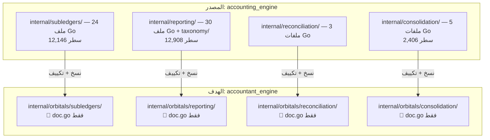
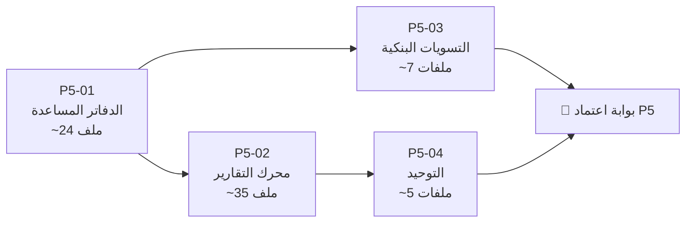

# 🛰️ الخطة التنفيذية — المرحلة P5: المكونات المدارية الاختيارية

> [!IMPORTANT]
> **قيود التنفيذ المعتمدة من المستخدم:**
>
> - ✅ لا تعديل على النواة (`internal/kernal/*`) إطلاقاً
> - ✅ لا تدخل باختبارات النواة (`internal/kernal/**/*_test.go`)
> - ✅ تنفيذ تسلسلي (بدون subagent بالتوازي)
> - ✅ الاختبارات آخر خطوة في كل مهمة

---

## 📊 ملخص التحليل والفجوات

### حالة المشروع الحالية

| البند | الحالة |
| :-- | :-- |
| المراحل P0-P1 | ✅ معتمدة ومكتملة |
| المرحلة P2 (النواة) | ✅ مكتملة (جدول الحالة يقول "غير معتمدة" لكن الاختبارات ناجحة) |
| المرحلة P3 (التخزين) | ✅ مكتملة |
| المرحلة P4 (SDK) | ✅ مكتملة — SDK يبني ويعمل، المستهلك الخارجي ناجح |
| المرحلة P5 (المدارية) | 🔴 **فارغة — فقط ملفات `doc.go`** |

### خريطة الفجوات المكتشفة



### نقاط الاعتماد الحرجة (ما يستخدمه المصدر مقابل ما هو متاح في الهدف)

| الاستيراد في المصدر | المقابل في المشروع المستهدف | الحالة |
| :-- | :-- | :-- |
| `internal/posting` | `internal/kernal/posting` | ✅ موجود |
| `internal/types` | `internal/kernal/types` | ✅ موجود |
| `internal/masterdata` | `internal/kernal/masterdata` | ✅ موجود |
| `internal/valuation` | `internal/kernal/valuation` | ✅ موجود |
| `internal/policy` | `internal/kernal/policy` | ✅ موجود |
| `pkg/api/v1/subledger` | `pkg/api/v1/subledger` | ✅ موجود |
| `pkg/api/v1/reporting` | `pkg/api/v1/reporting` | ✅ موجود |
| `pkg/spi/subledger` | `pkg/spi/subledger` | ✅ موجود |
| `pkg/spi/storage` | `pkg/spi/storage` | ✅ موجود |
| `storage/memory` (subledger) | **غير موجود — يحتاج بناء** | 🔴 فجوة |

---

## 📋 خطة التنفيذ التسلسلية التفصيلية

### المهمة P5-01: نقل وتكييف دفاتر الأستاذ المساعدة

#### الخطوة 1.1 — نقل النماذج والأنواع الأساسية

**الملفات المصدر:** `accounting_engine/internal/subledgers/models.go`
**الملف الهدف:** `accountant_engine/internal/orbitals/subledgers/models.go`

**الإجراء:**

1. نسخ `models.go` كاملاً
2. تعديل مسارات الاستيراد:
   - `internal/types` → `internal/kernal/types`
3. التحقق من البناء: `go build ./internal/orbitals/subledgers/...`

#### الخطوة 1.2 — نقل واجهات المستودعات والأخطاء

**الملفات المصدر:** `accounting_engine/internal/subledgers/repository.go` (الواجهات والأخطاء فقط — سطور 1-211)
**الملف الهدف:** `accountant_engine/internal/orbitals/subledgers/repository.go`

**الإجراء:**

1. نسخ تعريفات الواجهات (`Repository`, `EventRepository`, `OpenLineRepository`, `FixedAssetRepository`, `BankItemRepository`, إلخ)
2. نسخ تعريفات الأخطاء (`ErrNotFound`, `ErrAlreadyExists`, إلخ)
3. تعديل مسارات الاستيراد:
   - `internal/posting` → `internal/kernal/posting`
   - `internal/masterdata` → `internal/kernal/masterdata`
4. **عدم نسخ** `MemoryRepository` — سيتم بناؤه لاحقاً كمحول تخزين

> [!WARNING]
> `MemoryRepository` في المصدر مدمج داخل `repository.go` مما يخالف مبدأ الفصل المعماري. في المشروع المستهدف، سنفصل الواجهات عن التطبيق.

#### الخطوة 1.3 — نقل دفتر حسابات المدينين (AR)

**الملفات المصدر:** `accounting_engine/internal/subledgers/receivable.go`
**الملف الهدف:** `accountant_engine/internal/orbitals/subledgers/receivable.go`

**الإجراء:**

1. نسخ كامل الملف
2. تعديل مسارات الاستيراد:
   - `internal/posting` → `internal/kernal/posting`
   - `internal/types` → `internal/kernal/types`

#### الخطوة 1.4 — نقل دفتر حسابات الدائنين (AP)

**الملفات المصدر:** `accounting_engine/internal/subledgers/payable.go`
**الملف الهدف:** `accountant_engine/internal/orbitals/subledgers/payable.go`

**الإجراء:** مطابق للخطوة 1.3 مع تعديل الاستيرادات.

#### الخطوة 1.5 — نقل دفتر الأصول الثابتة

**الملفات المصدر:**

- `accounting_engine/internal/subledgers/fixed_assets.go`
- `accounting_engine/internal/subledgers/asset_schedule.go`
- `accounting_engine/internal/subledgers/asset_revaluation.go`

**الملفات الهدف:** `accountant_engine/internal/orbitals/subledgers/` (نفس الأسماء)

**الإجراء:**

1. نسخ الملفات الثلاثة
2. تعديل مسارات الاستيراد

#### الخطوة 1.6 — نقل دفتر الخزينة والبنك

**الملفات المصدر:** `accounting_engine/internal/subledgers/treasury.go`
**الملف الهدف:** `accountant_engine/internal/orbitals/subledgers/treasury.go`

#### الخطوة 1.7 — نقل حسابات الرقابة والمطابقة مع الأستاذ العام

**الملفات المصدر:**

- `accounting_engine/internal/subledgers/control_accounts.go`
- `accounting_engine/internal/subledgers/gl_reconciliation.go`
- `accounting_engine/internal/subledgers/reconciliation.go`
- `accounting_engine/internal/subledgers/reconciliation_exceptions.go`

**الملفات الهدف:** `accountant_engine/internal/orbitals/subledgers/` (نفس الأسماء)

#### الخطوة 1.8 — نقل الملفات المساعدة

**الملفات المصدر:**

- `accounting_engine/internal/subledgers/public_arap.go`
- `accounting_engine/internal/subledgers/writeoff.go`
- `accounting_engine/internal/subledgers/event_bridge.go`
- `accounting_engine/internal/subledgers/event_formula.go`
- `accounting_engine/internal/subledgers/event_hash.go`
- `accounting_engine/internal/subledgers/service.go`

**الملفات الهدف:** `accountant_engine/internal/orbitals/subledgers/` (نفس الأسماء)

#### الخطوة 1.9 — بناء `AssertSubledgerParity` (جديد)

**الملف الهدف:** `accountant_engine/internal/orbitals/subledgers/reconcile_control.go`

**الإجراء:** بناء دالة فحص المطابقة اللحظية التي:

1. تقرأ مجموع أرصدة الدفتر الفرعي لنوع معين (AR/AP/FA/TR)
2. تقرأ رصيد حساب الرقابة المقابل من الأستاذ العام عبر `storage.BalanceReader`
3. تقارن الفرق وتعيد `ReconciliationEvidence`
4. ترجع خطأ إذا كان الفرق غير صفري

#### الخطوة 1.10 — التحقق من البناء الكامل

```bash
go build ./internal/orbitals/subledgers/...
go vet ./internal/orbitals/subledgers/...
```

#### الخطوة 1.11 — كتابة الاختبارات (آخر خطوة)

**الملفات الهدف:**

- `accountant_engine/internal/orbitals/subledgers/subledgers_test.go`
- `accountant_engine/internal/orbitals/subledgers/reconcile_control_test.go`

**معايير القبول:**

- [ ] تطابق تام 100% بين مجموع أرصدة العملاء/الموردين ورصيد حساب الرقابة
- [ ] احتساب جداول إهلاك الأصول الثابتة وتوليد قيود الإهلاك المتوازنة

---

### المهمة P5-02: نقل وتكييف محرك التقارير المالية

#### الخطوة 2.1 — نقل واجهات المستودع والأنواع المساعدة

**الملفات المصدر:** `accounting_engine/internal/reporting/repository.go`
**الملف الهدف:** `accountant_engine/internal/orbitals/reporting/repository.go`

**الإجراء:**

1. نسخ الملف
2. تعديل مسارات الاستيراد:
   - `internal/masterdata` → `internal/kernal/masterdata`
   - `internal/posting` → `internal/kernal/posting`
   - `internal/subledgers` → `internal/orbitals/subledgers`
   - `internal/valuation` → `internal/kernal/valuation`

> [!IMPORTANT]
> هذه الخطوة تعتمد على اكتمال P5-01 بسبب استيراد `internal/orbitals/subledgers`.

#### الخطوة 2.2 — نقل حزمة التصنيفات المالية (taxonomy)

**الملفات المصدر:** كامل مجلد `accounting_engine/internal/reporting/taxonomy/`

- `evaluator.go`, `formula.go`, `models.go`, `tags.go`, `templates.go`

**الملفات الهدف:** `accountant_engine/internal/orbitals/reporting/taxonomy/` (نفس الأسماء)

**الإجراء:**

1. إنشاء مجلد `internal/orbitals/reporting/taxonomy/`
2. نسخ الملفات الخمسة
3. لا تعديلات مطلوبة على الاستيرادات (حزمة مستقلة)

#### الخطوة 2.3 — نقل ميزان المراجعة

**الملف المصدر:** `accounting_engine/internal/reporting/trial_balance.go`
**الملف الهدف:** `accountant_engine/internal/orbitals/reporting/trial_balance.go`

#### الخطوة 2.4 — نقل قائمة المركز المالي مع فحص المعادلة المحاسبية

**الملف المصدر:** `accounting_engine/internal/reporting/balance_sheet.go`
**الملف الهدف:** `accountant_engine/internal/orbitals/reporting/balance_sheet.go`

**بناء جديد مطلوب:** إضافة فحص آلي صريح يتحقق من:
$$\text{Assets} = \text{Liabilities} + \text{Equity}$$
ويرجع خطأ تدقيقياً `ErrUnbalancedBalanceSheet` إذا وُجد فارق (موجود أصلاً في الكود المصدري).

#### الخطوة 2.5 — نقل قائمة الدخل

**الملف المصدر:** `accounting_engine/internal/reporting/income_statement.go`
**الملف الهدف:** `accountant_engine/internal/orbitals/reporting/income_statement.go`

#### الخطوة 2.6 — نقل قائمة التدفقات النقدية

**الملفات المصدر:**

- `accounting_engine/internal/reporting/cash_flow.go`
- `accounting_engine/pkg/sdk/cash_flow.go` (نماذج SDK)

**الملفات الهدف:** `accountant_engine/internal/orbitals/reporting/cash_flow.go`

#### الخطوة 2.7 — نقل الملفات المساعدة

**الملفات المصدر:**

- `balance_integrity.go` — سلامة الأرصدة
- `bundle.go` — تجميع القوائم
- `capability.go` — قدرات محرك التقارير
- `closing_engine.go` — إقفال الفترات
- `closing_checklist.go` — قائمة فحص الإقفال
- `comparative.go` — التقارير المقارنة
- `consolidated_bundle.go` — تقارير التوحيد
- `currency_translation.go` — ترجمة العملات
- `dimensions.go` — الأبعاد
- `disclosure_registry.go` — سجل الإفصاحات
- `engine.go` — محرك التقارير الرئيسي
- `equity_statement.go` — قائمة حقوق الملكية
- `general_ledger.go` — الأستاذ العام
- `lineage.go` / `traceability.go` — تتبع أصل الأرقام
- `multi_currency_trial_balance.go` — ميزان متعدد العملات
- `ratios.go` — النسب المالية
- `reconciliation.go` — التسوية
- `reporting.go` — الملف الرئيسي
- `statement_reconciliation.go` — مطابقة القوائم

**الملفات الهدف:** `accountant_engine/internal/orbitals/reporting/` (نفس الأسماء)

#### الخطوة 2.8 — التحقق من البناء الكامل

```bash
go build ./internal/orbitals/reporting/...
go vet ./internal/orbitals/reporting/...
```

#### الخطوة 2.9 — كتابة الاختبارات (آخر خطوة)

**معايير القبول:**

- [ ] ميزان المراجعة متوازن دائماً ($\sum \text{Debit} = \sum \text{Credit}$)
- [ ] قائمة المركز المالي تثبت التوازن التام
- [ ] قائمة التدفقات النقدية تطابق صافي التغير في رصيد النقدية

---

### المهمة P5-03: نقل وتكييف محرك المطابقات والتسويات

#### الخطوة 3.1 — نقل محللات كشوف البنك

**الملفات المصدر:** `accounting_engine/internal/subledgers/bank_parsers/`

- `bank_parser.go` (35 سطر — واجهة المحلل)
- `camt053.go` (237 سطر — محلل CAMT.053)
- `mt940.go` (142 سطر — محلل MT940)
- `doc.go`

**الملفات الهدف:** `accountant_engine/internal/orbitals/reconciliation/bank_parsers/`

**الإجراء:**

1. إنشاء مجلد `internal/orbitals/reconciliation/bank_parsers/`
2. نسخ الملفات الأربعة
3. تعديل الاستيرادات إن وُجدت

#### الخطوة 3.2 — نقل محرك المطابقة

**الملفات المصدر:**

- `accounting_engine/internal/reconciliation/reconciliation.go`
- `accounting_engine/internal/reconciliation/capability.go`

**الملفات الهدف:** `accountant_engine/internal/orbitals/reconciliation/`

**الإجراء:**

1. نسخ الملفات
2. دمج منطق المطابقة مع محللات البنك في مسار تسوية متكامل
3. تعديل الاستيرادات

#### الخطوة 3.3 — بناء `matcher.go` (تكامل المكونين)

**الملف الهدف:** `accountant_engine/internal/orbitals/reconciliation/matcher.go`

**الإجراء:** بناء واجهة موحدة تدمج:

1. تحليل كشف حساب بنكي (CAMT.053 أو MT940)
2. استرجاع الحركات المسجلة من سجلات النقدية
3. تنفيذ المطابقة الآلية
4. توليد تقرير التسوية البنكية

#### الخطوة 3.4 — التحقق من البناء

```bash
go build ./internal/orbitals/reconciliation/...
go vet ./internal/orbitals/reconciliation/...
```

#### الخطوة 3.5 — كتابة الاختبارات (آخر خطوة)

**معايير القبول:**

- [ ] تحليل ملف كشف حساب تجريبي بصيغة CAMT.053 و MT940
- [ ] مطابقة الحركات مع سجلات النقدية وتوليد تقرير التسوية

---

### المهمة P5-04: نقل وتكييف محرك توحيد القوائم المالية

> [!NOTE]
> هذه المهمة تعتمد على P5-02 (محرك التقارير) بالإضافة إلى P4.

#### الخطوة 4.1 — نقل نماذج التوحيد

**الملف المصدر:** `accounting_engine/internal/consolidation/model.go` (256 سطر)
**الملف الهدف:** `accountant_engine/internal/orbitals/consolidation/model.go`

#### الخطوة 4.2 — نقل محرك التوحيد

**الملف المصدر:** `accounting_engine/internal/consolidation/engine.go` (727 سطر)
**الملف الهدف:** `accountant_engine/internal/orbitals/consolidation/engine.go`

**الإجراء:**

1. نسخ الملف
2. تعديل الاستيرادات (يعتمد على `golang.org/x/text/currency` — يجب التحقق من `go.mod`)

#### الخطوة 4.3 — نقل اكتشاف المعاملات البينية

**الملف المصدر:** `accounting_engine/internal/consolidation/discovery.go`
**الملف الهدف:** `accountant_engine/internal/orbitals/consolidation/discovery.go`

#### الخطوة 4.4 — نقل وحدة التوحيد

**الملف المصدر:** `accounting_engine/internal/consolidation/unit.go`
**الملف الهدف:** `accountant_engine/internal/orbitals/consolidation/unit.go`

#### الخطوة 4.5 — تكييف الاعتماديات

- ربط محرك التوحيد بمحرك التقارير `internal/orbitals/reporting`
- التأكد من أن `Consolidate()` تستهلك `TrialBalance` المُنتج من `P5-02`

#### الخطوة 4.6 — التحقق من البناء

```bash
go build ./internal/orbitals/consolidation/...
go vet ./internal/orbitals/consolidation/...
```

#### الخطوة 4.7 — كتابة الاختبارات (آخر خطوة)

**معايير القبول:**

- [ ] استبعاد المعاملات البينية بين شركتين شقيقتين بنجاح
- [ ] توليد ميزان مراجعة موحد للمجموعة بدقة

---

## 🔄 ترتيب التنفيذ الإجباري



> [!IMPORTANT]
> **تسلسل التنفيذ المعتمد (بدون توازي):**
>
> 1. **P5-01** أولاً — لأن P5-02 تستورد `subledgers`
> 2. **P5-03** ثانياً — مستقلة عن P5-02 لكن تحتاج P5-01 (bank_parsers)
> 3. **P5-02** ثالثاً — تعتمد على P5-01
> 4. **P5-04** أخيراً — تعتمد على P5-02

---

## ⚠️ نقاط يجب الانتباه لها

### 1. تعديل مسارات الاستيراد (عملية منهجية)

كل ملف يُنسخ يحتاج تعديل الاستيرادات حسب الجدول:

| المسار القديم | المسار الجديد |
| :-- | :-- |
| `accounting_engine/internal/posting` | `accounting_engine/internal/kernal/posting` |
| `accounting_engine/internal/types` | `accounting_engine/internal/kernal/types` |
| `accounting_engine/internal/masterdata` | `accounting_engine/internal/kernal/masterdata` |
| `accounting_engine/internal/valuation` | `accounting_engine/internal/kernal/valuation` |
| `accounting_engine/internal/policy` | `accounting_engine/internal/kernal/policy` |
| `accounting_engine/internal/subledgers` | `accounting_engine/internal/orbitals/subledgers` |
| `accounting_engine/internal/reporting` | `accounting_engine/internal/orbitals/reporting` |
| `accounting_engine/internal/reconciliation` | `accounting_engine/internal/orbitals/reconciliation` |
| `accounting_engine/internal/consolidation` | `accounting_engine/internal/orbitals/consolidation` |

### 2. فصل `MemoryRepository` من `repository.go`

في المشروع المصدر، `MemoryRepository` مدمج مع تعريفات الواجهات في `repository.go` (940 سطر). في المشروع المستهدف:

- الواجهات تبقى في `internal/orbitals/subledgers/repository.go`
- `MemoryRepository` **لا** يُنسخ هنا — سيتم بناؤه كجزء من `storage/memory` إذا لزم الأمر لاحقاً

### 3. تبعية `golang.org/x/text/currency`

يستخدمها `consolidation/engine.go` — يجب التحقق من وجودها في `go.mod`:

```bash
grep "golang.org/x/text" go.mod
```

إن لم تكن موجودة: `go get golang.org/x/text`

### 4. الملفات المحظور مساسها (من Master Plan)

| المحظور | السبب |
| :-- | :-- |
| `internal/kernal/*` | ملكية P2 — نواة مقفلة |
| `pkg/sdk/*` | ملكية P4 — واجهة مستقرة |
| `storage/*` | ملكية P3 — محولات مقفلة |

---

## 📏 معايير قبول بوابة المرحلة P5

| # | المعيار | نوع الفحص |
| :-- | :-- | :-- |
| 1 | `go build ./internal/orbitals/...` ناجح | بناء |
| 2 | `go vet ./internal/orbitals/...` بدون تحذيرات | تحليل ثابت |
| 3 | تطابق 100% بين أرصدة الدفاتر المساعدة وحسابات الرقابة | اختبار وظيفي |
| 4 | ميزان المراجعة متوازن دائماً | اختبار وظيفي |
| 5 | المعادلة المحاسبية محققة في المركز المالي | اختبار وظيفي |
| 6 | التدفقات النقدية تطابق التغير في النقدية | اختبار وظيفي |
| 7 | تحليل CAMT.053 و MT940 ناجح | اختبار وظيفي |
| 8 | التسوية البنكية تعمل | اختبار وظيفي |
| 9 | استبعاد المعاملات البينية ناجح | اختبار وظيفي |
| 10 | لا يوجد استيراد لـ `storage/*` أو حزم شبكية | فحص معماري |

---

## ✅ هل أبدأ بتنفيذ المهمة P5-01؟
