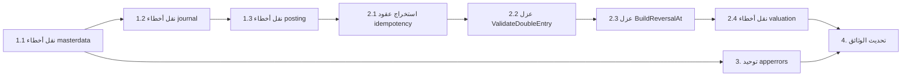
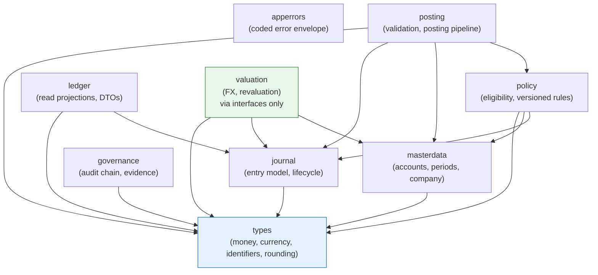

# خطة إصلاح حدود المسؤوليات وتطبيق DDD داخل النواة

## 1. الغرض من الخطة

ضمان أن كل حزمة داخل `internal/kernal` تملك مسؤوليات واضحة بلا تداخل، وأن الكود يتبع نمط Domain-Driven Design (DDD) كما تصفه وثيقة الحدود (`KERNEL_RESPONSIBILITY_BOUNDARIES_SPECIFICATION_v1.2.0`).

تعالج هذه الخطة **انتهاكات الحدود الفعلية** المكتشفة أثناء مراجعة الكود مقابل الوثيقة، وتقدم إجراءات مرتبة بالأولوية مع معايير قبول واضحة.

## 2. المبادئ الحاكمة

1. **مالك واحد لكل مفهوم:** لا يعرّف مفهوم المجال أو خطأه في أكثر من حزمة.
2. **اتجاه الاعتماد:** تتبع الاعتمادات الاتجاه الطبيعي (types ← journal/masterdata ← policy ← posting ← valuation)؛ لا دورات.
3. **العقود المجردة قبل الأنواع المباشرة:** إذا احتاجت حزمة A لمفهوم من حزمة B دون أن تعتمد عليها، تُستخدم واجهة مجردة.
4. **التوافق العكسي:** لا يُكسر أي مستهلك خارجي (`pkg/sdk`، `pkg/spi`، `storage/`) بشكل صامت؛ كل تغيير يصاحبه deprecated alias مؤقت.
5. **الاختبارات أولاً:** لا يُدمج تغيير دون اجتياز كل الاختبارات وفحوص المعمارية (`doc_test.go`).

## 3. الانتهاكات المكتشفة

### 3.1 تسرب أخطاء المجال إلى `types/errors.go` (خطورة عالية)

**الحالة:** `types/errors.go` يعرّف 16 خطأ sentinel، منها 10 لا تتعلق بالتمثيل المالي:

| الخطأ في `types` | المالك الصحيح | الحزم المستهلكة |
| --- | --- | --- |
| `ErrFiscalPeriodClosed` | `masterdata` | `masterdata` (alias)، `pkg/sdk` |
| `ErrFiscalPeriodNotFound` | `masterdata` | `masterdata` (alias)، `posting` (tests)، `pkg/sdk` |
| `ErrInvalidPeriodTransition` | `masterdata` | `masterdata` (alias) |
| `ErrCannotPostToParentAccount` | `masterdata` | `masterdata` (alias)، `pkg/sdk` |
| `ErrAccountNotFound` | `masterdata` | `masterdata` (alias)، `pkg/sdk`، `pkg/spi` |
| `ErrDuplicateAccountCode` | `masterdata` | `pkg/sdk` |
| `ErrZeroAmountLine` | `posting` | `posting` (alias) |
| `ErrUnbalancedMove` | `posting` | `pkg/sdk` |
| `ErrMoveAlreadyPosted` | `journal` | `pkg/sdk` |
| `ErrCannotModifyPostedMove` | `journal` | `journal` (direct)، `posting` (tests)، `pkg/sdk`، `storage/` |

**الأخطاء التي تبقى في `types` بشكل صحيح:** `ErrCurrencyMismatch`، `ErrInvalidCurrency`، `ErrInvalidAmount`، `ErrAmountExceedsPrecision`، `ErrSubMinorUnitAmount`، `ErrNegativeAmountProhibited`.

### 3.2 اقتران `valuation` بأنواع ودوال `posting` (خطورة متوسطة)

**الحالة:** `valuation/revaluation.go` يستورد `posting` ويستخدم:

- `posting.IdempotencyScope` — نوع بيانات
- `posting.IdempotencyRevaluation` — ثابت عملية
- `posting.ErrRevaluationAlreadyApplied` — خطأ
- `posting.ErrInvalidAdjustingEntryMetadata` — خطأ
- `posting.ValidateEntryDoubleEntry()` — دالة تحقق
- `posting.BuildReversalEntryAt()` — دالة بناء عكس

**المشكلة:** هذا يخلق اعتماداً عكسياً فعلياً؛ `valuation` يجب أن تكون مستقلة عن `posting` وترسل قيوداً مرشحة عبر عقد مجرد.

### 3.3 تكرار أخطاء `apperrors` مع `types` (خطورة منخفضة)

**الحالة:** `apperrors` يعرّف `ErrUnbalancedEntry` و`ErrPeriodClosed` وهي تكرارات دلالية لـ `types.ErrUnbalancedMove` و`types.ErrFiscalPeriodClosed`، لكن بغلاف `CodedError` مختلف. تُستخدم من `pkg/sdk` فقط.

---

## 4. الخطة التنفيذية

### المرحلة 1: نقل أخطاء المجال إلى الحزم المالكة

**الأولوية:** 🔴 عالية
**التقدير:** 2-3 أيام عمل
**المخاطرة:** متوسطة (عدد المستهلكين الخارجيين كبير)

#### الخطوة 1.1: نقل أخطاء `masterdata` من `types`

**الملفات المتأثرة:**

- `internal/kernal/types/errors.go` — حذف 6 أخطاء
- `internal/kernal/masterdata/errors.go` — ملف جديد، تعريف الأخطاء كمصدر حقيقة
- `internal/kernal/masterdata/coa.go` — تحويل aliases إلى استخدام محلي
- `internal/kernal/masterdata/fiscal_calendar.go` — تحويل aliases إلى استخدام محلي
- `internal/kernal/masterdata/account.go` — تحديث الاستخدام

**الإجراء:**

```
1. أنشئ internal/kernal/masterdata/errors.go:
   - انقل: ErrFiscalPeriodClosed, ErrFiscalPeriodNotFound,
     ErrInvalidPeriodTransition, ErrCannotPostToParentAccount,
     ErrAccountNotFound, ErrDuplicateAccountCode
   - عرّفها كـ errors.New(...) مستقلة

2. في types/errors.go:
   - أبقِ الأخطاء المنقولة مؤقتاً كـ deprecated aliases:
     // Deprecated: use masterdata.ErrFiscalPeriodClosed
     var ErrFiscalPeriodClosed = masterdata.ErrFiscalPeriodClosed
   - ⚠️ هذا يخلق اعتماداً مؤقتاً types → masterdata (مقبول كمرحلة انتقالية)

3. حدّث masterdata/coa.go وfiscal_calendar.go:
   - أزل الـ aliases التي تشير إلى types
   - استخدم التعريفات المحلية مباشرة

4. حدّث المستهلكين الخارجيين (pkg/sdk, pkg/spi, storage/):
   - غيّر types.ErrAccountNotFound → masterdata.ErrAccountNotFound
   - ... (نفس الشيء لبقية الأخطاء)

5. بعد تحديث كل المستهلكين: احذف deprecated aliases من types
```

**معايير القبول:**

- [ ] لا يوجد `Err.*Period\|Err.*Account\|ErrDuplicate` في `types/errors.go`
- [ ] `masterdata/errors.go` هو المصدر الوحيد لهذه الأخطاء
- [ ] `go build ./...` ينجح
- [ ] `go test ./...` ينجح
- [ ] `go test ./internal/kernal/ -run TestImportCharter` ينجح

#### الخطوة 1.2: نقل أخطاء `journal` من `types`

**الملفات المتأثرة:**

- `internal/kernal/types/errors.go` — حذف خطأين
- `internal/kernal/journal/errors.go` — ملف جديد
- `internal/kernal/journal/entry.go` — تحديث الاستخدام
- `pkg/sdk/application.go` — تحديث الاستيراد
- `storage/memory/posting.go` — تحديث الاستيراد
- `storage/postgres/uow.go` — تحديث الاستيراد

**الإجراء:**

```
1. أنشئ internal/kernal/journal/errors.go:
   - انقل: ErrMoveAlreadyPosted, ErrCannotModifyPostedMove

2. في types/errors.go:
   - deprecated alias مؤقت

3. حدّث journal/entry.go:
   - استبدل types.ErrCannotModifyPostedMove بالتعريف المحلي

4. حدّث storage/memory/posting.go و storage/postgres/uow.go:
   - غيّر types.ErrCannotModifyPostedMove → journal.ErrCannotModifyPostedMove

5. حدّث pkg/sdk/application.go:
   - غيّر الاستيرادات

6. بعد تحديث كل المستهلكين: احذف deprecated aliases من types
```

**معايير القبول:**

- [ ] لا يوجد `ErrMoveAlreadyPosted\|ErrCannotModifyPostedMove` في `types/errors.go`
- [ ] `journal/errors.go` هو المصدر الوحيد
- [ ] كل الاختبارات تنجح

#### الخطوة 1.3: نقل أخطاء `posting` من `types`

**الملفات المتأثرة:**

- `internal/kernal/types/errors.go` — حذف خطأين
- `internal/kernal/posting/errors.go` — ملف جديد (أو إضافة لملف موجود)
- `internal/kernal/posting/entry_validation.go` — تحديث

**الإجراء:**

```
1. أنشئ/حدّث internal/kernal/posting/errors.go:
   - انقل: ErrZeroAmountLine, ErrUnbalancedMove

2. حدّث الاستخدامات في posting وpkg/sdk

3. بعد تحديث كل المستهلكين: احذف deprecated aliases من types
```

**معايير القبول:**

- [ ] `types/errors.go` يحتوي فقط على أخطاء التمثيل المالي (6 أخطاء)
- [ ] كل الاختبارات تنجح

---

### المرحلة 2: فك اقتران `valuation` عن `posting`

**الأولوية:** 🟡 متوسطة
**التقدير:** 3-4 أيام عمل
**المخاطرة:** متوسطة-عالية (يلمس منطق مجال حساس)

#### الخطوة 2.1: استخراج عقود Idempotency إلى حزمة مشتركة أو `types`

**المشكلة:** `valuation` تستورد `posting.IdempotencyScope` وثوابت العمليات.

**الحل المقترح:** أنشئ أنواع idempotency في مكان مشترك (خيارين):

| الخيار | الوصف | المزايا | العيوب |
| --- | --- | --- | --- |
| **A: نقل إلى `types`** | `types.IdempotencyScope`, `types.IdempotencyOperation` | بسيط، لا حزمة جديدة | توسيع نطاق `types` |
| **B: واجهة مجردة في `valuation`** | `valuation` تعرّف واجهة `IdempotencyScopeBuilder` و`posting` ينفذها | فصل أنظف | تعقيد أكبر |

> **التوصية:** الخيار A أبسط ومتسق مع دور `types` كحزمة تأسيسية — لكن يجب أخذ قرار ADR لأن IdempotencyScope ليست مفهوماً مالياً بحتاً.

**الإجراء:**

```
1. سجّل ADR لقرار موقع أنواع idempotency

2. إذا الخيار A:
   - انقل IdempotencyScope, IdempotencyOperation, 
     IdempotencyPosting, IdempotencyReversal, IdempotencyRevaluation
     من posting/transaction.go إلى types/idempotency.go
   - أبقِ deprecated aliases في posting/transaction.go مؤقتاً
   - حدّث valuation/revaluation.go لاستيراد types
   - بعد الاستقرار: احذف deprecated aliases

3. إذا الخيار B:
   - عرّف واجهة في valuation:
     type IdempotencyScopeBuilder interface {
         BuildScope(op string, company CompanyID, key string) IdempotencyScope
     }
   - مرر التنفيذ عبر الحقن
```

#### الخطوة 2.2: استخراج `ValidateEntryDoubleEntry` من استهلاك `valuation`

**المشكلة:** `valuation/revaluation.go:664` يستدعي `posting.ValidateEntryDoubleEntry()`.

**الحل:** `valuation` لا يجب أن تتحقق من التوازن بنفسها — هذه مسؤولية `posting`. بدلاً من ذلك:

```
1. اجعل valuation تبني القيد وتعيده كـ journal.JournalEntry

2. المتصل (أو المنسق) يمرره إلى posting.PostEntry الذي يتحقق

3. أزل استدعاء posting.ValidateEntryDoubleEntry من revaluation.go

4. إذا كان التحقق المبكر ضرورياً كحماية (defensive check):
   - عرّف واجهة في valuation:
     type EntryValidator interface {
         ValidateDoubleEntry(entry *journal.JournalEntry) error
     }
   - مرر التنفيذ عبر الحقن عند إنشاء RevaluationEngine
```

#### الخطوة 2.3: استخراج `BuildReversalEntryAt` من استهلاك `valuation`

**المشكلة:** `valuation/revaluation.go:687` يستدعي `posting.BuildReversalEntryAt()`.

**الحل:** بناء العكس هو مسؤولية `posting`، لكن `valuation` تحتاج هذه القدرة لتوليد قيد عكس التقييم.

```
الخيار المقترح: عرّف واجهة في valuation:

type ReversalBuilder interface {
    BuildReversalAt(original journal.JournalEntry, date time.Time, 
                    actor, reason string, now time.Time) (journal.JournalEntry, error)
}

// posting تنفذها:
type postingReversalBuilder struct{}
func (b postingReversalBuilder) BuildReversalAt(...) { 
    return BuildReversalEntryAt(...) 
}

// تُحقن في RevaluationEngine عند الإنشاء
```

#### الخطوة 2.4: نقل أخطاء خاصة بـ`valuation` من `posting`

**المشكلة:** `posting.ErrRevaluationAlreadyApplied` و`posting.ErrInvalidAdjustingEntryMetadata` تُستخدم في `valuation`.

**الإجراء:**

```
1. ErrRevaluationAlreadyApplied:
   - هذا خطأ يخص التقييم → انقله إلى valuation/errors.go
   - أبقِ deprecated alias في posting

2. ErrInvalidAdjustingEntryMetadata:
   - هذا خطأ يخص بيانات التعديل (adjusting) → أبقه في posting
   - valuation تستهلكه عبر واجهة أو عبر errors.Is() دون استيراد مباشر
```

**معايير قبول المرحلة 2:**

- [ ] `valuation` لا تستورد `posting` مباشرة
- [ ] `valuation` تعتمد على: `types`, `journal`, `masterdata` فقط + واجهات مجردة
- [ ] خريطة الاعتمادات خالية من الدورات
- [ ] كل الاختبارات تنجح

---

### المرحلة 3: توحيد أخطاء `apperrors` مع أخطاء المجال

**الأولوية:** 🟢 منخفضة
**التقدير:** 1-2 يوم عمل
**المخاطرة:** منخفضة

**المشكلة:** `apperrors.ErrUnbalancedEntry` و`apperrors.ErrPeriodClosed` تكرارات دلالية بغلاف `CodedError`.

**الحل:**

```
1. اجعل apperrors.ErrUnbalancedEntry يلف posting.ErrUnbalancedMove:
   ErrUnbalancedEntry = NewCategorized("ERR_UNBALANCED_ENTRY", CategoryDomain, 
                         false, "journal entry is unbalanced", 
                         posting.ErrUnbalancedMove)  // ← Cause يشير للأصل

2. اجعل apperrors.ErrPeriodClosed يلف masterdata.ErrFiscalPeriodClosed:
   ErrPeriodClosed = NewCategorized("ERR_PERIOD_CLOSED", CategoryDomain,
                      false, "fiscal period is closed",
                      masterdata.ErrFiscalPeriodClosed)

3. حدّث pkg/sdk/application.go:
   - استخدم errors.Is(err, masterdata.ErrFiscalPeriodClosed) بدل فحصين منفصلين
```

**معايير القبول:**

- [ ] لا يوجد sentinel error مكرر بمعنيين مختلفين
- [ ] `errors.Is(apperrors.ErrPeriodClosed, masterdata.ErrFiscalPeriodClosed) == true`
- [ ] كل الاختبارات تنجح

---

### المرحلة 4: تحديث `doc.go` والوثائق

**الأولوية:** 🟢 منخفضة
**التقدير:** 0.5 يوم عمل

```
1. حدّث doc.go لكل حزمة متأثرة بعد نقل الأخطاء
2. حدّث KERNEL_RESPONSIBILITY_BOUNDARIES_SPECIFICATION_v1.2.0.md:
   - أزل ملاحظة "أخطاء مجال مستضافة مؤقتاً" من §6.1 بعد إتمام المرحلة 1
   - أزل ملاحظة "اقتران مباشر بـposting" من §6.9 بعد إتمام المرحلة 2
3. حدّث KERNEL_ARCHITECTURE_MAP.md بخريطة الاعتمادات الجديدة
4. سجّل ADR لكل تغيير حدود
```

---

## 5. ترتيب التنفيذ ومتطلبات كل مرحلة



| المرحلة | المتطلب السابق | يمكن تشغيلها بالتوازي مع |
| --- | --- | --- |
| 1.1 | لا شيء | — |
| 1.2 | 1.1 | — |
| 1.3 | 1.2 | — |
| 2.1 | 1.3 | — |
| 2.2 | 2.1 | — |
| 2.3 | 2.2 | — |
| 2.4 | 2.3 | — |
| 3 | 1.1 | 2.x |
| 4 | 2.4 + 3 | — |

## 6. التقدير الزمني الإجمالي

| المرحلة | التقدير | مجموع تراكمي |
| --- | --- | --- |
| المرحلة 1 (نقل الأخطاء) | 2-3 أيام | 2-3 أيام |
| المرحلة 2 (فك اقتران valuation) | 3-4 أيام | 5-7 أيام |
| المرحلة 3 (توحيد apperrors) | 1-2 يوم | 6-9 أيام |
| المرحلة 4 (تحديث الوثائق) | 0.5 يوم | 6.5-9.5 أيام |

## 7. المخاطر وخطة التخفيف

| المخاطرة | الاحتمال | الأثر | التخفيف |
| --- | --- | --- | --- |
| كسر توافق `pkg/sdk` | متوسط | عالي | deprecated aliases مؤقتة + compiler errors |
| كسر `storage/` adapters | متوسط | عالي | تحديث storage/ ضمن نفس PR |
| دورة اعتماد أثناء الانتقال | منخفض | عالي | مراحل متتابعة + فحص `go vet ./...` بعد كل خطوة |
| regression في اختبارات المجال | منخفض | متوسط | `go test ./internal/kernal/...` بعد كل خطوة |
| تعقيد واجهات valuation | منخفض | منخفض | حقن التنفيذ عبر constructor واحد |

## 8. بروتوكول التحقق بعد كل خطوة

```bash
# يُنفَّذ بعد كل خطوة قبل الدمج:
go build ./...
go vet ./...
go test ./internal/kernal/... -count=1
go test ./pkg/... -count=1
go test ./storage/... -count=1
go test ./internal/kernal/ -run TestImportCharter  # فحص المعمارية
```

## 9. الحالة المستهدفة بعد الإصلاح

### خريطة الاعتمادات النظيفة المستهدفة



### توزيع أخطاء المجال المستهدف

| الحزمة | الأخطاء التي تملكها |
| --- | --- |
| `types` | `ErrCurrencyMismatch`, `ErrInvalidCurrency`, `ErrInvalidAmount`, `ErrAmountExceedsPrecision`, `ErrSubMinorUnitAmount`, `ErrNegativeAmountProhibited` |
| `masterdata` | `ErrFiscalPeriodClosed`, `ErrFiscalPeriodNotFound`, `ErrInvalidPeriodTransition`, `ErrCannotPostToParentAccount`, `ErrAccountNotFound`, `ErrDuplicateAccountCode` |
| `journal` | `ErrMoveAlreadyPosted`, `ErrCannotModifyPostedMove` + أخطاء دورة الحياة المحلية |
| `posting` | `ErrZeroAmountLine`, `ErrUnbalancedMove` + أخطاء مسار الترحيل |
| `valuation` | `ErrRevaluationAlreadyApplied` + أخطاء التقييم المحلية |
| `apperrors` | `CodedError` envelope + أخطاء مرمّزة تلف أخطاء المجال |

---

**نهاية الخطة**
